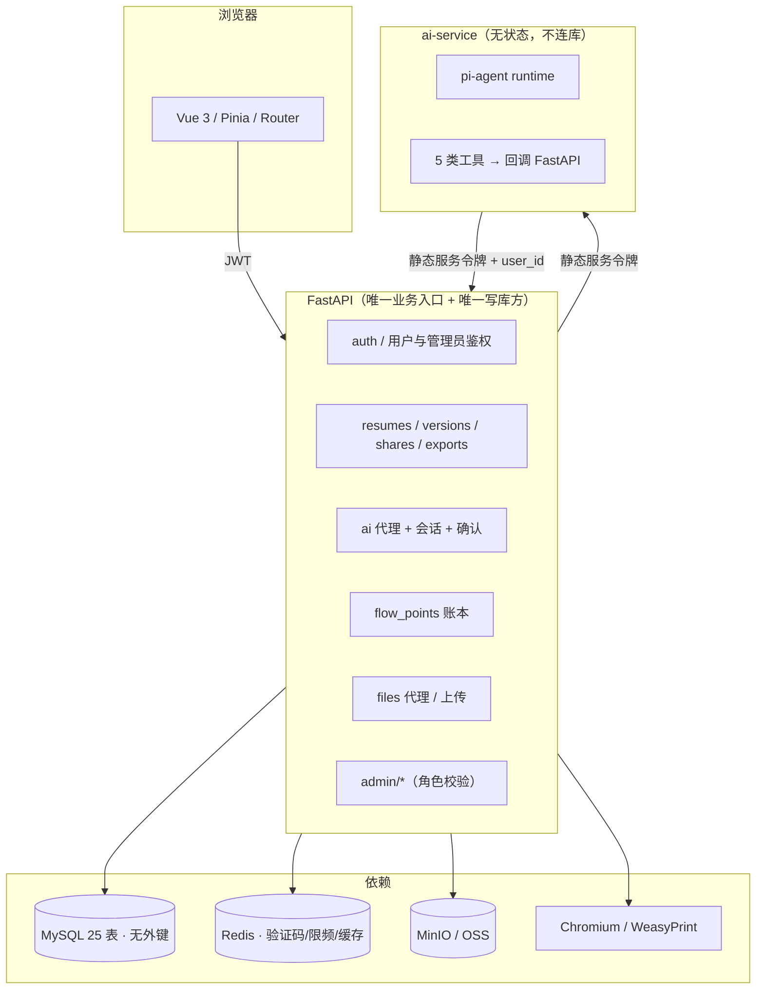

# ResumeFlow 全局 Code Review：交叉验证与最终审计

> 审计基线：`a8d451c`（2026-11-20），工作区仅文档改动。
> 审计范围：`frontend/`、`backend/`、`ai-service/`、`docs/`、部署配置、数据库迁移、测试。
> 审计方式：**只读**。逐条回读代码复核前四个阶段的结论，不采信报告原文；对无法静态定性的保留「待验证」。
> 未执行：并发压测、故障注入、真实模型调用、生产环境操作。

**关于前序材料的完整性**：`docs/code-review/` 下只有 `00`、`02`、`03`、`04` 四份，**`01-backend-review.md` 从未产出**。本阶段补查了此前从未系统审查的后端区域（认证与注册、管理员鉴权、全员积分发放/撤回、对象存储、技能包解压、Word 导出、公告、部署配置），并因此新增了 4 个问题（RF-003/027/028/033）。这一缺口本身也是审计结论的一部分：后端的「非 AI 链路」长期缺少同等级审查。

---

## 1. Executive Summary

### 1.1 项目整体质量

这是一个**工程素养明显高于同类项目**的代码库：三端职责清晰（浏览器只认 FastAPI、Node 无状态、MySQL 是唯一事实源），危险操作集中收口（模板配置白名单、富文本 bleach、对象名白名单、导出资源白名单、真实角色的管理员依赖），关键路径有测试（后端 524 个用例，计费/鉴权/越权/PDF 资源都有专项）。

问题不在「写得糙」，而在**五个跨切面缺少统一机制**：

1. **写简历没有并发控制**：四条写入路径各写各的，只有「版本恢复」带乐观锁。
2. **计费没有回合身份**：钱能对上账本，但对不上「哪一轮」。
3. **任务没有终止保障**：预扣之后没有租约，进程一停就永久 pending。
4. **前端保存没有「最后写入者」语义**：服务端响应会回写覆盖本地更新的内容。
5. **同一份配置被多个消费者复用**：`pdf_base_url` 同时给 Chromium 和浏览器用（RF-052）、标题长度在 schema/service/列宽三处各写一个数（RF-036）、连接池不配而事务跨渲染持有（RF-053）。第 5 条是 Phase 1 补查后的新增观察——**它不产生新类别的 bug，但让「每一层都做对了」的系统在跨层处漏风**。

### 1.2 架构成熟度

| 维度 | 评价 |
| --- | --- |
| 分层与边界 | 成熟。服务边界是这份代码最强的部分，AI 无法绕过确认写库这一点可验证 |
| 数据模型 | 中等。25 张表、无物理外键，靠应用层维持一致性；删除路径已有显式级联 |
| 异步与流式 | 中等偏上。NDJSON 中继、单飞预览、串行保存都做对了；缺端到端截止时间与取消告知 |
| 计费 | 中等。扣减原子、结算差额幂等；回调无幂等键、无回合关联 |
| 可观测性 | 中等。轨迹、回合耗时、工具质量都有；但「漏计费」这一类的缺失恰恰没有记录 |
| 测试 | 后端强、前端弱、端到端缺失 |

### 1.3 当前主要风险（按后果排序）

1. **静默数据丢失**：保存响应回写（RF-001）、AI 应用整包覆盖（RF-002）、卸载丢防抖（RF-004）。
2. **身份可伪造的部署形态**：生产环境在配置了 BYOK 密钥后，弱默认 JWT 密钥不再阻断启动（RF-003）。
3. **资金不可对账**：usage 回调无幂等与回合键（RF-007）、预扣无租约（RF-009）。
4. **越权面**：服务间静态令牌 + 明文 `user_id` + 暴露端口（RF-008）。
5. **状态机不收敛**：旧提案可覆盖新结果（RF-006）、`ai_tasks.status` 语义重载（RF-017）。
6. **用户可见的确定性故障**（Phase 1 补查后新增）：远程访问时预览与公开分享页的头像/字体全部裂（RF-052）；标题 101–120 字符时复制简历必然 500（RF-036）；隐藏敏感信息后 summary 里的手机号仍公开（RF-056）。这三条不丢数据、不丢钱，但**正好落在商业化门面上**。

### 1.4 最值得肯定的设计

- **确认闸门**：所有 AI 工具端点只读或只返回快照，`resolve_chat_change` 是唯一写入口（`api/ai.py:977-1153`、`ai_chat_service.py:1626`）。这是结构性的安全设计，不是补丁。
- **渲染安全三层**：Jinja autoescape + `rich_text` bleach 白名单 + 模板配置字段白名单（`template_config.py:110-160`）。
- **对象存储归属收敛**：`owned_object_names()` 是唯一的「前端传来的 object_name 不可信」收口（`storage_service.py:53-70`）。
- **幂等的正面样本**：兑换码（行锁 + 唯一约束 + 计数）、轨迹（`trace_id` upsert）、结算差额（重复调用 delta=0）。
- **技能包解压**：大小、条目数、单文件、符号链接、路径穿越全部处理（`user_ai_service.py:499-545`），是少见的认真实现。
- **可写字段白名单**：`update_profile` 只允许改用户名；`ResumeUpdate` 只允许五个字段。

### 1.5 是否适合持续商业化运营

**能运营，但不能按当前状态扩大规模。** 单实例、低并发、有运维盯盘时可以跑；一旦出现多标签页、弱网、长对话、并发退款，就会出现「用户说改的东西没了」「这笔钱对不上」这类无法自证的问题。RF-001/002/003/007/009 应在下一次正式发布前解决，其余可排入迭代。

---

## 2. 全局架构评价

### 2.1 架构图（实测关系）

### 2.2 模块关系与服务边界

| 边界 | 是否清晰 | 证据 |
| --- | --- | --- |
| 浏览器 ↔ FastAPI | 清晰 | 浏览器不直连 Node；流式也经 FastAPI 中继 |
| FastAPI ↔ Node | 清晰 | Node 不连 MySQL/Redis；`package.json` 仅 4 个运行依赖 |
| Node ↔ FastAPI 回调 | **模糊** | 身份是明文整数 + 共享令牌，无回合凭证（RF-008） |
| 渲染 ↔ 数据 | 清晰 | 预览/PDF/分享共用 `render_resume_html` |
| 计费 ↔ 业务 | **耦合且单向** | 业务先完成，计费由 Node 事后回调（RF-007/009） |

### 2.3 主要架构问题

1. **「整份覆盖」是唯一的写入语义**：PUT、AI apply、信息库导入、版本恢复都写整份 JSON；没有字段级 patch、没有版本号。四条路径的安全垫各缺一块（RF-005/013）。
2. **任务与回合不是一等公民**：`ai_tasks` 没有 `turn_id`，`ai_chat_messages` 没有 `task_id`，`resume_versions` 没有 `message_id`。三条事实链各自完整，但无法互相指认。
3. **状态用同一个字段表达两件事**：`ai_tasks.status` 同时是「执行结果」和「计费结果」（RF-017）。
4. **没有周期任务**：`main.py:38-54` 的 lifespan 只做启动日志与密钥校验，没有任何清扫/对账/重试。

### 2.4 本次补查的盲区（Phase 1 缺失的补偿）

> **2026-11-20 补记**：`01-backend-review.md` 在最终审计之后产出（此前该阶段从未存在）。已逐条与本文核对，结论如下：
>
> - 该报告 26 条（B-01～B-26）中，**8 条并入已有编号**（B-01→RF-003、B-04→RF-029、B-06→RF-036、B-10→RF-024、B-12→RF-040、B-15→RF-031、B-18→RF-053/RF-029、B-25→RF-038），其中 **2 条修正了本文的定性**：RF-036 上调为 P2、RF-038 补上「换邮箱即绕过限频」的维度。
> - **17 条是本文未覆盖的新问题，收敛为 15 个新编号 RF-052～RF-066**（B-09+B-13 合并为 061，B-23+B-24 合并为 066）；其中 8 条写成完整条目，其余进 P3 表。
> - **1 条排除**（B-26：后台只允许改 `sort_order/is_visible`，被同步覆盖的字段本就不可编辑）。
> - 因此**不需要重跑 Phase 5**：交叉验证的排除结论（§3.7 八条）与根因收敛（§4 四条）均未被推翻，只做增量合并与两处评级修正。
>
> **新增的 15 条里最重要的是 B-05**：一个 `pdf_base_url` 同时给 Chromium 和浏览器用，远程部署下预览与公开分享页的头像、字体全部指向访客自己的 `127.0.0.1:8000`。这是本轮唯一一条「三个专项都看不到、只在后端渲染细节里存在」的用户可见缺陷。

| 区域 | 结论 |
| --- | --- |
| 认证与注册 | 密码 bcrypt、注册锁 fail-closed、唯一约束齐全；邮箱可枚举（P3） |
| 管理员鉴权 | 10 个 admin 路由模块全部挂 `get_current_admin`，角色来自 DB，非前端 |
| 全员发放/撤回 | **无幂等**（RF-028）、读改写余额（RF-015） |
| JWT 密钥 | **生产校验被 BYOK 配置绕过**（RF-003）、无吊销机制（RF-027） |
| 对象存储 | 前缀白名单 + 归属集合 + 路径穿越防护；写库顺序仍非事务（RF-031） |
| 技能包 | 压缩炸弹/软链/穿越均已处理（正面） |
| Word 导出 | 路由已 410 下线，理由与注释一致（正面） |
| 公告 | 服务端 bleach 后才 `v-html`，缓存按版本失效（正面）；首读并发见 RF-058 |
| 部署 | 容器未设 `USER`（root 运行）、8300 全接口发布（并入 RF-008/RF-033）；`PDF_BASE_URL` 硬编码见 RF-052 |

---

## 3. 最终问题清单

> 编号规则：`RF-xxx`。每条只有一个主编号；与前序报告的关系写在「溯源」里。
> 状态定义：**已确认**＝代码路径确定且无保护；**高可信**＝路径确定但触发依赖运行时；**待验证**＝需要环境证据；**已排除**＝复核后不成立；**已合并**＝同一根因并入其它编号。
> 规模：66 条（P0 ×3、P1 ×15、P2 ×23、P3 ×25）。其中 RF-052～RF-066 来自 Phase 1 补查（见 §2.4 与 §3.6）。

### 3.1 P0（发布前必须修复）

#### RF-001 保存响应整对象回写，覆盖请求在途的新输入（已确认）

- **分类**：数据一致性 / 前端保存
- **位置**：`frontend/src/stores/resume.ts:231-242`（`updateResume`）；`frontend/src/views/ResumeEditor.vue:515-537`（`performSave`）
- **溯源**：03-F1
- **触发**：PUT 在途（50–300ms，弱网更久）时用户继续输入。
- **根因**：保存成功后 `this.currentResume = updated` 用服务端回显整体替换本地对象；`performSave` 随后 `editor.setSaved(true)`。保存链只保证请求串行，不保证「本地编辑优先」。
- **实际影响**：请求窗口内的输入从界面消失，且头部显示「已自动保存」；防抖的下一次保存写的是回显后的旧值。**用户无法感知，也无法撤回**。
- **修复**：响应只更新元数据（`update_time`/`title`/`template_id`），正文保留本地版本；或用「请求序号 + dirty 标记」丢弃过期响应。修复必须同时覆盖 `fetchResumeDetail` 在 AI 刷新路径上的同类替换（见 RF-002）。
- **验证方式**：延迟 PUT 响应 500ms，在延迟窗口内输入第二个字段，观察是否回退并显示已保存。
- **状态**：已确认（静态读代码 + 时序推导；未跑浏览器）。

#### RF-002 默认「应用」用整包快照，覆盖提案之后的已保存编辑（已确认）

- **分类**：数据一致性 / AI 确认
- **位置**：`frontend/src/views/ResumeEditor.vue:1025`（`@confirm="resolveChatDecision($event,'apply')"`）；`useResumeChatStream.ts:336-352`；后端 `ai_chat_service.py:1626-1688`、`1586-1623`
- **溯源**：03-F2（前端入口）；02-L2（后端整包写入）
- **触发**：AI 产出 pending 提案 → 用户切到编辑补一处并落库 → 回对话点「应用」。
- **根因**：主按钮不传 `merged_resume_data`，后端走 `pending_data = message.optimized_resume_data` 整份覆盖；`decide` 也不先 `save()`。
- **实际影响**：提案之后的所有修改被回滚。界面按覆盖后的数据渲染，用户看不出异常；版本历史里只有「AI 修改前」一份，恢复它同样会丢掉中间态。
- **修复**：主按钮默认提交「当前数据 + 全选 diff」的合并结果（复用 `buildSelectedResumeData`）；或把主按钮改为「审阅后应用」，整包快照只保留给无冲突场景。后端在无 `merged` 时应校验 `resume.update_time` 与提案时一致，否则 409 提示先审阅。
- **验证方式**：构造「提案后改手机号并保存 → 应用」用例，断言手机号保留。
- **状态**：已确认。

#### RF-003 生产环境弱默认 JWT 密钥的启动校验被 BYOK 配置绕过（已确认，条件触发）

- **分类**：安全 / 认证
- **位置**：`backend/app/core/config.py:8,55`；`backend/app/core/crypto.py:91-107`；`backend/app/main.py:44-52`；`backend/app/api/auth.py:135-136`
- **触发**：`APP_ENV=production` + 配置了 `BYOK_ENCRYPTION_KEYS`（crypto 返回 `mode=dedicated`，直接 return ""）+ 未改 `JWT_SECRET_KEY`。
- **根因**：唯一的生产密钥校验 `validate_encryption_config` 的职责是「保护 BYOK 密文」，只在**没有**独立 BYOK 密钥时才检查 JWT 弱默认。JWT 签名密钥本身没有独立的强度校验，也没有启动日志。
- **实际影响**：`JWT_SECRET_KEY=please_change_this_secret_key`（`.env.example` 的原值）下，任何人都能签出 `sub=<任意用户 id>` 的令牌；若该用户被 `ADMIN_EMAILS` 提升过，直接获得管理员权限。属于**完全账户接管**。
- **修复**：在生产环境无条件拒绝默认/短于 32 字节的 `JWT_SECRET_KEY`（与 BYOK 解耦）；启动日志输出密钥指纹（非明文）便于核对；`.env.example` 改为必填并给出生成命令。
- **验证方式**：`APP_ENV=production` + 独立 BYOK 密钥 + 默认 JWT 密钥启动，断言进程应拒绝；用默认密钥签 token 调 `/auth/me` 验证是否 200。
- **状态**：已确认（代码路径）；是否已在任何部署中发生属**待验证**。

### 3.2 P1（高优先级）

#### RF-004 卸载/切路由/刷新只取消防抖，不落库（已确认）

- **分类**：数据一致性
- **位置**：`frontend/src/views/ResumeEditor.vue:492-498`；`WorkspaceSidebar.vue:50-51,512-525`；`WorkspaceUserMenu.vue:30-32`
- **溯源**：03-F3
- **触发**：输入后 1.5s 内点「信息库 / 模型与技能 / 公告 / 帮助 / 个人资料」，或刷新/关页。
- **根因**：`onBeforeUnmount` 只 `cancelDebouncedSave()`；`flushSave()` 只接在「切简历/回首页/新建」等少数动作上；全仓无 `beforeunload`。
- **实际影响**：改动静默丢失。由于 `editor.saved` 在卸载时不再有意义，用户重进后看到的是旧内容。
- **修复**：卸载钩子改为 `await flushPendingSave()`；在路由器 `beforeEach` 对「离开编辑器」统一 flush；补 `pagehide` + 同步 `sendBeacon` 兜底。
- **验证方式**：输入后 200ms 触发路由跳转，断言 PUT 已发出且内容落库。
- **状态**：已确认。

#### RF-005 失焦即整份 PUT，且与 AI 应用形成无版本保护的写写竞争（高可信）

- **分类**：并发 / 数据一致性
- **位置**：`ResumeEditor.vue:721-731,770`；`schemas/resume.py:151-156`；`resume_service.py:109-137`
- **溯源**：03-F4；04-C7（并发面）
- **触发**：点「应用」时输入框失焦 → 50ms 后 PUT（旧数据），同时 apply 请求（快照）在途。
- **根因**：两条整份写入都没有版本号；`ResumeUpdate` 无 `expected_update_time`。
- **实际影响**：无论谁后到，两份修改必丢一份；前端只按 apply 响应刷新，因此界面与库可能长期不一致。
- **修复**：前端失焦只调 `flushPendingSave()`（复用串行链），不另发 PUT；`PUT /resumes/{id}` 增加可选 `expected_update_time`，冲突 409；`_persist_resume_change` 同样校验。
- **验证方式**：拦截 PUT 延迟 800ms，点应用，观察最终库内容与界面是否一致。
- **状态**：高可信（时序依赖网络，代码无任何排序保护）。

#### RF-006 旧 pending 提案可覆盖新结果；apply 与 reject 并发无行锁（已确认）

- **分类**：状态机 / 并发
- **位置**：`backend/app/services/ai_chat_service.py:1626-1646`（`db.get` + 状态判断）；`_save_assistant_message` 不 supersede 旧的 pending（`:389-415`）
- **溯源**：04-C2
- **触发**：A 标签页停留在旧提案；B 标签页应用了新提案；A 再点「应用」。或 apply 与 reject 同时发出。
- **根因**：只校验 `action_status == "pending"`，不校验「是否最新」；没有 `SELECT ... FOR UPDATE` 或条件 UPDATE。
- **实际影响**：旧快照整份写回，新结果丢失；apply/reject 并发时状态与内容各说各话（界面显示已取消，正文却已改写）。
- **修复**：`UPDATE ... WHERE id=? AND action_status='pending'`（rowcount 决定成败）；apply 前比对 `MAX(id) WHERE action_status='pending'`，旧提案需显式 `force`；或应用时带 `expected_update_time`。
- **验证方式**：构造两条 pending，先应用新、再应用旧，断言旧请求 409。
- **状态**：已确认（多条 pending 的堆积也已确认：无 TTL、无 supersede）。

#### RF-007 AI 用量回调无幂等键、无回合关联（已确认）

- **分类**：计费 / 幂等
- **位置**：`backend/app/api/ai.py:229-249`（`AiServiceUsageRequest` 无 `turn_id`）、`:1154-1276`（建任务 + 结算）；`ai-service/src/billing.ts:47,74`（3 次重试）
- **溯源**：02-B1；04-C1（关联面）
- **触发**：第一次请求已 commit 但响应丢失；`billing.ts` 重试；或多标签页/并发回合。
- **根因**：计费是「事后一次 POST」，没有幂等键；同一轮可能产生多条任务；任务与消息之间没有连接键。
- **实际影响**：重复建任务 + 重复扣点（用户被多扣）；或两条 usage 无法判断归属。**账本级能对上，回合级永远对不上。**
- **修复**：`turn_id`（复用被回复的 `ai_chat_messages.id`）随 usage 上报；`ai_tasks.turn_id` 唯一索引；命中即返回已有结果。轨迹已有 `trace_id` upsert，直接复用同一套模式。
- **验证方式**：同一 `turn_id` 连发两次 usage，断言只产生一条任务与一条扣点流水。
- **状态**：已确认。

#### RF-008 服务间身份只有静态令牌与明文 user_id，且端口对外发布（已确认）

- **分类**：安全 / 服务边界
- **位置**：`docker-compose.yml:79-80`（`8300:8300`）；`backend/app/api/ai.py:273-278`（`require_ai_service_token`）；`:1173`（`db.get(User, payload.user_id)`）；`ai_service_client.py:129-137`
- **溯源**：02-S2；04-C1（端口与回合绑定）
- **触发**：令牌泄漏、或宿主机/同网段进程可访问 8300。
- **根因**：令牌是全局静态值（无 audience、无过期、无回合绑定），`/service/*` 用请求体里的 `user_id` 自证；读接口（`info-fragments/search`）与记账接口（`usage`）没有简历归属兜底。
- **实际影响**：可读取任意用户的信息库、给任意用户记账；`/v1/chat` 可携带任意 `context` 驱动工具回调。写入越权被 `get_resume` 挡住（`api/ai.py:990`），但读与钱不设防。
- **修复**：令牌加 audience + 定期轮换；把 8300 改为 `127.0.0.1:8300` 或仅容器网络；`/service/usage` 校验 `turn_id` 归属于该 user/resume；长协改为「每回合短期签名」。
- **验证方式**：用服务令牌直接 POST `/service/usage` 指定他人 `user_id`，断言 403（当前会成功）。
- **状态**：已确认（代码）；是否已发生泄漏**待验证**。

#### RF-009 预扣没有租约，任务可能永久 pending（高可信）

- **分类**：计费 / 故障恢复
- **位置**：`backend/app/api/ai.py:301-346`（`new_task` 立即 `consume_flow_points` + commit）、`:418-500`（生成器 finally 收尾）；`ai_task_service.py:16-37`
- **溯源**：04-C3
- **触发**：生成请求发出后立刻取消/断网/进程重启，响应生成器尚未开始迭代。
- **根因**：预扣与任务创建先于流式响应；收尾只存在于生成器 `finally`；无 `expires_at`、无清扫任务。
- **实际影响**：点数被占用、任务停在 pending，用户拿不到内容，也没有任何自动退款。运营只能手工查库。
- **修复**：`ai_tasks` 增 `expires_at`；启动与每 5 分钟清扫「超过 15 分钟仍 pending」的任务并退款（退款走 `_apply_balance_delta`）；预扣改成「冻结 + 结算」两段。
- **验证方式**：请求 `/generate-resume/stream` 后立即断开客户端，10 分钟后查任务状态与余额。
- **状态**：高可信（Starlette 是否启动生成器取决于断开时机，需运行时确认）。

#### RF-010 Node 异步处理无错误出口，未捕获拒绝可致进程退出（已确认）

- **分类**：稳定性 / AI Service
- **位置**：`ai-service/src/server.ts:607`、`:819`（async handler 无 try）；无 `process.on('unhandledRejection')`、无错误中间件
- **溯源**：02-R1
- **触发**：handler 内任意 await 抛出（`resolveGroupRef`、`platformThinkingLevel`、`registerByokModel` 之外的意外路径），或 `res.end()` 之后抛出。
- **根因**：Express 4 不接管 async 拒绝；Node 22 默认把未处理的拒绝升级为进程退出。
- **实际影响**：单个异常请求可让整个 AI 服务退出，同进程内所有在途回合一起断；compose 会重启，但用户侧全是半截回答。
- **修复**：两个 handler 包 try/catch 并在未 flush 时返回 JSON 错误；补 `process.on('unhandledRejection')` 记日志后优雅退出；加全局错误中间件。
- **验证方式**：注入一个必抛的 BYOK 配置，观察进程是否退出。
- **状态**：已确认。

#### RF-011 faux 是进程级共享队列，且 compose 默认就是 faux（已确认）

- **分类**：隔离 / 部署
- **位置**：`ai-service/src/faux.ts:179,217-235`；`docker-compose.yml:87`
- **溯源**：02-F1
- **触发**：两个并发回合（多用户或多标签页）在 faux 模式下同时进行。
- **根因**：`createFauxRuntime` 返回单例 provider，`setResponses` 按请求重编程同一个队列；compose 未设 `PI_PROVIDER` 时默认 `faux`。
- **实际影响**：演示/自托管环境里，A 用户可能收到 B 用户触发的脚本化回复；若被当作生产默认，属于跨用户内容串扰。
- **修复**：faux 队列改为按请求/会话键隔离；或在非 development 环境拒绝以 faux 启动（启动时校验并退出）。
- **验证方式**：并发两个 `/v1/chat`（不同 message），断言回复不互换。
- **状态**：已确认；线上是否使用 faux **待验证**（compose 默认值提示风险较高）。

#### RF-012 BYOK 地址只挡字面内网，运行时不做 DNS 解析（已确认）

- **分类**：安全 / SSRF
- **位置**：`backend/app/schemas/user_ai.py:30-35`（`literal_public_url`）；`user_ai_service.py:293`；`ai-service/src/real.ts:135-180`
- **溯源**：02-S1
- **触发**：用户把 `base_url` 设为解析到内网/回环的公网域名（DNS rebinding），再发起对话。
- **根因**：保存与对话都只做字面量校验；`probe_public_url`（含 DNS 解析）只在「测试连接」时调用；Node 直接按 URL 请求且跟随重定向。
- **实际影响**：AI 服务可被用作内网探测/请求代理，响应内容进入模型上下文。
- **修复**：每轮请求前解析并拒绝私网结果（或解析后固定 IP）；禁用重定向；只允许 443/80。
- **验证方式**：用 `nip.io`/自建 DNS 指向 127.0.0.1 的地址保存并对话，观察是否连通内网。
- **状态**：已确认（机制）；实际可达性取决于 Node 所在网络。

#### RF-013 四条写简历路径的安全垫不一致（已确认）

- **分类**：数据一致性
- **位置**：`resume_service.py:109-137`（PUT，无快照/无锁）、`:316-347`（restore，有快照/秒级锁）；`ai_chat_service.py:1586-1623`（AI apply，有快照/不规范化）；`api/info_fragments.py:150-168`（信息库导入，无快照）
- **溯源**：02-L2；04-C7
- **触发**：AI 写入的形状与手动保存不同（超长文本、HTML 注释、重复 id、缺字段）后，用户再改任意字段触发保存。
- **根因**：四条路径各自实现，没有共用「写简历」函数。
- **实际影响**：AI 写进去的内容在下次保存时被静默改写（截断/去注释/标题本地化）；信息库导入误操作没有版本可回退。
- **修复**：抽出单一 `persist_resume_data(db, resume, data, source)`：统一 normalize、统一写前快照、统一乐观锁；四条路径只传 source。
- **验证方式**：让 AI 写入一段带 HTML 注释的长文本，手动保存后比对字段。
- **状态**：已确认。

#### RF-014 工具回调缺少 session_id，校验上下文可能取错会话（已确认）

- **分类**：业务正确性 / AI Service
- **位置**：`ai-service/src/tools/resume.ts:176-181`（回调体无 session_id）；`backend/app/api/ai.py:995-1006`；`ai_chat_service.py:340-359`（无 session 时取最近活跃）
- **溯源**：04-C6
- **触发**：会话 A 提问前，会话 B 刚被使用；工具校验读到的 `history`/`user_message` 来自 B。
- **根因**：跨服务契约缺少会话维度；Node 侧明明持有 `session_id`（用于轨迹），却没传给工具。
- **实际影响**：数值反幻觉守卫用错用户消息，导致误拦或误放；建议文案引用别的会话内容。
- **修复**：`/service/tool/update-resume` 请求体增加 `session_id`（或 `turn_id`），后端按会话取历史；不传时明确报错而不是回落。
- **验证方式**：两会话交叉提问，断言校验用的是当前会话最后一条用户消息。
- **状态**：已确认。

#### RF-040 一次对话回合的三次提交互不补偿（已确认）

- **分类**：数据一致性 / 失败恢复
- **位置**：`ai_chat_service.py:895-902`（用户消息 commit）、`:389-415`（助手消息 commit）、`api/ai.py:1154-1276`（计费 commit）
- **溯源**：04-C4
- **触发**：客户端断连、FastAPI 重启、Node 超时、usage 丢失。
- **根因**：三次 commit 分属三个请求生命周期，没有共享 key、没有补偿任务、没有对账查询。
- **实际影响**：出现三种残缺态——有用户消息无助手消息（孤儿回合）、有助手消息无任务（漏记）、有任务无消息（幽灵计费）。当前没有任何查询能把三者对上（缺 `turn_id`，见 RF-007）。
- **修复**：以 `turn_id` 串起三张表；回合失败时写一条 `failed` 占位任务；增加「孤儿回合」巡检（用户消息超过 N 分钟无助手消息且无任务）。
- **验证方式**：在 `result` 到达前强制 kill 后端，观察重启后的三表状态。
- **状态**：已确认（机制）；实际发生率**待验证**。

#### RF-052 一个 `pdf_base_url` 同时供 Chromium 与浏览器使用，远程部署下预览与分享页的头像/字体全部裂（已确认）

- **分类**：渲染正确性 / 部署配置（新发现，Phase 1 B-05）
- **位置**：`core/config.py:121`（默认 `http://127.0.0.1:8000`）；`docker-compose.yml:155-156`（注释写明「Chromium 与 uvicorn 同容器」）；`services/preview_service.py:196`（`_prepare_resume_data` 调 `resolve_for_render`）、`:117-134`（`font_face_css`）；`services/avatar_service.py:54-56`（`render_url` 拼 `pdf_base_url`）
- **溯源**：01-B-05。**Phase 3/4 均未发现**，因为它只在「同一份 HTML 有两个消费者」时才成立。
- **触发**：非本机访问。预览端点返回的 HTML 被前端以 `iframe :srcdoc` 注入（`PreviewFrame.vue:375,391`），浏览器解析后按 `pdf_base_url` 去请求图片与 `@font-face`；公开分享页同理。远程用户 → 请求打到用户自己的 `127.0.0.1:8000` → 头像裂图、字体回退到系统字体。
- **根因**：`avatar_service` 其实**提供了正确函数** `browser_url()`（相对路径 `/api/files/...`，`:59-61`），但 `_prepare_resume_data` 走的是 `resolve_for_render()` → `render_url()`。渲染入口只有一份「给 Chromium 用」的实现，没有按消费者区分地址。
- **实际影响**：PDF 导出正常、屏幕预览与分享页异常——这正是最难被运维发现的一类：导出验证通过，线上页面却是坏的。分享页是商业化功能，外部访客看到的是裂图。
- **修复**：`render_resume_html` 增加 `for_browser` 参数；预览/分享走 `browser_url`，PDF 走 `render_url`；`@font-face` 同样改成相对路径（`/api/files/font-assets/...`），Chromium 侧由已存在的请求拦截/基址补全。或让前端在 `patchHtml` 里把 `pdf_base_url` 替换为同源相对路径（代价是多一处隐式耦合，不推荐）。
- **验证方式**：另一台机器打开 `/workspace/resume/{id}` 预览与公开分享链接，Network 面板检查图片与 `.woff2` 请求的主机名；或直接断言 `/preview-html` 响应体内不含 `127.0.0.1`。
- **状态**：已确认（代码路径确定；是否已在生产暴露取决于访问方式，属**部署条件触发**）。

#### RF-053 请求级 Session 跨长耗时渲染持有连接，连接池用默认 5+10（已确认）

- **分类**：性能 / 稳定性（新发现，Phase 1 B-02）
- **位置**：`core/database.py:9`（只设 `pool_pre_ping/pool_recycle`，无 `pool_size/max_overflow/pool_timeout`）；`api/resumes.py:438-441`（`preview_pdf` 用 `Depends(get_db)`）；`services/pdf_export_service.py:611-625`
- **溯源**：01-B-02。与 RF-029（线程池被同步导入占用）**不是同一根因**：那条是 anyio 线程，这条是 SQLAlchemy 连接。
- **触发**：`get_resume()` 的 SELECT 开启事务并占住连接，直到请求结束 `close()`；Chromium 渲染 5–60s 发生在这段窗口内。默认 `pool_size=5, max_overflow=10, pool_timeout=30` → **15 个并发导出/预览后，全站所有接口排队 30s 再 500**。
- **根因**：把「读数据」和「渲染」放进同一个请求事务；连接归还时机由框架决定，不受业务控制。
- **实际影响**：不是慢，是**整站不可用**。且导入链路（RF-029）与预览共享同一个池，会互相放大。
- **修复**：渲染前显式 `db.commit()`（结束只读事务、归还连接）或先用短会话把 `resume_data` 读成普通 dict 再渲染；同时显式配置 `pool_size=10, max_overflow=20, pool_timeout=5` 并加连接池饱和度指标。
- **验证方式**：`pg_stat_activity`/`SHOW PROCESSLIST` 观察导出期间的连接占用；或 20 并发 `curl /preview-pdf` 后立刻请求 `/api/health`，测量延迟。
- **状态**：已确认（机制）；触发阈值取决于实际池参数，**需运行时确认**。

#### RF-054 三个上传接口先全量 `read()` 进内存、后校验大小（已确认）

- **分类**：性能 / 资源耗尽（新发现，Phase 1 B-03）
- **位置**：`services/storage/storage_service.py`（`save_uploaded` / `upload_bytes` / 聊天图片分支，`:161-196`、`:199-258`）
- **溯源**：01-B-03；与 RF-008（8000 直接发布到宿主机）叠加后放大。
- **触发**：`content = file.file.read()` 之后才 `len(content) > MAX_SIZE`。经 Nginx（25MB）时有上限；直连 `:8000` 时**没有任何上限**——40 个并发大文件 = GB 级内存峰值，容器 OOM。
- **根因**：校验与读取顺序颠倒，且未使用流式写入。
- **修复**：先查 `Content-Length` 并拒绝超额，再分块读写到对象存储；`MAX_SIZE` 在读取循环内累计判断。
- **验证方式**：直连 `:8000` 上传 500MB 文件，观察 RSS 与响应码。
- **状态**：已确认；实际内存峰值**需运行时测量**。

### 3.3 P2（中优先级）

#### RF-015 退款与全员撤回使用读改写余额，并发会丢更新（已确认）

- **分类**：计费 / 并发
- **位置**：`ai_task_service.py:79-110`（`user.flow_points = ... + refund`）；`api/admin/points.py:190-199,84-96`（全员发放/撤回同样写法）
- **溯源**：02-B3；新增管理端同类实现
- **触发**：同一用户的两个任务同时失败退款；或管理员撤回与用户消费并发。
- **根因**：`_apply_balance_delta` 已存在，但这三处仍用 ORM 对象读改写。
- **实际影响**：少退/多退；`balance_after` 与真实余额不一致。
- **修复**：三处统一改 `add_point_transaction`（内部走条件 UPDATE），不要在调用方赋值 `flow_points`。
- **验证方式**：并发两个失败任务，断言退款总额等于扣款总额。
- **状态**：已确认。

#### RF-016 透支钳零导致流水 delta 与 balance_after 不自洽（已确认，影响面有限）

- **分类**：账务
- **位置**：`flow_points_service.py:299-330`（`allow_overdraft_to_zero`）、`:336-378`（流水记全额 delta）
- **溯源**：02-B2（原判 P0，本阶段下调）
- **触发**：一次结算金额大于余额（chat 结算允许透支）。
- **根因**：余额钳到 0，但流水 `points_delta` 记全额、`balance_after` 记实际值。
- **实际影响**：`SUM(points_delta)` 与余额不相等，审计对不上；若该任务后续被标记失败，退款按 delta 全额退，会退得比扣得多。**复核后确认：当前没有「成功结算后再转失败」的可达路径，因此「倒赚」不成立**，仅保留账本一致性问题。
- **修复**：透支时按实际扣减额记流水（或加 `requested_points` 列），保证 `delta` 与 `balance_after` 可加性。
- **验证方式**：余额 10、应扣 500，断言流水 delta 与余额变化一致。
- **状态**：已确认；原「重复退款资损」结论**已排除**。

#### RF-017 `ai_tasks.status` 同时表示执行结果与计费结果（已确认）

- **分类**：状态机 / 可观测性
- **位置**：`api/resumes.py:67-74`（`_mark_import_task_failed` 把已成功的任务改 failed）；`api/ai.py:1252-1256`；`api/admin/dashboard.py:403-410,499-500`（成功率直接读 status）
- **溯源**：04-C5
- **触发**：内容已交付但结算异常（或导入后写库异常）。
- **根因**：一个字段承担两种语义；`test_ai_service_usage.py:184` 的用例把「结算失败→failed」固化成预期，说明这是**有意设计**而非疏漏。
- **实际影响**：看板成功率与真实交付不一致；`points_used=0` 掩盖「已交付未计费」。
- **修复**：拆 `status` + `billing_status`；看板按 `status` 统计，结算失败只改 `billing_status` 并保留应收金额。
- **验证方式**：mock 结算抛错，断言 `status` 仍为 success、`billing_status=failed`。
- **状态**：已确认（行为确定）；是否算「缺陷」取决于统计口径——本报告将其定性为**口径缺陷**，不是功能 bug。

#### RF-018 用户 AI 记录暴露内部任务，且多模型回合按行计数（已确认）

- **分类**：数据展示 / 统计口径
- **位置**：`api/ai.py:538-563`（无 `task_type` 过滤）；`ai_feature_label`（`:349-364`）无 `chat_summary` 分支；`api/ai.py:1229-1246`（每个模型一条 task）
- **溯源**：04-C10 + 新（多模型计数）
- **触发**：用户打开「AI 记录」；或一个回合命中多个模型（路由组）。
- **根因**：任务行既是计费单元又被当作回合单元；内部任务没有 `internal` 标记。
- **实际影响**：用户看到 "chat_summary" 这种内部行；后台把「任务数」当「回合数」，多模型时翻倍。
- **修复**：`my_ai_records` 默认排除 `chat_summary`（或加 `internal` 列）；看板按 `turn_id` 去重统计回合。
- **验证方式**：产生一次摘要压缩，检查用户记录列表。
- **状态**：已确认。

#### RF-019 一轮内多次 `update_resume` 只保留最后一次（已确认）

- **分类**：业务正确性 / AI Service
- **位置**：`ai-service/src/tools/state.ts:21`；`tools/resume.ts:214`
- **溯源**：02-L1
- **触发**：模型在一轮里两次调用 `update_resume`（例如先改工作再改项目）。
- **根因**：`TurnState.pendingChange` 是单槽位，后写覆盖前写；两次工具返回都告诉模型「成功」。
- **实际影响**：第一次改动静默消失，模型却据此向用户汇报「已改 A 和 B」。
- **修复**：按 section 合并多个 pending（或直接累积 updates 列表），result 里回传合并后的快照。
- **验证方式**：faux 计划两步工具调用，断言 result 同时包含两处改动。
- **状态**：已确认。

#### RF-020 带图片的回合整体关闭数值反幻觉守卫（已确认）

- **分类**：安全 / 业务正确性
- **位置**：`ai_chat_service.py:1167-1172`
- **溯源**：02-L3
- **触发**：任意图片附件 + 模型编造数字。
- **根因**：守卫只看文本证据，无法读图，于是「有附件就跳过」。
- **实际影响**：图文混合场景可写入未经证实的量化成果（简历造假风险由用户承担，但平台承诺的守卫失效）。
- **修复**：把图片 OCR/视觉提取结果并入证据集；无法提取时只跳过「可能来自图片」的数字，而非整轮跳过。
- **验证方式**：上传图片并要求「把离职时间写成 2021」，断言被拦。
- **状态**：已确认。

#### RF-021 失败路径保留乐观用户消息；无停止生成（已确认）

- **分类**：交互 / 计费间接
- **位置**：`useResumeChatStream.ts:235-241`；`AiComposer.vue:297-316`（无 stop）
- **溯源**：03-F5、03-F10
- **触发**：402/401/400/保存失败；或用户想中断长回复。
- **根因**：catch 只移除空的 assistant 气泡；`cancelTurn` 只暴露给卸载/切简历。
- **实际影响**：界面出现「我发了消息但没回复」，刷新后消失 → 用户重发，产生真实重复回合与扣费；中断只能离开页面，且不知道是否已计费。
- **修复**：失败时给用户消息打 `failed` 标记并提供「重发」；增加停止按钮，停止后明确提示「可能已产生费用」。
- **验证方式**：造 402，断言界面不留幻影消息。
- **状态**：已确认。

#### RF-022 预览测量自触发 MutationObserver，形成常驻循环（已确认）

- **分类**：性能 / 前端
- **位置**：`PreviewFrame.vue:95-102`（往 body 插 marker）、`:219-244`、`:253-267`（观察 body 的 childList）
- **溯源**：03-F11（原判 P1，本阶段维持 P2：影响体验与功耗，不影响正确性）
- **触发**：编辑器预览可见。
- **根因**：测量副作用落在被观察节点上。
- **实际影响**：约 60ms 一轮的全页 `querySelectorAll` + TreeWalker + getComputedStyle，长简历明显耗电/掉帧。
- **修复**：marker 放到观察范围外，或 observer 过滤 marker 节点，或改用常量/`clientHeight`。
- **验证方式**：DevTools Performance 录制 10s，统计 `updatePageCount` 调用次数。
- **状态**：已确认（静态）；调用频次**待验证**。

#### RF-023 流式每个 delta 全量重渲染 Markdown 并滚动（已确认）

- **分类**：性能 / 前端
- **位置**：`ResumeAiChatPanel.vue:223`（模板内调用 `renderMarkdown`）、`:102-109`（每次 content 变化滚动）
- **溯源**：03-F12
- **触发**：长回复流式输出。
- **根因**：模板方法调用 + 全量 `markdown-it` + `DOMPurify`；每 delta 两次 rAF + scrollTo。
- **实际影响**：O(n²) 解析与频繁重排，长回复卡顿。
- **修复**：按段落缓存已渲染 HTML，只重渲染最后一段；滚动节流到 ≥50ms。
- **验证方式**：3000 字回复下统计每秒重渲染次数与掉帧。
- **状态**：已确认。

#### RF-024 消息只取 80 条、无分页、无虚拟化（已确认）

- **分类**：功能缺失 / 性能
- **位置**：`api/ai.py:766-779`（不暴露 limit/after_id）；`ai_chat_service.py:362-375`（limit=80）；`ResumeAiChatPanel.vue:210-293`
- **溯源**：03-F13、03-§8.4
- **实际影响**：长会话早期消息永久不可见；80 条全量渲染 + 每条可能带整份简历快照，内存与首屏压力大。
- **修复**：后端暴露 `before_id` 分页；前端「加载更早」+ 窗口化渲染。
- **状态**：已确认。

#### RF-025 JWT 被拼进图片 URL（已确认）

- **分类**：安全 / 凭据暴露
- **位置**：`frontend/src/lib/fileUrl.ts:10-16`；`api/files.py:59-88`（支持 query token）
- **溯源**：03-F7
- **触发**：加载对话图片。
- **根因**：`` 无法带 Authorization，选择了复用长时效 JWT。
- **实际影响**：token 进入浏览器历史、代理/网关访问日志、错误上报；有效期 24h，泄漏即账户接管。
- **修复**：改成短时效签名 URL（`?sig=&exp=`），或后端下发一次性图片 token。
- **验证方式**：抓包/看 nginx access log 是否出现 `token=`。
- **状态**：已确认。

#### RF-026 预览失败被当作「简历不存在」；apply 刷新失败被报成写入失败（已确认）

- **分类**：错误归因 / 可用性
- **位置**：`stores/resume.ts:193-201`（串行 `refreshPreviewHtml`）；`ResumeEditor.vue:473-479`；`useResumeChatStream.ts:351-355`
- **溯源**：03-F8、03-F9
- **触发**：`preview-html` 5xx；或 apply 成功后 GET 失败。
- **实际影响**：用户被踢出编辑器且看到错误原因；或看到「修改写入失败」而实际已写入，可能重复点击。
- **修复**：预览失败降级为空预览 + 局部提示；刷新失败提示「已写入，请刷新」。
- **状态**：已确认。

#### RF-027 令牌无吊销机制（已确认）

- **分类**：安全 / 认证
- **位置**：`core/security.py:29-36`（JWT 只有 `sub`+`exp`）；`api/auth.py:191-202`（改密不失效旧 token）
- **触发**：用户改密、重置密码、或怀疑被盗后。
- **根因**：无 `token_version`/`jti` 黑名单。
- **实际影响**：旧会话在 24h 内继续有效；改密无法踢出攻击者。
- **修复**：`users.token_version` 入 JWT claim，改密/重置时自增；或维护 Redis 吊销表。
- **验证方式**：登录拿 token → 改密 → 用旧 token 调 `/auth/me`，断言 401。
- **状态**：已确认。

#### RF-028 全员发放积分没有幂等保护（已确认）

- **分类**：资金 / 管理端
- **位置**：`api/admin/points.py:66-120`
- **触发**：管理员双击「全员发放」或请求重试。
- **根因**：每次生成新 `batch_no`，无「同一操作」判重；撤回有判重但发放没有。
- **实际影响**：全体用户被重复加积分，且无法用「撤回批次」精确回滚（会产生两个批次）。
- **修复**：前端提交幂等键（`request_id`），后端唯一约束；或发放前要求二次确认并展示影响人数。
- **验证方式**：同一 `request_id` 连发两次，断言只发放一批。
- **状态**：已确认。

#### RF-029 同步导入占用线程池 180s，AI 端点无并发限制（已确认）

- **分类**：稳定性
- **位置**：`api/resumes.py:116-220`（sync 路由）；`ai_service_client.py:275-283`（`asyncio.run`）；`api/ai.py` 无 rate limit
- **溯源**：04-C15
- **触发**：多个用户同时导入 PDF/Word；或脚本刷生成接口。
- **实际影响**：anyio 默认 40 线程被占满后，所有同步路由（含登录、文件代理）排队；AI 端点无用户级并发上限。
- **修复**：导入改异步任务 + 轮询/流式进度；对 AI 入口加用户级并发/频率限制。
- **状态**：已确认。

#### RF-030 JSON 导入不校验格式版本（已确认）

- **分类**：数据兼容
- **位置**：`services/resume_json_export.py:108-143`（`format_version`/`schema_version` 只写不读）；`api/resumes.py:127-136`
- **触发**：导入未来版本或第三方 JSON。
- **实际影响**：未知字段被 normalize 静默丢弃，用户以为完整迁移；无任何警告。
- **修复**：校验 `format_version`，高于当前版本拒绝或提示降级导入；对丢弃的字段汇总成 warning 返回。
- **状态**：已确认。

#### RF-031 对象存储与数据库非事务（已确认）

- **分类**：数据一致性 / 存储
- **位置**：`storage_service.py:161-196`（先写对象后插库）；`:172`（配额检查与插入非原子）
- **溯源**：04-C13
- **触发**：写库失败、响应丢失后重试、并发上传接近配额。
- **实际影响**：孤儿对象累积（无清理任务）；并发可超出 `MAX_AVATARS_PER_USER`。
- **修复**：先插 pending 行再写对象，失败置 failed 并周期清理；配额用条件插入/计数据锁。
- **状态**：已确认（孤儿累积为设计已知：删除只清索引）。

#### RF-036 简历标题长度在 schema / service / 列宽之间不一致，复制超长标题必然 500（原 P3，本阶段上调至 P2）

- **分类**：数据契约 / 功能缺陷
- **位置**：`api/resumes.py:100-113`（创建/复制请求允许 120）；`schemas/resume.py`（`ResumeDuplicateRequest.title` 上限 120）；`services/resume_service.py:155`（`title[:120]`）；`models/resume.py`（`title = String(100)`）
- **溯源**：03-F13；01-B-06 补上了关键一环——**复制路径自己把标题截到 120**，而不是 100。
- **触发**：标题 101～120 字符（中文约 50–60 字，正常简历标题即可达到）→ 复制简历 → MySQL `DataError: Data too long for column 'title'` → 500。
- **为什么上调**：Phase 3/5 把它归为「前端无 maxlength 的体验问题」，但这不是体验问题——后端契约允许的值，落在自己数据库列宽之外，是一条**确定性 5xx**，且用户重试永远失败（复制是唯一入口）。
- **修复**：三处收敛到同一常量（建议 100，与列宽一致）；`title[:120]` 改 `[:100]`；前端 `maxlength=100` + 计数提示；`ResumeUpdate` 补 `max_length`。
- **验证方式**：`POST /resumes/{id}/duplicate` 传 110 字符标题，断言 200 而非 500。
- **状态**：已确认（静态；列宽以模型定义为准）。

#### RF-055 登录限频只有「邮箱+IP」维度，换邮箱即可无限触发 bcrypt（已确认）

- **分类**：安全 / 资源耗尽（新发现，Phase 1 B-17）
- **位置**：`api/auth.py:124-134`（`throttle_id = f"{email}|{get_client_ip(request)}"`）；`core/throttle.py:44-50`
- **溯源**：01-B-17。**修正本文 §4 的旧表述**——此前把「登录限频（邮箱+IP）」整体算作正面项，实际维度不足以抵御换邮箱爆破。
- **触发**：固定 IP + 每次不同邮箱调用 `/auth/login`。每个邮箱各自的计数器都是新的 → 无锁定；每次请求执行一次 bcrypt（成本 12，约 100–300ms CPU）→ 有限线程池被打满，正常用户登录排队。
- **根因**：限频键包含攻击者可控维度（email），等于没有全局上限；缺 per-IP 与全局两层。
- **实际影响**：不需要爆破成功即可造成登录不可用；叠加默认单 worker，影响面是全站。
- **修复**：加 per-IP 计数（`login_ip` scope）与全站失败率熔断；对同一 IP 的登录尝试做速率限制而非失败计数；bcrypt 前置一个轻量存在性检查（注意不要重新引入时序泄露）。
- **验证方式**：同一 IP 用 100 个不同邮箱各试 1 次错误密码，断言第 N 次开始返回 429；同时测登录 P95。
- **状态**：已确认（代码路径）；阈值影响**需压测**。

#### RF-056 「隐藏敏感信息」只清理 `basics`，自我介绍与自定义模块里的联系方式仍然公开（已确认）

- **分类**：隐私 / 公开分享
- **位置**：`services/resume_share_service.py:82-99`（`prepare_public_share_content`）；`SENSITIVE_BASIC_FIELDS` 仅覆盖 `basics`
- **溯源**：01-B-14。
- **触发**：用户在分享设置里勾选脱敏 → `basics` 的姓名/电话/邮箱/自定义字段被清空、头像隐藏；但 `resume_data` 其余部分 `deepcopy` 后原样返回，**`summary`（自我介绍）与 `custom_sections` 完全不动**。
- **实际影响**：简历自我介绍里写「联系方式：138xxxxxxxx」是常见写法（AI 生成时尤其容易带上）；用户以为已脱敏，实际手机号在公开页面上。这是**用户明确表达过意愿之后**的信息泄露。
- **修复**：脱敏范围从字段白名单改成「全文正则 + 结构化字段」双策略：对 `summary`、`custom_sections[].items`、`experience/projects` 的文本做手机号/邮箱/IP 模式掩码；或在 UI 上明确写「仅隐藏基本信息区的联系方式」。
- **验证方式**：构造 summary 含手机号的简历 → 开启脱敏 → 断言 `/share/{token}` 响应不含该号码。
- **状态**：已确认（静态）。

#### RF-057 版本创建「先查后插」无锁，并发可产生重复快照；恢复的乐观锁存在 TOCTOU（已确认）

- **分类**：数据一致性 / 并发
- **位置**：`services/resume_service.py:171-253`（`resume_version_digest` + `create_version` 查重后 `db.add`）；`:300-330`（`restore_version` 的 `expected_update_time` 比较在写之前）
- **溯源**：01-B-08；与 RF-013 同族（写路径缺并发控制），但位置在 `resume_versions` 表本身，独立编号。
- **触发**：（a）两个请求同时保存同一份简历 → 两次指纹查询都落空 → 两条相同快照；（b）恢复时检查 `expected_update_time` 与真正写入之间被另一个保存插入 → 覆盖。
- **实际影响**：版本列表出现重复项（用户看到「两个一模一样的历史版本」，去重逻辑失效）；恢复可能覆盖刚刚的保存。
- **修复**：`resume_versions` 加 `(resume_id, content_digest)` 唯一索引并捕获 `IntegrityError` 当作「已存在」；恢复改成 `UPDATE ... WHERE id=? AND update_time=?` 的条件更新，影响行数为 0 时返回 409。
- **验证方式**：两线程同时 `PUT` 相同内容，断言只产生一条快照。
- **状态**：已确认（机制）。

#### RF-058 公告首次已读是 check-then-insert，并发会撞唯一约束返回 500（已确认）

- **分类**：异常处理 / 并发
- **位置**：`api/announcements.py`（已读写入）；`services/announcement_cache_service.py`
- **溯源**：01-B-07。
- **触发**：同一用户双标签页同时打开公告，或前端重试 → 两个请求都判定「未读」→ 第二个 `INSERT` 撞 `(announcement_id, user_id)` 唯一约束 → 未捕获 `IntegrityError` → 500。
- **实际影响**：弹窗报错、公告未标已读（用户反复看到），刷新后自愈。属体验级，但 500 会进错误率统计。
- **修复**：改用 `INSERT ... ON DUPLICATE KEY UPDATE`（或 `INSERT IGNORE`）；或捕获 `IntegrityError` 后 `rollback` 并当成功返回。
- **状态**：已确认（静态）。

#### RF-059 自定义分享链接最短 3 位，且公开端点无限频（已确认）

- **分类**：安全 / 隐私
- **位置**：`services/resume_share_service.py:25`（`CUSTOM_SHARE_TOKEN_PATTERN` 允许 3–64 位）；`api/shares.py:13`（公开 GET 无鉴权无限频）
- **溯源**：01-B-20。
- **触发**：用户把分享链接设为 `abc`、`cv`、`job` 一类短词 → 他人用字典枚举 3 位 token → 命中已公开的简历。
- **实际影响**：**只影响用户主动公开的简历**，不是越权读取私有数据；但公开≠愿意被随意翻到，尤其含真实姓名与工作经历。属低频高误解风险。
- **修复**：自定义长度下限提到 8 位；对 `/share/{token}` 加 per-IP 速率限制与 404 计数告警。
- **状态**：已确认（静态）。

### 3.4 P3（低优先级）

| ID | 问题 | 位置 | 说明 |
| --- | --- | --- | --- |
| RF-032 | 主预览 iframe 无 `sandbox` | `PreviewFrame.vue:371-393` | **复核后未找到可利用链**（autoescape + bleach + 配置白名单）；分享页/模板页都有 sandbox，唯独主预览没有。属纵深防御缺口，加 `allow-same-origin` 即可 |
| RF-033 | 超时语义错位 | `ai_service_client.py:45-47`；`config.ts:34`；`docker-compose.yml:90` | 代理 180s 是**空闲**、Node 300s 是**总时长**、代码默认 60s；长时间无 delta 的阶段会被代理先断，且用户只看到笼统错误 |
| RF-034 | PDF 缓存签名不全 | `pdf_export_service.py:465-490`；`models/export_record.py` | 不含 Chromium 版本；模板哈希 `lru_cache(1)`；`ExportRecord` 不记渲染引擎；删简历后记录成死链 |
| RF-035 | PDF 生成锁是进程内锁 | `pdf_export_service.py:40-60` | **下调**：默认 `uvicorn` 单 worker，当前部署下成立；多 worker/多副本时失效 |
| RF-037 | 容器以 root 运行 | `backend/Dockerfile:56`；`ai-service/Dockerfile:16` | 无 `USER`；建议非特权用户 + 只读根文件系统 |
| RF-038 | 邮箱可枚举 | `api/auth.py:62-73,82-86` | 重置密码明确返回「尚未注册」，注册返回「邮箱已存在」；有 Redis 限频兜底。**注意**：兜底维度可被换邮箱绕过，见 RF-055 |
| RF-039 | 全员撤回不支持断点续跑 | `api/admin/points.py:130-158` | 任一批 commit 后重试会被「已撤回」挡住，剩余用户无法继续 |
| RF-060 | `/templates` 每请求同步 DB 并渲染 12 份完整预览 | `api/templates.py`；`services/template_service.py:260-320` | 公开端点、无鉴权、无缓存；单次请求触发 12 次 Jinja 全量渲染，可被外部反复调用打 CPU（01-B-11） |
| RF-061 | 看板把匹配行全量拉进 Python 统计；`resumes/ai_tasks/flow_point_transactions` 缺 `(user_id, time)` 组合索引 | `api/admin/dashboard.py`；`core/database.py` | 用户量上万后看板变慢并吃内存；热查询走全表扫描（01-B-09/B-13） |
| RF-062 | `/export/pdf` 响应无 `Cache-Control` | `api/exports.py:23-25` | `/preview-pdf` 已 `no-store`，导出没有；代理可能缓存已认证 PDF，用户改完简历仍拿到旧文件（01-B-16） |
| RF-063 | 后台用户/简历搜索未转义 LIKE 通配符、无关键字长度上限 | `api/admin/users.py:46,137` | 与 `resume_service._escape_like` 不一致；搜 `%` 命中全部（01-B-19） |
| RF-064 | 反馈正文上限 500k 且无频率限制 | `api/feedback.py:27` | 存储型资源滥用，且每条都会触发同步 SMTP（01-B-21） |
| RF-065 | 创建/复制简历、提交反馈无幂等键 | `api/resumes.py:100-113`；`api/feedback.py:48` | 双击/网关重试产生重复简历；属**幂等缺失的第三处表现**（与 RF-007/RF-028 同族）（01-B-22） |
| RF-066 | 手动版本不受 50 条保留策略约束；`/docs`、`/openapi.json` 默认公开 | `services/resume_service.py:231-253`；`main.py:56` | 手动版本每份都是全量 JSON，无总量配额；生产建议关闭文档端点（01-B-23/B-24） |

> RF-036 原列在本表，Phase 1 复核后**上调至 P2**，见 §3.3（标题 101–120 字符时复制必然 500）。

### 3.5 补充条目（前序 P2/P3 的归并，按 RF 续号）

| ID | 问题 | 级别 | 位置 | 说明 |
| --- | --- | --- | --- | --- |
| RF-041 | 翻译不更新 `resume.language`，语言一致性全靠内容推断 | P2 | `skills.ts:84-93`；`resume_locale.py:126-146`；`ai_chat_service.py:1657-1665` | 部分翻译/中英混排时推断失败，标题会被本地化回原文语言；导出/分享/编辑器可能不一致（02-L4 / 04-C9） |
| RF-042 | 删除简历与在途回合无互斥 | P2 | `resume_service.py:140-148`；`ai_chat_service.py:389-415` | 无外键，删除后仍可插入消息/版本，产生悬挂数据（04-C8） |
| RF-043 | 模型不可用或 BYOK 失效时静默回退，并按实际模型计费 | P2 | `ai_chat_service.py:605-629`；`real.ts:44-50` | 用户以为在用所选模型/自带额度，实际按平台模型扣点，无任何提示（02-B10/B11） |
| RF-044 | 附件上限 9×5MB 与 Node 20MB body 不匹配 | P2 | `AiComposer.vue:65`；`server.ts:56`；`storage_service.py:20` | base64 后 2–3 张大图即 413；用户消息已落库但无回复（02-R4） |
| RF-045 | 无优雅关闭；轨迹上报阻塞计费 | P3 | `server.ts:762-810`、末尾无 SIGTERM 处理 | 重启窗口内丢轨迹或丢 usage（02-B8/C2） |
| RF-046 | 长回复可能超出 MySQL `TEXT`（约 16k 中文字符） | P3 | `models/ai_chat.py:37`；`ai_chat_service.py:402` | 插入失败时用户已看到内容却无消息行，刷新即消失（02-R7） |
| RF-047 | 定价配置语义：显式 0 被旧单价覆盖；`requests` 不计价 | P3 | `flow_points_service.py:224-247`；`api/ai.py:170` | 运营把输入/输出单价设 0 仍会按旧单价收费；多请求回合口径不明（02-B5/B6） |
| RF-048 | 目录把明文 Key 落临时文件；跨进程写无锁 | P3 | `catalog.ts:1-12,191-217` | 宿主机备份/快照泄露面；多副本丢更新（02-S4/C1） |
| RF-049 | 文档与帮助中心仍宣传已不存在的命令/功能 | P3 | `ai-service/README.md`；`HelpCenter.vue:96`；`02-D1/D2/D3/B9/L10` | 误导用户与运维，且 `system_prompt` 覆盖路径无人调用 |
| RF-050 | 轨迹 error 截断 400 字符，可能含模型输出片段 | P3 | `trace.ts:284` | 复核后仅保留提示；属低概率 PII（02-S3） |
| RF-051 | 长会话摘要压缩无条数/Token 预算 | P3 | `ai_chat_service.py:46,497-530` | 超长会话可能压缩失败并每轮重试，挤占回合延迟（02-R5） |

### 3.6 去重与重新归类

| 原编号 | 合并到 | 说明 |
| --- | --- | --- |
| 02-B1 | RF-007 | 同一根因（无幂等键），合并计费与关联两个后果 |
| 02-B2 | RF-016 | 降级为账本口径问题；「倒赚」路径**已排除** |
| 02-B3 | RF-015 | 与管理员发放/撤回的读改写合并为「余额非原子更新」 |
| 02-B7 | **已排除** | `settle` 恒用 `allow_overdraft_to_zero=True`，402 分支几乎不可达；保留「返回 5xx 让 Node 重试」的加固建议 |
| 02-S2 | RF-008 | 合并 04-C1 的端口与回合绑定 |
| 02-L2 | RF-013 | 与 PUT/导入路径合并为「四条写路径安全垫不一致」 |
| 03-F1 | RF-001 | — |
| 03-F2 | RF-002 | 与 04-C2 拆开：本条是「整包覆盖」，RF-006 是「旧提案覆盖」 |
| 03-F3 | RF-004 | — |
| 03-F4 | RF-005 | 与 04-C7 的并发面合并 |
| 03-F5/F10 | RF-021 | 同属「失败/中断状态处理」 |
| 03-F6 | RF-032 | 降级为纵深防御 |
| 03-F7 | RF-025 | — |
| 03-F8/F9 | RF-026 | 同属错误归因 |
| 03-F11/F12 | RF-022/RF-023 | 保留两条（不同机制） |
| 03-F13 | RF-024 | 合并 03-§8.4 虚拟化 |
| 04-C1 | RF-008 | 身份面；计费关联面并入 RF-007 |
| 04-C2 | RF-006 | — |
| 04-C3 | RF-009 | — |
| 04-C5 | RF-017 | 修正定性为口径缺陷（测试已固化） |
| 04-C6 | RF-014 | — |
| 04-C7 | RF-005 + RF-013 | 拆成「并发」与「形状」两问 |
| 04-C10 | RF-018 | 并入多模型计数 |
| 04-C11~C15 | RF-030/031/033/029 | 分别合并 |
| 00-F11（PDF 锁） | RF-035 | 单 worker 下降级 |
| 02-B4 | RF-016 / RF-007 | 「只预检不预扣」是 `charge_on_finish` 的刻意设计；后果并入透支与回调丢失 |
| 02-B5/B6 | RF-047 | 定价配置语义 |
| 02-B8 | RF-045 | 轨迹阻塞计费 |
| 02-B9 | RF-049 | 文档说预扣、实现只预检（导入） |
| 02-B10/B11 | RF-043 | 静默回退与计费提示 |
| 02-R2 | RF-010 | 同属异步收尾缺口 |
| 02-R3 | **待验证** | 「abort 当成功计费」取决于 pi 的 abort 语义；未在代码层确认，不列为问题 |
| 02-R4 | RF-044 | 附件/请求体上限错配 |
| 02-R5 | RF-051 | 摘要压缩预算 |
| 02-R6 | RF-029 | 无速率限制 + body 先于鉴权 |
| 02-L4 | RF-041 | 翻译语言列 |
| 02-L5 | **已排除** | 审阅合并提交的是用户在审阅台确认的内容；AI 提案在工具阶段已过守卫 |
| 02-L6 | RF-006 | 并发确认 |
| 02-S3 | RF-050 | 轨迹 error 片段 |
| 02-S4 | RF-048 + RF-037 | 明文 Key 临时文件 + root 容器 |
| 02-C1 | RF-048 | 目录跨进程写 |
| 02-C2 | RF-045 | 无优雅关闭 |
| 02-D1/D2/D3 | RF-049 | 文档与死配置 |
| 02-L7/L8/L9 | **已排除** | 均为低概率边界：图片守卫在无模型时不生效、`ask_user` 同轮产出、空回复；不影响资金与数据 |
| 04-C4 | RF-040 | 三段式提交 |
| 04-C8 | RF-042 | 删除与在途回合 |
| 04-C9 | RF-041 | 翻译语言列 |
| 01-B-01 | RF-003 | 同一根因（JWT 强度校验缺失），本文已由 Phase 5 独立发现 |
| 01-B-02 | RF-053 | — |
| 01-B-03 | RF-054 | — |
| 01-B-04 | RF-029 | 同一问题的两面：那条是「同步调用占线程池 180s」，这条是「解析本身无页数/像素/OCR 上限」，合并为一条「同步导入无资源上限」 |
| 01-B-05 | RF-052 | — |
| 01-B-06 | RF-036 | 并**上调**为 P2 |
| 01-B-07 | RF-058 | — |
| 01-B-08 | RF-057 | 与 RF-013 同族但独立（位置在版本表自身） |
| 01-B-09、B-13 | RF-061 | 合并为「看板全量拉取 + 热查询缺索引」 |
| 01-B-10 | RF-024 | 同一接口同一后果：`/messages` 80 条无分页，且每条重复携带全量 `optimized_resume_data` |
| 01-B-11 | RF-060 | — |
| 01-B-12 | RF-040 | 信息库「上限检查 + 去重查询」先查后写，属三段式提交的部分成功面 |
| 01-B-14 | RF-056 | — |
| 01-B-15 | RF-031 | — |
| 01-B-16 | RF-062 | — |
| 01-B-17 | RF-055 | 并**修正** §4/§6 中「登录限频（邮箱+IP）」算作正面项的表述 |
| 01-B-18 | RF-053 + RF-029 | 同步 SMTP/OCR/Chromium 抢占的是线程池与连接池两个资源，不单列 |
| 01-B-19 | RF-063 | — |
| 01-B-20 | RF-059 | — |
| 01-B-21 | RF-064 | — |
| 01-B-22 | RF-065 | 与 RF-007/RF-028 同族 |
| 01-B-23、B-24 | RF-066 | 合并为「运维卫生」一条 |
| 01-B-25 | RF-038 | — |
| 01-B-26 | **已排除** | 后台只允许改 `sort_order/is_visible`，被同步覆盖的字段本就不可编辑，不构成 bug |

### 3.7 已排除的问题（复核后不成立）

| 原结论 | 排除理由 |
| --- | --- |
| 「AI 可以绕过用户确认直接改简历」 | 四个写入点全部经用户动作；`/service/tool/*` 只读或只回快照；`import_fragments` 不 commit |
| 「退款会倒赚（退得比扣得多）」 | 需要「成功结算后再转失败」；复核无可达路径（`finished` 标志 + 无重试） |
| 「结算失败被静默吞掉（02-B7）」 | chat 结算恒允许透支，402 不可达；失败分支有测试但属防御性 |
| 「兑换码并发可重复兑换」 | `FOR UPDATE` + `(code_id,user_id)` 唯一 + `used_count`，已测 |
| 「伪造 XFF 绕过限频」 | `request_utils.py:1-60` 按受信代理从右往左取，nginx 覆盖而非追加 |
| 「PDF 导出 SSRF」 | `_pdf_url_fetcher` + 资源白名单拒绝非白名单资产（`pdf_export_service.py:373-455`） |
| 「公告存储型 XSS」 | 服务端 `sanitize_announcement_html` 后才入库；前端 `v-html` 的是净化后内容 |
| 「预览/PDF/分享语言不一致」 | 三处都经 `resolve_resume_language` 内容推断，实测逻辑一致 |
| 「技能包 zip 可穿越/炸弹」 | 大小、条目、单文件、软链、路径全部处理 |
| 「主预览 iframe 现成 XSS」 | 未找到可执行内容进入 HTML 的路径（降级为 RF-032） |

---

## 4. 安全审计总结

| 面向 | 结论 | 依据 |
| --- | --- | --- |
| 认证 | 基本可靠，但**部署密钥**、**吊销**与**限频维度**是短板 | bcrypt、JWT 24h、注册锁；限频只有「邮箱+IP」，换邮箱即可绕过并持续消耗 bcrypt（RF-055）；RF-003/027 |
| 授权 | 强 | 10 个 admin 路由模块全部 `get_current_admin`；所有用户态资源经 `get_resume(user_id, id)` |
| 用户隔离 | 强 | 会话、消息、版本、附件、信息库全部按 user+resume 过滤；`owned_object_names` 收敛附件 |
| 文件安全 | 强 | 对象名前缀白名单 + 穿越拦截 + 私有前缀鉴权 + 匿名仅限头像/公告；**上传大小在读取之后才判**（RF-054，资源面而非越权面） |
| AI Agent 安全 | 边界正确，回调面偏宽 | 工具不落库；但服务令牌可读任意用户信息库、可给任意用户记账（RF-008）；BYOK SSRF（RF-012） |
| 数据泄露 | 可控但有三处 | JWT 入 URL（RF-025）；弱 JWT 密钥（RF-003）；**脱敏只覆盖 `basics`，summary 里的手机号仍公开**（RF-056） |
| 管理后台 | 强 | 角色来自 DB；敏感值只回掩码（`api_key_masked`）；前端不持久化明文密钥 |
| 公开分享 | 较强 | token 唯一、`no-store`、过期/停用校验、沙箱 iframe；但自定义 token 最短 3 位可枚举（RF-059），脱敏范围不足（RF-056） |
| 其它 | 容器 root（RF-037）、邮箱枚举（RF-038）、无 AI 限流（RF-029）、反馈 500k 无频控（RF-064）、`/docs` 公开（RF-066） | |

**总体**：没有发现「公网可直接利用」的注入/越权链；最严重的两个都是**配置与凭据**问题（RF-003、RF-008），它们的共同点是「默认值不安全 + 校验职责错位」。

---

## 5. 数据一致性总结

| 对象 | 结论 | 关键证据 |
| --- | --- | --- |
| 简历保存 | **有静默丢失** | RF-001（回写覆盖）、RF-004（卸载丢）、RF-005（双写竞争） |
| 版本管理 | 有快照但覆盖不全 | AI apply 与 restore 有快照，PUT 与信息库导入没有（RF-013）；并发下中间态无法重建；**版本去重本身无锁，可产生重复快照**（RF-057） |
| AI 修改确认 | 状态机有洞 | 旧提案可覆盖（RF-006）；pending 无 TTL、无 supersede；apply/reject 无锁 |
| Flow Points | 单次成功路径一致，异常路径有缺口 | 扣减原子、结算差额幂等；退款读改写（RF-015）、透支账本不自洽（RF-016）、预扣无租约（RF-009） |
| AI 使用记录 | 账本对得上，回合对不上 | 无 `turn_id`（RF-007）；内部任务外露（RF-018） |
| 对象存储 | 最终一致但无对账 | 先写对象后写库（RF-031）；删除只清索引，孤儿累积 |
| JSON 导入导出 | 完整但无版本闸门 | 头像剥离正确（deepcopy 避免写坏库）；`format_version` 不校验（RF-030） |
| 删除级联 | 显式且基本完整 | 消息/会话/版本/PDF 缓存都删；`export_records` 留死链（RF-034） |

---

## 6. 性能与稳定性总结

| 层 | 观察 | 判断 |
| --- | --- | --- |
| 数据库 | 无外键；热点查询（版本、信息库）有组合索引，但 `resumes/ai_tasks/flow_point_transactions` 缺 `(user_id, time)`；**连接池用默认 5+10/30s**（`core/database.py:9` 只设了 `pre_ping`） | 索引缺口见 RF-061；连接池 + 请求事务跨渲染持有 → 15 并发导出即可打满全站（RF-053） |
| Redis | 仅用于验证码/限频/缓存/兑换尝试；全部有降级路径 | 设计良好：限频 fail-open、缓存回源、验证码 fail-closed 503 |
| Backend | 单 worker；同步导入阻塞线程池 180s；无 AI 并发限制；上传先全量入内存；`/templates` 每请求渲染 12 份预览 | RF-029/054/060；吞吐上限显著低于预期 |
| AI Service | 无 worker 池/队列；faux 单例；无 unhandledRejection 兜底 | RF-010/RF-011；单进程故障即全断 |
| Frontend | 预览循环（RF-022）、流式全量解析（RF-023）、长列表无虚拟化（RF-024） | 编辑与长对话场景会明显卡顿 |
| PDF | 指纹缓存有效（数据/模板/配置都进哈希）；单进程锁 | 单实例正确，扩容失效（RF-035） |
| 渲染地址 | 同一份 HTML 的图片/字体基址写死为 `http://127.0.0.1:8000` | 远程访问下预览与分享页失效（RF-052）；不影响性能但影响可用性 |
| 外部依赖 | BYOK 无 DNS 校验、模型无熔断；失败即整轮失败 | RF-012；路由组有成员冷却（正面） |

---

## 7. 测试覆盖分析

### 7.1 现状

- 后端 524 个用例，覆盖：注册/限频、附件归属、PDF 资源白名单与锁、兑换码、计费原子性、用量上报、确认决策、会话、轨迹、导入导出、后台看板。
- 前端 26 个 spec，覆盖：`aiDiff`、`reviewDraft`、`markdown`、store 历史、流式取消、后台面板。
- 无 E2E、无契约测试、无并发测试、无视觉回归。

### 7.2 最值得补的测试（按收益排序）

1. **自动保存时序**（RF-001/004/005）：延迟响应 + 在途输入 + 卸载 flush。当前**零覆盖**，而这是最严重的数据丢失面。
2. **确认状态机**（RF-002/006）：提案后编辑再应用；旧提案应用应 409；并发 apply/reject。
3. **usage 幂等**（RF-007）：同 `turn_id` 两次只记一次。
4. **预扣租约**（RF-009）：断连后任务被清扫并退款。
5. **跨会话工具上下文**（RF-014）：两会话交叉提问。
6. **流式解析边界**：半行 JSON、`\r\n`、空行、超大单行、error 帧。
7. **JWT 启动校验**（RF-003）：production + 默认密钥应拒绝启动。
8. **契约测试**：前端类型 ↔ OpenAPI；`/v1/chat` 事件字段 ↔ 后端消费。
9. **负载**：40 并发导入、20 并发对话下的 P95 与线程池占用。
10. **连接池饱和度**（RF-053）：20 并发 `/preview-pdf` 期间请求 `/api/health`，断言不排队；这是当前最容易「一压就全站挂」的点，且**零覆盖**。
11. **渲染地址与超长标题**（RF-052/RF-036）：断言 `/preview-html` 不含 `127.0.0.1`；`duplicate` 传 110 字符标题应 200。两条都是「改一行即可修、但一旦回归就是线上可见故障」的用例，成本极低。

---

## 8. 工程质量评分

| 项目 | 分数 | 理由与证据 |
| --- | --- | --- |
| 架构设计 | **7.5** | 三端边界清晰、确认闸门与渲染三层是结构性优点；扣分在「整份覆盖 + 无版本号」与「任务/回合非一等公民」 |
| Backend | **6.8** | 鉴权、白名单、事务边界、异常码规范（`AppException` 显式码）都扎实；扣分在四条写路径不统一、管理端读改写、同步长任务、**连接池/上传/渲染地址三处基础参数未收敛**（RF-053/054/052，Phase 1 补查后由 7.0 下调） |
| AI Service | **6.5** | 无状态、工具白名单、错误 envelope 设计好；扣分在异步错误出口、faux 单例、pending 单槽位、无并发限制 |
| Frontend | **6.0** | composable 拆分与错误文案收口不错；扣分在两个 P0 数据丢失、预览循环、流式渲染、无取消 |
| 数据一致性 | **5.5** | 单次成功路径可对账；但保存/确认/退款/预扣四处都有缺口，且缺周期对账 |
| 安全性 | **6.5** | 没有可直接利用的注入/越权；但弱 JWT 默认、token 入 URL、服务令牌面宽、BYOK SSRF、**登录限频维度不足**（RF-055）都是实质风险 |
| 性能 | **6.3** | 缓存与单飞设计合理；编辑器与长对话有明确热点，导入阻塞线程池，**连接池默认值与请求事务跨渲染持有叠加后是「一压全站挂」而非「变慢」**（RF-053，由 6.5 下调） |
| 可维护性 | **7.0** | 注释解释「为什么」、单一来源意识强；`ResumeEditor` 1362 行、`ai_chat_service` 1700 行是负担 |
| 测试完整度 | **6.0** | 后端覆盖亮眼（计费/越权/PDF），前端核心链路几乎空白，无 E2E |
| 工程化 | **7.5** | 文档齐全（含设计规范与决策记录）、迁移 44 个有序、compose 一键起、健康检查齐全；扣分在容器 root、缺 CI 证据 |

**综合结论**：十项等权平均 **6.6/10**（Backend 6.8、性能 6.3 下调后加权仍为 6.56，取 6.6）。高于「能跑的原型」，低于「可无脑扩容的商用系统」。

> 补记：Phase 1 补查后新增 13 条（3 条 P1），分项下调但未改变总体档位。这说明此前的判断方向是对的——问题集中在**同一批机制缺失**（写路径无并发控制、计费无回合身份、任务无租约、保存无最后写入语义），而不是散落的新缺陷。真正让分数停在 6.6 的原因是：**每一层单独看都做了正确的防御，但跨层的参数与契约没有统一治理**（地址、池、超时、长度、幂等键）。

---

## 9. 修复路线图

### 第一周：紧急修复（数据与凭据）

| 顺序 | 事项 | 对应 |
| --- | --- | --- |
| 1 | 保存响应不回写正文；卸载/路由切换统一 flush；补 `pagehide` | RF-001、RF-004 |
| 2 | 「应用」默认合并当前数据；apply 校验 `expected_update_time` | RF-002、RF-006 |
| 3 | 生产环境无条件校验 JWT 密钥强度；`.env.example` 改必填 | RF-003 |
| 4 | usage 带 `turn_id` + 唯一索引 | RF-007 |
| 5 | 预扣任务加 `expires_at` + 清扫退款 | RF-009 |

### 第二周：稳定性与一致性

| 事项 | 对应 |
| --- | --- |
| 四条写简历路径收敛为一个函数（normalize + 快照 + 乐观锁） | RF-013、RF-005 |
| 退款/发放/撤回改走 `_apply_balance_delta` | RF-015 |
| Node handler 补 try/catch 与进程级兜底；faux 队列隔离或生产禁用 | RF-010、RF-011 |
| 工具回调补 `session_id`；`update_resume` 多 pending 合并 | RF-014、RF-019 |
| 服务令牌收窄 + 8300 只绑回环 + usage 校验归属 | RF-008 |
| 失败消息标记与「停止生成」 | RF-021 |
| 孤儿回合巡检（用户消息长期无助手消息/无任务） | RF-040 |
| 预览/分享改用浏览器相对地址，`@font-face` 同改（**改一处参数即可**，建议提前搭车第一周） | RF-052 |
| 标题长度三处收敛到 100（**改一处常量**） | RF-036 |
| 脱敏从「basics 白名单」扩到 summary/自定义模块的联系方式；自定义 token 下限 8 位 | RF-056、RF-059 |
| 公告已读改 `INSERT ... ON DUPLICATE`；版本表加指纹唯一索引 + 恢复改条件更新 | RF-058、RF-057 |

### 第三周：性能与体验

| 事项 | 对应 |
| --- | --- |
| 渲染前结束只读事务（或短会话读数据）；显式配置连接池参数 + 饱和度指标 | RF-053 |
| 上传改流式 + 先查 `Content-Length`；`/templates` 加预览缓存 | RF-054、RF-060 |
| 修预览测量循环；流式增量渲染 + 滚动节流 | RF-022、RF-023 |
| 消息分页 + 窗口化（同时去掉每条消息里的重复快照） | RF-024 |
| 导入改异步任务；AI 入口限流 | RF-029 |
| 图片 URL 改签名 URL；令牌吊销（token_version） | RF-025、RF-027 |
| JSON 版本校验；对象存储两阶段 | RF-030、RF-031 |
| 看板改聚合查询 + 补 `(user_id, time)` 组合索引 | RF-061 |

### 第四周：测试与工程质量

| 事项 | 对应 |
| --- | --- |
| 前端自动保存/确认状态机测试；usage 幂等与租约测试 | §7.2 1–5 |
| 连接池饱和度压测；渲染地址与超长标题的回归断言 | §7.2 10–11 |
| 契约测试（OpenAPI ↔ 前端类型；NDJSON 事件） | §7.2 8 |
| 容器非 root、iframe sandbox、PDF 引擎记录、死链清理 | RF-032/034/037 |
| 无需安排：大规模重构（当前收益 < 风险） | — |

---

## 10. 最终结论

### 10.1 当前最严重的五个问题

1. **RF-001** 保存响应回写覆盖在途输入（静默、不可恢复、UI 谎报已保存）。
2. **RF-002** 主按钮「应用」整包覆盖提案后的编辑（默认路径，必丢一份）。
3. **RF-003** 生产弱默认 JWT 密钥在特定配置下通过启动校验（可伪造任意身份）。
4. **RF-007** usage 回调无幂等与回合键（重复扣费 + 无法对账）。
5. **RF-009** 预扣无租约（点数永久占用，无自动退款）。

### 10.2 是否存在 P0 问题

**存在 3 个**：RF-001、RF-002、RF-003。
RF-001/002 是数据完整性级 P0（静默丢用户内容）；RF-003 是安全级 P0，但**依赖部署条件**（生产 + 独立 BYOK 密钥 + 未改 JWT 密钥），若部署正确则为 P1。

### 10.3 是否存在数据丢失风险

**存在，且有三条独立路径**：

- 保存回显覆盖（RF-001，窗口 = PUT 往返）；
- AI 应用整包覆盖（RF-002，窗口 = 提案之后的所有编辑）；
- 卸载/刷新丢防抖（RF-004，窗口 = 1.5s）。

另有两条次要：旧提案覆盖（RF-006）、信息库导入无快照（RF-013）。

### 10.4 是否存在计费漏洞

**存在，但性质是「对不上」而非「随便刷」**：

- 重复扣费：仅在网络重试/并发回合下（RF-007）；
- 漏计费：取消、超时、Token 统计失败时无记录（02 已述，无改动）；
- 预扣悬挂：RF-009；
- 退款并发丢更新：RF-015；
- 账本不自洽：RF-016。
未发现「余额可被负数刷爆」或「兑换码可重复」这类直接资损漏洞。

### 10.5 AI Agent 是否具备可靠的执行和恢复机制

**执行可靠，恢复不完整。**

- 可靠：无状态、工具白名单、确认闸门、回退到 DB 事实源、失败不扣费。
- 不完整：无任务租约（RF-009）、无回合计费键（RF-007）、取消不告知是否计费（RF-021）、faux 单例（RF-011）、异步错误可致进程退出（RF-010）。重启后 pending 提案是安全的，但「进行中的回合」既不可续跑也不可对账。

### 10.6 当前架构是否适合继续扩展

**适合纵向扩展（功能），不适合直接横向扩展（多副本）。** 单 worker 下进程内锁、单例 faux、内存态后台任务都成立；一旦多副本，PDF 锁、后台摘要、faux 队列、SSE 中继都会出问题。扩展前应先完成 RF-007/008/009 与「任务外置」。

### 10.7 下次正式发布前必须修复

**必须**：RF-001、RF-002、RF-003、RF-004、RF-007、RF-009、RF-013。
**强烈建议**：RF-006、RF-008、RF-010、RF-014、RF-021、RF-040；**另加 RF-052 与 RF-036**——两者改动都是一行到三行，但后果分别是「远程用户看到的分享页裂图」和「复制简历必然 500」，属于投入产出比最高的两条。

### 10.8 可以进入后续迭代

RF-005（并发概率低但需排期）、RF-011（仅影响自托管默认配置）、RF-012、RF-015/016/017/018、RF-019/020、RF-022~031、RF-032~035、RF-037~039、RF-041~051、RF-053/054（性能类）、RF-055~066。

---

## 附录：审计方法与局限

- 分两轮完成。第一轮（Phase 5 主审）回读 40 余处关键实现，逐条比对前序报告的行号与结论，**修正 3 条**（02-B7 排除、02-B2 降级、03-F6 降级）、**新增 4 条**（RF-003/027/028/037）。
- 第二轮（Phase 1 补齐后）：`01-backend-review.md` 此前从未产出，补查后对本文做增量核对——**11 条重合、9 条新增（并入 RF-052~RF-060）、2 条评级或定性修正（RF-036 上调 P2、RF-038 补限频维度）、1 条排除（B-26）**。本文 §2.4、§3.2/3.3/3.4、§3.6、§6、§7、§8、§9 均已同步；结论方向未变，故未重跑主审。
- 未做：运行时复现（浏览器/并发/故障注入）、真实模型调用、生产配置核验。
- 因此「已确认」表示代码路径与触发条件成立，**不表示已在运行环境观测到**；涉及部署事实的四条（RF-003、RF-011、RF-008、RF-052）需要运维确认实际访问方式与配置后再定最终等级。
