# ResumeFlow（VitaFlow）全项目架构梳理

> Phase 0 产出。目标是「把项目看懂并用可核对的方式写下来」，不是评审结论、不是重构方案。
>
> - 基线：`a8d451c`（2026-11-20），工作区干净
> - 方法：先读文档建立假设，再逐模块读源码核对；**所有模块关系都标注了代码位置**，只有文档依据的会显式说明
> - 未执行：未改业务代码、未连接数据库、未调用真实模型、未运行测试套件
> - 行号会漂移，引用时以函数名/类名为准（与 `docs/ai/ai-call-flows.md` 的约定一致）
> - 「未知」表示静态阅读无法确认，不是「不存在」

---

## 0. 阅读范围与项目规模

### 0.1 实际规模（`find + cat | wc -l`，不含测试）

| 层 | 文件 | 行数 | 说明 |
| --- | --- | --- | --- |
| Backend | `backend/app/**/*.py` 共 99 个 | 19,929 | `api/` 26（含 admin 12）、`core/` 15、`models/` 12、`schemas/` 9、`services/` 36、`main.py` |
| AI Service | `ai-service/src/**/*.ts` 49 个（非测试 27 个） | 6,331 | 测试与实现同目录 |
| Frontend | `frontend/src/**/*.{ts,vue}` 205 个（含测试） | 29,598（不含测试） | 115 个 `.vue`、90 个 `.ts` |
| 模板 | `backend/app/templates/resume/*.html` | 12 套 + `style-base.css` + `partials/` | 另有 `app/static/resume-common.css`、`resume-print.css` |
| 迁移 | `backend/alembic/versions/*.py` | 43 个（0001–0043） | 有效表 25 张（`email_verification_codes`、`announcement_dismissals` 已删） |
| 测试 | backend 54 个文件 / ai-service 22 个 / frontend 26 个 | backend 9,315 行 | 本阶段未运行 |

### 0.2 已读文档

`README.md`、`AGENTS.md`、`CONTEXT.md`、`docs/README.md`、`docs/PROJECT-OVERVIEW.md`（620 行）、`docs/ai/ai-call-flows.md`、`docs/ai/resume-agent.md`、`docs/ai/ai-chat-pending-change.md`（目录级）、`docs/architecture/pi-agent重构设计.md`（目录级）、`docs/data/resume-schema.md`（目录级）、`docs/reviews/2026-11-16-code-review.md`、`backend/.env.example`、`frontend/.env.example`、`.env.example`、`docker-compose.yml`、`frontend/nginx.conf`。

`docs/design-system.md`（257 KB）只确认存在与索引位置，未逐条阅读。

---

## 1. 项目整体架构

### 1.1 运行时拓扑

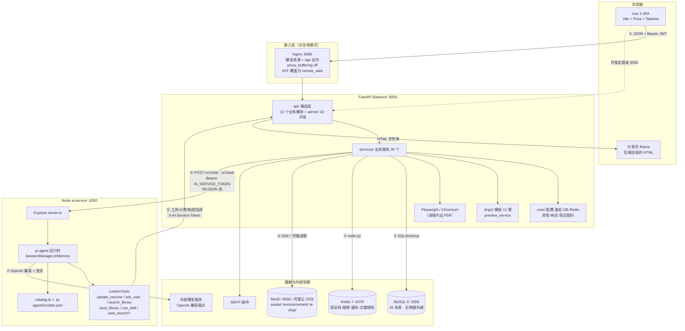

**三条硬边界**（`docs/PROJECT-OVERVIEW.md` §3，代码可验证）：

1. 浏览器不直连 ai-service：前端只出现 `VITE_API_BASE_URL`（`frontend/src/api/request.ts` 与 `ai.ts` 共用 `API_BASE_URL`）。
2. ai-service 不连数据库：`ai-service/src` 无任何 MySQL/Redis 客户端依赖（`package.json` 仅 express/dotenv/pi）。
3. 平台模型 Key 只在 ai-service 进程：`backend/.env.example` 无模型 Key；`ai-service/.pi-agent/models.json`（**被 `ai-service/.gitignore` 忽略，不入仓**）持有 provider 与 `$ENV_VAR` 引用。

### 1.2 通信方式汇总

| 链路 | 协议 / 形态 | 鉴权 | 关键实现 |
| --- | --- | --- | --- |
| 浏览器 → FastAPI（普通接口） | HTTPS + JSON，响应统一 `{code,message,data}` | `Authorization: Bearer <JWT>` | `frontend/src/api/request.ts`；`backend/app/core/security.py` |
| 浏览器 → FastAPI（AI 流式） | `fetch` + `ReadableStream`，逐行 NDJSON | 同上（fetch 手写头） | `frontend/src/api/ai.ts::postAiStream` |
| 浏览器 → FastAPI（图片代理） | `` query token 或 Bearer | JWT（私有对象） | `backend/app/api/files.py::_request_token` |
| FastAPI → ai-service | HTTP POST/GET，NDJSON 流 / JSON | `Bearer AI_SERVICE_TOKEN`（fail-closed） | `backend/app/services/ai_service_client.py`；`ai-service/src/server.ts::authorize` |
| ai-service → FastAPI（回调） | HTTP JSON | `X-AI-Service-Token`（`hmac.compare_digest`） | `backend/app/api/ai.py::require_ai_service_token` |
| FastAPI → MySQL | SQLAlchemy 2.x，连接池 `pool_pre_ping` | 账号密码 | `backend/app/core/database.py` |
| FastAPI → Redis | `redis-py`，`decode_responses=True` | URL（可含密码） | `backend/app/core/redis.py` |
| FastAPI → MinIO/OSS | 官方 SDK，流式读取 | access key | `backend/app/services/storage/storage_service.py` |
| FastAPI → Chromium | Playwright `sync_playwright` 进程内启动 | 无 | `pdf_export_service._render_pdf_with_chromium` |
| FastAPI → SMTP | `smtplib` | 账号/授权码 | `backend/app/services/email_service.py` |
| ai-service → 模型供应商 | OpenAI 兼容 HTTP（pi-ai） | models.json 中的 Key 或 BYOK 临时 provider | `ai-service/src/real.ts`、`faux.ts` |

**超时口径并不统一**（静态观察，见 §9.6）：`AI_TURN_TIMEOUT_MS=300000`（compose）／httpx `read=180s`（`ai_service_client._http_timeout`）／Nginx `proxy_read_timeout 360s`。

### 1.3 两种运行形态

| 形态 | 启动 | 组成 | 入口 |
| --- | --- | --- | --- |
| 手动开发（默认） | `docker compose up -d` | mysql / redis / minio / ai-service 容器；backend 8000、frontend 5173 在宿主机 | `http://localhost:5173` |
| 全栈 | `docker compose --profile full up -d --build` | 额外 `backend-migrate`（一次性 alembic）→ `backend` → `frontend`(Nginx) | `http://localhost:8080` |

依据：`docker-compose.yml` 服务定义与 `profiles: ["full"]`；`frontend/nginx.conf` 的 `/api/` 反代。

---

## 2. Backend 模块地图

### 2.1 分层与依赖方向

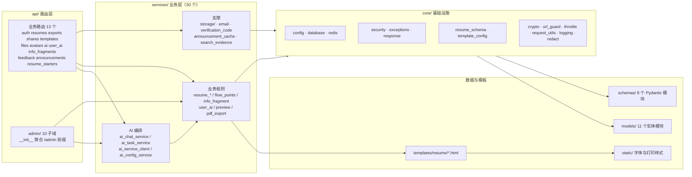

**实际依赖是单向的**：`grep -rn "from app.api" backend/app/services backend/app/core` 为空——service 不反向依赖路由。`core` 只依赖 `models`（`security.py`、`resume_schema` 之外）。

### 2.2 API 路由清单（全部挂 `/api`）

| 前缀 | 文件 | 路由数 | 职责 |
| --- | --- | --- | --- |
| `/auth` | `api/auth.py` | 9 | 验证码、注册、登录、重置密码、资料、改密 |
| `/resumes` | `api/resumes.py` | 19 | 列表/创建/起手式/导入/CRUD/复制/版本/分享设置/预览 |
| `/resumes`（导出） | `api/exports.py` | 3 | PDF、JSON、Word（410 下线） |
| `/ai` | `api/ai.py` | 29 | 能力、记录、积分、生成、会话、消息、决策、服务间回调 |
| `/info-fragments` | `api/info_fragments.py` | 8 | 信息库 CRUD、批量、提取、导入简历 |
| `/avatars` | `api/avatars.py` | 2 | 头像库列表/移除（不建表，复用 `uploaded_files`） |
| `/user-ai` | `api/user_ai.py` | 21 | BYOK 多模型、技能、审计、密钥清除、探活 |
| `/files` | `api/files.py` | 5 | 三类图片上传、字体、对象代理 |
| `/shares` | `api/shares.py` | 1 | 公开分享（免登录） |
| `/templates` | `api/templates.py` | 2 | 模板列表/详情 |
| `/resume-starters` | `api/resume_starters.py` | 1 | 行业起手式目录 |
| `/feedback` | `api/feedback.py` | 2 | 提交/我的反馈 |
| `/announcements` | `api/announcements.py` | 4 | 公告列表/当前/详情/忽略 |
| `/admin` | `api/admin/__init__.py` 聚合 10 个 | 60+ | 用户、简历、任务、积分、兑换码、公告、反馈、导出、模板、设置、模型目录 |

注册顺序见 `backend/app/main.py` 的 `include_router`；**`/admin` 内部顺序有语义**：`points` 必须排在 `users` 之前，否则 `/users/flow-points/grant-all` 会被 `/users/{user_id}/...` 先匹配（`api/admin/__init__.py` 注释）。

### 2.3 core/ 模块

| 文件 | 职责 | 被谁依赖 |
| --- | --- | --- |
| `config.py` | `Settings`（pydantic-settings），`database_url`、`export_path`、`debug_enabled`、`is_production` | 全仓 |
| `database.py` | engine / `SessionLocal` / `Base` / `get_db`；**明确禁止把请求级 session 带进 StreamingResponse** | 路由、服务 |
| `redis.py` | 全局 `redis_client`（decode_responses、socket 超时） | 验证码、限频、缓存、点数规则 |
| `security.py` | bcrypt、JWT 签发/解析、`get_current_user`、`get_current_admin`、`user_from_token` | 路由 |
| `exceptions.py` | `AppException(message, code)` + 三类异常处理器，生产不回显异常原文 | 全仓 |
| `response.py` | `success()` / `error_response()` | 路由 |
| `resume_schema.py` | `SCHEMA_VERSION="1.1"`、`SECTIONS`（7 内置 + custom_sections）、`FRAGMENT_KINDS`（15 类）、`normalize_resume_document()`、`schema_compact()`、`schema_prompt()` | 保存、导入、AI、信息库 |
| `template_config.py` | `normalize_template_config()` 白名单（会进 `<style>`） | 简历保存、预览、PDF、分享 |
| `crypto.py` | BYOK Fernet，密文 `fernet:<kid>:<token>`，`validate_encryption_config(strict)` | `main.lifespan`、`user_ai_service` |
| `url_guard.py` | SSRF 校验（字面量 + DNS 两级） | BYOK 探活、PDF 资源 |
| `throttle.py` | 登录失败计数（Redis，fail-open） | `api/auth.py` |
| `request_utils.py` | `get_client_ip()`：仅直连方是受信代理时才采信 XFF，且从右往左取 | 登录、注册、兑换码、审计 |
| `logging.py` / `redact.py` | 日志配置、日志脱敏 filter | 全仓 |

### 2.4 services/ 职责与扇入扇出

| 服务 | 行数 | 主要职责 | 被谁调用 |
| --- | --- | --- | --- |
| `ai_chat_service.py` | 1686 | 会话 CRUD、上下文、摘要压缩、模型/BYOK 解析、流中继与落库、校验合并、决策落库 | `api/ai.py`（10 个入口）、`api/resumes.py` |
| `api/ai.py` 之外的 AI 编排 | — | — | — |
| `ai_service_client.py` | 329 | 到 Node 的 `/v1/chat`、`/v1/task`、catalog；附件转 base64 | `api/ai.py`、`api/resumes.py`、`api/admin/ai_configs.py` |
| `ai_task_service.py` | 115 | `create_ai_task` / `finish_ai_task` / 失败退款 | `api/ai.py`、`ai_chat_service`、`resumes.py` |
| `ai_config_service.py` | 383 | 模型策略解析、Redis 缓存、目录能力（多模态） | `api/ai.py`、`ai_chat_service`、`admin/ai_configs.py` |
| `flow_points_service.py` | 736 | 规则、计价、预检、原子加减、结算、兑换码 | 多处 |
| `info_fragment_service.py` | 746 | 信息库 CRUD/指纹去重/从简历提取/导入简历/Agent 检索/提案校验 | `api/info_fragments.py`、`api/ai.py`、`ai_chat_service` |
| `user_ai_service.py` | 717 | BYOK 凭据、探活、技能与技能包、审计 | `api/user_ai.py`、`ai_chat_service` |
| `resume_service.py` | 361 | 简历 CRUD、复制、版本（指纹/保留/恢复）、删除级联 | `api/resumes.py`、`ai_chat_service` |
| `preview_service.py` | 268 | Jinja2 渲染、字体注入、section 组装、富文本清理 | 预览、PDF、分享、模板缩略 |
| `pdf_export_service.py` | 624 | 指纹缓存、Chromium/WeasyPrint、资源守卫、导出记录 | `api/exports.py`、`api/resumes.py` |
| `resume_json_export.py` | 177 | 快照序列化/解析/回填 | `api/exports.py`、`api/resumes.py` |
| `resume_import_service.py` | 168 | PDF/docx/图片/txt 抽文本 | `api/resumes.py` |
| `resume_starter_*`（4 个） | 409+628+348+136 | 起手式数据、内容构建、渲染、服务 | `api/resume_starters.py`、`api/admin/templates.py` |
| `template_service.py` | 345 | 内置模板元数据、DB 同步、Redis 缓存、缩略图 | 多处 |
| `storage/storage_service.py` | 307 | 三类图片上传、对象代理、私有前缀鉴权、缓存头 | `api/files.py`、`ai_service_client`、PDF |
| `verification_code_service.py` | 220 | Redis 验证码、发送频率、试错上限、并发锁 | `api/auth.py` |
| `email_service.py` | 213 | 注册/重置/反馈回信 SMTP | 同上 |
| `announcement_cache_service` / `announcement_service` | 91 / 11 | 公告 Redis 版本化缓存与 CRUD 辅助 | `api/announcements.py`、`api/admin` |
| `app_settings_service.py` | 135 | 站点开关（注册赠送、用户协议等），富文本清理 | 多处 |
| `avatar_service.py` | 140 | 头像库列表/使用计数/删除索引 | `api/avatars.py` |
| `rich_text_service.py` | 107 | 富文本白名单清理（AI 输出必经） | `preview_service`、schema 规范化 |
| `resume_normalization.py` / `resume_locale.py` | 143 / 186 | 简历结构规范化、语言与标签 | 保存、AI、预览 |
| `search_evidence_service.py` | 92 | **进程内内存**的联网证据（TTL 30 min） | `api/ai.py` |
| `model_pricing.py` | 63 | 美元价 → 点数建议价（×21600） | `admin/ai_configs.py` |
| `word_export_service.py` | 201 | python-docx（已下线，保留） | 无（导出路由 410） |

> 30 个 `.py`（含 `__init__`）对应 30 个业务服务；`services/ai/` 只剩 `token_usage.py`（104 行，估算与合并 token）。

### 2.5 其他目录

| 目录 | 内容 | 入口/约定 |
| --- | --- | --- |
| `models/` | 11 个模块、25 张表；统一 `BigInteger` 主键，`JSON` 存 `resume_data` / `template_config` | `models/__init__.py` 聚合导出 |
| `schemas/` | `auth`、`resume`、`ai`、`ai_chat`、`user_ai`、`info_fragment`、`announcement`、`resume_starter` | 请求/响应契约；`schemas/__init__.py` |
| `templates/resume/` | 12 套模板 + `style-base.css` + `partials/` | `preview_service.env`（Jinja `FileSystemLoader`） |
| `static/` | 4 套中文字体 woff2、`resume-common.css`、`resume-print.css` | `preview_service` 注入 `@font-face` |
| `alembic/versions/` | 43 个迁移，最新 `0043_version_source_backfill` | `alembic upgrade head` |
| `backend/tests/` | 54 个文件，覆盖 AI/计费/版本/上传/分享/PDF/权限 | `pytest -q` |

---

## 3. AI Service 模块地图

### 3.1 模块与职责

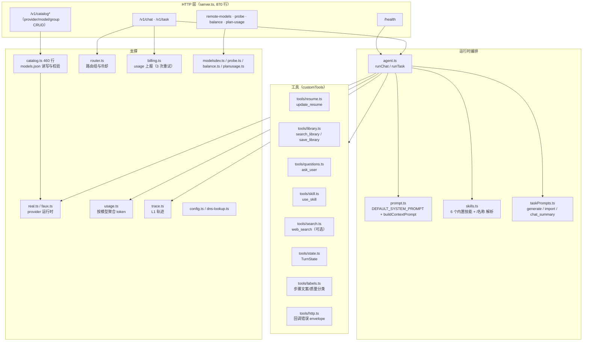

关键事实：

- 依赖只有 4 个：`@earendil-works/pi-coding-agent`、`pi-ai`、`express`、`dotenv`（`ai-service/package.json`）。
- 会话完全无状态：`SessionManager.inMemory(cwd)`（`agent.ts` `createAgentSession`），请求结束 `dispose()`；不写 JSONL。
- 工具白名单写死在 `agent.ts` 的 `tools: [...]`：`update_resume`、`ask_user`、`search_library`、`save_library`、`use_skill`，`web_search` 仅在 `isSearchEnabled(config)` 时追加；`read/bash/edit/write` 未注册。
- `get_resume_context` **不再作为工具注册**（`agent.ts` 无此工具），但后端 `/api/ai/service/tool/get-resume-context` 端点仍存在（见 §9.4）。

### 3.2 一次对话回合的生命周期

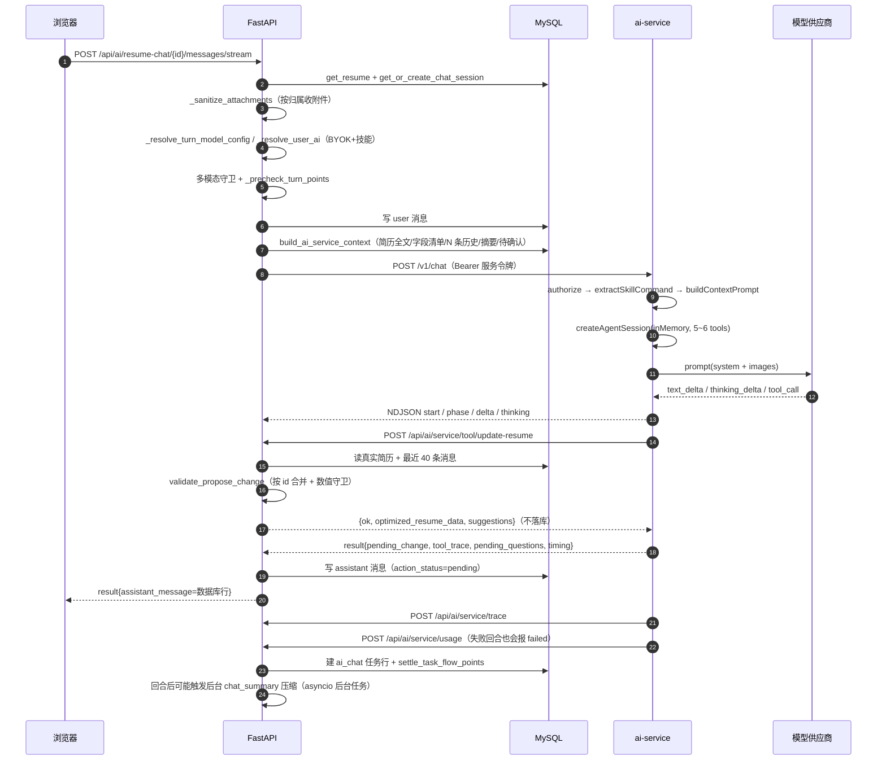

关键符号：`ai_chat_service.stream_ai_service_chat`（811）、`_stream_ai_service_reply`（672）、`_compact_chat_context`（497）、`server.ts` `/v1/chat`（607）、`agent.runChat`（192）、`tools/resume.createUpdateResumeTool`（104）、`api/ai.py::service_update_resume`（977）。

#### 生命周期要点（`agent.ts`）

1. **解析模型**：`resolveRealModel(runtime, modelRef)`；解析失败直接 `error` 事件并结束，不进入 session。
2. **建会话**：`new DefaultResourceLoader({ systemPromptOverride, noContextFiles: true, noSkills: true })` → `await loader.reload()` → `createAgentSession({ sessionManager: SessionManager.inMemory(cwd), tools, customTools, thinkingLevel })`。
3. **订阅事件**：`session.subscribe` 把 `message_update`（text/thinking delta）、`message_end`（usage）、`tool_execution_start/end`、`agent_settled` 桥接成 NDJSON。
4. **执行**：`session.prompt(message, { images })`；`setTimeout(() => session.abort(), config.turnTimeoutMs)` 兜住整轮超时。
5. **收尾**：`finally` 里二次 `sendResult`（防 `agent_settled` 未触发）、`unsubscribe()`、`session.dispose()`；失败回合 `usage=[]`，不参与计费。
6. **结果形状**：`result.data` 含 `assistant_message`（骨架，后端用 DB 行替换）、`timing`，以及按需的 `pending_change` / `pending_info_fragments` / `pending_questions` / `tool_trace`。

### 3.3 工具与回调矩阵

| 工具 | 参数 | 回调端点 | 结果去向 | 是否落库 |
| --- | --- | --- | --- | --- |
| `update_resume` | `changes[]` + `from_library[]` | `POST /api/ai/service/tool/update-resume` | `TurnState.pendingChange` → `optimized_resume_data` | 否（用户点「应用」才写） |
| `search_library` | `query` / `kinds` / `limit` | `GET /api/ai/service/tool/info-fragments/search` | 直接回给模型 | 否（只读检索，不写库） |
| `save_library` | `items[]` | `POST /api/ai/service/tool/info-fragments/propose` | `pending_info_fragments` | 否（确认后 `apply_proposals`） |
| `ask_user` | `questions[]`（≤3） | 无 | `pending_questions` | 随 assistant 消息落库 |
| `use_skill` | `name` | 无 | 技能正文 | 否 |
| `web_search` | `query` | `POST /api/ai/service/tool/search-evidence` | 回给模型 + 证据内存 | 否（进程内存） |

### 3.4 计费与轨迹（Node 侧）

- `billing.reportUsage`：回合结束后把按 `provider/model` 聚合的 usage POST 到 FastAPI；最多 3 次退避重试，4xx 立即放弃，全失败打 `RECONCILE` 结构化日志。
- `trace.reportTrace`：一次回合一条 L1 轨迹，整包 POST `/api/ai/service/trace`，按 `trace_id` 幂等覆盖。
- `usage.createUsageAggregator`：从 `message_end.usage` 聚合，过滤 `faux` provider 后上报。

### 3.5 模型目录与 provider

| 关注点 | 实现 | 备注 |
| --- | --- | --- |
| 目录存储 | `.pi-agent/models.json`（volume 挂载，**gitignore**） | 结构示例见 `ai-service/models.json.example` |
| 目录 CRUD | `server.ts` `/v1/catalog*` → `catalog.mutateCatalog` → `rebuildRuntime()` | faux 模式拒绝写 |
| provider 运行时 | `createRealRuntime`（real）/ `createFauxRuntime`（faux） | `PI_PROVIDER` 控制 |
| BYOK | `real.registerByokModel(runtime, byok)`，providerId = owner + 配置哈希 | 每用户临时注册，LRU 上限 200 |
| 路由组 | `router.resolveRoutingGroup` + 冷却/粘性 | `group/<id>` 引用 |
| 推理强度 | `platformThinkingLevel(modelRef)` 读 catalog | 与 `ai_model_configs` 无关 |

---

## 4. Frontend 模块地图

### 4.1 目录职责

### 4.2 路由与页面

路由表与守卫在 `frontend/src/router/index.ts`（41 行）：`/workspace/:id`、`/workspace/{templates,resumes,info,help,profile,announcements,ai-records,settings,admin}` 全部由 `Workspace.vue` 承载，`Workspace.vue` 用 `panel` 计算属性单选渲染（`views/Workspace.vue:34`）。

守卫只做三件事：未登录跳 `/login`、已登录访问 `/` 跳 `/workspace`、`meta.requiresAdmin` 时调 `meApi()` 校验（`router/index.ts:44`）。**前端守卫不是安全边界**，后端 `get_current_admin` 才是。

### 4.3 编辑器 / AI 对话 / 预览的状态关系

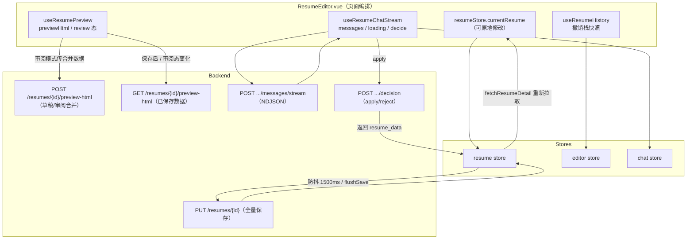

**三类状态各归其位**：

| 状态 | 位置 | 为什么 |
| --- | --- | --- |
| 简历正文、模板配置、预览 HTML | `resume` store（`currentResume` 为可变对象） | 编辑表单、预览、导出多处共用一份 |
| 保存态、撤销栈、预览缩放 | `editor` store | 与具体简历解耦，切简历时 `resetHistory` |
| 会话列表与当前会话 | `chat` store | 侧栏与编辑器共用，切换需同步 |
| 消息数组、流式增量、审阅勾选 | `ResumeEditor` 局部 + `useResumeChatStream` / `useResumePreview` | 强依赖本地可变数组与流式时序 |

补充约定：

- `types/` 有 5 个文件：`api.ts`（统一响应）、`resume.ts`（`ResumeData` / `ResumeItem` / `TemplateConfig`）、`ai.ts`（能力/记录/会话）、`chat.ts`（`ChatMessage` / `ToolStep`）、`user.ts`。类型与后端 schema 手工对齐，没有生成器。
- `components/ai/ResumeAiChatPanel.vue` 是**纯展示组件**，只 emit `send / regenerate / confirm / reject / clear`；真正的请求在 `ResumeEditor` 调用的 `useResumeChatStream` 里。
- `components/preview/*` 只负责容器、缩放、分页提示；HTML 由后端返回，前端不参与排版计算（`utils/resumePagination.ts` 仅做估算）。

> 注意：`docs/PROJECT-OVERVIEW.md` §8.3 把 `editor` store 描述为「当前简历、脏标记、保存、预览刷新」，实际 store 只有 `saved/saving/history/previewScale`；简历正文在 `resume` store（`frontend/src/stores/editor.ts` 全文 101 行）。

### 4.4 双通道请求

| 通道 | 实现 | 行为 |
| --- | --- | --- |
| 普通接口 | `api/request.ts` axios 实例 | 注入 `vitaflow_token`；`code !== 200` 抛错；401 清 token 跳登录；`responseType: "blob"` 直通下载 |
| AI 流式 | `api/ai.ts::postAiStream`（179 行） | `fetch` + `ReadableStream`，逐行 `JSON.parse`；402 走 `SilentStreamError` + 全局 toast；`AbortSignal` 支持取消 |

`API_BASE_URL` 只在 `api/request.ts` 导出，`api/ai.ts` 复用之（P2-3 修复后的单一来源）。

---

## 5. 数据模型

### 5.1 表清单（25 张有效表）

| 域 | 表 | 核心字段 | 主键 | 唯一约束 / 索引 | 主要场景 |
| --- | --- | --- | --- | --- | --- |
| 账号 | `users` | `username`、`email`、`password_hash`、`flow_points`、`role`、`status`、`register_ip`、`last_login_*` | `id` BIGINT | `username`、`email` 唯一；`role`、`status` 索引 | 登录、鉴权、余额、管理员 |
| 简历 | `resumes` | `user_id`、`title`、`language`、`resume_data` JSON、`template_id`、`template_config` JSON、`share_*` | `id` | `user_id`、`share_enabled`、`share_expire_time` 索引；`share_token` 唯一 | 简历主体、分享 |
| 版本 | `resume_versions` | `resume_id`、`resume_data`、`template_config`、`reason`、`source`、`content_hash`、`size_bytes` | `id` | `resume_id` 索引；`(resume_id, create_time)` 复合 | 手动/AI 前/恢复前快照，保留 50 |
| 模板 | `resume_templates` | `template_id`、`name`、`category`、`is_pro`、`sort_order`、`is_visible` | `id` | `template_id` 唯一 | 模板中心、后台管理 |
| 起手式 | `resume_starters` | `starter_id`、`industry_id`、`role_title`、`content` JSON、`is_visible` | `id` | `starter_id` 唯一；`industry_id` 索引 | 按行业/岗位起稿 |
| 起手式 | `resume_starter_industry_templates` | `industry_id`、`default_template_id`、`sort_order` | `id` | `industry_id` 唯一 | 行业默认模板 |
| 文件 | `uploaded_files` | `user_id`、`file_type`、`object_name`、`file_url`、`content_type`、`file_size` | `id` | `user_id` 索引（无 object_name 唯一） | 头像库、公告图、对话图 |
| 导出 | `export_records` | `user_id`、`resume_id`、`file_type`、`file_name`、`file_path`、`status` | `id` | `user_id`、`resume_id` 索引 | PDF/JSON 导出流水 |
| 公告 | `announcements` | `title`、`content`、`status`、`created_by`、`published_at`、`read_count` | `id` | `status`、`published_at`、`created_by` 索引 | 站内公告 |
| 公告 | `announcement_reads` | `announcement_id`、`user_id` | `id` | `(announcement_id,user_id)` 唯一 | 已读状态（忽略状态在 Redis） |
| 反馈 | `user_feedbacks` | `user_id`、`category`、`content`、`status`、`admin_reply`、`reply_time` | `id` | `user_id`、`category`、`status`、`create_time` 索引 | 反馈与回信 |
| 对话 | `ai_chat_sessions` | `user_id`、`resume_id`、`title`、`is_pinned`、`context_summary`、`summary_message_id` | `id` | `user_id`、`resume_id` 索引 | 一份简历多条会话 |
| 对话 | `ai_chat_messages` | `session_id`、`user_id`、`resume_id`、`role`、`content`、`attachments`、`suggestions`、`optimized_resume_data`、`pending_info_fragments`、`tool_trace`、`timing`、`pending_questions`、`action_status` | `id` | `session_id`、`user_id`、`resume_id` 索引 | 消息与待确认快照 |
| AI 任务 | `ai_tasks` | `user_id`、`resume_id`、`task_type`、`feature`、`input_data`、`output_data`、`status`、`points_used`、`tokens_used` | `id` | `user_id`、`resume_id`、`task_type`、`feature`、`status`、`create_time` 索引 | 成本与成功率事实行 |
| 模型策略 | `ai_model_configs` | `name`、`model_ref`、`context_messages`、`is_chat_selectable`、`sort_order`、三种费率、`is_active` | `id` | `model_ref` 唯一；`is_active` 索引 | 定价、默认模型、上架 |
| 轨迹 | `ai_agent_traces` | `trace_id`、`turn_id`、`session_id`、`user_id`、`resume_id`、`outcome`、`model`、`prompt_versions`、`events`、`event_count` | `id` | `trace_id` 唯一；`turn_id/session_id/user_id/resume_id/outcome/model/create_time` 索引 | L1 轨迹（无 PII） |
| 积分 | `flow_point_rules` | `feature_type`、`display_name`、`points_per_call`、`*_per_million*`、`enabled` | `id` | `feature_type` 唯一 | 兜底价（现仅 3 类） |
| 积分 | `flow_point_transactions` | `user_id`、`task_id`、`feature_type`、`points_delta`、`balance_after`、`tokens_used`、`description` | `id` | `user_id`、`task_id`、`feature_type`、`create_time` 索引 | 账本 |
| 积分 | `flow_point_redeem_codes` | `code`、`batch_no`、`points`、`price`、`total_count`、`used_count`、`ip_once`、`expire_time`、`status` | `id` | `code` 唯一；`batch_no/expire_time/status/created_by` 索引 | 兑换码 |
| 积分 | `flow_point_redeem_records` | `code_id`、`code`、`user_id`、`ip_address`、`points`、`price` | `id` | `(code_id,user_id)` 唯一；`ip_address` 索引 + `(code_id,ip_address)` | 核销记录 |
| 设置 | `app_settings` | `key`、`value`、`description` | `id` | `key` 唯一 | 注册开关、赠送点数、协议 |
| BYOK | `user_ai_credentials` | `user_id`、`provider_label`、`base_url`、`model`、`api_key_encrypted`、`api_key_masked`、`reasoning_effort`、`is_default`、`enabled` | `id` | `user_id` 索引；`is_default`、`enabled` 索引 | 多模型接入（每用户 ≤10） |
| BYOK | `user_ai_audit_logs` | `user_id`、`action`、`credential_id`、`label`、`detail` | `id` | `(user_id,id)`、`create_time` 索引 | 使用/变更审计 |
| 技能 | `user_skills` | `user_id`、`slug`、`name`、`description`、`instructions`、`enabled`、`source` | `id` | `(user_id,slug)` 唯一 | 用户写作偏好 |
| 信息库 | `info_fragments` | `user_id`、`kind`、`title`、`summary`、`payload` JSON、`tags`、`search_text`、`fingerprint`、`source`、`enabled`、`usage_count` | `id` | `user_id`、`kind`、`fingerprint` 索引；`(user_id,kind)`、`(user_id,update_time)` | 原子信息（每用户 ≤500） |

**已删除的表**（不要按旧文档找）：`email_verification_codes`（0005 移到 Redis）、`announcement_dismissals`（0009 移到 Redis）。

### 5.2 ER 图（核心业务域）

> MySQL 不使用物理外键（AGENTS.md / PROJECT-OVERVIEW §5.4）。下图关系全部是**应用层维护的逻辑关系**，用虚线表示。

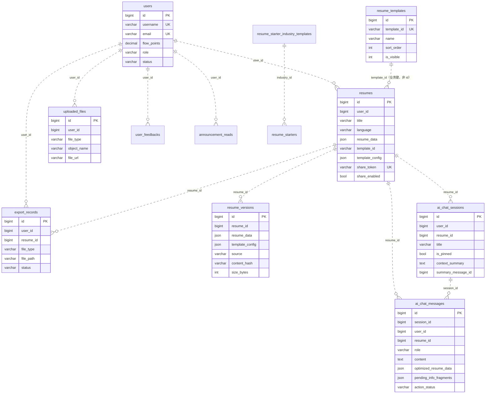

### 5.3 ER 图（AI 计费、BYOK、信息库）

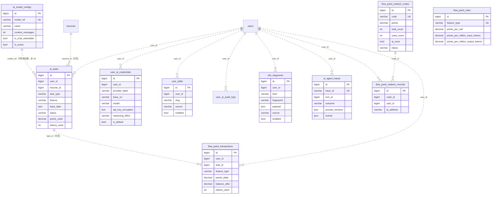

### 5.4 约束与索引要点

- 所有主键 `BIGINT AUTO_INCREMENT`；两个例外用 `BigInteger().with_variant(Integer, "sqlite")` 让单测能跑真实 ORM（`info_fragment.py`、`user_ai.py`）。
- 唯一约束集中在：`users.username/email`、`resumes.share_token`、`resume_templates.template_id`、`resume_starters.starter_id`、`resume_starter_industry_templates.industry_id`、`ai_model_configs.model_ref`、`ai_agent_traces.trace_id`、`flow_point_rules.feature_type`、`flow_point_redeem_codes.code`、`(code_id,user_id)`、`(announcement_id,user_id)`、`(user_id,slug)`。
- `ai_model_configs.model_ref` 可空但唯一（MySQL 允许多个 NULL，用于「尚未绑定目录模型」的历史行）。
- 迁移 `0041` 给 `ai_model_configs.model_ref` 建唯一索引，是「一个模型一行定价」的结构保证；`0019` 把点数改为 `DECIMAL(14,2)`。
- 迁移 id 必须 ≤32 字符（`alembic_version.version_num` 是 VARCHAR(32)），这是长期踩坑点，见项目记忆。

### 5.5 删除与级联（无外键的现实后果）

`resume_service.delete_resume`（140）显式删除：`ai_chat_messages` → `ai_chat_sessions` → `resume_versions` → PDF 缓存 → `resumes`。

**不删除**：`ai_tasks`、`export_records`、`ai_agent_traces`、`info_fragments`、`uploaded_files`。

其中：

- `ai_agent_traces` 是**有意**保留（`ai_trace.py` 文档：轨迹是分析资产，无 PII）。
- `ai_tasks` / `export_records` 保留 `resume_id` 孤儿值；后台任务列表用 `outerjoin`（`admin/records.py::_ai_task_select`），不会因简历删除而消失，只是标题为空。
- 是否需要对这两张表做保留策略，文档未说明（**未知**）。

---

## 6. 核心业务流程

> 每条流程给出：触发入口 → 前后端模块 → 接口 → 核心函数 → 数据流。图中数字与 §1.2 的链路口径一致。

### 6.1 用户注册登录

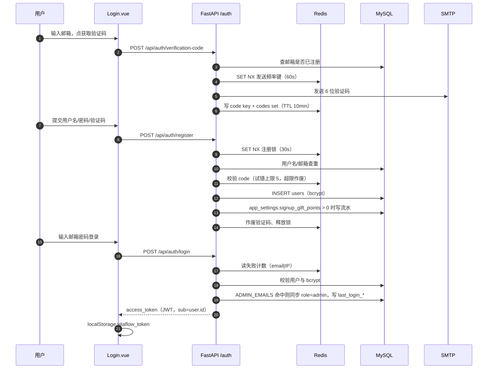

| 层 | 文件 / 函数 |
| --- | --- |
| 前端 | `views/Login.vue`、`api/auth.ts`、`stores/user.ts` |
| 路由 | `api/auth.py`：`send_verification_code`、`register`、`login`、`reset_password` |
| 服务 | `verification_code_service`（Redis 键 `vitaflow:auth:<purpose>:<sha1(email)>:*`）、`email_service`、`core/throttle.py`、`core/request_utils.get_client_ip` |
| 数据 | `users`、`flow_point_transactions`、`app_settings` |

要点：验证码只存 Redis（`0005` 迁移删表）；密码 `passlib[bcrypt]`；JWT 无刷新令牌，过期即 401 → 前端跳登录；注册赠送点数按站点设置。

### 6.2 简历创建与编辑

四条创建路径都收口到 `ResumeCreateFlow.vue`（工作区根部，`listen-global`）：

| 路径 | 前端调用 | 后端入口 | 核心实现 |
| --- | --- | --- | --- |
| 空白模板 | `createResumeApi({ template_id })` | `POST /api/resumes` | `resume_service.create_resume`：`normalize_template_config` → `normalize_resume_document` → 入库 |
| 岗位起稿 | `createResumeFromStarterApi` | `POST /api/resumes/from-starter` | `resume_starter_render.create_resume_from_starter`：读 `resume_starters` → 按 level 组装 `resume_data` |
| AI 生成 | `generateResumeStreamApi` → `store.createResumeFromAi` | `POST /api/ai/generate-resume/stream` → `POST /api/resumes` | 后端 `new_task`（预扣）→ `/v1/task` → 归一化 → `finish_ai_task` 结算并回传 `resume_data`；前端再调 `createResumeApi` 落库（`ResumeCreateFlow.generateResume`） |
| 导入文件 | `importResumeFileApi` | `POST /api/resumes/import-file` | `.json` 走 `import_resume_from_json`；其它走 `extract_resume_text_from_uploads` + `/v1/task(import_resume)` |

编辑侧：

- 页面 `views/ResumeEditor.vue`；模块侧栏 `components/editor/ModuleSidebar.vue`；表单 `ResumeFormPanel.vue` / `SectionListForm.vue` / `BasicInfoForm.vue` / `RichTextEditor.vue`。
- 编辑直接改 `resumeStore.currentResume.resume_data`，`markChanged()` 标脏 + 提交撤销快照 + 触发防抖保存（`composables/useResumeHistory.ts:109`）。
- 语言切换走 `setResumeLanguage`，会重写 `resume_data.layout.language_locked` 与 section 标题。

### 6.3 自动保存

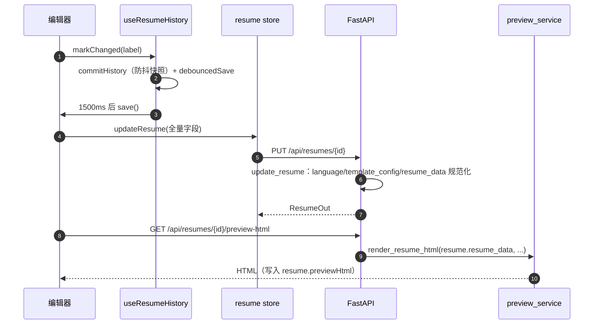

- 保存是**串行链**：`saveChain = saveChain.catch(...).then(performSave)`（`ResumeEditor.vue:539`），避免并发 PUT。
- 切简历、打开分享/版本面板、发送 AI 消息、删除简历前都会 `flushSave()`（`useWorkspaceBridge.ts`）。
- **普通保存不写版本快照**；版本只在手动存档、AI 应用前、恢复前产生（`resume_service.create_version`）。
- 无乐观锁：`ResumeUpdate` 无 `expected_update_time`，多标签页后写者胜（版本恢复接口才有 409 校验）。

### 6.4 AI 对话修改简历

见 §3.2 的完整时序。补充前端侧：

| 步骤 | 前端位置 |
| --- | --- |
| 发送 / 重新生成 / 决策 / 清空 | `composables/useResumeChatStream.ts`（`send` 193、`regenerate` 258、`decide` 336） |
| 输入区（技能卡、`/` 菜单、模型选择、图片） | `components/ai/AiComposer.vue`、`components/ai/chatSkills.ts`、`composables/useChatModels.ts` |
| 消息与待确认卡 | `components/ai/ResumeAiChatPanel.vue`、`ToolSteps.vue`、`ChatTurnMeta.vue`、`QuestionDialog.vue` |
| 流解析 | `api/ai.ts::postAiStream` |

后端关键点：

- 会话按 `(user_id, resume_id)` 隔离；`session_id` 省略时落在该简历最近会话（兼容旧前端）。
- 每轮上下文由 `build_ai_service_context` 从 MySQL 组装，包含**简历全文**（`context.resume.data`）与 `schema_compact()` 字段清单。
- 模型解析失败/未配置时不阻断（返回 `None`，不映射、不计费）；BYOK 解析失败只 warning 并回退平台默认（`_resolve_user_ai`）。
- 图片守卫：模型不支持图片时直接返回 error 事件（`_reject_turn_images`），不进入 AI 服务。

### 6.5 用户确认 AI 修改

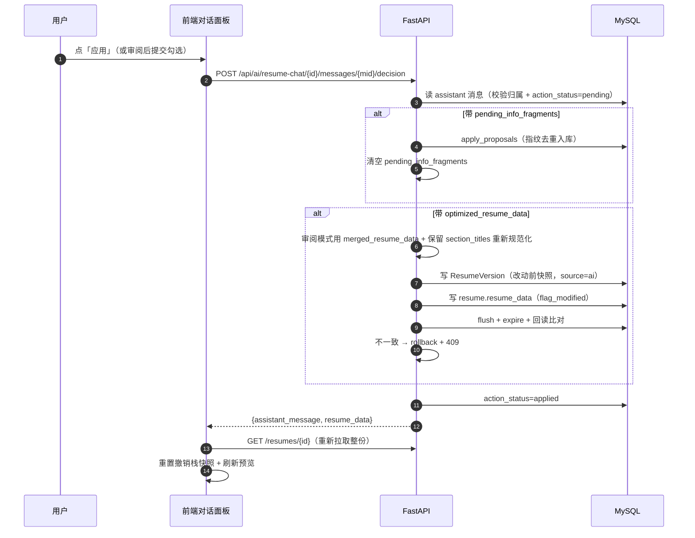

- 只有最新一条 pending 可操作；更早的卡片在 UI 上提示「已有更新版本」。
- `reject` 只清 `pending_info_fragments` 并置 `rejected`，不动简历。
- 版本快照存的是**改动前**内容，`reason="AI 修改前"`（`VERSION_REASON_AI`）。

### 6.6 AI 点数扣费

两条语义不同的路径：

| 路径 | 何时预扣 | 何时结算 | 代码 |
| --- | --- | --- | --- |
| 对话（`ai_chat`） | 仅**预检** `points_per_call` 下限，不预扣 | Node 回合结束回调 `/api/ai/service/usage` → 按模型逐条建 `ai_tasks` → `settle_task_flow_points` | `_precheck_turn_points`（656）、`report_ai_service_usage`（1155）、`ai_task_service.finish_ai_task` |
| 一次性任务（`generate_resume` / `import_resume`） | `new_task` 里 `consume_flow_points` 立即扣 | `result` 事件到达时按真实 usage `finish_ai_task(settle=True)` 多退少补 | `api/ai.py::new_task`（301）、`_ai_service_task_stream_response`（416） |

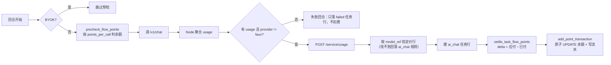

要点：

- 计价公式：`points_per_call + 输入token×输入单价/百万 + 输出token×输出单价/百万`，模型级字段**逐键**覆盖兜底规则（`calculate_points` 203）。
- 失败退款：`_refund_failed_task_points` 汇总该任务流水净额，为负才补一笔正数流水。
- 并发：扣减走条件 UPDATE（`_apply_balance_delta` 299），余额不足靠 `rowcount=0` 判定（P1-3 修复）。
- BYOK：`provider` 以 `byok-` 开头时仍建任务行用于统计，但 `settle=False`、`points_used=0`。

### 6.7 简历翻译

当前实现**没有独立翻译接口**，走统一对话入口的内置技能：

1. 前端 `ResumeAiChatPanel` 技能卡「翻译」→ emit `send("/翻译 <目标语言>")`（`chatSkills.ts`）。
2. 后端原样透传 message；ai-service `extractSkillCommand` 命中 `translate`，用户消息替换为技能 `ask`，技能正文以 `# 本轮技能：翻译` 注入（`skills.ts`、`server.ts`）。
3. 模型按技能做法整份互译，调用 `update_resume` 一次性提交各模块 `changes`；Python 侧 `validate_propose_change` 合并并生成 `optimized_resume_data`。
4. 用户点「应用」→ §6.5 的落库链路；`_normalize_keeping_section_titles` 保留提案里的 `layout.section_titles`，避免被语言包重置。
5. 计费：按 `ai_chat` 规则 + 模型级定价；`ai_tasks.feature = "translate"`。

**未在代码中找到**：把 `resumes.language` 同步成目标语言的写入路径。`resumes.language` 只由 `PUT /resumes/{id}`（前端 `setResumeLanguage`）或创建时决定。因此「AI 翻译完成」与「简历语言列」之间靠用户手动切换或前端约定衔接，这个交互未写入文档（**待验证**，见 §9.6）。

旧的 `resume_translate` 独立任务类型仍出现在 `ai_feature_label`、后台筛选、`/ai/histories` 白名单里，但 `ACTIVE_AI_FEATURE_TYPES` 只剩 `generate_resume` / `import_resume` / `ai_chat`（`flow_points_service.py:62`），新链路不会产生该类型。

### 6.8 PDF 导出

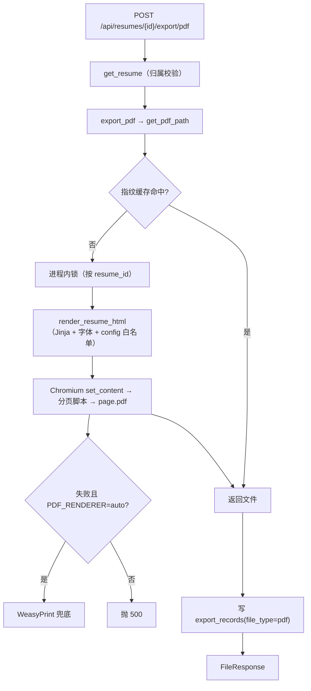

关键实现：

| 关注点 | 位置 | 说明 |
| --- | --- | --- |
| 缓存指纹 | `_pdf_fingerprint`（477） | `cache_version + pdf_base_url + renderer + 模板目录 hash + resume_data + language + template_config + template_id + weasyprint 版本` |
| 缓存目录 | `settings.export_path / "pdf_cache"` | **本地磁盘**，不在 MinIO |
| 并发锁 | `_pdf_lock`（45） | `threading.Lock`，**进程内**，多 worker 不共享 |
| 资源守卫 | `_fulfill_uploaded_file_route`（437）、`_is_renderable_asset`（380） | 只放行自家上传对象/内联 scheme/公网 http(s)；失败用 1×1 透明图 |
| 分页 | `PAGINATION_SCRIPT` / `PAGED_EXPORT_SCRIPT` | 渲染前在页面内切页 |
| 预览 PDF | `GET /resumes/{id}/preview-pdf` | 复用同一缓存路径 |

### 6.9 JSON 导入导出

| 方向 | 接口 | 实现 | 关键约束 |
| --- | --- | --- | --- |
| 导出 | `POST /resumes/{id}/export/json` | `resume_json_export.export_json_bytes` / `build_export_payload` | 不落盘，流式 `Response`；`export_records.file_path="inline:json"`；不含 `id/user_id/share_token/create_time`；剥掉本系统头像引用 |
| 导入 | `POST /resumes/import-file`（`.json` 短路） | `import_resume_from_json` → `parse_resume_export` | 不调模型、不扣点；`template_id` 不存在回落 `tech`；`template_config` 过白名单；`resume_data` 仍走 `normalize_resume_document` |

前端：`api/export.ts::exportJsonApi`（`responseType: "blob"`）、`ResumeCreateFlow.vue::handleImportFile`。

### 6.10 文件上传与访问

| 场景 | 上传接口 | 对象前缀 | 访问策略 |
| --- | --- | --- | --- |
| 头像（同时入头像库） | `POST /files/upload-avatar` | `avatar/{user_id}_{uuid}.jpg` | 公开可读（`public, immutable`） |
| 公告图 | `POST /files/upload-announcement-image` | `announcement/{uuid}` | 公开可读 |
| AI 对话图 | `POST /files/upload-ai-chat-image` | `ai-chat/{user_id}_{uuid}` | **私有**：必须登录且属于本人，`private, no-store` |

统一入口 `GET /api/files/{object_name}`（`api/files.py::get_uploaded_file`）：

1. `is_allowed_object_name` 校验前缀与路径穿越；
2. 私有前缀额外 `user_from_token` + `owned_object_names`，未登录/非本人一律 404；
3. `stream_uploaded_file` 流式返回，头含 `ETag`、`X-Content-Type-Options: nosniff`。

头像库不建表：`uploaded_files.file_type="avatar"` 即库；`GET /avatars` 计算 `usage_count`；`DELETE /avatars/{id}` 只删索引不删对象（已分享简历仍可显示）。

### 6.11 简历公开分享

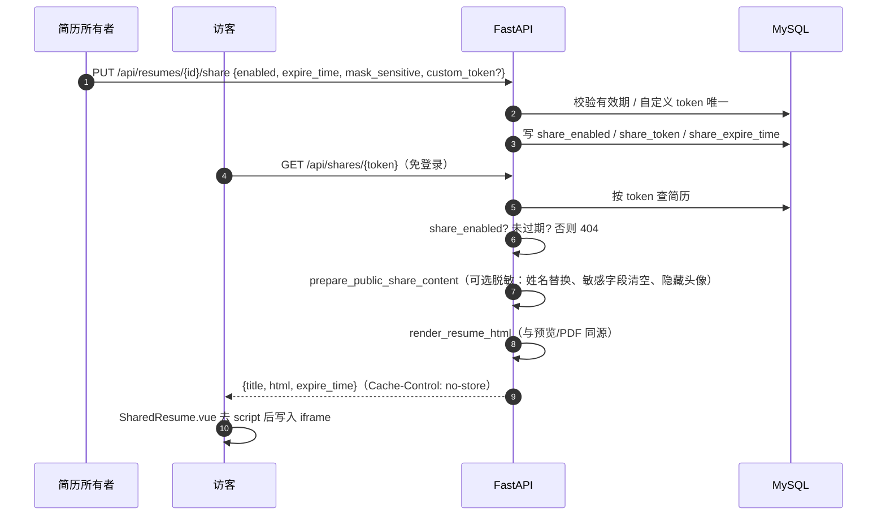

- 自定义 token 规则：`^[A-Za-z0-9][A-Za-z0-9_-]{2,63}$`，查重后写库（`resume_share_service.normalize_custom_share_token`）。
- 脱敏只改副本（`deepcopy`），不就地改 ORM 对象。
- 分享页与预览、PDF 共用 `preview_service.render_resume_html`，模板只有一份。

---

## 7. 服务间通信关系

### 7.1 调用矩阵

| 调用方 → 被调方 | 端点 | 载荷 | 鉴权 | 超时/重试 | 失败表现 |
| --- | --- | --- | --- | --- | --- |
| 浏览器 → FastAPI | `/api/**` | JSON | JWT | axios 30s；导出 120s | 统一中文错误 |
| 浏览器 → FastAPI（流） | `/api/ai/**/stream` | JSON → NDJSON | JWT | fetch 无超时，靠 AbortController | `error` 事件 |
| FastAPI → ai-service | `POST /v1/chat` | message/context/model/images/skills/ids | `Bearer AI_SERVICE_TOKEN` | httpx connect 5s / read 180s | 转成 `error` 事件 |
| FastAPI → ai-service | `POST /v1/task` | task/input/model | 同上 | 同上 | 任务 failed + 退款 |
| FastAPI → ai-service | `/v1/catalog*` | JSON | 同上 | 同步请求（`call_catalog`） | `AppException` |
| ai-service → FastAPI | `/api/ai/service/tool/update-resume` | updates/from_library | `X-AI-Service-Token` | 15s（`AI_TOOL_HTTP_TIMEOUT_MS`） | 工具 envelope `{ok:false, category}` |
| ai-service → FastAPI | `/api/ai/service/tool/info-fragments/*` | query/items | 同上 | 15s | 同上 |
| ai-service → FastAPI | `/api/ai/service/usage` | usage[]/feature/timing | 同上 | 10s × 3 次退避 | 打 RECONCILE 日志 |
| ai-service → FastAPI | `/api/ai/service/trace` | 轨迹事件 | 同上 | 自带重试 | 只丢分析数据 |
| FastAPI → MySQL | SQLAlchemy | — | 账号 | pool_pre_ping / recycle 3600 | 500 |
| FastAPI → Redis | redis-py | — | URL | socket 超时 3s | 部分功能 fail-open |
| FastAPI → MinIO/OSS | SDK | bytes | key | 默认 | 上传 500 / 读取跳过 |
| FastAPI → Chromium | Playwright | HTML | — | `PDF_RENDER_TIMEOUT_MS` 30s | 500 或 WeasyPrint 兜底 |
| ai-service → 模型 | OpenAI 兼容 | prompt | Key / BYOK | `AI_TURN_TIMEOUT_MS` | `error` 事件 |

### 7.2 契约与幂等

- 服务间 token 双向校验，缺省即 401（`ai_service_client` 无 token 直接 yield error；`server.authorize` 用 `timingSafeEqual`）。
- `/service/usage` 及 `/service/trace` 都按 `trace_id`/任务行幂等；`/service/trace` 覆盖同一行。
- `/service/tool/update-resume` **不落库**，只回快照；这是「AI 不能直接改库」的核心约束。
- 聊天消息的最终形态以 FastAPI 落库行为准：Node 返回的 `assistant_message` 会被数据库行整体替换（`_stream_ai_service_reply` 的 `result` 分支）。

---

## 8. 关键文件索引

| 关注点 | 文件 | 入口符号 |
| --- | --- | --- |
| 应用装配 | `backend/app/main.py` | `lifespan`、`include_router` |
| 配置 | `backend/app/core/config.py` | `Settings` |
| 鉴权 | `backend/app/core/security.py` | `get_current_user`、`get_current_admin`、`create_access_token` |
| 统一异常 | `backend/app/core/exceptions.py` | `AppException`、`register_exception_handlers` |
| 简历契约 | `backend/app/core/resume_schema.py` | `SECTIONS`、`FRAGMENT_KINDS`、`normalize_resume_document`、`schema_compact` |
| 模板配置白名单 | `backend/app/core/template_config.py` | `normalize_template_config` |
| 简历服务 | `backend/app/services/resume_service.py` | `create_resume`、`update_resume`、`create_version`、`restore_version`、`delete_resume` |
| 预览渲染 | `backend/app/services/preview_service.py` | `render_resume_html`、`_prepare_resume_data` |
| PDF | `backend/app/services/pdf_export_service.py` | `get_pdf_path`、`export_pdf`、`_pdf_fingerprint` |
| JSON 导出 | `backend/app/services/resume_json_export.py` | `export_json_bytes`、`import_resume_from_json` |
| 分享 | `backend/app/services/resume_share_service.py` | `get_shared_resume`、`prepare_public_share_content` |
| 存储 | `backend/app/services/storage/storage_service.py` | `upload_avatar`、`stream_uploaded_file`、`owned_object_names` |
| 对话主控 | `backend/app/services/ai_chat_service.py` | `stream_ai_service_chat`、`build_ai_service_context`、`resolve_chat_change` |
| Node 客户端 | `backend/app/services/ai_service_client.py` | `ai_service_chat_events`、`ai_service_task_result_sync` |
| 计费 | `backend/app/services/flow_points_service.py` | `calculate_points`、`precheck_flow_points`、`settle_task_flow_points` |
| 信息库 | `backend/app/services/info_fragment_service.py` | `import_fragments`、`search_for_agent`、`apply_proposals` |
| AI 路由 | `backend/app/api/ai.py` | `resume_chat_send_stream`、`resume_chat_decision`、`service_update_resume`、`report_ai_service_usage` |
| 后台看板 | `backend/app/api/admin/dashboard.py` | `dashboard`、`_funnel`、`_stage_quality_breakdown` |
| Agent 运行时 | `ai-service/src/agent.ts` | `runChat`、`runTask`、`sendResult` |
| 提示词 | `ai-service/src/prompt.ts` | `DEFAULT_SYSTEM_PROMPT`、`buildContextPrompt` |
| 技能 | `ai-service/src/skills.ts` | `SKILLS`、`extractSkillCommand`、`skillPromptBlock` |
| 唯一写工具 | `ai-service/src/tools/resume.ts` | `createUpdateResumeTool`、`toUpdates` |
| 工具状态 | `ai-service/src/tools/state.ts` | `createTurnState`、`TurnState` |
| HTTP 入口 | `ai-service/src/server.ts` | `/v1/chat`、`/v1/task`、`/v1/catalog*` |
| 计费上报 | `ai-service/src/billing.ts` | `reportUsage` |
| 轨迹 | `ai-service/src/trace.ts` | `createTurnTrace`、`reportTrace` |
| 前端路由 | `frontend/src/router/index.ts` | `beforeEach` |
| 前端请求 | `frontend/src/api/request.ts`、`api/ai.ts` | `request`、`postAiStream` |
| 编辑器页面 | `frontend/src/views/ResumeEditor.vue` | `performSave`、`loadResumeEditor`、`flushPendingSave` |
| 对话回合 | `frontend/src/composables/useResumeChatStream.ts` | `send`、`regenerate`、`decide` |
| 预览/审阅 | `frontend/src/composables/useResumePreview.ts` | `refreshPreviewLatest`、`applySelectedReviewChanges` |
| 会话状态 | `frontend/src/stores/chat.ts` | `activeSessionId`、`ensureSession` |
| 简历状态 | `frontend/src/stores/resume.ts` | `fetchResumeDetail`、`updateResume`、`refreshPreviewHtml` |
| 工作区 | `frontend/src/views/Workspace.vue`、`components/layout/WorkspaceShell.vue` | `panel` 分发 |

---

## 9. 初步风险观察

> 本阶段只记录「读代码看到的结构性问题」，不做缺陷定性。每条都给了证据位置；需要运行时确认的标 **待验证**。已在 `docs/reviews/2026-11-16-code-review.md` 修复的 P0/P1/P2 不重复列出。

### 9.1 模块职责不清晰

| # | 位置 | 观察 |
| --- | --- | --- |
| A1 | `backend/app/api/admin/dashboard.py`（748 行） | 看板聚合（漏斗、失败归因、阶段质量、模型定价表、渠道收入）全部写在路由层，没有对应 service；与 `PROJECT-OVERVIEW` §5.1「api 不堆业务」的自我约束冲突 |
| A2 | `backend/app/api/resumes.py::import_resume_file`（115–222） | 路由承担「抽文本 → 判语言 → 估算 token → 预检 → 建 AiTask → 调 Node → 归一化 → 建简历 → 结算 → 失败落任务」，是一个完整用例，适合下沉到 service |
| A3 | `backend/app/services/ai_chat_service.py`（1686 行） | 单文件承担 8 类职责（见 §2.4）；`_stream_ai_service_reply`、`resolve_chat_change`、`_merge_list_section` 等被 10 个路由入口共享 |
| A4 | `backend/app/services/user_ai_service.py`（717 行） | 凭据 CRUD、探活、技能包解析（ZIP/文件夹）、审计四类职责混在一起 |
| A5 | `ai-service/src/server.ts`（870 行） | 除 chat/task 外，还承载目录 CRUD、路由组、余额、套餐、远程模型列表；sidecar 已从「只跑 agent」扩成「AI 运维面」 |
| A6 | `frontend/src/views/ResumeEditor.vue`（1362 行） | 逻辑已大量移入 composable，但模板仍有 800+ 行；`WorkspaceSettings.vue` 948 行、`AiRecords.vue` 633 行同样偏大 |

### 9.2 潜在的依赖问题

| # | 观察 | 证据 |
| --- | --- | --- |
| B1 | 未发现 service → api 的反向依赖，也没有明显的循环依赖 | `grep -rn "from app.api" backend/app/services backend/app/core` 为空 |
| B2 | `ai_chat_service` 是扇出中心：同时依赖 `ai_config_service`、`ai_service_client`、`ai_task_service`、`flow_points_service`、`info_fragment_service`、`resume_service`、`storage`、`user_ai_service`、`resume_normalization` | 文件头 import 区 |
| B3 | `api/ai.py` 直接 import 12 个服务模块，是后端最大的路由级聚合点 | `api/ai.py` 1–95 行 |
| B4 | 路由函数之间直接调用：`my_ai_histories` 调 `my_ai_records` | `api/ai.py:576` |
| B5 | 前端 composable 通过 options 回调与页面解耦（未反向 import views），这是刻意设计 | `useResumeChatStream.ts` 文件头注释 |
| B6 | `api/ai.ts` 在 API 层直接 `window.location.href = "/login"`，跳转副作用不在路由层 | `api/ai.ts:188`、`api/request.ts:44` |

### 9.3 过度耦合

| # | 观察 |
| --- | --- |
| C1 | `resume` store 同时是「列表 + 当前简历 + 预览 HTML + PDF Blob + 模板配置」的容器；`currentResume` 被表单组件原地修改，Pinia 的时间旅行与严格单向数据流都不可用（`stores/resume.ts:169`） |
| C2 | `preview_service` 用 `settings.pdf_base_url` 拼字体 URL（`font_face_css`），浏览器预览、分享页、PDF 共用同一份 HTML；该地址配错只表现为字体回退，不会报错 |
| C3 | 模板元数据存在三处：`template_service.TEMPLATES`（名称/分类）、`preview_service.AVAILABLE_TEMPLATES`（文件名白名单）、`frontend/utils/templateNames.ts`（兜底名）。新增模板要改 3 处 + 加 1 个 Jinja 文件 |
| C4 | 模板名已经出现不一致：后端 `tech` 为「技术岗位」，前端兜底为「技术蓝线」（`template_service.py` vs `templateNames.ts`） |
| C5 | 技能清单一式两份：`ai-service/src/skills.ts` 与 `frontend/src/components/ai/chatSkills.ts`；名称必须完全一致，但目前只有 Node 侧 `skills.test.ts`，没有跨端契约测试 |
| C6 | `ai_chat_service` 直接读 `user_ai_service` / `info_fragment_service`，这两个模块的接口变更会直接影响对话主链 |

### 9.4 重复实现 / 死代码

| # | 观察 | 证据 |
| --- | --- | --- |
| D1 | 旧工具端点 4 个仍在注册，但 Node 侧已无调用：`/service/tool/update-basics-field`、`/update-section`、`/propose-change`、`/get-resume-context` | `api/ai.py:870/906/944/1031`；`grep -rn "api/ai/service" ai-service/src` 只有 update-resume / info-fragments / search-evidence / usage / trace |
| D2 | 与之配套的三套校验函数仍在维护：`validate_basics_field_update`、`validate_section_update`、`validate_propose_change`（只有最后一个被新链路的 `service_update_resume` 使用） | `ai_chat_service.py:1217/1419/1464` |
| D3 | `_latest_pending_change` 定义后无任何调用（仅在一段注释里被提到） | `ai_chat_service.py:1033` |
| D4 | 功能标签表保留已停用类型：`resume_score` / `jd_optimize` / `resume_translate` / `section_optimize`，而 `ACTIVE_AI_FEATURE_TYPES` 只有 3 类 | `api/ai.py:353`、`admin/points.py:303`、`flow_points_service.py:62` |
| D5 | `/ai/histories` 只接受 3 个旧 task_type；前端「生成历史」仍请求这 3 类，新链路不会写入，标签页对新数据恒为空 | `api/ai.py:574`、`AiRecords.vue:216` |
| D6 | `word_export_service.py`（201 行）保留但接口 410 | `api/exports.py:68` |
| D7 | 错误文案有两套相邻实现：`utils/errorText.ts`（Error 消息中文判定）与 `api/ai.ts::readErrorMessage/fallbackMessage`（响应体解析） | 两文件 |

### 9.5 服务边界不清晰

| # | 观察 |
| --- | --- |
| E1 | 「模型是否可用/是否支持图片」有两个判断源：DB `ai_model_configs`（`resolve_chat_ai_config`）与 Node 目录能力（`get_catalog_capabilities` → Redis 缓存）。两者不一致时，可能「策略允许但目录不支持」 |
| E2 | ai-service 除跑 agent 外，还提供余额、套餐用量、模型探活、models.dev 同步；这些是运营能力，却只能通过 Node 的静态令牌访问 |
| E3 | `search_evidence_service` 是进程内内存（TTL 30 min，文件头自述「假设单 worker」）；多 worker/多副本部署时，证据只在处理该请求的进程里可见 |
| E4 | PDF 渲染在 FastAPI 进程内起 Chromium；容器需要浏览器与字体，属于部署耦合。并发导出会争抢同一进程的 GIL/内存 |
| E5 | 存储抽象只覆盖图片（`ALLOWED_TYPES`）；导出产物写本地 `export_dir`，并非「统一存储层」 |
| E6 | 头像既是「用户素材库」又挂在简历 `basics.avatar` 上；删除头像只清索引、不删对象，长期会积累不可达对象（有意设计，但缺少回收策略说明） |

### 9.6 可能存在的数据一致性风险

| # | 风险 | 证据 / 说明 | 状态 |
| --- | --- | --- | --- |
| F1 | 聊天计费完全依赖 Node 回调 | Node 重试 3 次失败即放弃（`billing.ts` RECONCILE 日志）；FastAPI 侧没有预扣，回调丢失 ⇒ 该回合既不计费也不产生 `ai_tasks` 行。预检只校验 `points_per_call` 下限 | 静态确认 |
| F2 | 失败退款绕过原子加减 | `_refund_failed_task_points` 用 `user.flow_points = flow_points + refund`（`ai_task_service.py:95`），与 P1-3 引入的 `_apply_balance_delta` 条件 UPDATE 不一致；并发退款可能与扣费互相覆盖 | 静态观察，**待验证** |
| F3 | 多标签页覆盖 | `PUT /resumes/{id}` 全量写入、无 `expected_update_time`；版本恢复接口才有 409 保护 | 静态确认 |
| F4 | 删除简历留下孤儿行 | `ai_tasks`、`export_records` 保留 `resume_id`；后台用 outerjoin 容错，但没有清理/归档策略 | 静态确认 |
| F5 | 上传非事务 | 先写对象存储再写 `uploaded_files`；DB 失败会留下无索引对象 | 静态观察 |
| F6 | 自定义分享 token 并发 | 先查重再写，仅靠唯一索引兜底，未捕获 `IntegrityError`（对比兑换码 `redeem_flow_points` 有捕获） | 静态观察，**待验证** |
| F7 | 翻译与语言列不同步 | 应用翻译只写 `resume_data`；`resumes.language` 由前端手动切换维护，且切换会重写 `section_titles`。两条路径叠加时可能覆盖 AI 译好的标题 | **待验证** |
| F8 | PDF 缓存指纹不含 Chromium 版本 | 指纹含模板目录 hash 与 WeasyPrint 版本，不含浏览器版本；升级 Chromium 后旧 PDF 仍命中 | 静态确认 |
| F9 | 限频 fail-open | Redis 故障时登录失败计数直接放行（`throttle.py` 文件头自述） | 有意设计 |
| F10 | 超时层级不一致 | `AI_TURN_TIMEOUT_MS=300000` / httpx `read=180s` / Nginx `360s`；模型静默超过 180s 时 FastAPI 先断 | 静态确认 |
| F11 | PDF 锁是进程内锁 | 多 worker/多容器会各自渲染同一份简历（缓存最终一致，但存在重复计算） | 静态确认 |
| F12 | 确认应用是「先提交信息库、后写简历」 | `apply_proposals` → `create_fragment` 内部已 `db.commit()`；若随后 `_persist_resume_change` 因「没有实际变化」或「回读不一致」抛 400/409，消息仍停在 pending，但信息条目已经入库。用户看到失败、库里却有数据；重试靠指纹去重合并，不会重复建条 | 静态确认，**待验证** |

### 9.7 文档与代码不一致

| # | 文档位置 | 文档说法 | 代码事实 |
| --- | --- | --- | --- |
| G1 | `PROJECT-OVERVIEW.md` §4 | backend 约 13k 行、frontend 约 17k 行 | 19,929 / 29,598 行（不含测试） |
| G2 | 同上 | `services/` 24 个、`models/` 10 个、`schemas/` 11 个、迁移 39 个、测试 25 个 | 30 / 11 / 8 / 43 / 54 |
| G3 | §12 技术债 | `ai_chat_service.py` 1675 行 | 1686 行 |
| G4 | §5.4 | `ai_chat_messages` 含 usage 字段 | 无 usage 列；usage 在 `ai_tasks.input_data.token_usage`（`ai_task_service.finish_ai_task`） |
| G5 | §3 运行时拓扑 | MinIO 存「头像、公告图、AI 对话图、**导出文件**」 | 导出 PDF 写 `export_dir/pdf_cache` 本地磁盘；MinIO 只有三类图片（`storage_service` 前缀白名单） |
| G6 | §5.2 | 把 `update-basics-field` / `update-section` / `propose-change` / `get-resume-context` 列为「供 ai-service 调用」 | Node 已不调用；只有 `update-resume` + 信息库两个端点 + search-evidence + usage + trace |
| G7 | §8.5 | 预览通过 `POST /preview-html` 传未保存数据，保证与表单实时一致 | 普通预览走 `GET /preview-html`（已保存数据），保存后才刷新；仅审阅模式用 `POST` 传合并数据（`useResumePreview.fetchPreviewHtmlLatest`） |
| G8 | §8.3 | `editor` store 管「当前简历、脏标记、保存、预览刷新」 | 该 store 只有 `saved/saving/history/previewScale`；简历正文在 `resume` store |
| G9 | §7.2 | `/v1/task` 等行号以 2026-09-04 为准（文档已声明会漂移） | `server.ts` 现有 870 行，`/v1/chat` 在 607、`/v1/task` 在 819 |
| G10 | `README.md` 功能列表 | 「翻译记录可在 AI 记录中查看并单独计费」 | 新链路写 `ai_tasks.task_type=ai_chat`、`feature=translate`；`/ai/histories` 只接受 `resume_translate` 等旧类型，前端「生成历史」拿不到新翻译轮次 |
| G11 | `PROJECT-OVERVIEW.md` §4 | 「AGENTS.md … AI 技术栈段落已过时」 | 现 `AGENTS.md` 已更新为 ai-service/pi-agent 描述，该注解本身已过期 |
| G12 | `docs/ai/resume-agent.md` §4 | 工具表 5 个 + 可选 `web_search` | 与代码一致；但同页未说明旧端点仍存在，易被误读为「5 个端点」 |

### 9.8 未知项（静态阅读无法确认）

1. `.pi-agent/models.json` 的真实 provider/模型清单与 Key 引用（文件不入仓，未读取）。
2. 生产部署的 uvicorn worker 数、副本数（直接影响 E3、F11 的实际影响面）。
3. 线上是否仍存在 `resume_score` / `jd_optimize` / `resume_translate` 历史数据（决定 D4/D5 是「纯死代码」还是「历史回看」）。
4. 前端真实交互（拖拽、抽屉、审阅台、流式中断）未实测，仅按代码推断。
5. SMTP、MinIO/OSS、Chromium 在目标环境的可用性。
6. 管理后台 10 个面板的完整交互只做了目录级阅读（`Admin.vue` + `dashboard.py` + `records.py`）。
7. `docs/design-system.md` 与前端实际样式的一致性未逐条核对（本阶段不涉及 UI 规范）。

---

## 10. 已检查 / 未检查范围

### 10.1 已检查（逐文件或逐函数阅读）

- 根文档：`README.md`、`AGENTS.md`、`CONTEXT.md`、`docs/README.md`、`PROJECT-OVERVIEW.md`、`docs/ai/ai-call-flows.md`、`docs/ai/resume-agent.md`、`docs/reviews/2026-11-16-code-review.md`。
- 部署：`docker-compose.yml`、`frontend/nginx.conf`、三份 `.env.example`、`ai-service/package.json`、`frontend/package.json`、`ai-service/.gitignore`。
- Backend：`main.py`、`api/` 全部路由声明（grep 提取 160+ 条）、`core/` 全部 15 个文件、`models/` 全部 12 个文件、`services/` 30 个业务文件的函数清单 + 10 个核心文件全文、`alembic/versions` 的表/索引/列变更。
- AI Service：`server.ts`、`agent.ts`、`tools/resume.ts`、`prompt.ts`（`buildContextPrompt`）、`skills.ts`（清单）、`billing.ts`、`config.ts`、`package.json`。
- Frontend：`router/index.ts`、`api/request.ts`、`api/ai.ts`（流解析）、`api/resume.ts`、`api/export.ts`、`stores/{editor,chat,resume}.ts`、`composables/{useResumeChatStream,useResumePreview,useResumeHistory}.ts`、`views/{Workspace,ResumeEditor}.vue`、`components/ai/chatSkills.ts`、`views/SharedResume.vue`、目录结构。
- 数据：25 张表的模型定义、唯一约束与索引（models + 迁移双向核对）、两张已删除表。

### 10.2 未检查 / 覆盖较弱

- `backend/app/api/admin/*` 的 10 个面板只看了 `dashboard.py`、`records.py`、`__init__.py` 与路由签名，未逐条读业务实现。
- `services/resume_starter_*`、`announcement_service`、`email_service`、`model_pricing` 只读了签名与调用点。
- `frontend/src/components/admin/*`（10 个面板 + AI 接入卡）未逐文件阅读。
- `frontend/src/components/editor/*` 的表单实现、`RichTextEditor` 的清理链路未逐行核对。
- 所有测试文件未阅读、未运行。
- `docs/design-system.md`、`docs/ai/ai-trajectory.md`、`docs/ai/rsi-plan.md`、`docs/design/workbuddy-visual-reference.md` 未读。
- 运行时行为（登录、对话、导出、分享）未实测。

---

## 11. 下一阶段建议的检查重点

按「改动影响面 × 现有复杂度」排序，供 Phase 1 直接取用：

### 11.1 最高优先：AI 主链与计费对账

| 对象 | 建议动作 |
| --- | --- |
| `services/ai_chat_service.py`（1686 行） | 按职责切分阅读：会话/上下文/流中继/校验/决策；重点核对 `build_ai_service_context` 的窗口、`_compact_chat_context` 的并发（后台任务与前台写同一 session 的风险）、`resolve_chat_change` 的幂等 |
| `api/ai.py` + `services/ai_service_client.py` | 核对流式接口的 session 生命周期（`db_factory`）、异常路径是否都能落到 `error` 事件、usage 回调丢失后的补偿方案 |
| `flow_points_service.py` + `ai_task_service.py` | 用并发脚本验证：同一用户两轮对话 + 一次退款；确认 F2 是否可复现 |
| `tools/resume.ts` + `service_update_resume` | 构造越界 section / 重复 id / 空 changes / 数值幻觉输入，确认校验边界 |
| 旧端点 4 个 + 三套校验函数 | 确认是否还有外部调用方（脚本/旧前端），再决定删除或标注 deprecated |

### 11.2 高优先：渲染一致性与数据契约

| 对象 | 建议动作 |
| --- | --- |
| `preview_service.py` / `pdf_export_service.py` / `templates/resume/*` | 同一份简历在浏览器预览、PDF、分享页三处逐像素/逐分页比对；核对 `template_config` 全字段是否都被模板消费 |
| `core/resume_schema.py` ↔ `frontend` 表单 | 字段表与 `SectionListForm.vue` / `BasicInfoForm.vue` 的默认字段做一次机械比对（字段名、类型、上限） |
| `resume_json_export.py` | 往返测试：导出 → 手改 template_config → 导入，确认白名单与 `normalize` 收口 |
| `info_fragment_service.py` | 指纹去重、`preset_type` 落点、导入简历的 hidden_sections 行为 |

### 11.3 中优先：权限、存储与外部输入

| 对象 | 建议动作 |
| --- | --- |
| `api/files.py` + `storage_service.py` | 越权矩阵：未登录/他人对象/路径穿越/非图片 MIME；确认 `owned_object_names` 是所有读取路径的唯一入口 |
| `api/shares.py` + `resume_share_service.py` | 过期/关闭/自定义 token 并发/脱敏字段遗漏 |
| `user_ai_service.py` + `core/crypto.py` + `core/url_guard.py` | 密钥轮换、旧密文、SSRF 两级校验、审计覆盖 |
| `api/resumes.py::import_resume_file` | 大文件、OCR 缺失、AI 超时、任务退款四类失败路径 |

### 11.4 低优先：结构与文档

- 死代码与旧端点清理（D1–D3、D6）。
- 文档数字与事实同步（G1–G5、G7、G8、G10）。
- 模板/技能/错误文案的单一来源（C3–C5、D7）。
- 前端大组件继续拆分（A6），但需先补交互回归。

---

## 12. 一句话总结

ResumeFlow 是「Python 拥有业务与数据、Node 只做无状态 Agent、浏览器只认 FastAPI」的三层结构；复杂度集中在两条链：**AI 对话的校验/确认/计费**（`ai_chat_service` + `api/ai.py` + `ai-service/src/agent.ts`）与**简历渲染的同源复用**（`resume_schema` → `preview_service` → 预览/PDF/分享）。结构边界总体清晰，主要债务是超大文件、两代工具端点并存、文档数字漂移，以及「回调驱动计费」在多副本部署下的对账缺口。
