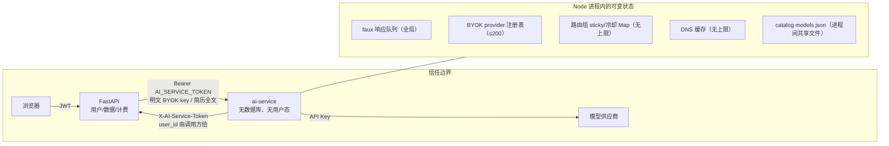
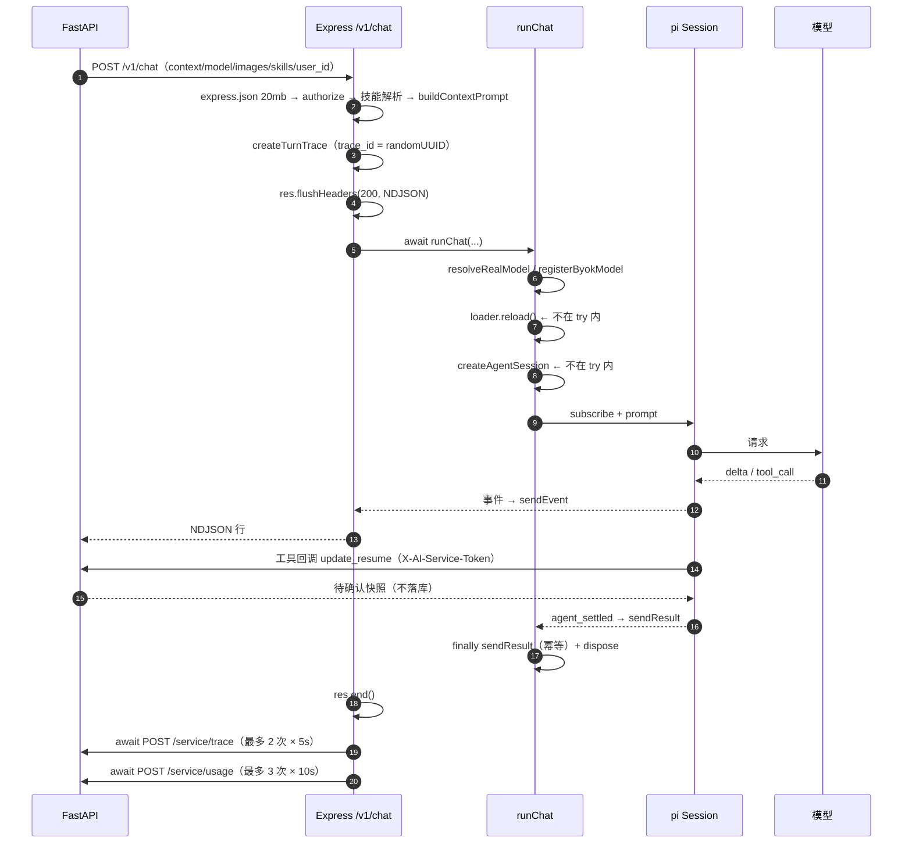
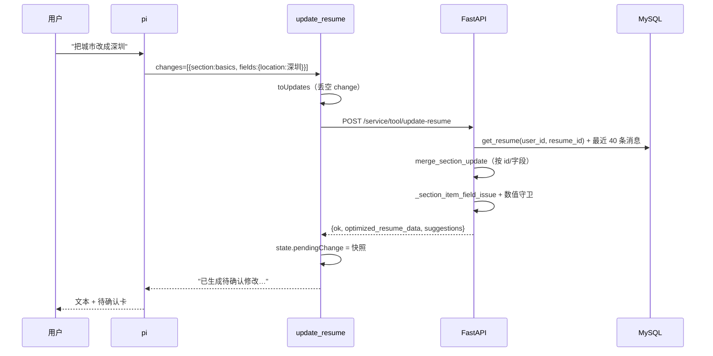
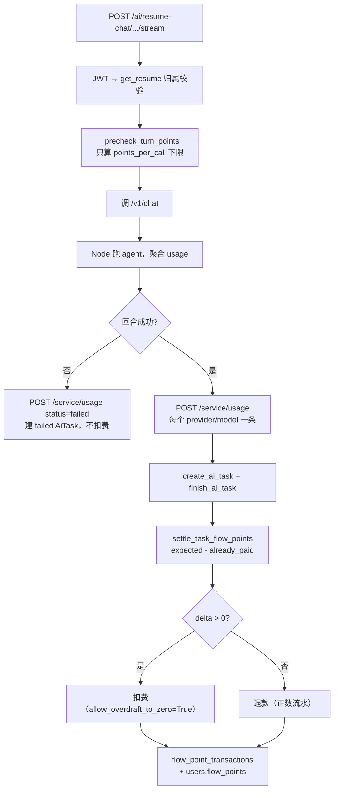

# ResumeFlow AI Service 深度代码审查（Phase 2）

> 审查对象：`ai-service/`（pi-agent 旁路服务）+ 与之耦合的 Python 计费/确认链路。
> 基线：`a8d451c`（2026-11-20），与 `docs/code-review/00-architecture-map.md` 同一提交。
>
> 说明：
> - 仓库中**没有 Phase 1 的 `01-backend-review.md`**（`docs/code-review/` 只有 00）。本报告以 Phase 0 的结论 + 逐行阅读 `backend/app/api/ai.py`、`services/ai_chat_service.py`、`services/flow_points_service.py`、`services/ai_task_service.py` 代替。
> - 只读审查：**未修改任何业务代码**，未连接数据库，未调用真实模型，未运行测试套件。
> - 标注「静态确认」= 代码路径可直接推出；「待验证」= 需要运行时/并发环境才能定性，不在本阶段下结论。
> - 行号会漂移，引用时以函数名为准。

---

## 0. 结论摘要

### 0.1 一句话评价

AI 服务的**职责切分是对的**（Node 只跑 agent，Python 拥有用户/数据/计费，浏览器只认 FastAPI），工具白名单与「待确认才落库」也是本仓库最值得保留的设计。真正的风险不在模型能力，而在**两处边界**：

1. **计费是「事后回调 + 无幂等键」**：一轮对话的扣费完全依赖 Node 在响应结束后的一次 POST；重试、超时、进程退出都可能造成重复扣费或漏计费。
2. **Node 侧的错误出口不完整**：`/v1/chat`、`/v1/task` 的异步 handler 没有 try/catch，Express 4 不会接住 Promise 拒绝；Node 22 默认会把未处理拒绝升级为进程退出。

### 0.2 高优先级发现（详见对应章节）

| ID | 严重度 | 结论 | 证据 |
| --- | --- | --- | --- |
| B1 | **P0** | `/service/usage` 没有幂等键；Node 的网络重试会在「已提交但响应丢失」时重复建任务、重复扣费 | `ai-service/src/billing.ts:47,74`；`backend/app/api/ai.py:1155,1237`；`AiServiceUsageRequest` 无 turn/trace id（`api/ai.py:229`） |
| B2 | **P0** | 透支到 0 时，账本记全额、余额只扣到 0；后续失败退款按账本退，可能「退得比扣得多」 | `flow_points_service.py:319-323,420-430`；`ai_task_service.py:95` |
| B3 | **P1** | 失败退款仍是 ORM 读改写，绕过 P1-3 的原子 UPDATE，并发下会丢更新 | `ai_task_service.py:95` vs `flow_points_service.py:318` |
| B4 | **P1** | 对话只预检 `points_per_call`、不预扣；实际 token 费用在回调时结算，回调丢失即零计费 | `ai_chat_service.py:656`；`api/ai.py:1155` |
| R1 | **P1** | `/v1/chat`、`/v1/task` 的 await 没有 catch；`agent.runChat/runTask` 的 loader/session 创建也在 try 之外。异常会挂住请求或直接杀进程 | `server.ts:607,735`；`agent.ts:333,336` |
| F1 | **P1** | Faux provider 是**进程级单例 + 全局响应队列**，并发请求互相覆盖 programmed response；默认 compose 就是 faux | `faux.ts:182,217-230`；`agent.ts:499`；`docker-compose.yml:87` |
| S1 | **P1** | BYOK 只在保存时做「字面量」URL 校验，对话时 ai-service 直接请求；域名解析到内网/302 跳内网可 SSRF | `schemas/user_ai.py:30`；`user_ai_service.py:293`；`real.ts:143`；`dns-lookup.ts:25` |
| S2 | **P1** | 服务间共享静态令牌拥有跨租户能力：`/service/tool/*`、`/service/usage` 完全信任 payload 里的 `user_id` | `api/ai.py:273,990,1032,1155` |
| L1 | **P1** | `TurnState.pendingChange` 只有一个槽位；模型一轮调用两次 `update_resume` 时，前一次改动被静默丢弃，但模型已被告知成功 | `tools/state.ts:26`；`tools/resume.ts:214`；`agent.ts:303` |
| L2 | **P1** | 「应用」路径直接把 AI 快照写库，没有 `normalize_resume_document`；手动保存与审阅路径都会规范化，三条路径不一致 | `ai_chat_service.py:1610,1664` vs `resume_service.py:126` |
| L3 | **P1** | 只要消息带任意图片附件，数值反幻觉守卫直接整体跳过（`return set()`） | `ai_chat_service.py:1167-1172` |

> P2/P3 共 30 余条列在 §8；12 个指定场景的逐条结论见 §7.9。

---

## 1. AI Service 架构评价

### 1.1 定位与边界



**正确的部分（应保留）**：

- Node 不碰 MySQL/Redis：`package.json` 只有 pi/express/dotenv；所有身份与数据由 Python 注入。
- 工具只产出 `TurnState`，由 `result` 事件回传，FastAPI 落成 `pending` 消息；用户确认才写库。这从结构上排除了「模型直接改数据」。
- 工具回调走独立服务令牌（`api/ai.py:273 require_ai_service_token`），与用户 JWT 分离。
- 任务（生成/导入）用 `tools: []` 的独立 session，模型没有工具通道。
- 流式契约稳定（`start/phase/delta/thinking/tool/result/error`），前端与 Node 解耦。

**结构性问题**：

| # | 观察 | 证据 |
| --- | --- | --- |
| A1 | `server.ts` 869 行、21 个端点，同时承担 chat/task、目录 CRUD、路由组、余额、套餐、远程模型、探活；sidecar 已从「只跑 agent」扩成「AI 运维控制面」 | `ai-service/src/server.ts` |
| A2 | `runChat`（约 350 行）与 `runTask`（约 160 行）都把「资源创建」和「模型执行」放在同一个函数里，前者在 try 之外（见 R1） | `agent.ts:192,553` |
| A3 | 文档与实现严重脱节：`ai-service/README.md` 仍写「Ticket 01 骨架」「零工具白名单 tools: []」「HTTP/SSE」「`/润色 /翻译 /优化 /生成` PromptTemplate」「API Key 只走 $ENV」；实际是 5~6 个工具、NDJSON、六技能、管理台把明文 Key 写进 models.json | `ai-service/README.md:5-19,41-43` vs `agent.ts:345`、`catalog.ts:1-12` |
| A4 | 目录能力缓存失败时 `capability_supports_images` 对未知 ref 返回 **true（宽容）**，与「不支持就明确拒绝」的产品承诺相反 | `ai_config_service.py:312-318` |
| A5 | `AI_MODEL_IO_LOG_*` 三个配置项被 `.env.example` 宣传，但全仓无实现（grep 仅命中 `config.py`） | `core/config.py:98-100` |

### 1.2 模块规模（读到的实际值）

| 文件 | 行数 | 关注点 |
| --- | --- | --- |
| `server.ts` | 869 | HTTP、鉴权、目录、路由组、账单/轨迹编排 |
| `agent.ts` | 715 | pi session 生命周期、事件桥接、工具注册 |
| `catalog.ts` | 460 | models.json 读写、校验、脱敏 |
| `trace.ts` | 356 | L1 轨迹 |
| `prompt.ts` | 178 | 三层提示词拼装 |
| `billing.ts` | 130 | usage 上报（3 次退避） |
| `tools/resume.ts` | 227 | 唯一写工具 |
| `tools/labels.ts` | 201 | 步骤文案/质量摘要 |
| `tools/library.ts` | 175 | 信息库读写回调 |
| `router.ts` | 119 | 路由组 |
| `real.ts` / `faux.ts` | 200 / 238 | provider 运行时 |
| `planusage.ts` | 710 | 套餐用量（未逐行审） |

---

## 2. Agent 生命周期分析

### 2.1 单回合时序（含计费与轨迹的真实顺序）



关键事实：

- **响应先结束，计费后上报**：`res.end()` 在 `reportTrace/reportUsage` 之前（`server.ts:754,772-789`）。用户拿到完整回复时，账还没记。
- **轨迹挡在计费前面**：`reportTrace` 是 `await`，最坏拖 10s 才轮到 usage；如果进程此时被 SIGTERM，计费丢失（§7.6）。
- **result 事件先于计费**：`sendResult` 在 `agent_settled` 或 `finally` 触发（`agent.ts:296,476,524`），usage 聚合在之后。

### 2.2 状态管理

| 状态 | 生命周期 | 是否跨请求 | 风险 |
| --- | --- | --- | --- |
| `TurnState`（pendingChange/Fragments/Questions） | 单回合 | 否 | 单槽位，多次工具调用互相覆盖（L1） |
| pi `SessionManager.inMemory` | 单请求 | 否 | 无持久化；重启即丢，设计如此 |
| `toolTrace` | 单回合 | 随 result 落消息 | 只保留 curated 文案 |
| `faux` 响应队列 | **进程级** | **是** | 并发请求互相踩（F1） |
| `byokRegistry` | 进程级 | 是（仅用于驱逐） | 保存明文 key 的 signature（§6.6） |
| `stickyBySession` / 冷却表 | 进程级 | 是 | 无上限增长（§7.4） |
| `dns` 缓存 | 进程级 | 是 | 无上限、与 SSRF 交互（S1） |
| `models.json` | 文件 | 是（跨实例） | 明文 Key、跨进程写丢更新（§7.8） |

### 2.3 中断机制

| 触发 | 实现 | 结果 |
| --- | --- | --- |
| 客户端断开 | `res.on("close") → controller.abort() → session.abort()`（`server.ts:733`、`agent.ts:375`） | 停止生成；是否上报 usage 取决于是否已产生 `message_end` |
| 回合超时 | `setTimeout(() => session.abort(), AI_TURN_TIMEOUT_MS)`（`agent.ts:502`） | 同上；超时本身不会产生 `error` 事件（§7.3） |
| 工具回调超时 | `AbortSignal.timeout(AI_TOOL_HTTP_TIMEOUT_MS=15s)`（`tools/http.ts`） | 工具返回 infra envelope，模型自行决定继续 |
| 进程重启 | 无 SIGTERM handler | 连接直接断；未上报的计费/轨迹丢失 |

### 2.4 多用户/多会话隔离

- **真实模型模式**：每次请求独立 `createAgentSession`，上下文全部来自请求体，无共享会话；`session_id` 仅用于路由组粘性与轨迹关联。跨用户隔离成立。
- **Faux 模式**：`faux.setResponses()` 是全局队列，`prepare` 在任何请求进入时都会重写它 → **A 用户可能收到 B 用户的回复/工具计划**。默认 `docker compose` 的 `PI_PROVIDER=faux`，所以这不是仅测试环境的问题（F1）。
- **BYOK**：provider id = `byok-<user_id>-<config hash>`，不会串用；但注册表驱逐是全局的（§7.4）。
- **信息库/简历工具**：`user_id`/`resume_id` 由请求注入并硬编码进工具闭包，模型无法通过参数改用户；后端还会按 `user_id` 校验归属（`validate_proposals:699`、`import_fragments:_user_row`）。

---

## 3. Prompt、Skills、Tools 分析

### 3.1 提示词分层

| 层 | 位置 | 内容 | 变更频率 |
| --- | --- | --- | --- |
| 常驻 | `prompt.ts:DEFAULT_SYSTEM_PROMPT` | 身份、唯一写入口、事实底线、信息库、回复风格 | 改代码 |
| 每轮 | `buildContextPrompt`（`prompt.ts:73`） | 字段清单 → 用户偏好 → 本轮技能 → 简历 JSON → 摘要 → 历史 → 待确认 | 每轮 |
| 按需 | `skills.ts` body / `req.body.skills` | 技能做法、用户写作偏好 | 换技能/改设置 |

顺序设计（稳定→易变）是正确的，对供应商前缀缓存友好；测试 `prompt.test.ts` 覆盖章节顺序与空简历文案。

**问题**：

- **没有 token 预算**。`build_ai_service_context`（`ai_chat_service.py:425`）把简历全文 + 最多 `context_limit` 条历史（默认 12，可配到 40）直接拼进 prompt；单条消息上限 8000 字（`schemas/ai_chat.py:19`），最坏 40×8000≈32 万字。没有任何 `estimate_tokens` 预检或裁剪，模型侧直接 context overflow。
- **摘要压缩同样没有预算**：`_COMPACT_MAX_MESSAGES=200`（`ai_chat_service.py:46`），一次最多把 200 条消息塞进 `/v1/task(chat_summary)`（`:522`）。200×8000 字远超多数模型上下文，压缩会稳定失败 → 水位不推进 → 每轮重试、历史继续涨（§7.5）。
- **`system_prompt` 覆盖路径是死代码**：`server.ts:672` 支持请求自带 system prompt，但后端 `ai_service_chat_events` 从不传（grep 无调用方）。它还会完全跳过 `buildContextPrompt`，若未来启用会丢简历上下文。

### 3.2 Skills

- 六个内置技能（`skills.ts:28`）：诊断/JD匹配/重写经历/润色/翻译/开场白；`id` 同时是计费 feature。
- 两条触发路径：`extractSkillCommand`（`/名称`）与模型自行 `use_skill`；两条都落到同一份 body，设计良好。
- 用户技能（`build_skills_payload`，`user_ai_service.py:402`）：后端按总长 8000 字截断，ai-service 再按单条 8000、最多 20 条兜底（`parseSkills`，`prompt.ts:133`）。**边界是软的**：正文只声明「不能覆盖平台规则」，没有结构化隔离；用户技能可写 `# 当前简历` 之类伪章节，模型可能照做。影响限于用户自己的简历，属产品取舍。
- 前后端技能名双份维护（`skills.ts` vs `chatSkills.ts`），无跨端契约测试（Phase 0 已记录）。

### 3.3 Tools

| 工具 | 参数校验 | 权限/归属 | 超时 | 结果去向 |
| --- | --- | --- | --- | --- |
| `update_resume` | TypeBox 粗校验（section 枚举、items/fields 任意对象）→ 后端 `validate_propose_change` 深校验 | 后端 `get_resume(user_id)` + `_section_item_field_issue` | 15s | `pendingChange` |
| `search_library` | TypeBox | 后端按 `(user_id, enabled)` | 15s | 回模型 |
| `save_library` | TypeBox；最多 10 条 | 后端 `validate_proposals` 校验 id 归属 | 15s | `pendingFragments` |
| `ask_user` | TypeBox；≤3 问 | — | — | `askedQuestions` |
| `use_skill` | TypeBox | 只读本地表 | — | 技能正文 |
| `web_search` | TypeBox；count ≤ maxResults | 外部搜索供应商 | 15s | 回模型 + 证据 POST |

**校验层次是清楚的**：工具层只保证「形状能解析」，业务校验在 Python。`_section_item_field_issue`（`ai_chat_service.py:1293`）拒绝列表条目的未知字段；`normalize_resume_document` 再做长度/类型清洗。这一层比多数 Agent 项目扎实。

**但状态设计有硬伤**：`TurnState.pendingChange` 只有一个槽位（`tools/state.ts:26`），`update_resume` 每次成功都直接赋值（`tools/resume.ts:214`）。模型如果按「先改 basics，再改 work」调用两次：

1. 第一次返回「已生成待确认修改 A」，模型据此告诉用户已改 A；
2. 第二次覆盖 `pendingChange` 为 B（后端每次都基于 DB 当前简历合并，不包含 A）；
3. `result` 只带 B，用户点应用只落 B。

同理 `pendingFragments` 被第二次 `save_library` 覆盖，`askedQuestions` 被第二次 `ask_user` 覆盖。这是**静默丢改动**，不是模型幻觉。

### 3.4 Prompt Injection 表面

| 注入源 | 进入位置 | 现有防护 | 影响 |
| --- | --- | --- | --- |
| 用户消息 | user message | 无（本来就是要执行的指令） | 可诱导模型编造事实；数值守卫部分拦截 |
| 简历 JSON | system prompt 的 ```json 块 | 仅代码围栏 | 简历字段含 ``` 可逃逸成指令；用户自己的数据 |
| 历史/摘要 | system prompt `# 最近的对话` / `# 更早的对话摘要` | 无 | **跨轮持久注入**：用户可让模型输出指令，被摘要/历史带回后续回合 |
| 用户技能 | system prompt `# 用户的写作偏好` | 文案声明「不得覆盖平台规则」 | 软约束；可伪造章节 |
| 网页搜索结果 | 工具返回值 | 无 | 恶意页面可让模型引用伪造数字（且数字会被当成"证据"） |
| 上传文件文本（import） | user message | 无 tools | 可改变解析结果；后端只做结构归一化，不校验事实 |
| 模型自身输出 | assistant 消息/历史 | 前端 DOMPurify | XSS 已挡；但会再次进入下一轮 prompt |

**结论**：代码层没有「未授权 Tool 调用」通道——工具集合固定、`user_id` 不可由模型改、工具只产生 pending。Prompt Injection 的实际影响是**内容真实性与跨轮持久化**，不是越权。

---

## 4. 核心业务链路

### 4.1 简历修改



关键函数：`tools/resume.ts:104 createUpdateResumeTool`、`api/ai.py:978 service_update_resume`、`ai_chat_service.py:1464 validate_propose_change`、`:1313 _merge_list_section`。

**正确性**：按 id 合并、未提及条目不动、新条目分配新 id（`_merge_list_section:1360-1371`），能防止模型改乱既有条目编号。未知列表字段被拒。

**缺口**：

- dict 模块（basics/summary/layout）走 `merged_section.update(proposed)`（`:1399`），**不校验字段名/类型/长度**；模型可塞任意键（`layout.foo`、`basics.avatar` 外链），只在最后 `normalize` 时清洗已知字段。
- `removed_ids` 可一次删空一个模块；没有「删除比例」保护。用户确认是唯一闸门。
- 同一轮多次调用丢改动（L1）。

### 4.2 润色 / 4.3 JD 匹配

两者都是「技能正文 + 同一套 update_resume」，后端没有专属逻辑：

- 润色：`skills.ts:72` 要求只改表达；但代码层不校验「数字/专有名词是否保留」，靠模型自觉 + 数值守卫。
- JD 匹配：`skills.ts:44` 要求「缺口不写」；代码层不校验新增内容是否有证据（只拦数字）。模型可以把 JD 要求改写成「已具备」的非数字描述，守卫拦不住。
- 前端 `useResumeChatStream.ts:217,299` 仍以 `content.startsWith("/JD优化")` 触发「另存为 JD 优化简历」，但 `skills.ts` 里没有 `JD优化` 这个技能名（只有 `JD匹配`）。`/JD优化` 会被当成普通文本发送，`jdOptimizeArmed` 仍会置位——流程能跑但语义错位（P3）。

### 4.4 简历生成

- `POST /api/ai/generate-resume/stream` → `new_task`（`api/ai.py:301`，预扣 100 点）→ `/v1/task`。
- `runTask`（`agent.ts:553`）：`tools: []`，`thinkingLevel:"off"`，单轮 JSON；解析失败用一次「有界重生成」（`:674-689`）。
- 结果由后端 `normalize_resume_data` + 前端 `createResumeFromAi` 建简历；**生成任务不经过用户确认**（用户主动发起，合理）。

风险：`GenerateResumeRequest` 的 `personal_info/projects/work` 等字段没有长度上限（`schemas/ai.py:6-19`），超长输入会直接进 prompt；预扣固定 100 点，实际 token 成本不封顶。

### 4.5 中英文翻译

- 走对话技能 `translate`（`skills.ts:85`）：要求逐模块翻译、保留 id/顺序/富文本标签、同时提交 `layout.section_titles`、一次 `update_resume`。
- 后端没有任何「翻译专用」校验：不校验条目数量/ id 集合是否与原文一致，不校验 HTML 标签是否保留；模型可以合并/拆分条目、丢 highlights，仍会生成 pending 快照。
- **`resumes.language` 不会被 AI 翻译更新**：`resolve_chat_change` 只在 `_normalize_keeping_section_titles` 里用 `{"language": resume.language}` 做归一化（`ai_chat_service.py:1662`），没有写 `resume.language`。前端另有手动切语言入口会重写 `section_titles`，两条路径叠加可能覆盖译好的标题。
- 计费按 `ai_chat` + `feature="translate"`；`/ai/histories` 只认旧的 `resume_translate`，所以「翻译历史」标签页拿不到新翻译回合（Phase 0 已记录）。

**结论**：翻译是「提示词约束 + 用户确认」，不是「结构校验」。对一份 20 条经历的简历，模型完全可能合并同类项；用户在 diff 里能看出来，但没有自动拦截。

### 4.6 多轮对话与摘要

- 上下文 = 简历全文 + 字段清单 + 摘要 + 最近 N 条 + 待确认摘要；`session_id` 隔离会话，`summary_message_id` 做增量压缩水位。
- 压缩在回合结束后以 `asyncio.create_task` 后台跑（`ai_chat_service.py:571-580`），不阻塞回复；失败只落 failed 任务行，水位不推进（下一轮重试）。
- 风险：无 token 预算（§3.1）；同一会话两个回合同时触发压缩会重复压缩同一段（`_compact_chat_context` 读-算-写无锁）；摘要本身可被注入（跨轮持久）。

### 4.7 工具调用 / 4.8 结果返回

- 工具失败返回统一 envelope（`ok/category/retryable/reason`），`categoryGuidance` 告诉模型「validation 可改参重试 / business 不要原样重试 / infra 告知用户」（`tools/http.ts`）。这是很好的设计。
- `result` 事件携带 `assistant_message` 骨架、`timing`、`pending_change`、`pending_info_fragments`、`pending_questions`、`tool_trace`（`agent.ts:296-316`）。
- 后端用数据库行替换 `assistant_message`（`ai_chat_service.py:804`），MySQL 是消息事实源。
- 流中断时：只要没收到 `result`，后端不会写 assistant 消息；用户消息保留；无计费。前端 `postAiStream` 抛「AI 未返回有效结果」。

### 4.9 Diff 与 4.10 用户确认

- Diff 完全在前端（`utils/aiDiff.ts`）；后端只提供 `optimized_resume_data`。
- 确认 `POST .../decision` → `resolve_chat_change`（`ai_chat_service.py:1626`）：
  - 先 `apply_proposals`（信息库，内部 `create_fragment` 会 `commit`）；
  - 再写 `ResumeVersion`（改动前快照，`source=ai`）；
  - 写 `resume.resume_data`，`flush + expire + 回读比对`，不一致 409；
  - 置 `applied`。
- **风险**（详见 §8）：
  - 没有 `SELECT ... FOR UPDATE`：并发 apply/reject 可同时通过 `action_status=pending` 检查；
  - 允许多条 pending 并存，应用旧快照会整体覆盖新编辑（`_persist_resume_change` 是整包写）；
  - 「应用」路径不 normalize（L2）；
  - 审阅模式提交 `merged_resume_data` 只做 `_normalize_keeping_section_titles`，不重跑字段/数值校验（L5）。

---

## 5. Flow Points 计费专项审计

### 5.1 全链路



### 5.2 计价口径

- 公式：`points_per_call + 输入token×输入单价/百万 + 输出token×输出单价/百万`（`flow_points_service.py:203-248`）。
- 模型级 override **逐键**覆盖（`:217-224`），缺省回落 `flow_point_rules`。
- 默认：生成 100/次、导入 50/次、对话 5/次 + 1000 点/百万 token（`DEFAULT_POINT_RULES:35`）。

**口径问题**：

1. `AiServiceUsageEntry.requests`（`api/ai.py:170`）被记录但**不参与计价**。一轮里模型因工具回调产生多次 LLM 调用时，`points_per_call` 只收一次。若产品定义是「每次模型调用收 5 点」，这是系统性少收；若是「每轮收 5 点」，则 `requests` 字段无意义。文档没有写清。
2. 模型级 override 只包含 `points_per_call / per_million_input / per_million_output`；如果运营把输入/输出单价都设为 **0** 想只按次收费，`calculate_points` 会因为 `(input_rate or output_rate)` 为假而落到旧的 `points_per_million_tokens`（默认 1000），**仍然按 token 收费**（`:234-247`）。这是配置语义陷阱。
3. `cache_read_tokens/cache_write_tokens` 只记录不计价；若上游把缓存 token 算进 `input`，会按全价收；若不计入，则缓存部分免费。口径未定义。

### 5.3 余额与并发

- 扣减是原子条件 UPDATE（`flow_points_service.py:318-333`，P1-3 修复），**余额不会变负数**：透支模式用 `CASE WHEN flow_points + delta < 0 THEN 0` 钳到 0。
- 但「钳到 0」与账本不一致（B2）：`add_point_transaction` 写入的 `points_delta` 是**应扣全额**，`balance_after` 是 0。例：余额 10，应付 500 → 余额 0，流水 `-500`，用户实际只损失 10。
- 并发两轮：各自原子扣减，不会互相覆盖余额；但两轮都可能透支出同一笔「未支付差额」，平台承担。
- 退款路径反向操作（B3）：`_refund_failed_task_points` 直接 `user.flow_points = user.flow_points + refund`（`ai_task_service.py:95`），与原子 UPDATE 不是同一套；并发扣费时可能把别人刚扣的余额覆盖回去。

### 5.4 幂等性

| 场景 | 结果 | 证据 |
| --- | --- | --- |
| Node 上报超时后重试 | **可能重复扣费**：第一次已 commit 但响应丢失 → 第二次新建 task 再结算 | `billing.ts:74-130`；`api/ai.py:1208-1247` |
| 用户双击发送 | 两次请求 = 两次模型调用 = 两次扣费；前端 `loading` 只能挡住大部分 | `useResumeChatStream.ts:193`；后端无去重 |
| 重复点「应用」 | 第二次因 `action_status != pending` 返回 409；并发两个请求可能都通过检查（§8 L6） | `ai_chat_service.py:1642` |
| 重复点「重新生成」 | 每次重新执行、重新计费；会删掉目标消息之后的所有消息 | `_regenerate_turn:1011` |
| 导入/生成重复提交 | 每次新建 task；生成预扣后再结算，导入只结算 | `api/ai.py:301`；`resumes.py:148` |
| 兑换码重复 | 唯一约束 `(code_id,user_id)` + `with_for_update` + IntegrityError 捕获，**安全** | `flow_points_service.py:525,560-564` |

**结论：当前计费不具备幂等性。** 唯一具备幂等键的是轨迹（`trace_id`，`ai_agent_traces.trace_id` 唯一 + upsert），而计费没有复用这个键，是明显的落差。

### 5.5 退款

| 场景 | 行为 | 评价 |
| --- | --- | --- |
| AI 回合失败（有 `status=failed` 上报） | 建 failed task，不扣费；生成的预扣由 `_refund_failed_task_points` 退（导入无预扣） | 正常 |
| AI 超时 | 同上（若 Node 判定 failed 且非客户端 abort） | 正常 |
| 用户取消 | Node 跳过失败上报；若已产生 usage 且成功路径，仍会计费 | 半正常：消耗了 token，但用户没拿到完整结果 |
| 回调丢失 | 不扣费（平台承担） | 反向资损 |
| 结算失败（规则缺失等 AppException） | catch 后 task failed、返回 HTTP 200、`billed=false` | Node 视为成功，不重试；静默漏计费（B7） |
| 重复退款 | 按流水净额判断，第二次净额为 0 → 不再退 | 安全 |
| 透支后退款 | 按账本全额退，可能 > 实际扣款（B2） | 资损 |

### 5.6 账务一致性

| 断言 | 结论 |
| --- | --- |
| `flow_point_transactions` 之和 == 余额变化 | **不成立**（透支场景） |
| `ai_tasks.points_used` == 实际扣款 | **不成立**（同上：记 expected，不是实扣） |
| 每条余额变化都有流水 | 基本成立：充值/兑换/扣费/退款/管理员调整都走 `add_point_transaction`；但退款绕过了原子函数 |
| 能按回合审计 | **不能**：`ai_tasks` 没有 `turn_id/trace_id`，`flow_point_transactions` 没有 trace 关联；只能按 user/time 猜 |
| 使用记录与扣费一致 | 成功回合基本一致；失败/漏报/重复上报不一致 |
| 兑换码并发安全 | 是（行锁 + 唯一约束 + IP 检查） |

### 5.7 可审计性

- 余额变化都有 `FlowPointTransaction`（user/task/feature/delta/balance_after/description/time），可追溯。
- 但缺少三类关联键：`trace_id`（回合）、`message_id`（对话消息）、`request_id`（上报批次）。出现「用户说被多扣」时，只能按时间窗口比对 `ai_tasks` 与流水，无法精确对到某一轮。
- `RECONCILE` 日志只在 Node stdout，没有落库/告警；进程重启即丢。

### 5.8 计费结论

> **原子性：部分具备**（扣减原子，退款不原子）。
> **幂等性：不具备**（usage 上报无幂等键）。
> **可追溯性：账本级具备，回合级不具备**（缺 trace/turn 关联）。

---

## 6. 安全审计

### 6.1 租户隔离

| 面 | 结论 |
| --- | --- |
| 真实模型对话上下文 | 隔离（每次请求独立 session，上下文来自该 user/resume） |
| 工具读写 | 隔离（闭包硬编码 user/resume；后端二次校验归属） |
| Faux 模式 | **不隔离**（全局响应队列，F1） |
| BYOK | 隔离（provider id 含 user）；但注册表驱逐全局 |
| 路由组 sticky | 按 DB `session_id`，不跨用户 |
| 搜索证据 | 按 `(user_id, resume_id)`，但**进程内内存**（多 worker 失效） |

### 6.2 未授权 Tool 调用

- 工具集合固定（`agent.ts:345`），没有 bash/read/write；`noContextFiles/noSkills` 关闭 pi 的文件发现。
- 模型无法通过参数改 `user_id`；`update_resume` 只产生 pending。
- **但共享服务令牌可以**：`/service/tool/update-resume`、`/service/tool/get-resume-context`、`/service/tool/info-fragments/search` 都直接读 payload 里的 `user_id`，只校验 `X-AI-Service-Token`（`api/ai.py:273`）。令牌一旦泄露（日志、镜像、环境变量、内网嗅探），攻击者可读取任意用户简历、写入任意用户 pending、给任意用户记账。
- 服务间是明文 HTTP（默认 `AI_SERVICE_URL=http://...`），BYOK 明文 key 在请求体里传输；同宿主机/同 Docker 网络外，属于敏感数据裸奔。

### 6.3 SSRF（BYOK）

**确认的校验落差**：

1. 保存模型：`UserAiCredentialIn.base_url` 只过 `literal_public_url`（`schemas/user_ai.py:30`），**不做 DNS 解析**。`literal_public_url` 的 docstring 明说「域名：DNS 解析交给 probe_public_url，避免每次对话都做一次网络查询」（`url_guard.py:62`）。
2. 对话时：`resolve_model_override` 仍只用 `literal_public_url`（`user_ai_service.py:293`），把 `base_url` 原样传给 ai-service。
3. ai-service：`registerByokModel` 只检查 `^https?://`（`real.ts:143`），随后由 pi/fetch 发起请求；`fetch` 默认跟随 302。`probe_public_url` 只在「测试连接 / 拉模型列表」时调用。
4. 全局 DNS 缓存（`dns-lookup.ts:25-62`）会把解析结果缓存 5 分钟，进一步放大「先公网、后改解析」的窗口。

**攻击路径**：用户保存 `https://attacker.example`（当时解析公网）→ 把 DNS 改成 `127.0.0.1`/`169.254.169.254` → 发一条对话 → ai-service 以 `Authorization: Bearer <用户key>` POST 到内网 `/chat/completions`。可探测内网、读云元数据（部分云对任意路径返回凭证）、把内网响应经错误信息回显给用户。

**同类问题**：管理后台 `/ai-catalog/remote-models` 直接用管理员填的 `base_url` 调 ai-service，没有 `probe_public_url`（`admin/ai_configs.py:536`）；`probe/balance/plan-usage` 也接受目录里的任意 http(s)（`catalog.ts:310`）。管理员权限降低了严重度，但仍是 SSRF 面。

### 6.4 System Prompt / API Key 泄露

- System prompt 含当前用户简历，模型可被要求复述；这是用户自己的数据，不是跨租户泄露。没有「禁止复述系统提示词」的硬约束。
- 平台模型 Key 在 `models.json` 明文（`catalog.ts:1-12` 自述），文件默认权限、容器 root、volume 挂载；任何能读 volume 的进程都可读。
- BYOK key：DB 里 Fernet 密文；运行时明文只在 FastAPI→Node 请求体、Node 内存、`byokRegistry` 的 `signature` 字符串（`real.ts:153,190`）。**`byokRegistry` 的 value 包含 `baseUrl|model|apiKey|effort`，即明文 Key 会在内存里至少留到被驱逐（最多 200 条）**。
- `maskApiKey` 对 9 位 key 显示前 3 + 后 4（`catalog.ts:222-227`），泄露比例偏高（仅管理台可见）。
- `balance.ts:295` 把 API key 拼进 URL（部分厂商），可能进入上游/代理访问日志。

### 6.5 服务令牌与限流

- 所有 `/v1/*`（除 `/health`）都要令牌，`timingSafeEqual` 比较，fail-closed；这点做得好。
- **没有限流**：`/v1/chat`、`/v1/catalog`、`/service/*` 都没有速率限制；`express.json({limit:"20mb"})` 在 `authorize` 之前执行（`server.ts:56,609`），未认证请求也能让进程解析 20MB JSON。
- ai-service 端口在 compose 中发布到宿主机（`8300:8300`），不是纯内网。
- `AI_SERVICE_TOKEN` 是单值共享、无过期、无轮换机制；`/service/usage` 可被用来给任意 `user_id` 记账。

### 6.6 其他

| 项 | 结论 |
| --- | --- |
| 任意代码执行 | 未发现：无 bash/read/write 工具，无 eval，无动态 import 用户内容 |
| 文件访问 | Node 只读 `.pi-agent`；无用户可控路径拼接（`catalogPath` 固定） |
| URL 访问 | BYOK/管理台 SSRF（§6.3）；PDF 外链在 Python 侧另有守卫 |
| 外部模型响应 | 不可信：HTML 由前端 DOMPurify + 后端 bleach 双重清理；工具参数由 Python 校验；但「非数字事实」没有校验 |
| 前端渲染 | `renderMarkdown` = markdown-it + DOMPurify；简历富文本走 bleach 白名单（`rich_text_service.py`），`|safe` 前已过滤 |

---

## 7. 并发与稳定性

### 7.1 未捕获的异步异常（R1）

`server.ts` 的两个核心 handler 都是 `async` 且**没有 try/catch**：

```ts
app.post("/v1/chat", async (req, res) => {
  ...
  res.flushHeaders();                 // 200 已发出
  const outcome = await runChat(...); // 若 reject，Express 4 不接
  res.end();
});
```

`runChat` 里 `await loader.reload()`（`agent.ts:333`）与 `await createAgentSession(...)`（`:336`）在 `try` 之外。`resolveGroupRef` 里的 `readCatalog` 也可能抛 `CatalogError`（`server.ts:151-157`）。

Express 4 不会捕获 async handler 的 rejection；Node 22 默认 `--unhandled-rejections=throw`。后果二选一：

- 请求已 flush 头：客户端拿到 200 + 永不结束的流，FastAPI 侧 `httpx` 读 180s 后超时；
- 发生在 flush 前：进程未处理拒绝 → **整个 ai-service 退出**，所有进行中的对话一起断。

`/v1/task` 同构（`server.ts:819`、`runTask` 的 `loader.reload` 在 `agent.ts:580`）。

### 7.2 Faux 全局队列（F1）

```ts
const faux = registerFauxProvider();          // 进程级单例
...
prepare: (systemPrompt, message, plan) => {
  faux.setResponses([...]);                   // 覆盖全局队列
}
```

`runChat` 在 `session.prompt` 前调用 `runtime.prepare`（`agent.ts:499-501`）。两个并发请求 A/B：

1. A `setResponses([A 的回复])`；
2. B `setResponses([B 的回复])`；
3. A 的 session 消费到 B 的回复；B 可能拿到 A 的工具计划/空队列。

影响：默认 compose（`PI_PROVIDER=faux`）下，**演示/试用环境会串用户内容**；e2e 测试并发跑也会互相污染。真实模型模式不经过 faux，不存在此问题。

### 7.3 超时层级

| 层 | 值 | 位置 |
| --- | --- | --- |
| 模型回合 | `AI_TURN_TIMEOUT_MS`（compose 300000；config 默认 60000） | `agent.ts:502`、`config.ts` |
| FastAPI→Node 读 | 180s | `ai_service_client.py:45-47` |
| 工具回调 | 15s | `tools/http.ts` |
| Nginx | 360s | `frontend/nginx.conf` |

**FastAPI 的 180s 比模型回合的 300s 短**：推理模型长时间不吐 token 时，后端先断流，Node 收到 close → abort → 该轮被判失败/中断，用户看到「AI 对话处理失败」，但模型可能仍在计费。三层没有统一预算。

**超时/中止不可区分**：`session.abort()` 后 `prompt` 可能正常 resolve，`sawError` 为 false；`usage.ts:51` 只跳过 `stopReason==="error"`，被中止/被 max_tokens 截断的调用仍计入 usage；`finally` 无条件 `sendResult`。结果：**半截回复可能被当成完整成功，并按已消耗 token 计费**。是否真的 resolve 取决于 pi 行为，需运行时验证（§9）。

### 7.4 内存与泄漏

| 结构 | 上限 | 结论 |
| --- | --- | --- |
| `stickyBySession`（`router.ts:29`） | 无 | 每个会话一条，永不过期（只在读时判断 TTL），长期运行持续增长 |
| `dns` cache（`dns-lookup.ts:25`） | 无 | 过期条目从不删除；BYOK 可制造大量唯一域名 |
| `byokRegistry`（`real.ts:128`） | 200 | 有界；但 value 含明文 key；驱逐会 `unregisterProvider` 可能影响在飞回合 |
| `memberFailureUntil`/`memberUsageCount`/`rotateCursor` | 由模型/组数决定 | 有界 |
| `search_evidence`（Python） | 每 key 50 条，key 无上限 | 多用户长期运行增长 |
| `ai_agent_traces` / `ai_chat_messages` | 无保留策略 | 持续增长（含全量简历快照） |

BYOK 驱逐的具体风险：`registerByokModel` 在 `byokRegistry.size >= 200` 时 unregister 最旧的 provider（`real.ts:160-165`）。如果那正是某个正在多轮工具调用的会话，下一轮 LLM 调用会找不到 provider，回合中途失败。

### 7.5 长上下文

- 对话：40 条 × 8000 字 + 简历全文，无预算（§3.1）。
- 摘要：200 条 × 8000 字（§3.1），压缩任务本身会超上下文；失败后水位不推进，每轮重试。
- 生成/导入：输入字段无长度上限（生成）；导入文本后端截断 30k（`resume_import_service`）。
- 消息列表：`/ai/resume-chat/{id}/messages` 返回最多 80 条，每条含完整 `optimized_resume_data` 快照；一份 100KB 的简历 × 多条 pending = 数 MB 响应。
- 助手回复没有长度上限：`_save_assistant_message` 把 `reply` 原样写入 `ai_chat_messages.content`（MySQL `TEXT`，64KB 字节）。超长翻译/长回复在 strict mode 下会保存失败，但用户已经收到完整流式内容。

### 7.6 重启与恢复

- 服务无状态（session 在内存、请求级），重启后新请求正常。
- 进行中的回合：连接断，FastAPI 收到 httpx 错误 → `error` 事件；生成任务 finally 标 failed + 退款；对话无 charge（若 usage 未上报）。
- 已产生的 pending：在 `ai_chat_messages` 里，重启不影响确认。
- **计费窗口**：`res.end()` 后、`reportUsage` 前若进程被 SIGTERM（Docker 默认 10s 宽限），该轮不记账；没有持久化队列/重放。
- 没有 SIGTERM handler：不等待在飞请求，直接退出。

### 7.7 健康检查

`/health` 只返回 `{status:"ok"}`（`server.ts:112`），不检查 models.json 是否可读、是否有可用模型、目录是否合法。compose 会把它标成 healthy，后端继续接流量，用户侧才看到「模型不可用」。

### 7.8 水平扩展

| 组件 | 多实例行为 |
| --- | --- |
| 对话 | 无状态，可扩 |
| 路由组 sticky/冷却 | 每实例独立，切实例会换成员（缓存命中率下降） |
| BYOK | 每请求注册，无状态；驱逐表独立 |
| faux | 每实例独立队列，仍会实例内串 |
| models.json 写 | 每实例独立 mutex，跨进程无锁；并发写会丢更新（tmp+rename 只防半文件，不防 lost update） |
| DNS 缓存 | 独立 |

### 7.9 12 个重点场景结论

| # | 场景 | 结论 | 依据 |
| --- | --- | --- | --- |
| 1 | 两个 AI 请求同时扣费 | 余额不变负；两次都可能透支，账本各记全额，实际只扣到 0 | B2、`_apply_balance_delta` |
| 2 | AI 成功但响应丢失 | 若 Node 已上报：照扣；若进程在 `res.end` 后退出：漏扣。两种都没有回执/对账 | §5.4、§7.6 |
| 3 | AI 失败但已扣费 | 常规失败不扣；生成/导入预扣会退；退款直接写余额，并发可能丢更新/多退 | B2、B3 |
| 4 | 重复提交同一消息 | 两次模型调用、两次扣费；无幂等键；前端只能弱挡 | §5.4 |
| 5 | 中途取消 | abort 停止生成；若已产生 usage 且按成功路径收尾，仍计费；无「取消退款」概念 | §2.3、§7.3 |
| 6 | Tool 成功但后续失败 | 若未产出 result：pending 丢弃、不扣费；若已 result：pending 落库，后续失败不影响 | §4.7 |
| 7 | AI 输出结构不合法 | 对话：纯文本也接受；任务：一次修复重试，仍失败则 error+退款；apply 不 normalize | L2、`runTask:674` |
| 8 | Agent 长时间不返回 | 后端 180s 先断，早于 300s 回合超时；表现为 error/半截，可能已计费 | §7.3 |
| 9 | 多用户同时对话 | 真实模式隔离；faux 模式串内容 | F1 |
| 10 | 同一用户多会话并发 | 上下文按 session 隔离；同 session 并发会各写一条 assistant、各扣一次；summary 压缩可能重复 | §4.6、§5.4 |
| 11 | Prompt Injection 调未授权 Tool | 无越权通道；影响是伪造非数字事实、跨轮持久注入、搜索证据污染 | §3.4、§6.2 |
| 12 | 结果未确认时重启 | pending 已落库则安全；仅存在 Node 内存/未 result 则丢；重启不影响已确认数据 | §7.6 |

---

## 8. 已确认问题清单

> 「静态确认」= 代码路径可直接推出；严重度按「资损/越权 > 可用性 > 数据质量 > 体验」。

### 8.1 P0（资损/多扣）

| ID | 问题 | 证据 | 影响 |
| --- | --- | --- | --- |
| B1 | usage 上报无幂等键，网络重试可重复建任务/重复扣费 | `billing.ts:47,74`；`api/ai.py:229-240,1208-1247` | 用户被多扣；账本出现重复流水；无法自动对账 |
| B2 | 透支记账：账本全额、余额钳 0；退款按账本 | `flow_points_service.py:319-323,420-430`；`ai_task_service.py:95` | 账实不符；退款可能「退得比扣得多」 |

### 8.2 P1（高）

| ID | 问题 | 证据 | 影响 |
| --- | --- | --- | --- |
| B3 | 退款是 ORM 读改写，非原子 | `ai_task_service.py:95` | 并发退款/扣费互相覆盖 |
| B4 | 对话只预检、不预扣，回调丢失即零计费 | `ai_chat_service.py:656`；`api/ai.py:1155` | 高 token 回合可免费；平台成本失控 |
| B7 | 结算失败仍返回 200 + `billed:false`，Node 视为成功 | `api/ai.py:1252-1268`；`billing.ts:97` | 静默漏计费 |
| R1 | `/v1/chat`、`/v1/task` 异步异常未捕获 | `server.ts:607,735,819`；`agent.ts:333,336,580` | 请求挂 180s 或进程退出 |
| F1 | Faux 全局响应队列 | `faux.ts:182,217-230`；`docker-compose.yml:87` | 默认部署串用户内容/工具计划 |
| S1 | BYOK SSRF（仅字面量校验 + 跟随重定向） | `schemas/user_ai.py:30`；`user_ai_service.py:293`；`real.ts:143` | 内网探测/云元数据读取 |
| S2 | 共享静态令牌可跨租户读写/记账 | `api/ai.py:273,990,1032,1155` | 令牌泄露 = 全量用户数据 + 计费被操纵 |
| L1 | `pendingChange` 单槽位，多次工具调用丢改动 | `tools/state.ts:26`；`tools/resume.ts:214` | 用户看到「改了 A/B」，实际只应用 B |
| L2 | 应用路径不规范化 | `ai_chat_service.py:1610`；`resume_service.py:126` | malformed resume_data 落库，预览/导出异常 |
| L3 | 带图片即跳过数值守卫 | `ai_chat_service.py:1167-1172` | 任意伪造数字可通过（产品诚信） |

### 8.3 P2（中）

| ID | 问题 | 证据 | 影响 |
| --- | --- | --- | --- |
| B5 | `requests` 不参与计价 | `api/ai.py:170`；`flow_points_service.py:203` | 多轮工具调用少收/口径不明 |
| B6 | 输入/输出单价显式 0 仍按 token 收费 | `flow_points_service.py:234-247` | 运营配置失效 |
| B8 | 轨迹上报阻塞计费 | `server.ts:772-785` | 计费延迟/重启丢失窗口 |
| R2 | 早退路径不 dispose session | `agent.ts:361-366,594-597` | 资源泄漏（fallback 场景） |
| R3 | 超时/中止/截断按成功收尾并计费（取决于 pi 的 abort 语义，待验证） | `agent.ts:502,524`；`usage.ts:51` | 半截回复被当完整，仍扣费 |
| R4 | 9×5MB 附件 vs 20MB body | `AiComposer.vue:65`；`storage_service.py:20`；`server.ts:56` | 2~3 张大图即 413 |
| R5 | 摘要压缩 200 条无预算 | `ai_chat_service.py:46,522` | 长会话压缩失败、每轮重试 |
| R7 | 助手回复不截断，可能超出 MySQL `TEXT`（64KB） | `ai_chat_service.py:402`；`models/ai_chat.py:86` | 长翻译/长回复保存失败，用户已看到内容却无消息行 |
| R6 | 无速率限制，body 解析先于鉴权 | `server.ts:56,609` | 未认证 20MB 请求可打满 CPU/内存 |
| L4 | 翻译不校验结构、不同步 language | `skills.ts:85`；`ai_chat_service.py:1662` | 条目合并/标题回退/语言列不一致 |
| L5 | 审阅提交绕过字段/数值校验 | `ai_chat_service.py:1659-1665` | 可写入未经守卫的内容 |
| L6 | 并发 apply/reject 无锁；旧 pending 可覆盖新编辑 | `ai_chat_service.py:1642,1610` | 双写版本、覆盖手工编辑 |
| S3 | 轨迹 error 可能持久化 prompt/PII | `trace.ts:284`；`api/ai.py:1303-1311` | 违反 L1「无 PII」承诺 |
| S4 | 目录明文 Key + 临时文件 + root 容器 | `catalog.ts:1-12,209`；`Dockerfile` | 宿主机/备份泄露面 |
| P1 | `stickyBySession`/DNS 缓存无上限 | `router.ts:29`；`dns-lookup.ts:25` | 长运行内存增长 |
| P2 | BYOK 驱逐可能打断在飞回合 | `real.ts:160-165` | 多用户高频换配置时偶发失败 |
| D1 | `ai-service/README.md` 大面积过时；前端帮助中心/后台标签仍用 `/JD优化`、`optimize`、`generate` 等已不存在的 feature | README；`HelpCenter.vue:96`；`utils/adminFormat.ts:137` | 误导运维与新人 |
| C1 | 目录跨进程写无锁 | `catalog.ts:191-217` | 多副本丢更新 |
| C2 | 无 graceful shutdown | `server.ts:859-869` | 在飞请求/计费丢失 |

### 8.4 P3（低/体验）

| ID | 问题 | 证据 |
| --- | --- | --- |
| L7 | 无模型配置时图片守卫失效；能力未知返回 true | `ai_chat_service.py:651`；`ai_config_service.py:312` |
| L8 | `ask_user` 不真正结束回合，可能同时产出问题+改动 | `tools/questions.ts` |
| L9 | 空回复也会保存为成功 assistant 消息 | `agent.ts:296` |
| L10 | 前端仍宣传 `/JD优化`、`/生成`，技能表无这两个名字；`jdOptimizeArmed` 只按 `/JD优化` 前缀置位 | `useResumeChatStream.ts:217`；`HelpCenter.vue:96`；`skills.ts:28` |
| D2 | `system_prompt` 覆盖路径无人调用 | `server.ts:672`；`ai_service_client.py:91` |
| D3 | `AI_MODEL_IO_LOG_*` 配置未实现 | `core/config.py:98-100` |
| S5 | `balance.ts` 把 key 放 URL | `balance.ts:295` |
| S6 | 管理台远程模型接口无 DNS 校验 | `admin/ai_configs.py:536` |
| B9 | 导入路径不预扣（文档说预扣） | `resumes.py:148` vs `docs/ai/ai-call-flows.md` §3.2 |
| B10 | 用户选的模型不可用时静默回退到平台默认/首个可用模型，并按实际模型计费 | `ai_chat_service.py:605-609`；`real.ts:44-50` |
| B11 | BYOK 解密失败/被停用时静默回退平台模型，用户以为在用自带额度却被扣平台点数 | `ai_chat_service.py:612-629`；`user_ai_service.py:293` |

---

## 9. 待验证风险

以下需要真实模型/并发/多进程环境，本阶段只记录假设与验证方法：

1. **中止后的 usage 语义**：`session.abort()` 后 pi 是否仍发 `message_end.usage`、`prompt` 是否 resolve。验证：本地 fake stream 注入延迟，客户端 2s 断开，观察 `/service/usage` 是否收到。
2. **超时是否被判 success**：将 `AI_TURN_TIMEOUT_MS=1000`，让模型慢响应，观察 result/usage。若 result 成功 → R3 坐实。
3. **Faux 并发串话**：并发 2 个 `/v1/chat`（faux），断言回复分别包含各自 message；当前代码预期会串。
4. **usage 重复上报**：构造 FastAPI 在 commit 后断开响应（或代理丢弃响应），观察 Node 重试是否生成两条 `ai_tasks`。
5. **透支退款**：余额 10、模拟 expected 500 的 usage，再让任务失败，检查退款是否 500、余额是否变为 500。
6. **并发 apply/reject**：同一 pending 消息并发 POST decision，观察 `resume_versions` 行数与最终 `action_status`。
7. **BYOK DNS rebinding**：保存公网域名 → 改 hosts/内网 DNS → 发对话，确认请求落到内网。
8. **多 worker 行为**：`uvicorn --workers 4` 下搜索证据是否只在单进程可见；ai-service 多副本下 models.json 并发写是否丢模型。
9. **pi 上下文自动压缩**：长会话是否由 pi 自行裁剪，还是直接报 context overflow（决定 R5 的实际影响）。
10. **`models.json` 无 Key 时的启动**：`ModelRuntime.create` 是否联网/是否可用；`/health` 仍 ok 的窗口有多长。

---

## 10. 修复建议

### 10.1 P0（先止血，改动小、收益大）

1. **给 usage 上报加幂等键**
   - `TurnTracePayload.trace_id` 已有（`trace.ts:228`）。把它随 `reportUsage` 一起发送，`AiServiceUsageRequest` 增加 `trace_id`；
   - 后端新增 `usage_reports(trace_id, model_ref, ...)` 唯一键，或给 `ai_tasks` 加 `(source, trace_id, model_ref)` 唯一索引；
   - `report_ai_service_usage` 先 `INSERT ... ON DUPLICATE KEY`/捕获 IntegrityError，命中即返回已存在结果，不重复结算。
2. **修正透支记账**
   - 方案 A：`add_point_transaction` 记录「实际扣减额」而不是「应扣额」，另存 `unpaid_amount`；退款只退实际扣减。
   - 方案 B：不允许透支，余额不足时按剩余额度部分收费并标记 `unpaid`，后续补扣；至少让 `sum(points_delta)` 与余额变化一致。
   - 无论哪种，`task.points_used` 应等于实际扣减额，而不是 expected。
3. **退款改用原子加减**
   - `_refund_failed_task_points` 复用 `_apply_balance_delta`（正 delta），不要直接赋值 `user.flow_points`。

### 10.2 P1（可靠性/安全/数据）

4. **给两个 async handler 包 try/catch + 统一错误事件**
   - `server.ts` 的 `/v1/chat`、`/v1/task` 外层 try：已 flush 头则 `sendEvent({type:"error"}) + res.end()`；未 flush 则 500 JSON。
   - `agent.ts` 把 `loader.reload()`、`createAgentSession()` 移入 try，或在 `runChat/runTask` 外层包 catch，保证一定 `emit error`。
   - 加 `process.on("unhandledRejection")` 兜底日志（不吞错）。
5. **Faux 改为请求级队列**
   - `registerFauxProvider()` 每次 `createFauxRuntime` 返回独立实例，或把 `setResponses` 改成按 `sessionId` 隔离的 Map；最省事的做法是 **默认 `PI_PROVIDER=real`**，faux 仅显式开启，并在 `/health` 或启动日志显式标注 `provider=faux`。
6. **BYOK SSRF 收口**
   - 保存时调用 `probe_public_url`（DNS 解析）并缓存解析结果；
   - 对话每轮重新校验，或由 ai-service 在 `registerByokModel` 前做 DNS 校验（Node 侧没有 guard，需移植）；
   - 禁止/限制重定向：`fetch(..., { redirect: "manual" })` 或每一跳重新校验；
   - 明确 `BYOK_ALLOW_PRIVATE_NETWORK=true` 的部署风险。
7. **收缩服务令牌权限**
   - 至少给 `/service/tool/*` 增加 `resume_id` 与 `user_id` 的一致性校验（当前 `get_resume` 已按 user 过滤，但调用方可任意指定 user）；
   - 更好的做法：FastAPI 签发一次性、含 `user_id/resume_id/turn_id` 的短期 HMAC token；Node 回调只带该 token，不再传裸 `user_id`。
8. **`pendingChange` 改为合并而非覆盖**
   - `update_resume` 第二次调用时，把新 `changes` 应用到 `state.pendingChange.optimized_resume_data` 上（后端已返回完整快照，可直接以最新快照为基线再调一次校验），或在第二次调用时返回「本轮只允许一次提交」并让模型合并后重试；
   - `pendingFragments` 同理累加去重。
9. **应用路径统一规范化**
   - `_persist_resume_change` 在写入前调用 `normalize_resume_document`（与 `resume_service.update_resume` 一致），再比对/落库；
   - 审阅路径也走同一函数，避免两条路径行为分叉。
10. **数值守卫不要因图片整体关闭**
    - 改为「附件中的数字视为额外证据」，而不是 `return set()`；至少保留非图片场景的检查，或要求图片附件 + 用户文字同时确认数字来源。

### 10.3 P2（工程化）

11. 计费顺序改为 **usage 先、trace 后**（或 trace fire-and-forget），避免分析通道拖累账务。
12. 统一超时预算：`AI_TURN_TIMEOUT_MS` ≤ backend read timeout ≤ Nginx；或在后端 heartbeat/keepalive。
13. 给 `chat_summary` 加 token 预算（按字符/估算 token 截断批次），失败时指数退避而不是每轮重试。
14. 附件链路对齐：要么把 ai-service body limit 提到 9×5MB×4/3，要么把前端/后端上限降到 2 张；并在上传处提示。
15. 给 `/v1/chat`、`/service/*` 加基础限流（按 IP/令牌），`express.json` 放到鉴权之后或限制未认证请求体。
16. 轨迹/日志脱敏：`turn_end.error.message` 只存错误类别+长度，或过 `redact`；`ai_agent_traces` 加保留策略。
17. `stickyBySession`/DNS cache 加 LRU/TTL 清理；BYOK registry 只存 id，不存含 key 的 signature。
18. 目录文件写入：多副本场景用文件锁/单写者，或把目录迁到 DB/配置中心；至少把 `models.json` 权限设为 600。
19. 增加 SIGTERM handler：停止接新请求、等待在飞 turn、补报 usage。
20. `/health` 增加 `catalog_ready` / `provider`（受令牌保护或仅内网）。

---

## 11. 测试缺口

| 缺口 | 现状 | 建议 |
| --- | --- | --- |
| `/v1/chat` HTTP 层 | 无 `server.test.ts`；只有 `agent.e2e` 直接调 `runChat` | 加 supertest：401、空 message、模型不存在、runChat reject、客户端断开 |
| `/v1/task` HTTP 层 | 同上 | 加 400/413/500 路径 |
| Faux 并发隔离 | 无 | 并发两请求，断言回复不串 |
| 中止/超时 | 无 | 注入慢 stream，断言 result/usage/stopReason |
| 计费幂等 | 无 | 模拟 commit 后响应丢失，断言只扣一次 |
| 透支/退款 | 仅断言钳 0，不断言流水 | 断言 `sum(delta)` 与余额变化一致；失败退款不超过实扣 |
| BYOK SSRF | 只测字面量私网 | 加 DNS rebinding / 302 用例（mock resolver/fetch） |
| 多工具调用状态 | 无 | 一轮两次 `update_resume`，断言 pending 包含两次改动 |
| Apply 规范化 | 无 | 提交畸形 `optimized_resume_data`，断言落库后结构合法 |
| 并发 decision | 无 | 两请求同时 apply，断言只写一份版本/状态一致 |
| Trace PII | 无 | 断言 error 不含 prompt 片段 |
| 多副本目录写 | 无 | 两进程并发 `mutateCatalog`，断言无丢更新 |

现有测试的优点：`billing.test` 覆盖 3 次重试/4xx 不重试；`usage.test` 覆盖按模型分桶与 error 跳过；`task.test` 覆盖解析失败→修复；`router.test` 覆盖冷却/粘性；`catalog.test` 覆盖脱敏。缺口集中在 **HTTP 边界、并发、幂等、安全**。

---

## 12. 已检查 / 未检查范围

### 12.1 已检查（逐行）

- `ai-service/src/`：`server.ts`、`agent.ts`、`prompt.ts`、`skills.ts`、`billing.ts`、`usage.ts`、`trace.ts`、`catalog.ts`、`real.ts`、`faux.ts`、`router.ts`、`config.ts`、`taskPrompts.ts`、`probe.ts`、`modelsdev.ts`、`dns-lookup.ts`、`tools/{resume,library,questions,skill,search,state,http,labels}.ts`。
- 测试：`agent.e2e`、`billing`、`usage`、`task`、`router`、`balance`、`catalog`、`skills`、`prompt`、`trace`、`tools/*` 的用例清单（未运行）。
- Backend 计费/确认链路：`api/ai.py`（usage/trace/tool/decision/stream）、`services/ai_chat_service.py`、`services/flow_points_service.py`、`services/ai_task_service.py`、`services/ai_service_client.py`、`services/ai_config_service.py`、`core/url_guard.py`、`schemas/user_ai.py`、`services/user_ai_service.py`（BYOK 部分）、`api/resumes.py`（导入）。
- 配置/部署：`ai-service/package.json`、`Dockerfile`、`.env.example`、根 `docker-compose.yml`、`frontend/nginx.conf`、`backend/.env.example`。
- 文档：`ai-service/README.md`、`docs/ai/resume-agent.md`、`docs/ai/ai-call-flows.md`、`docs/PROJECT-OVERVIEW.md` 相关章节。

### 12.2 未检查 / 覆盖较弱

- `planusage.ts`（710 行）只看了密钥解析与签名入口，未逐厂商核对；`balance.ts` 只看了 URL/日志部分。
- 22 个 ai-service 测试文件未逐条阅读（只看用例名）；未运行任何测试。
- 未实测真实模型（DeepSeek/vision）、未启动 Docker、未连 MySQL/Redis。
- 未审查 `models.json` 实际内容（不入仓，避免读取密钥）。
- 未覆盖管理后台 AI 目录 UI 与后端 proxy 的完整交互（只看了路由）。
- 未做并发压测、内存剖析、火焰图。

---

## 13. 下一阶段建议（Phase 3 入口）

1. **先做计费对账**：用真实/模拟 usage 跑「成功、失败、超时、取消、重复上报、透支」六条路径，产出 `ai_tasks` × `flow_point_transactions` × 余额三方对账脚本。
2. **再做 HTTP 边界测试**：给 `server.ts` 补 supertest，覆盖 R1 的挂起/退出路径。
3. **最后做状态合并**：L1（pending 合并）与 L2（apply 规范化）是用户可感知的数据质量问题，改动集中在 `tools/resume.ts` 与 `ai_chat_service._persist_resume_change`，适合单独一轮提交。

本阶段到此为止。
