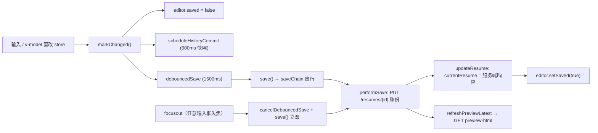
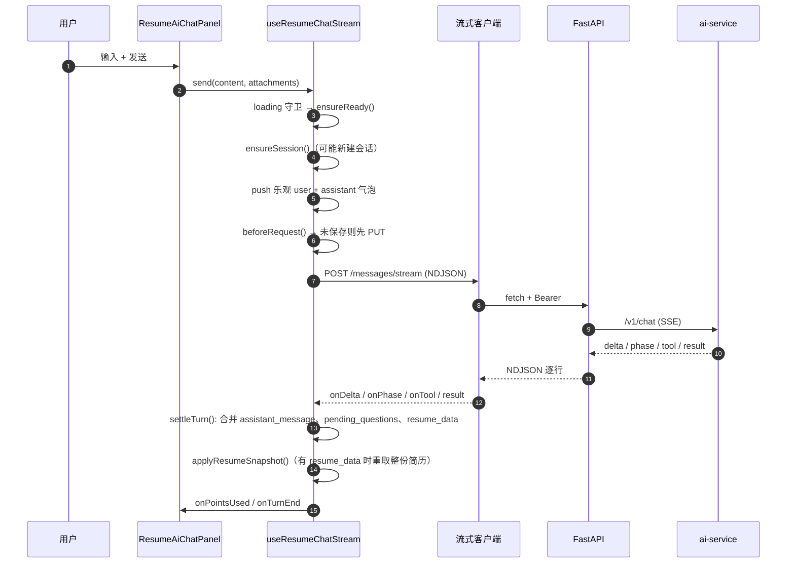

# Phase 3：ResumeFlow Frontend 深度代码审查

> 审查基线：`a8d451c`（2026-11-20）
> 审查对象：`frontend/src`（205 个文件、29,598 行；115 个 `.vue`、90 个 `.ts`）
> 审查方式：**只读**。全文精读 `views/ResumeEditor.vue`、`composables/useResumeChatStream.ts`、`composables/useResumePreview.ts`、`composables/useResumeHistory.ts`、`stores/{resume,editor,chat,user}.ts`、`api/{request,ai,resume,export,file,userAi}.ts`、`components/{ai,editor,preview,review}/*`，并按需回读后端 `api/ai.py`、`services/ai_chat_service.py`、`schemas/*` 做契约对照。
> 未执行：`vitest`、`vue-tsc`、浏览器实测、真实 AI 回合。因此每条结论都标注了置信度；标「静态」的条目是从代码路径确定性推导，未做运行时复现。
>
> 说明：`docs/code-review/` 下没有 Phase 1 的 `01-backend-review.md`（只有 `00` 与 `02`）。本阶段的「后端行为」对照，直接读 `api/ai.py`、`services/ai_chat_service.py`、`schemas/*.py` 与 `models/resume.py` 完成，不依赖缺失的 Phase 1 文档。

---

## 1. 前端架构评价

### 1.1 分层现状

```
浏览器
  ├─ api/            axios 实例 + fetch 流式解析（唯一出口）
  ├─ stores/         resume / editor / chat / user（Pinia）
  ├─ composables/    回合、预览、撤销、桥接、模型（有状态逻辑）
  ├─ components/     编辑器表单 / AI 面板 / 预览 / 审阅台 / 管理后台
  └─ views/          ResumeEditor（1362 行）· Workspace（外壳）· 其余内容页
```

三层边界基本成立：**组件只读 store 的可变对象 + emit 变更意图**，网络全部收在 `api/`，跨页共享状态收在 store。工程化底子不差：

- `tsconfig.json` 开了 `strict`，全仓 `@ts-ignore` 为 0；`any` 共 95 处，集中在 `resume_data` 这种动态 JSON（`types/resume.ts:41,43-48`）与后台表格。
- `utils/errorText.ts`、`utils/toast.ts`、`ui/dropdown/ActionMenu.vue`、`lib/markdown.ts` 都是单一来源，没有出现「同一件事三份实现」。
- `ResumeEditor` 已把回合、预览、撤销抽成 composable，页面本身只剩业务动作注入，这是对的。

### 1.2 结构性问题

| # | 问题 | 证据 | 影响 |
| --- | --- | --- | --- |
| A1 | `ResumeEditor.vue` 1362 行，同时承担布局、保存、导出、分享、模板、版本、审阅、会话切换 8 类职责 | `views/ResumeEditor.vue:1-1362` | 任何保存相关改动都要动这个文件，回归面极大 |
| A2 | 编辑器状态分散在 4 处：`resume` store（正文）、`editor` store（保存/历史/缩放）、`chat` store（会话）、组件局部（消息数组、审阅勾选） | `stores/*` + `useResumePreview.ts:75-79` | 「保存态」与「正文」不在同一事务里，导致 §4 的覆盖问题 |
| A3 | `useChatModels()` 每次调用都新建一套 ref，注释却写「跟首页共用一份」 | `composables/useChatModels.ts:37-41`；`ResumeEditor.vue:152-162`；`WorkspaceHome` 各调一次 | 编辑器与首页各自拉 `/ai/capability` + `/ai/user-ai/models`，切页重复请求；`loaded` 也各自为政 |
| A4 | `watch(resumeId)` 的重载逻辑实际是死代码 | `ResumeEditor.vue:483-490`；`Workspace.vue:99` 用 `:key="resumeId"` 强制重挂 | 维护者会以为切简历走的是灰度重载，实际每次整组件重建（丢消息数组、丢滚动位置） |
| A5 | 无全局错误出口 | `main.ts:9-12`、`App.vue` 均未设 `app.config.errorHandler` / `unhandledrejection` | 渲染期异常只进控制台，用户看到白块无提示 |

组件规模（非测试，Top 6）：

| 文件 | 行数 |
| --- | --- |
| `views/ResumeEditor.vue` | 1362 |
| `components/admin/ai/AiProviderCard.vue` | 982 |
| `views/WorkspaceSettings.vue` | 948 |
| `components/layout/WorkspaceSidebar.vue` | 830 |
| `views/WorkspaceInfo.vue` | 820 |
| `components/resume/ResumeCreateFlow.vue` | 639 |

---

## 2. 组件与 Store 设计

### 2.1 Store 职责

| Store | 持有 | 是否持久 | 问题 |
| --- | --- | --- | --- |
| `resume` | `currentResume`（含 `resume_data`、`template_config`）、`resumeList`、`previewHtml` | 否 | `updateResume` 用服务端响应**整体替换** `currentResume`（`:231-242`），是 §4 P0 的直接原因 |
| `editor` | `saved` / `saving` / `saveError` / `currentSection` / 撤销栈 / 预览缩放 | 否（仅面板宽度进 localStorage） | `saved` 是「全局单值」而非按简历；重挂载时不复位（`loadResumeEditor` 未 `setSaved`） |
| `chat` | `sessionsByResume`、`activeByResume`、`loadedResumeIds` | 否 | `writeSessions` 每次都重排（`:57-60`），`touchSession` 的置顶意图随后被排序抵消 |
| `user` | `token`、`userInfo` | token 进 localStorage | 见 §8 |

`activeSessionId` 有隐式回落：选中会话不在列表里时自动取 `list[0]`（`stores/chat.ts:46-51`）。删除当前会话、或列表刷新期间，界面会「自己跳到第一条会话」，用户以为消息丢了。

### 2.2 路由与权限

- 守卫只做「有没有 token」+ `requiresAdmin` 现查 `meApi`（`router/index.ts:48-66`），没有页面级 `meta.permissions`，也没有离开确认。
- **没有 `onBeforeRouteLeave`、没有 `beforeunload`**（全仓 grep 无命中）。这是 §4 数据丢失的第二条通路。
- 401 处理是硬跳转：`window.location.href = "/login"`（`api/request.ts:34-38`），正在编辑的页面直接被卸载，连「保存失败」提示都来不及出现。

### 2.3 Axios 封装

`api/request.ts` 的收口是合理的（统一 base、blob 白名单、`{code,message,data}` 解包、Blob 错误体反解）。但有三处口径问题：

| # | 问题 | 证据 |
| --- | --- | --- |
| R1 | 超时统一 30s，唯独导入 180s / PDF 120s；AI 流式走 fetch **完全没有超时** | `request.ts:11-14`；`api/resume.ts:102,107`；`api/ai.ts:179-189` |
| R2 | `errorMessage` 丢弃所有非中文错误，422 的 Pydantic 详情、413、网络错误全部退化成调用方兜底文案 | `utils/errorText.ts:8-12` |
| R3 | 业务码判定 `if (body.code && body.code !== 200)`，`code=0` 会被当成成功 | `request.ts:31` |

### 2.4 生命周期清理（结论：基本干净）

| 位置 | 清理 |
| --- | --- |
| `ResumeEditor` | `resize` / `keydown` / `visibilitychange` 全部在 `onUnmounted` 摘除（`:240-245`） |
| `PreviewFrame` | 2 个 ResizeObserver + 1 个 MutationObserver + 3 个 window 监听在 `onBeforeUnmount` 断开（`:348-356`） |
| `BasicInfoForm` | `window.click` 与 Sortable 实例都销毁（`:48-52,192-198`） |
| `ChatTurnMeta` | `setInterval` 在 streaming 结束时停（`:30-40`） |
| `useResumeChatStream` | `onBeforeUnmount(cancelTurn)`（`:87`） |

例外：`ResumeEditor.showToast` 的 3s `setTimeout` 未在卸载时清理（`:304-312`），会在已销毁组件上写 ref（无害但属噪音）。

---

## 3. 简历编辑器专项

### 3.1 数据初始化

`loadResumeEditor` → `fetchResumeDetail`（GET 简历 → `normalizeResumeData` → `normalizeTemplateConfig` → **再串行 GET 一次 preview-html**）→ `captureEditorSnapshot` → `resetHistory`（`ResumeEditor.vue:460-480`，`stores/resume.ts:193-201`）。

两个观察：

1. **首屏两次串行 RTT**。预览 HTML 必须由服务端渲染，串行无法避免；但 `fetchResumeDetail` 把预览失败也算进「简历加载失败」，见 3.6。
2. **重挂载不复位保存态**。`loadResumeEditor` 没有 `editor.setSaved(true)`，也没有清 `saveError`。上一份简历若停在「保存失败」，新简历打开后头部仍显示红色「保存失败」，直到下一次成功保存才消失。

### 3.2 模块增删改与排序

- 表单直接改 store 对象（`v-model="resumeStore.currentResume.title"`、`props.basics.name` 等），变更靠显式 `emit("change")` → `markChanged()` 通知。**没有脏字段 diff**，所以保存永远是整份 PUT。
- 自定义模块删除会同步清 `section_order` / `section_titles` / `field_labels`（`ResumeEditor.vue:621-630`），这条是对的。
- 模块排序走原生 drag（`ModuleSidebar.vue:162-166`）+ 移动端排序弹窗；`onDrop` 直接 `order.splice` 后 `emit("change")`（`:108-116`）。没有 `dataTransfer.setData`，Firefox 下拖拽可能不触发（低危，未实测）。
- 基本信息字段排序用 SortableJS，`onEnd` 回写 `row/order`（`BasicInfoForm.vue:199-215`）。切换模块时 Sortable 实例会重建（`:250-258`），没有泄漏。

### 3.3 模板切换

`selectTemplate` 先改 `templateConfig`（含 12 套默认配色硬编码在视图里），再 `await save()`（`ResumeEditor.vue:98-131`）。

问题：**模板默认色表是第三份来源**。`stores/resume.ts:122-136` 的 `normalizeTemplateConfig`、`ResumeEditor.vue:105-118` 的 `defaults`、后端 `core/template_config.py` 各有一份，新增模板时漏改任一处就会出现「选中模板但配色不跟随」。与 Phase 0 记录的「模板元数据三处来源」是同一类问题。

### 3.4 语言切换

`setResumeLanguage` 调 `applyResumeLanguage` 就地改写正文默认标题与字段标签，置 `language_locked = true`，然后 `markChanged`（`ResumeEditor.vue:587-597`）。**这是一次性不可逆的本地改写**：切到英文再切回中文，之前自动翻译的标题不会还原（只保留用户手改的部分？不——`applyResumeLanguage` 会按当前语言重写默认标题）。用户误点语言按钮后没有确认弹窗，也没有撤销入口（只能靠撤销栈，而撤销栈 50 步内混着其它编辑）。

### 3.5 头像与图片

- 头像：FileReader → 裁剪 → `uploadAvatarApi` → 只把 `object_name` 写进 `basics.avatar`（`BasicInfoForm.vue:290-321`），换域名不失效，设计正确；5MB 前置校验与后端一致（`utils/avatar.ts:5-6`）。
- 对话图片：`uploadImages` 串行上传，失败逐条收集（`AiComposer.vue:146-176`）。**没有客户端大小/类型兜底**，超出后端 5MB 的图片要等一次失败上传才知道。
- `privateFileUrl` 把 JWT 拼进 `` 查询串（`lib/fileUrl.ts:10-16`），见 §8。

### 3.6 本地状态 ↔ 服务端状态

这是本阶段最关键的结论，单独列节。

---

## 4. 自动保存专项（本阶段最高优先级）

### 4.1 链路



设计上正确的两点：

- `saveChain`（`ResumeEditor.vue:539-542`）让保存严格串行，**不会出现「后发先至」写坏数据**。
- 保存前 `flushHistoryCommit()`，撤销栈不会把中间态记成一步。

但有 6 条失效路径。

### 4.2 P0-1：保存响应回写覆盖请求期间的新输入

**位置**：`stores/resume.ts:231-242`（`updateResume`）、`ResumeEditor.vue:515-537`（`performSave`）

```ts
// stores/resume.ts:233-237
const updated = await updateResumeApi(this.currentResume.id, payload || this.currentResume)
updated.language = resolveResumeLanguage(...)
updated.resume_data = normalizeResumeData(updated.resume_data, updated.language)
this.currentResume = updated        // ← 整对象替换
```

**触发条件**：保存请求在途（典型 50–300ms，弱网更久）时用户继续输入。

**时序**：

| 时刻 | 事件 | 结果 |
| --- | --- | --- |
| t0 | 输入 A → `saved=false`，1500ms 防抖 | — |
| t1 | 防抖到期 → PUT 发出，body 是 t1 的快照 | — |
| t2 | 用户继续输入 B（改的是同一个对象） | 本地有新值，`saved` 被 `markChanged` 置 false |
| t3 | 响应返回 → `currentResume = updated`（只含 A） | **B 从界面消失** |
| t4 | `performSave` 继续 `editor.setSaved(true)` | **头部显示「已自动保存」**，B 永远不落库 |

关键点：`editor.setSaved(true)` 在 `await updateResume` 之后执行（`ResumeEditor.vue:530`），所以 t2 的 `saved=false` 会被 t4 覆盖，用户得不到任何「未保存」提示。防抖在 t3 后才会因 t2 的 `markChanged` 再触发一次保存，但那时 `currentResume` 已经是服务端回写的旧值——保存的是 A，不是 A+B。

**影响**：用户正在打的字静默丢失，且 UI 声称已保存。这是本阶段最严重的数据完整性问题。

**置信度**：已确认（静态，路径确定）。

### 4.3 P0-2：切路由 / 关页面丢防抖中的改动

**位置**：`ResumeEditor.vue:492-498`

```ts
onBeforeUnmount(() => {
  if (applyTimer) clearTimeout(applyTimer)
  clearFlushSave(flushPendingSave)
  cancelDebouncedSave()      // ← 只取消，不落库
  cancelHistoryCommit()
  ...
})
```

- 侧栏切简历、回首页、新建简历都调了 `flushSave()`（`WorkspaceSidebar.vue:241,253,263,273`；`Workspace.vue:57`），这条链路是安全的。
- **但侧栏的两个 `RouterLink` 没走 flush**：`/workspace/info`、`/workspace/settings`（`WorkspaceSidebar.vue:50-51`），以及用户菜单里的公告 / 帮助 / 个人资料（`WorkspaceUserMenu.vue:30-32`）。点击即换 `panel`，`ResumeEditor` 被卸载（`Workspace.vue:99`），1500ms 内的改动直接丢。
- 刷新 / 关标签页同样没有任何 `beforeunload` 兜底。

**影响**：用户在输入后 1.5s 内点「信息库」或「模型与技能」，改动消失且无提示（因为 `cancelDebouncedSave` 不会把 `saved` 置 false 或提示）。

**置信度**：已确认（静态）。

### 4.4 P0-3：失焦即整份 PUT，且与「应用 AI 修改」竞争

`@focusout` 挂在根节点（`ResumeEditor.vue:770`），处理函数对任意 input/textarea/contentEditable 都执行 `cancelDebouncedSave(); save()`（`:721-731`，50ms 后）。

两个后果：

1. **每切一次输入框就一次整份 PUT**。表单有几十个字段，用户 Tab 一遍就是几十次全量写库 + 几十次预览刷新（`performSave` 默认 `refreshPreview: true`）。
2. **与 AI 应用产生写写竞争**。点「应用」按钮时先把焦点从输入框移走 → focusout → 50ms 后 PUT（内容是**应用前**的本地数据）；同时 `decide` 发出 apply 请求。两个请求都没有版本号（`ResumeUpdate` 无 `expected_update_time`，`backend/app/schemas/resume.py:151-156`），谁后落库谁赢。若 PUT 后到，AI 刚写入的结果被旧数据覆盖；而前端已经按 apply 的响应刷新过界面，于是界面显示「已应用」，数据库却是旧的。

**置信度**：条件性确认（两条请求的先后取决于网络，但代码里没有任何排序或版本保护）。

### 4.5 P1-4：没有重试、没有离线状态、`saved` 不真实

- 保存失败只置 `editor.saveError = true` 并抛错（`ResumeEditor.vue:531-533`），**不排重试**。网络恢复后必须等用户再改一个字才会再次保存。
- 头部状态只看 `saving`：`editor.saving ? '保存中...' : editor.saveError ? '保存失败' : '已自动保存'`（`:789-793`）。`saved=false` 但没在请求中时，仍然显示「已自动保存」——从输入到请求发出之间的 1.5s、以及请求排队期间，文案都是假的。
- `saveChain` 只保证串行，不合并：连点重试会排队 N 次整份 PUT。

### 4.6 P1-5：多标签页无协同

全仓没有 `storage` 事件监听、没有 `BroadcastChannel`。两个标签页编辑同一份简历时：

- 各自的 `currentResume` 是独立副本；
- 都以「整份 PUT」落库，最后提交者覆盖前者；
- 没有任何冲突提示或版本比对。

配合 §4.2 的回写覆盖，多标签页是「静默互相回滚」的最短路径。

### 4.7 P2-6：撤销/重做与保存不一致

`restoreHistorySnapshot` 先移动 history 指针，再 `await options.save()`（`useResumeHistory.ts:64-84`）。保存失败时 finally 只复位 `applyingHistory`，不回滚指针、不排重试——撤销栈指向「旧内容」，数据库还是「新内容」，`saved` 停在 false。

---

## 5. AI 对话专项

### 5.1 回合生命周期



### 5.2 做得对的地方

- **单回合互斥**：`beginTurn()` 先 abort 上一个 controller（`:73-79`），不会出现两路 delta 交错。
- **切会话锁**：流式期间侧栏切换被拒绝并回滚选中态（`ResumeEditor.vue:502-511`），有明确 toast。
- **确认防重**：`decide` 先同步置 `decisionLoadingId`（`:340`），面板按钮同时 disabled（`ResumeAiChatPanel.vue:251-270`），重复点击不会打两笔。
- **重新生成失败即以服务端为准**：`regenerate` 的 catch 直接 `load()`（`:319-323`），避免本地被截断的气泡序列继续存在。
- **渲染安全**：AI 正文走 `DOMPurify.sanitize(markdown-it)`（`lib/markdown.ts:6-8`），不是裸 `v-html`。

### 5.3 P0-7：点「应用」会回滚 AI 提案之后的手动修改

**位置**：`useResumeChatStream.ts:336-352`；后端 `ai_chat_service.py:1659-1662, 1586-1623`

前端 `decide` 只在 apply 时 `flushHistory()`（同步提交撤销栈），**没有 `beforeRequest()`、没有保存**。对话卡片的主按钮走的是「整包快照」分支：

```ts
// api/ai.ts:96-97 —— 只有审阅台传 merged_resume_data
decideResumeChatChangeApi(resumeId, messageId, action, mergedResumeData)
// 对话卡片：resolveChatDecision(message,'apply') → mergedResumeData = undefined
```

后端拿到 `merged_resume_data = None` 时用 message 里的 `optimized_resume_data` **整份覆盖** `resume.resume_data`（`_persist_resume_change` → `resume.resume_data = next_data`），随后前端 `applyResumeSnapshot()` 重取整份简历。

**触发条件**（不需要很巧）：

1. 用户先让 AI 改简历，得到 pending 提案；
2. 用户切到「内容编辑」补了一处 AI 没提到的内容（比如更新手机号），防抖已落库；
3. 回到 Agent 面板点「应用」。

**结果**：第 2 步的修改被第 1 步的快照覆盖。界面刷新后看不出异常（因为界面就是按覆盖后的数据渲染的），只有用户自己记得改过。

**缓解存在但不默认启用**：「逐条审阅」走 `buildSelectedResumeData(resumeStore.resumeData, ...)`，以**当前本地数据**为基底，能保住第 2 步（`useResumePreview.ts:149-160`）。也就是说，同一个业务动作有两条语义不同的路径，主按钮那条是破坏性的。

更糟的是，§4.4 的失焦保存会和这次 apply 形成两条**整份写入**：一条写「本地数据（含手动修改、不含 AI 修改）」，一条写「AI 快照（不含手动修改）」。谁后落库谁生效，因此无论时序如何，两份改动里必然丢一份——要么 AI 改的被回滚，要么手动改的被覆盖。前端没有任何版本号或字段级合并来避免这个二选一。

**置信度**：已确认（静态；后端整包写入已在 Phase 2 §L2 记录，此处补上前端入口）。

### 5.4 P1-8：错误路径留下「幻影用户消息」

`send` 的 catch 只移除空的 assistant 气泡：

```ts
// useResumeChatStream.ts:237-241
const assistant = messages.value[assistantIndex]
if (assistant) assistant.streaming = false
if (!assistant?.content) messages.value = messages.value.filter((item) => item.id !== pendingAssistant.id)
error.value = isSilentStreamError(err) ? "" : errorMessage(err, "AI 对话失败")
```

用户气泡（`id: user-<stamp>`）**无条件保留**。但 402（余额不足）、401、400（内容超长）、以及 `beforeRequest` 保存失败，都发生在后端落库之前。

**结果**：界面里有一条「我发的消息 + 没有回复」，刷新后又消失。用户会重复发送，进而真的产生多笔扣费。

### 5.5 P1-9：没有「停止生成」

`AiComposer` 只有发送/清空/新对话，`loading` 时发送按钮变 spinner 并禁用（`AiComposer.vue:313-316`），**没有 stop 按钮**；`cancelTurn` 只在卸载、切简历、清空时调用（`useResumeChatStream.ts:82-87, 361-364, 396-406`）。

用户想中断只能切走页面。而后端此时可能已经产生 usage 并结算（Phase 2 §B 系列），前端不会告知「本次可能已计费」。

### 5.6 P1-10：流式解析的健壮性缺口

`postAiStream`（`api/ai.ts:179-258`）整体可用（按行切、尾包处理、result 即 cancel），但：

| 缺陷 | 证据 | 后果 |
| --- | --- | --- |
| `JSON.parse(line)` 无 try | `:223` | 服务端中途断开留下的半行 JSON 会把「正常结束」变成 `Unexpected end of JSON input`（再被 `errorMessage` 吞成兜底文案） |
| `event.type === "error"` 直接 throw，不 cancel reader | `:234` | 连接保持到 GC；后端已落库的 assistant 消息前端不知道 |
| fetch 无超时、无重试 | `:181-189` | 网关挂住时 spinner 无限转（后端 180s 超时也要等它返回错误帧） |
| 200 + JSON 一律当错误 | `:207-212` | 若后端某天用 JSON 返回「问答式」结果，前端无法兼容（当前后端确实不会，属防御性缺口） |

### 5.7 P2-11：会话与消息的边界

- 消息列表**只取最近 80 条且没有分页入口**（后端 `list_chat_messages(limit=80)`，`api/ai.py:766-779` 不暴露 `limit/after_id`；前端 `getResumeChatMessagesApi` 也不传）。超过 80 条的会话，最早的消息在前端永久不可见。
- 每条消息可能携带整份 `optimized_resume_data`（百 KB 级）。80 条 × 多份快照 = 数 MB 内存 + 一次全量 JSON 传输。
- 「新对话」每次都 `POST sessions`（`chat.ts:84-89`），空会话不会回收；连点会堆出多条空会话。
- `touchSession` 把目标会话排到首位（`chat.ts:125-130`），但 `writeSessions` 紧接着按 `update_time` 重排（`:57-60`），在其 `fetchSessions(force)` 回来之前顺序会闪一下。

### 5.8 审阅台（track-changes）

设计是完整且自洽的：`pendingReviewMessage` 取最后一条 pending（`useResumePreview.ts:81-87`），默认全选，勾选/微调都触发 300ms 防抖的**服务端渲染预览**（`:237-243, 254-255`），应用时把合并结果作为 `merged_resume_data` 提交（`:149-160`）。

两个缺陷：

**P2-12：`buildSelectedResumeData` 的 layout 是无条件整包合并**

```ts
// utils/aiDiff.ts:528-546
const nextLayout = layoutOf(next)
if (nextLayout) {
  const titleChanges = ...
  const mergedTitles = { ...current }
  ...
  result.layout = { ...(layoutOf(result) || {}), ...nextLayout, section_titles: mergedTitles }
}
```

`nextLayout` 一旦存在（AI 快照必然带 `layout`），`section_order`、`hidden_sections`、`field_labels`、`skills_options`、`language_locked` 全部取提案值，**与是否勾选无关**。现有用例只断言 `merged.work`（`utils/__tests__/aiDiff.spec.ts:125-132`），没有断言 layout。用户「全部取消勾选再应用」仍可能被改掉模块顺序 / 隐藏模块。

**P2-13：审阅态下勾选集合不随本地编辑重算**

`selectedDiffIds` 只在 `pendingReviewMessage` 变化时重置（`useResumePreview.ts:111-115`）。用户在 pending 期间手动改了某个条目，diff 条目会变（新增/消失），但已选 id 不重算，`applySelectedReviewChanges` 会用旧 id 集合去合并新 sections——部分勾选静默失效。

---

## 6. API 数据契约

### 6.1 对齐良好的部分

| 契约 | 前端 | 后端 | 结论 |
| --- | --- | --- | --- |
| 响应信封 | `types/api.ts:1-5` | `core/response.py` | 一致 |
| 简历实体 | `types/resume.ts:1-11` | `schemas/resume.py:202-214` | 字段一致 |
| 对话消息 | `types/chat.ts:72-94` | `schemas/ai_chat.py:79-93` | 后端无 `streaming/phase/thinking`（前端本地态），其余一致 |
| 待回答问题 | `api/ai.ts:125-128` | `tools/questions.ts:25-44` | `{question,hint}` 一致 |
| 附件上限 | `AiComposer.vue:65` = 9 | `schemas/ai_chat.py:17` = 9 | 一致 |
| BYOK 字段 | `api/userAi.ts:7-35` | `schemas/user_ai.py:37-60` | 一致 |
| 分页 | `api/resume.ts:14-21` | 各列表端点 | `items/total/page/page_size` 一致 |

### 6.2 不一致 / 缺失

| # | 问题 | 前端 | 后端 | 影响 |
| --- | --- | --- | --- | --- |
| C1 | 标题长度三套口径 | 无 `maxlength`（`ResumeEditor.vue:780-786`） | `ResumeCreate.title` 无上限、`ResumeUpdate.title` 无上限（`schemas/resume.py:144,152`），`ResumeDuplicateRequest` 120，DB `String(100)`（`models/resume.py:17`） | 粘贴 >100 字标题 → MySQL 报错 → 500 → 前端只显示「保存失败」；>120 时复制接口先 422，同一字段两种行为 |
| C2 | 历史接口只认旧类型 | 三个 tab 固定请求 `resume_score/jd_optimize/resume_translate`（`AiRecords.vue:214-233`） | 白名单仅这三类（`api/ai.py:573-577`），但新链路不再产生这三类任务（Phase 2 §B9） | 「历史」tab 永远是空的，且一次并发 3 个必空请求；新的对话式翻译记录无处可查 |
| C3 | 消息列表无分页契约 | 直接拿 `ChatMessage[]` | `limit=80` 固定、无 `after_id` 暴露 | 长会话早期消息不可达（见 §5.7） |
| C4 | 预览失败被当成简历加载失败 | `fetchResumeDetail` 串行 `await refreshPreviewHtml()`（`stores/resume.ts:200`），异常上抛；`loadResumeEditor` catch 里 toast「简历不存在或无权限访问」并 `replace('/workspace')`（`ResumeEditor.vue:475-479`） | 预览渲染与简历读取是两个端点 | 预览 500 会把用户踢出编辑器，并给出完全错误的归因 |
| C5 | 应用成功但刷新失败被报成「修改写入失败」 | `decide` 的 try 包住 `applyResumeSnapshot`（`useResumeChatStream.ts:351`），catch 统一 `errorMessage(err, "修改写入失败")` | 后端已 commit | 用户看到失败提示，可能重复点击（第二次会 400/409），并怀疑数据没写入 |
| C6 | `saved`/`saveError` 无接口语义 | 纯本地 | — | 重挂载后旧错误态残留（§3.1） |

---

## 7. 安全问题

### 7.1 P1：主预览 iframe 没有 sandbox，而分享页和模板页都有

| 位置 | 属性 | 能力 |
| --- | --- | --- |
| `components/preview/PreviewFrame.vue:371-377, 388-393` | **无 `sandbox`** | 同源 + 允许脚本。一旦渲染出的 HTML 里有可执行内容，可直接读 `parent.localStorage` |
| `views/SharedResume.vue:144-153` | `sandbox="allow-same-origin"` | 可被父页测量，脚本被禁 |
| `components/templates/TemplatePreview.vue:42-51` | `sandbox=""` | 完全隔离 |

编辑器预览是三者里**唯一不加 sandbox** 的，而它渲染的正是用户可编辑内容。

当前实际可利用性低（这是一条重要的限定）：

- 普通字段走 Jinja `autoescape=select_autoescape(["html","xml"])`（`services/preview_service.py:21-24`）；
- 富文本字段走 `|rich_text|safe`，但滤镜是 bleach 白名单（`services/rich_text_service.py:26-33`，标签集合不含 `script/iframe/object`，`<script>` 还会被正则预删）；
- AI 正文走 DOMPurify。

所以这不是「现在就存在 XSS」，而是**纵深防御缺口**：任何一次 bleach 白名单放宽、或新增一个 `|safe` 输出点，都会直接升级成「同源脚本 → 偷 JWT」。修复成本极低（加 `sandbox="allow-same-origin"`，父页 `contentDocument` 仍可读）。

### 7.2 P1：JWT 存在 localStorage，且被拼进图片 URL

- `stores/user.ts:7,15`、`api/request.ts:17`、`api/ai.ts:180` 全部从 `localStorage['vitaflow_token']` 取。
- `lib/fileUrl.ts:10-16` 把它拼成 `/api/files/ai-chat/....?token=<JWT>` 给 ``。

后果：token 会出现在浏览器历史、代理/网关 access log、`Referer`（若图片所在页有外链跳转）、以及任何前端错误上报里；有效期内的 token 可直接复用。这是「为了绕开 `` 不能带 Authorization」的常见妥协，但应该用**短时效签名 URL**（后端已有文件代理，加一个 `?sig=&exp=` 成本不高），而不是长期 JWT。

### 7.3 P2：上传与渲染的其余观察

- 头像上传只校验大小（`BasicInfoForm.vue:293-296`），类型靠后端；前端用 `FileReader` 读成 dataURL 进裁剪器，超大图会先占内存（5MB 上限内可接受）。
- 对话图片无客户端大小校验（§3.5），后端拒绝后只显示「上传失败」。
- `SharedResume.vue:46` 在客户端再剥一次 `<script>`，属冗余防御，方向正确。
- 管理后台密钥只展示 `api_key_masked`，明文只在提交时出现在请求体（`AiProviderCard.vue:650-693`），没有写 localStorage / console。这一块是干净的。
- 路由权限只有 `requiresAdmin` 现查（`router/index.ts:57-65`），失败回 `/login` 而不是 403 页；普通用户直接访问 `/workspace/admin` 会被静默重定向，不算漏洞。

---

## 8. 性能问题

### 8.1 P1：预览测量自触发 MutationObserver，形成常驻循环

`PreviewFrame.vue` 一边观察 `measureFrame` 的 `body`，一边在每次测量时往同一个 `body` 里插一个临时 div：

```ts
// :95-102  每次测量都 append + remove 一个 marker
function pageHeightPx(doc: Document) {
  const marker = doc.createElement("div")
  ...
  doc.body.appendChild(marker)
  const height = marker.getBoundingClientRect().height
  marker.remove()
  return height || 1123
}

// :253-267
frameMutationObserver = new MutationObserver(() => scheduleUpdatePageCount([60, 240]))
frameMutationObserver.observe(doc.body, { childList: true, subtree: true, characterData: true, attributes: true })

// :219-231  测量里又调用 pageHeightPx
function updatePageCount() { ... const pageHeight = pageHeightPx(doc) ... }
```

`appendChild` / `remove` 都会命中 `childList`，于是：测量 → 变更 → observer → `scheduleUpdatePageCount` → 测量。`scheduleUpdatePageCount` 每次都 `clearPendingTimers()` 再排 5 个定时器（`:233-244`），所以这个环会一直转，节奏约 60ms。

单次 `updatePageCount` 的成本还包括 `page.querySelectorAll("*")` + 全文本 `TreeWalker` + 每个元素 `getComputedStyle`（`:145-185`）。因此编辑器只要开着预览（桌面端常驻），就在持续做整页布局测量。

**影响**：CPU 占用、风扇、笔记本续航，长简历更明显；预览刷新时还会叠加 iframe 重建，用户感知为「打字发涩」。

**修复方向**：测量 marker 放到未被观察的容器（如 `doc.documentElement` 之外不可行时，改用 CSS `100vh`/`297mm` 的常量或 `doc.documentElement.clientHeight`），或 observer 回调里忽略 `marker` 节点，或直接去掉 MutationObserver（ResizeObserver + 图片 load 已足够）。

**置信度**：已确认（静态推导；未做 CPU profile）。

### 8.2 P1：每个分页一个完整 iframe

`PreviewFrame.vue:378-396` 对 `pageSlices` 逐页渲染 `<iframe :srcdoc="patchHtml(page)">`，每页都是一份完整文档（字体、样式、图片、分页脚本）。`pageSlices` 上限 80（`:206`）。一份 5 页简历 = 6 个文档实例，字体与图片重复解码/重复请求（浏览器可能命中缓存，但布局与合成是独立的）。

叠加 8.1 的循环，每次 `pageSlices` 变化都会让 N 个 iframe 重新 `srcdoc` 解析。

### 8.3 P1：流式期间每个 delta 都全量重渲染 Markdown

```html
<!-- ResumeAiChatPanel.vue:223 -->
<div v-if="message.content" class="chat-markdown break-words" v-html="renderMarkdown(message.content)" />
```

`renderMarkdown` 是模板里的方法调用，`message.content` 每次 `+=` 都会触发组件重渲染 → 重新跑 `markdown-it` + `DOMPurify.sanitize` 全量解析。一条 3000 字的回复按 100+ 个 delta 计，就是 100 次全量解析（O(n²)）。

同时 `watch` 监听「最后一条消息的 content」（`:102-109`），每个 delta 都 `scrollToLatest`：`nextTick` + 两层 `requestAnimationFrame` + `list.scrollTo`，形成「解析 → 重排 → 滚动」的每帧三连。

### 8.4 P2：长对话无虚拟化

消息列表直接 `v-for` 全量渲染（`:210-293`），每条含 `TransitionGroup` 动画、`ChatTurnMeta`、`ToolSteps`、`Markdown`。80 条消息 + 每条可能带整份 `optimized_resume_data`，首屏与滚动都会掉帧。没有 `content-visibility`、没有窗口化。

### 8.5 P2：其它

| 问题 | 证据 |
| --- | --- |
| 每次保存都重取一次 preview-html（编辑态默认开启） | `ResumeEditor.vue:529` + `useResumePreview.ts:180-206` |
| `refreshPreviewHtml` 与 `previewHtmlApi` 双份实现 | `stores/resume.ts:271-274` vs `useResumePreview.ts:198` |
| 侧栏搜索/信息库搜索都做了防抖与序号守卫（正面） | `WorkspaceSidebar.vue:151-176` |
| pdfjs 动态 import（正面） | `PdfPreviewFrame.vue:30-39` |
| 首屏 editor 静态引入 A4Preview（含 pdfjs 类型与分页脚本），但 pdfjs 本身懒加载 | 可接受 |

---

## 9. 已确认问题清单

> 置信度：**确认** = 代码路径确定；**条件** = 需要特定时序/网络；**待验证** = 需运行时或后端行为确认。

### P0（数据丢失 / 业务错误）

| ID | 问题 | 位置 | 触发 | 影响 |
| --- | --- | --- | --- | --- |
| F1 | 保存响应整对象回写，覆盖请求期间的新输入；随后 `setSaved(true)` 掩盖 | `stores/resume.ts:231-242`；`ResumeEditor.vue:515-537` | 保存在途时继续输入 | 用户输入静默丢失且显示「已自动保存」（确认） |
| F2 | 应用 AI 修改走整包快照，回滚提案之后的手动修改 | `useResumeChatStream.ts:336-352`；`api/ai.ts:96-97`；后端 `ai_chat_service.py:1586-1623` | 提案生成后手动编辑并落库，再点「应用」 | 已保存的修改被覆盖（确认） |
| F3 | 卸载只取消防抖不落库；RouterLink 导航与刷新均无兜底 | `ResumeEditor.vue:492-498`；`WorkspaceSidebar.vue:50-51`；`WorkspaceUserMenu.vue:30-32` | 输入后 1.5s 内点信息库/设置/公告/帮助，或刷新 | 改动丢失（确认） |

### P1（可靠性 / 一致性 / 安全）

| ID | 问题 | 位置 | 触发 | 影响 |
| --- | --- | --- | --- | --- |
| F4 | 失焦即整份 PUT，并与 apply 形成无版本保护的写写竞争 | `ResumeEditor.vue:721-731,770`；`schemas/resume.py:151-156` | 点「应用」时输入框失焦 | 全量写库放大；极端时序下 AI 结果被旧数据回滚（条件） |
| F5 | 错误路径保留乐观用户消息 | `useResumeChatStream.ts:237-241` | 402/401/400/保存失败 | 幻影消息；诱导重复发送（确认） |
| F6 | 主预览 iframe 无 sandbox | `PreviewFrame.vue:371-393` | 任意渲染内容 | 失去纵深防御，一次白名单放宽即同源脚本（确认） |
| F7 | JWT 拼进图片 URL | `lib/fileUrl.ts:10-16` | 每次加载对话图片 | token 进日志/历史（确认） |
| F8 | 预览失败被当作「简历不存在」并踢出编辑器 | `stores/resume.ts:200`；`ResumeEditor.vue:475-479` | preview-html 5xx | 错误归因 + 中断编辑（确认） |
| F9 | apply 成功但刷新失败被报成「修改写入失败」 | `useResumeChatStream.ts:351-355` | 应用后 GET 失败 | 误导用户重试（确认） |
| F10 | 无「停止生成」 | `AiComposer.vue:297-316` | 长回复/想改主意 | 只能离开页面；不知道是否已计费（确认） |
| F11 | 预览测量自触发 observer，常驻 60ms 循环 | `PreviewFrame.vue:95-102,219-244,253-267` | 打开编辑器 | 持续 CPU/布局开销（确认，静态） |
| F12 | 流式每 delta 全量 Markdown + 滚动 | `ResumeAiChatPanel.vue:102-109,223` | 长回复 | 卡顿、掉帧（确认） |
| F13 | 消息只取 80 条且无分页 | `ai.py:766-779`；`ai_chat_service.py:362-375` | 长会话 | 早期消息不可达（确认） |

### P2（体验 / 维护性 / 契约）

| ID | 问题 | 位置 |
| --- | --- | --- |
| F14 | `buildSelectedResumeData` 无条件合并 layout，取消勾选仍改顺序/隐藏 | `utils/aiDiff.ts:528-546`（用例未覆盖 layout，`aiDiff.spec.ts:125-132`） |
| F15 | 审阅勾选集合不随本地编辑重算 | `useResumePreview.ts:111-115` |
| F16 | `saved`/`saveError` 跨简历残留、头部文案不真实 | `ResumeEditor.vue:789-793`；`stores/editor.ts:64-67` |
| F17 | 保存失败无重试、无离线恢复 | `ResumeEditor.vue:531-533` |
| F18 | 多标签页无同步，最后写入者覆盖 | 全仓无 `storage` / `BroadcastChannel` |
| F19 | 标题长度三套口径（无上限 / 120 / DB 100） | `ResumeEditor.vue:780-786`；`schemas/resume.py:144,152,191`；`models/resume.py:17` |
| F20 | 历史 tab 三类任务已不再产生 | `AiRecords.vue:35-38,214-233`；`api/ai.py:573-577` |
| F21 | 模板默认配色三份来源 | `ResumeEditor.vue:105-118`；`stores/resume.ts:122-136`；`core/template_config.py` |
| F22 | 语言切换即时改写标题且不可逆 | `ResumeEditor.vue:587-597` |
| F23 | 空会话堆积；`touchSession` 被排序抵消 | `chat.ts:57-60,84-89,125-130` |
| F24 | `useChatModels` 非单例，重复拉能力/模型 | `useChatModels.ts:37-41,110-140` |
| F25 | 流式解析 `JSON.parse` 无保护、error 帧不 cancel | `api/ai.ts:223,234` |
| F26 | `errorMessage` 丢弃英文错误（422/413 详情） | `utils/errorText.ts:8-12` |
| F27 | 无全局错误出口 | `main.ts:9-12`；`App.vue` |
| F28 | 死代码：`watch(resumeId)` 与 `Workspace.vue:99` 的 `:key` 重复 | `ResumeEditor.vue:483-490` |
| F29 | 未使用的导出（`schedulePreviewRefresh`/`fetchPreviewHtmlLatest`/`isPreviewVisible`） | `useResumePreview.ts:257-268` |

### 9.1 12 个指定场景逐条结论

| # | 场景 | 结论 | 依据 |
| --- | --- | --- | --- |
| 1 | 快速连续编辑多个字段 | **部分失效**：防抖合并正常，但保存回写覆盖在途输入 | F1 |
| 2 | 自动保存未完成切路由 | **失效**：RouterLink/刷新丢改动；侧栏切简历安全 | F3 |
| 3 | 保存返回顺序 ≠ 发起顺序 | **成立（已防住）**：`saveChain` 串行 | `ResumeEditor.vue:539-542` |
| 4 | AI 修改期间手动编辑 | **不阻断**：`mainMode` 可切，流不中断 | `ResumeEditor.vue:950-967` |
| 5 | AI 结果覆盖本地新修改 | **失效**：整包 apply；审阅路径可缓解 | F2 |
| 6 | 重复点击确认 | **成立（已防住）**：`decisionLoadingId` + disabled | `useResumeChatStream.ts:337-341` |
| 7 | 网络断开后恢复 | **部分**：保存置错不重试；AI 流中断需手发 | F17；§5.6 |
| 8 | 刷新后恢复编辑状态 | **失效**：无草稿持久化，1.5s 内改动与撤销栈全丢 | F3 |
| 9 | 多标签页编辑同一份 | **失效**：无同步，后写覆盖 | F18 |
| 10 | AI 流式中途断开 | **部分**：半截正文保留、无 result 报错、用户气泡留存 | F5；§5.6 |
| 11 | 长对话卡顿 | **成立**：无虚拟化 + 每 delta 全量解析 + 滚动 | F12, §8.4 |
| 12 | JSON 导入后状态刷新 | **成立（正向）**：`created` → `flushSave` → push → 按 id 重挂载 | `Workspace.vue:55-59,99` |

---

## 10. 待验证风险

这些需要运行时或后端配合才能定性，本阶段只记录：

1. **F11 的实际 CPU 占用**：自触发环是静态确定的，但浏览器是否会对同一帧合并 mutation、以及 marker 插入是否引起完整重排，需 DevTools Performance 实测。
2. **F4 的竞争概率**：两个请求的先后依赖网络；需在后端加请求日志（`resume_id + update_time + body hash`）才能确认真实发生率。
3. **F2 的实际发生率**：取决于用户是否习惯「先让 AI 改、再自己补」。可用埋点统计「pending 期间发生 PUT」的比例。
4. **`normalizeResumeData` 的破坏面**：它在每次保存响应后重跑，会过滤 `section_order`、重置 `skills_options` 默认值（`stores/resume.ts:87-93`）。若后端返回的 `layout` 少了某键，前端会「补默认」并视为已保存，需比对一次真实响应。
5. **`_message_out` 的 `optimized_resume_data` 体积**：需要在真实数据上量一次（80 条 × 快照）。
6. **iOS Safari 的 `downloadBlob`**：`URL.revokeObjectURL` 紧跟 `a.click()`（`api/export.ts:8-17`），Safari 可能取消下载，需真机验证。
7. **`SharedResume` 的 `allow-same-origin` 是否可被绕过**：当前无 `allow-scripts`，理论上安全；但与 `srcdoc` 组合的历史 CVE 需再确认一次浏览器版本。

---

## 11. 测试缺口

现有 26 个 spec，覆盖了 `aiDiff`、`reviewDraft`、`markdown`、`editor`/`resume` store、`useResumeChatStream` 的取消路径、后台面板。**编辑器主链路几乎没有覆盖**。

| 缺口 | 为什么重要 | 现状 |
| --- | --- | --- |
| `ResumeEditor` 组件级测试 | 1362 行、保存/应用/导出全在这里 | 无 |
| 自动保存时序（在途输入、卸载、路由切换） | F1/F3 是本阶段最严重问题 | 无（`editor.spec.ts` 只测历史栈） |
| `updateResume` 回写行为 | F1 的直接载体 | 无（`resume.spec.ts` 只测 `applyRestoredResume`） |
| `buildSelectedResumeData` 的 layout 断言 | F14 | 仅断言 `merged.work` |
| 审阅勾选在本地编辑后的重算 | F15 | 无 |
| `postAiStream` 半行 JSON、error 帧、超时 | F25 | 只测 HTTP 错误码分支 |
| 预览刷新的单飞/排队/失败 | 保存成败判定依赖它 | 无 |
| `PreviewFrame` 测量循环 | F11 | 无（jsdom 也测不了布局） |
| 多标签页 / 离线 | F18 | 无 |
| 401 拦截后的路由行为 | 硬跳转丢编辑 | 无 |
| 契约测试（前端类型 vs OpenAPI） | C1/C3/C6 这类漂移只能靠它防 | 无 |

一个具体建议：给 `api/ai.ts` 的流式解析补「分块边界」用例（一个 JSON 被切成两段、尾部半行、`\r\n`、空行、超大单行），这是最容易写也最容易回归的地方。

---

## 12. 修复建议

### 第一批（P0，先止血，不动架构）

1. **保存回写改为「只更新元数据，不回写正文」**：`updateResume` 成功后只更新 `update_time`/`title`/`template_id` 等，`resume_data` 保留本地版本；或用「请求序号 + 本地 dirty 标记」判断——响应回来时若 `!editor.saved` 或序号落后，则丢弃响应正文。这一步能同时解掉 F1 与部分 F4。
2. **卸载前强制落库**：`onBeforeUnmount` 改为 `await flushPendingSave()`（Vue 支持 async 卸载钩子），并补 `beforeunload`（`event.preventDefault()` + 同步 `navigator.sendBeacon` 或至少提示）。RouterLink 的导航统一走 `flushSave()`。
3. **「应用」默认带合并数据**：`decide(message,'apply')` 在未显式传 merged 时，前端用 `buildSelectedResumeData(current, optimized, 全部 id, sections)` 现算一份提交；或者干脆把主按钮改成「审阅后应用」，让整包快照只保留给「AI 无改动」的场景。
4. **失败路径撤掉乐观用户消息**（或标记 `failed` 并提供「重发」），避免幻影消息诱导重复扣费。

### 第二批（P1，一致性与防御）

5. `focusout` 只做 `flushPendingSave()`，不再额外发一次 PUT；并把 `saved` 纳入头部文案（`未保存 / 保存中 / 已保存 / 保存失败`）。
6. 预览 iframe 加 `sandbox="allow-same-origin"`（与 `SharedResume` 对齐），确认 `contentDocument` 仍可读。
7. 图片 URL 改短时效签名，不再拼 JWT。
8. `fetchResumeDetail` 把预览失败与读取失败分开：预览失败只降级为空预览 + 局部提示，不重定向。
9. `decide` 里把「写入简历」与「刷新本地」拆成两个 try，后者失败只提示「已写入，刷新失败，请手动刷新」。
10. 补「停止生成」按钮（复用 `cancelTurn`），停止后明确提示「已中断，可能已产生费用」。
11. 修 F11：测量 marker 移到 observer 之外，或让 observer 过滤 marker 节点。
12. 流式渲染改增量：把已完成段落缓存成 HTML，只对「最后一段」重渲染；滚动改为 `requestAnimationFrame` 节流（≥50ms）。

### 第三批（P2，清理与契约）

13. 统一标题长度：DB 100、schema 100、前端 `maxlength=100`。
14. 下线 AiRecords 的三个历史 tab，或把新链路（`ai_chat` + feature）接进来。
15. 消息列表加分页（后端暴露 `before_id`，前端「加载更早」）。
16. `buildSelectedResumeData` 的 layout 改为「按勾选项合并」，并补 layout 用例。
17. `useChatModels` 改成模块级单例（或 Pinia store），避免首页/编辑器各拉一遍。
18. 模板默认配色收敛到 `utils/templateDefaults.ts`，并让 `normalizeTemplateConfig` 引用它。
19. 清理死代码：`watch(resumeId)`、未使用导出、`refreshPreviewHtml` 双份实现。
20. 补 §11 的前四项测试。

---

## 13. 已检查 / 未检查范围

### 已检查（逐文件读完或按函数读完）

| 范围 | 内容 |
| --- | --- |
| 入口 | `main.ts`、`App.vue`、`router/index.ts`（全部路由 + 守卫） |
| API | `request.ts`、`ai.ts`、`resume.ts`、`export.ts`、`file.ts`、`userAi.ts`、`template.ts`、`avatar.ts` |
| Store | `resume.ts`、`editor.ts`、`chat.ts`、`user.ts` |
| Composables | `useResumeChatStream.ts`、`useResumePreview.ts`、`useResumeHistory.ts`、`useChatModels.ts`、`useWorkspaceBridge.ts`、`useWorkspaceDrawer.ts`（引用面） |
| 视图 | `ResumeEditor.vue`（全文）、`Workspace.vue`（全文）、`SharedResume.vue`（前 110 行）、`AiRecords.vue`（脚本段） |
| 组件 | `ResumeAiChatPanel.vue`、`AiComposer.vue`（发送/上传段）、`PreviewFrame.vue`（全文）、`A4Preview.vue`、`TemplatePreview.vue`、`ReviewDiffCard.vue`、`ReviewEntryFields.vue`、`ResumeFormPanel.vue`、`BasicInfoForm.vue`（脚本段）、`WorkspaceSidebar.vue`（导航/搜索段）、`ChatTurnMeta.vue` |
| 工具 | `aiDiff.ts`（全文）、`reviewDraft.ts`（全文）、`markdown.ts`、`fileUrl.ts`、`errorText.ts`、`avatar.ts`、`resumePagination.ts`（注入脚本） |
| 后端对照 | `api/ai.py`（消息/历史/结算端点）、`services/ai_chat_service.py`（`list_chat_messages`/`_persist_resume_change`/`resolve_chat_change`/`_normalize_keeping_section_titles`）、`schemas/{resume,ai_chat,user_ai}.py`、`models/resume.py`、`services/{preview_service,rich_text_service,resume_normalization}.py` |
| 测试 | 26 个 spec 的文件清单与用例名；`aiDiff`、`resume` store、`useResumeChatStream` 三个 spec 的重点用例 |
| 构建 | `package.json`、`vite.config.ts`、`vitest.config.ts`、`tsconfig.json`、`nginx.conf` |

### 未检查 / 未执行

- **未运行** `vitest` / `vue-tsc` / `vite build`，未启动浏览器做交互验证（前端 dev server 在 5173 有响应，但无可用登录态）。
- 未逐个精读：`WorkspaceSettings.vue`（948 行）、`WorkspaceInfo.vue`（820 行）、`AiProviderCard.vue`（982 行）、`AdminResumeStartersPanel.vue`（568 行）、`Profile.vue`、`HelpCenter.vue`、`Login.vue`（仅看登录/跳转段）。这些以「扫描 + 关键函数」为主，未做行级审查。
- 未覆盖：`components/ui/*` 基础组件（Button/Input/Dialog/Dropdown/Switch/Toast）、`directives/scrollHint.ts`、`utils/tooltip.ts`（设计规范已在 `docs/design-system.md` 收口，属另一条线）。
- 未验证：真实 AI 回合的 NDJSON 帧序列、`/ai/capability` 的真实响应体、`preview-html` 的真实 HTML 体积、浏览器内存占用。
- 未涉及：管理后台业务正确性（属 Phase 1 范围）、计费口径（Phase 2 已覆盖）。
