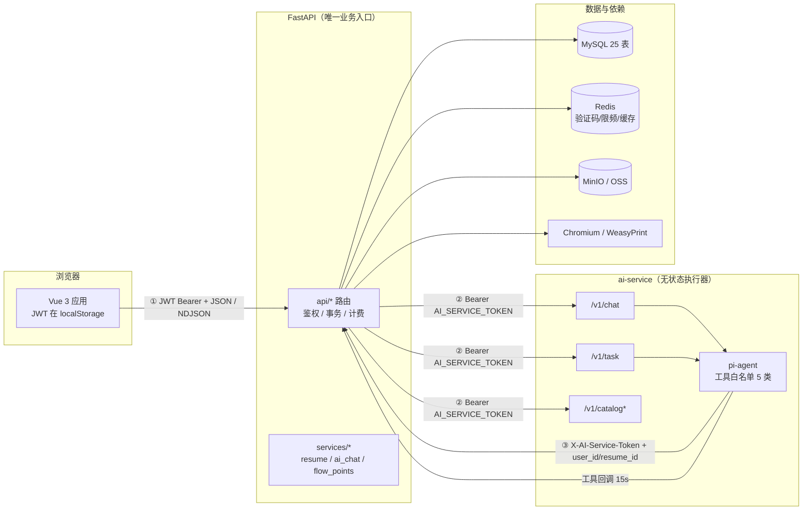
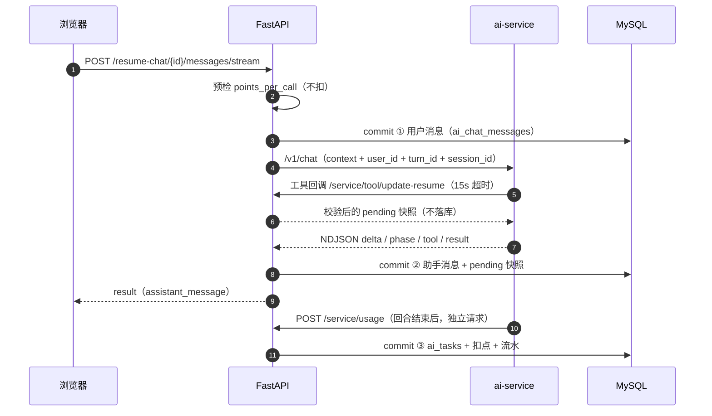
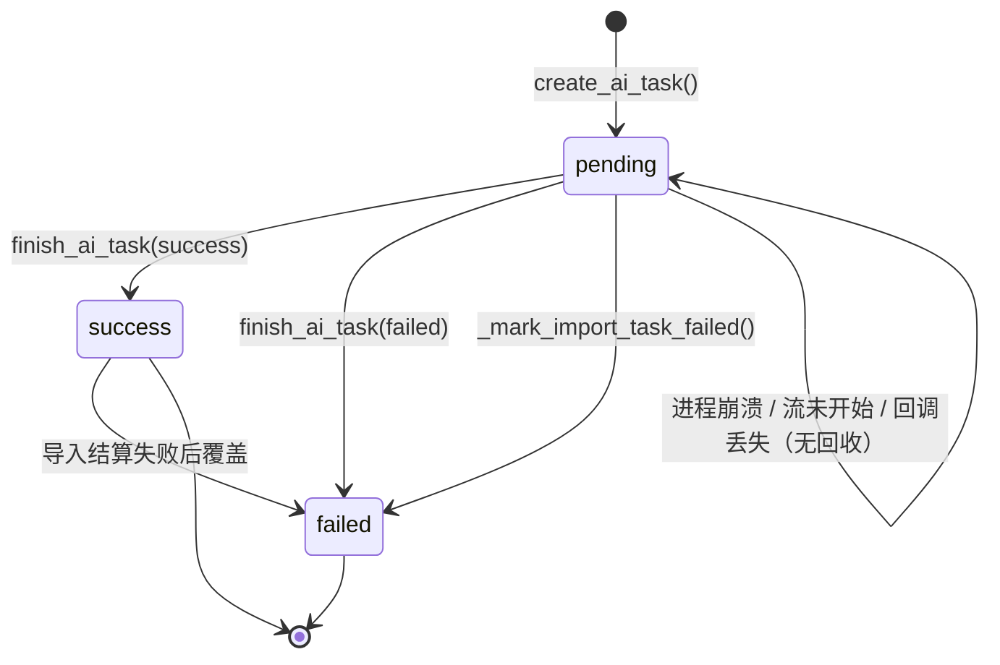
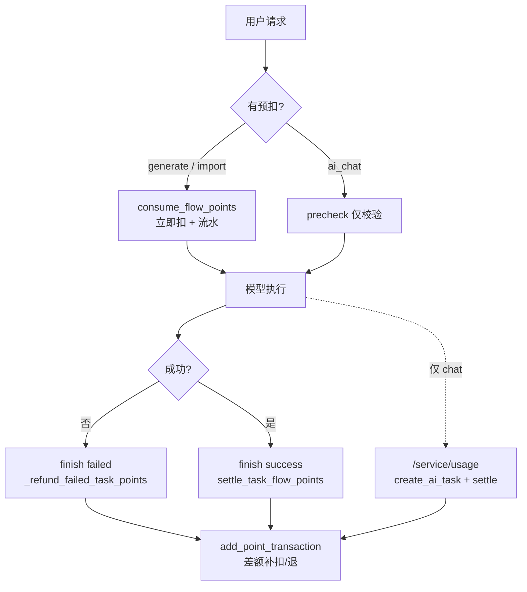

# Phase 4：ResumeFlow 跨服务业务链路与数据一致性审查

> 审查基线：`a8d451c`（2026-11-20）
> 审查范围：`frontend/` → `backend/` → `ai-service/` 的完整调用链，以及 MySQL / Redis / MinIO-OSS / Chromium 四类外部依赖。
> 审查方式：**只读**。全文精读三端的请求构造与收尾代码（`ai_service_client.py`、`api/ai.py`、`ai_chat_service.py`、`flow_points_service.py`、`ai_task_service.py`、`server.ts`、`agent.ts`、`billing.ts`），并按链路回读 `resumes.py`、`pdf_export_service.py`、`storage_service.py`、`resume_json_export.py`。
> 未执行：并发压测、故障注入、真实模型调用、数据库写入。报告里的「确认」指代码路径确定，「条件」指需要特定时序，「待验证」需运行时。

> **与前序报告的关系**：00 建立了模块地图，02 审查了 AI 服务内部与计费回调，03 审查了前端保存与对话。本阶段**不重复**它们的结论；对同一缺陷，只在「跨服务组合后产生新后果」时重新立项，并标注 `关联 02-B1` 这类出处。

---

## 1. 跨服务架构：三条跨界通道



三条通道的信任模型完全不同：

| 通道 | 凭证 | 携带身份 | 可否伪造 | 有效期 |
| --- | --- | --- | --- | --- |
| ① 浏览器 → FastAPI | 用户 JWT | 用户 | 否（签名） | 有，可过期 |
| ② FastAPI → ai-service | 静态共享令牌 | `user_id` / `resume_id` 明文 | 持有令牌即可 | **无过期、无 audience** |
| ③ ai-service → FastAPI | 同一个静态令牌 | 同样是明文 `user_id` | 持有令牌即可 | 无过期 |

**这是本阶段最重要的一条结构性事实**：用户身份在 ② ③ 之间退化成「请求体里的一个整数」，两侧都不再有签名或回合凭证。后文的 C1、C6 都长在这条缝上。

### 1.1 超时与预算矩阵

| 层 | 超时 | 位置 | 行为 |
| --- | --- | --- | --- |
| 浏览器 axios | 30s（导入 180s / PDF 120s） | `frontend/src/api/request.ts:11-14` | 超时抛错，界面提示 |
| 浏览器流式 fetch | **无超时** | `frontend/src/api/ai.ts:179-189` | 只能靠卸载/切页 abort |
| Nginx | 360s read | `frontend/nginx.conf:34` | 断开上游 |
| FastAPI → Node（httpx） | connect 5s / **read 180s（空闲）** | `backend/app/services/ai_service_client.py:45-47` | 空闲超时断开 |
| Node 回合 | **300s 总时长**（compose/`.env.example`；代码默认 60s） | `ai-service/src/config.ts:34`；`agent.ts:502,667`；`docker-compose.yml:90` | abort session |
| Tool 回调 | 15s | `ai-service/src/tools/http.ts` | 工具失败，模型可重试 |
| 浏览器 → FastAPI 之后 | 无总时限 | — | 慢速流可无限续命 |

**两个错位**：① 代理的 180s 是**空闲**超时，而 Node 的 300s 是**总时长**——一段长时间没有 delta 的工具/模型阶段会让代理先断开，Node 的总预算根本用不到；② 不设 `AI_TURN_TIMEOUT_MS` 时（直接 `npm run dev`）代码默认只有 60s，和部署值差 5 倍。后果见 C14。

---

## 2. 核心调用链

### 2.1 链路 A：认证与身份传递

```
登录：UI → POST /auth/login → users 表校验 → JWT → localStorage
每次请求：UI → Authorization: Bearer → get_current_user → user 行
AI 回合：Backend → payload{user_id, resume_id} → Node → 工具回调 payload{user_id, resume_id} → get_resume(user_id, resume_id)
```

- 用户 ID **不能被浏览器伪造**：所有用户态接口都走 `get_current_user`，AI 代理入口用同一个依赖取 `user`，再把自己的 `user.id` 写进 payload（`ai_chat_service.py:715`）。
- ai-service **不信任也未验证** `user_id`，它只是透传；真正的归属校验发生在回调落点：`service_update_resume` 里 `get_resume(db, payload.user_id, payload.resume_id)`（`api/ai.py:990`），跨用户会 404。所以「模型让 AI 服务去改别人的简历」这条路是堵住的。
- 但**同一条通道上的读接口没有二次收敛**：`/service/tool/info-fragments/search` 只按 `payload.user_id` 查（`api/ai.py:1090-1103`），`/service/usage` 只按 `payload.user_id` 记账（`:1173-1176`）。令牌一旦落到不该拿的人手里，读和记账是直接生效的，不需要任何简历归属。
- Token 过期：Backend 统一 401；前端 `request.ts:34-38` 与 `api/ai.ts:191-195` 都硬跳 `/login`；Node 永远看不到 JWT，因此不存在「AI 服务里残留过期身份」。

### 2.2 链路 C/D：一次对话回合的三次提交



**三次提交互相之间没有事务、没有共享 key**：

| 提交 | 内容 | 失败时 |
| --- | --- | --- |
| ① | 用户消息 | 回合不开始，无副作用 |
| ② | 助手消息（含 pending） | 用户消息成孤儿；节点仍可能继续跑并上报计费 |
| ③ | 任务行 + 扣点 | 用户已拿到回答；平台漏收（或记为 failed） |

这就是 C4、C5 的根。

### 2.3 链路 F/G/H 的入口与落点

| 链路 | 入口 | 外部依赖 | 事务边界 |
| --- | --- | --- | --- |
| F PDF | `GET /resumes/{id}/preview-pdf`、`POST /export/pdf`（`api/resumes.py:428`、`export_pdf`） | Chromium/WeasyPrint、本地磁盘 | 文件先落盘 → 再写 `export_records` |
| G JSON | `POST /resumes/{id}/export/json`、`POST /resumes/import-file`（`.json` 短路） | 无 | 直接建新简历，不覆盖 |
| H 对象存储 | `POST /files/upload-*`、`GET /files/{object_name}`（`api/files.py:23-88`） | MinIO/OSS | 先写对象 → 再插 `uploaded_files` |

### 2.4 链路 B / E 的跨服务结论（只写本阶段新增部分）

| 链路 | 跨服务事实 | 新结论 |
| --- | --- | --- |
| **B 自动保存** | 前端只发一次整份 `PUT /resumes/{id}`，后端 `update_resume` 走 `normalize_resume_document` 后**无条件覆盖**；`ResumeUpdate` 没有版本字段（`schemas/resume.py:151-156`）；乐观锁只长在 `restore_version` 上，且比较精度到秒（`resume_service.py:328`） | 保存与 AI 应用是**两条互不设防的整份写入**，谁的 commit 后到谁赢（C7）。版本快照只在 AI 写入前拍一张，无法重建并发交错后的中间态 |
| **E 翻译** | 翻译不是一个接口，而是 chat 的一个技能（`skills.ts:84-93`）——结果走 `update_resume` → pending → 用户确认；`resume.language` 列**不会被更新** | 「翻译」在数据层没有专属记录：`ai_tasks.feature` 记 `translate`，但 `/ai/histories` 只认旧的 `resume_translate`（03-C2）；语言一致性完全依赖 `resolve_resume_language` 的内容推断（C9） |

### 2.5 闸门核对：AI 能否绕过确认写正式简历

结论：**结构化路径不能**。写入 `resumes.resume_data` 的调用点只有四处：

| 写入点 | 触发 | 是否经用户确认 | 写前快照 | 规范化 | 并发保护 |
| --- | --- | --- | --- | --- | --- |
| `PUT /resumes/{id}` | 用户编辑保存 | 用户动作本身 | 无 | 有 | 无 |
| `resolve_chat_change(apply)` | 用户点「应用」 | 是 | 有（`source=ai`） | 仅审阅分支 | 无 |
| `restore_version` | 用户点「恢复」 | 是 | 有（`source=restore`） | 有 | 有（秒级） |
| `POST /info-fragments/apply` | 用户点「导入到简历」 | 是 | **无** | 有（走 `update_resume`） | 无 |
| `create_resume` 系列 | 新建简历 | 新对象 | — | 有 | — |

`/service/tool/*` 的全部端点都是只读或只返回快照（`api/ai.py:977-1153`），`import_fragments` 不 commit，`apply_proposals` 只在 decision 里调用。**这一点是本仓库最值得保留的边界**。

但「确认」本身的语义有洞：旧提案能覆盖新数据、apply 与 reject 可并发（C2）；AI 写进去的形状会在下一次手动保存时被静默改写（C7）；信息库导入是**唯一一条不经编辑器、由服务端直接合并正文的路径**（`api/info_fragments.py:150-168`），它和手动保存一样没有版本快照，但用户的操作发生在另一个页面，本地撤销栈根本覆盖不到。也就是说，闸门位置对，闸门的状态管理与安全垫不一致。

---

## 3. 服务间数据契约

### 3.1 三份契约的现状

| 契约 | 定义处 | 消费处 | 一致性 |
| --- | --- | --- | --- |
| `/v1/chat` 请求 | `ai_service_client.py:91-176` | `server.ts` 路由体 | 一致（`message/context/user_id/resume_id/images/model/model_override/skills/turn_id/session_id/trigger`） |
| `/v1/chat` 事件 | `server.ts:102-108` | `ai_chat_service.py:724-805` | 一致（`start/phase/delta/thinking/tool/result/error`），但 **`result` 的字段是弱校验**（见 3.2） |
| `/v1/task` | `ai_service_client.py:208-224` | `server.ts:819-855` | 一致（`task/input/model`），usage 只走 `result`，**不回调整**，这是刻意的 |
| Tool 回调 | `ai-service/src/tools/*.ts` | `backend/app/api/ai.py:870-1153` | **不一致**：回调不带 `session_id`（C6） |
| Usage 上报 | `server.ts:776-800` | `api/ai.py:1154-1276` | **不一致**：回调不带 `turn_id/session_id/message_id`（C1/C2） |
| Trace 上报 | `trace.ts` | `api/ai.py:1284+` | 一致，且 `trace_id` 唯一 + upsert（**全链路唯一真正幂等的上报**） |

### 3.2 `result` 的弱校验

`_stream_ai_service_reply` 只做类型过滤，不做结构校验：

```python
trace = data.get("tool_trace")                       # list → 逐个 isinstance(dict)
questions = data.get("pending_questions")            # 同上
raw_timing = data.get("timing")                      # 只保留 int/float/None
pending_fragments = data.get("pending_info_fragments")# 同上
pending = data.get("pending_change")
if isinstance(pending, dict) and pending.get("optimized_resume_data"): ...
```

`pending.optimized_resume_data` 直接进 `_save_assistant_message` 落库，**没有任何规范化**（长度、HTML、条目数、id 唯一性都不校验）。对比用户手动保存的 `PUT /resumes/{id}`，后者走 `normalize_resume_document`（`resume_service.py:126-130`）。

于是存在一条可复现的「形状漂移」：AI 写入的 `resume_data` 是 A 形状 → 用户下一次改任意字段触发保存 → 后端按 B 形状重写 → 内容被截断/去注释/标题本地化/重复 id 被改号。用户看到的是「我只改了一个电话，别的地方变了」。**关联 02-L2（apply 不 normalize），这里补上用户可感知的后果。**

同一个 `pending` 由工具 `validate_propose_change` 生成，而它只合并 + 跑数值守卫，不规范化（`ai_chat_service.py:1464-1517`）。所以即使不经过模型幻觉，只要模型输出超长字段，就会原样进入待确认快照。

### 3.3 契约里缺失的三个字段

| 缺失字段 | 影响 |
| --- | --- |
| `turn_id`（usage/tool 回调） | 计费行无法对应到具体回合/消息，见 C2 |
| `session_id`（tool 回调） | 校验上下文可能取错会话，见 C6 |
| `schema_version`（pending 快照） | 前后端/AI 三方对 `resume_data` 形状没有版本闸门 |

---

## 4. 状态机分析

### 4.1 `AiTask.status`



| 转换 | 位置 | 是否合法 | 问题 |
| --- | --- | --- | --- |
| `pending → failed`（导入结算失败） | `api/resumes.py:67-74` | 语义冲突 | 内容已交付，记录却变 failed |
| `success → failed` | 同上（先写 success 再被覆盖） | **非法** | 见 C5 |
| `pending` 永久停留 | 无回收任务 | **缺终止态** | 见 C3 |

`finished` 标志位只存在于生成器内存里；进程重启即丢。全仓没有「超过 N 分钟的 pending 任务」清扫（`main.py:38-54` 的 lifespan 只做启动日志与加密校验）。

### 4.2 `AiChatMessage.action_status`

`none → pending → applied | rejected`。三个问题：

1. **`pending` 无上限、无 TTL**：每轮都可能产生新的 pending，旧的不会被自动 supersede。`build_ai_service_context` 只注入最新一条（`ai_chat_service.py:455-470`），前端也只显示最新一条（`ResumeAiChatPanel.vue:134-145`），旧的永久 pending。
2. **apply 没有「基于哪个版本」**：`resolve_chat_change` 只检查 `action_status == "pending"`（`:1641-1643`），不检查它是不是最新提案。**旧提案可以覆盖新数据**，见 C2。
3. **apply/reject 没有行锁**：`db.get(AiChatMessage, message_id)` 后直接判断，两个并发请求（两标签页）都能通过检查。一个 apply 一个 reject 时，`status` 与简历内容可能各说各话。

### 4.3 其它状态

| 实体 | 状态 | 观察 |
| --- | --- | --- |
| `Resume` | 无状态列，只有 `update_time` | 乐观锁只接在版本恢复上（C7） |
| `ResumeVersion` | `manual/ai/restore` + 指纹 | 写入前快照；并发写入时可能都基于同一 before |
| `UploadedFile` | 无状态 | 对象写成功、DB 失败 → 孤儿对象（C13） |
| `ExportRecord` | `success`（失败不写） | 失败无审计；不记录渲染引擎（C12） |
| `FlowPointTransaction` | 只追加 | 不可变，方向正确（见 §9） |

---

## 5. 幂等性分析

| 接口 / 动作 | 幂等键 | 重复请求的后果 | 结论 |
| --- | --- | --- | --- |
| `POST /resumes/{id}/versions/{vid}/restore` | `expected_update_time`（秒级） | 第二次 409 | 基本安全，但同秒内失效 |
| `POST /ai/resume-chat/.../decision` | `action_status` 检查（无锁） | 第二次 409；并发可双通过 | 弱 |
| `POST /service/usage` | **无** | 重复任务 + 重复扣点（关联 02-B1） | 不安全 |
| `POST /service/tool/update-resume` | 无（但只读、不落库） | 重复无副作用 | 安全（天然幂等） |
| `POST /resumes/{id}/export/pdf` | 内容指纹缓存 | 重复生成同一文件；每次写一条 export_record | 可接受 |
| `POST /files/upload-*` | 无 | 重复上传产生重复对象 + 重复行 | 不安全 |
| `POST /ai/flow-points/redeem` | `(code_id,user_id)` 唯一 + `FOR UPDATE` | 第二次 400/唯一冲突 | **安全（正面样本）** |
| `POST /service/trace` | `trace_id` 唯一 + upsert | 覆盖，不重复 | **安全（正面样本）** |

**结论**：这个仓库里已经有两次「正确的幂等实现」（兑换码、轨迹），说明团队知道怎么做；偏偏**唯一直接动钱的跨服务回调（usage）没有复用任何一条**。这是设计落差，不是能力缺口。

---

## 6. 并发风险

| # | 场景 | 现状 | 后果 |
| --- | --- | --- | --- |
| 1 | 两个标签页同时保存同一简历 | 两个整份 PUT，无版本号（`schemas/resume.py:151-156`） | 后写覆盖，前者无感知（关联 03-F1） |
| 2 | 自动保存 + AI apply | 整份 PUT vs 整份快照，均无锁（`resume_service.py:109-137`、`ai_chat_service.py:1586-1623`） | 必丢一份（关联 03-F2/F4） |
| 3 | 旧提案 apply + 新提案 apply | 只校验 pending 状态 | 旧快照覆盖新结果（C2） |
| 4 | apply 与 reject 并发 | 无行锁 | 状态与内容不一致（C2） |
| 5 | 同一用户并发两个回合 | 无用户级并发限制 | 两条 usage，两条任务；计费正确但无法对账（C1） |
| 6 | 并发扣费 | `_apply_balance_delta` 条件 UPDATE（`flow_points_service.py:299-330`） | 不会扣成负数；但允许透支到 0 导致账实不符（关联 02-B2） |
| 7 | 并发兑换 | 行锁 + 唯一约束（`:518-577`） | 安全 |
| 8 | 并发导入 | 每请求占用一个线程池线程最长 180s（C15） | anyio 默认 40 线程被占满后，所有同步路由排队 |
| 9 | 删除简历 + 在途回合 | 无外键、无级联保护（C8） | 删除后仍写入消息/版本 |
| 10 | 多 worker 渲染同一 PDF | 进程内锁（`pdf_export_service.py:40-60`） | 重复计算；缓存删除可能删掉他进程正在用的文件 |

---

## 7. 数据一致性

### 7.1 三类「双写」都没有事务

| 双写 | 顺序 | 失败模式 | 现状 |
| --- | --- | --- | --- |
| 对象存储 + `uploaded_files` | 先对象，后 DB（`storage_service.py:178-195`） | DB 失败 → 孤儿对象；响应丢失 → 重复对象 | 无补偿、无对账 |
| PDF 文件 + `export_records` | 先文件，后 DB（`pdf_export_service.py:629-644`） | DB 失败 → 孤儿文件；记录失败 → 无审计 | 可接受（文件可复用） |
| 简历写入 + 版本快照 | 同事务（`_persist_resume_change`） | 回读不一致时 409 | 正确 |
| 信息库提案 + 简历写入 | `apply_proposals` 逐条 commit，再写简历（`resolve_chat_change:1657-1673`） | 简历写入 400/409 → 信息已入库、消息仍 pending | 半成功（关联 02-§4.10） |

### 7.2 删除路径留下的悬挂引用

`delete_resume`（`resume_service.py:140-148`）显式删了消息、会话、版本、PDF 缓存，但：

- **不删 `ai_tasks`**：任务保留 `resume_id`，`my_ai_records` 用 `outerjoin` 所以标题变 null，记录仍在（可接受，属审计）。
- **不删 `export_records`**：`file_path` 指向已被 `delete_cached_pdfs` 删掉的文件（`:146`），后台导出记录变成死链。
- **不删 `uploaded_files`**：头像与对话图片是账号级素材，保留是设计。

### 7.3 版本链在并发下不可重建

`_persist_resume_change` 在写之前抓一份 `resume.resume_data` 作为「AI 修改前」快照。若期间有 PUT 落库：

```
T1 apply 读 v0 → 写 version(v0) → 准备写 v1
T2 PUT 写 v2（v0 + 用户手改）
T3 apply 提交 v1（基于 v0）
```

最终库是 v1，用户手改丢失；版本历史里只有 v0 和 v1，**v2 从未存在过**，所以「从版本历史恢复手改」也做不到。这不是理论推演——`update_resume` 与 `_persist_resume_change` 都没有比较 `update_time`。

---

## 8. 故障恢复分析（12 个场景）

> 「最终状态」按当前代码推导，不含人工介入。

| # | 故障 | 最终状态 | 账务 | 可恢复性 |
| --- | --- | --- | --- | --- |
| 1 | AI 执行成功，Backend 没收到响应（连接断） | Node 侧 `res.on("close")` → abort → 回合按失败收尾，**不上报成功 usage**；若已 `res.end()` 则 usage 照发 | 通常不计费；模型成本平台承担 | 用户消息孤儿，需手动重发 |
| 2 | Backend 拿到结果，浏览器断开 | 助手消息已 commit；前端只收到部分 delta | usage 正常结算 → **扣费但用户没看到完整回答** | 刷新可见完整回答（DB 有） |
| 3 | 扣费完成后服务重启 | `ai_tasks` 已 commit；`FlowPointTransaction` 已 commit | 一致（单事务） | 安全 |
| 4 | AI 成功，Token 统计失败 | `usage` 为空 → Node 不发 usage（`billableUsage.length === 0`）→ **无任务行、无扣费、无失败记录** | 漏收 | 无痕，监控看不到 |
| 5 | 保存成功，前端认为失败并重提交 | 第二次 PUT 覆盖为同一内容（幂等） | 无影响 | 安全 |
| 6 | 确认成功，响应丢失 | DB 已 applied；前端 catch 回滚本地状态为 pending（`useResumeChatStream.ts:353-355`） | 无 | 重试 409，界面与库不一致，需刷新 |
| 7 | DB 提交成功，对象存储失败 | 上传接口先写对象后写库，**不会出现**此顺序；反序（对象成功、DB 失败）留孤儿对象 | 无 | 无对账 |
| 8 | Redis 不可用 | 限频放行（`core/throttle.py:1-12`）；验证码 503（`verification_code_service.py:79-81`）；公告缓存降级读库（`announcement_cache_service.py:41-49`）；兑换尝试上限失效（`flow_points_service.py:502-515`） | 无 | AI 链路不受影响（不依赖 Redis） |
| 9 | 两个浏览器编辑同一份简历 | 两份内存副本，两次整份 PUT，后写覆盖 | 无 | 版本快照只保留 AI 前的，手改无从找回 |
| 10 | AI 请求与自动保存同时改简历 | 见 §7.3；必丢一份 | 无 | 依赖用户自己发现 |
| 11 | 重复提交兑换码 | 行锁 + 唯一约束 + `used_count` → 第二次 400 | 正确 | 安全 |
| 12 | 用户取消，Agent 继续执行 | `res.on("close")` → abort → `runChat` 返回 failed 且 usage 为空 → **不扣费**；但模型 token 已消耗 | 漏收成本 | 用户消息孤儿 |

两条值得单独强调的结论：

- **场景 4 是「静默漏收」**：`billableUsage.length === 0` 时既不记账也不记失败，且 `runChat` 的 `failed` 分支被 `else if` 吃掉（`server.ts:781-810`）。平台既没收到钱，也没有任何一行记录说明「这一轮花了 token」。
- **场景 1/12 的取消语义是对的**（不扣费），但它同时意味着**未计费的模型消耗完全不可见**——对账时无法区分「用户取消」和「usage 丢了」。

---

## 9. 账务一致性审计

### 9.1 数据流



### 9.2 三个口径能否对上

| 口径 | 载体 | 能否回答「这一轮扣了多少」 |
| --- | --- | --- |
| 余额 | `users.flow_points` | 只有当前值 |
| 流水 | `flow_point_transactions` | 能，按 `task_id` |
| 任务 | `ai_tasks` | 能，按 `id` |
| 消息 | `ai_chat_messages` | **不能**——没有 `task_id` |
| 轨迹 | `ai_agent_traces` | 能，有 `turn_id`，但**不与 task 关联** |

**核心结论：账本级（余额 ↔ 流水 ↔ 任务）在单次成功路径上是一致的；回合级（消息 ↔ 任务 ↔ 流水）没有任何连接键。**

具体后果：

1. 用户问「这条回答扣了我多少点」——查不到，只能按时间猜。
2. 两条 usage 并发到达时，无法判断哪条属于哪条消息。
3. 退款按 `task` 粒度正确（`_refund_failed_task_points` 读流水净额），但**按回合对账不可能**。
4. 多模型回合会产生 N 条 task（`api/ai.py:1229-1246` 循环），看板把行数当回合数，统计翻倍。
5. 失败回合在 `ai_tasks` 里是一条 `failed`，但它没有对应的助手消息；成功回合的 task 创建时间晚于消息——按时间对齐会错位。

### 9.3 已有的一致性守卫（正面）

- `settle_task_flow_points` 用「应扣 − 已扣」算差额（`flow_points_service.py:398-411`），重复调用第二次 delta=0，**天然幂等**。
- `_refund_failed_task_points` 按流水净额退，不会退超过已扣（`:79-100`）。
- 兑换码用行锁 + 唯一约束 + 计数三重保护。
- `chat_summary` 用 `settle=False` 明确标成平台成本（`ai_chat_service.py:555-563`），不向用户收费。
- 余额扣减走条件 UPDATE，不会扣成负数。

---

## 10. 已确认问题

### P0

| ID | 问题 | 位置 | 触发 | 影响 |
| --- | --- | --- | --- | --- |
| **C1** | 跨服务身份无回合凭证：`user_id` 明文 + 静态令牌 + 无 audience/过期；且 ai-service 端口发布到宿主机 | `ai_service_client.py:129-137`；`api/ai.py:1173`；`docker-compose.yml:79-80`；`schemas/ai.py` | 令牌泄漏或 8300 可达 | 任意用户信息库可读、任意用户可被记账；无法定位是哪一轮（关联 02-S2，新增「无回合绑定 + 端口暴露 + 无过期」三点） |
| **C2** | 旧 pending 提案可覆盖新数据；apply/reject 无行锁 | `ai_chat_service.py:1636-1643` | 两标签页/旧提案 | 新修改被旧快照回滚；状态与内容不一致（新增，非 03-F2 的前端路径） |
| **C3** | 预扣任务无租约：`new_task` 先扣点，流未开始/进程崩溃则 `finally` 不执行 | `api/ai.py:301-346,418-500`；`task_service.py:16-37` | 生成请求后立刻取消/崩溃 | 点数永久占用、任务永久 pending，无回收（新增） |

### P1

| ID | 问题 | 位置 | 触发 | 影响 |
| --- | --- | --- | --- | --- |
| **C4** | 三段式提交无补偿：用户消息 / 助手消息 / 计费各自 commit | `ai_chat_service.py:895-930,389-415,672-805` | 断连、重启、超时 | 孤儿用户消息、无任务行、幽灵计费三种残缺状态（新增；02 只覆盖了取消语义） |
| **C5** | `ai_tasks.status` 同时表示执行结果与计费结果 | `api/resumes.py:67-74,204-213`；`api/ai.py:1252-1256` | 内容已交付但结算失败 | 成功被改写为 failed，看板成功率与 `points_used` 失真（新增） |
| **C6** | 工具回调不带 `session_id`，历史/证据取「最近活跃会话」 | `ai-service/src/tools/resume.ts:176-181`；`api/ai.py:995-1010`；`ai_chat_service.py:340-359` | 多会话切换后发言 | 数值守卫用错会话的用户消息 → 误拦或误放（新增） |
| **C7** | 四条写正文路径的安全垫不一致：规范化、版本快照、乐观锁各缺一块；信息库导入无版本快照 | `resume_service.py:109-137,328`；`ai_chat_service.py:1610-1613`；`api/info_fragments.py:150-168` | AI 写入后用户再保存 / 误点导入 | 内容被静默改写；并发写丢更新；误操作无法从版本历史回退（关联 02-L2，新增并发与回退缺口） |
| **C8** | 删除简历与在途回合竞态，无外键兜底 | `resume_service.py:140-148`；`ai_chat_service.py:389-415` | 回合中删除简历 | 删除后仍插入消息/版本，产生悬挂数据（新增） |
| **C9** | 翻译只改 `resume_data`，不写 `language` 列，语言全靠内容推断 | `skills.ts:84-93`；`resume_locale.py:126-146`；`ai_chat_service.py:1657-1665` | 部分翻译 / 中英混排 | 推断失败时标题被本地化回原文语言；导出/分享/编辑器可能不一致（新增） |
| **C10** | 用户 AI 记录暴露内部任务 `chat_summary` | `api/ai.py:536-563`；`ai_chat_service.py:526-533` | 打开「AI 记录」 | 用户看到 "chat_summary" 行，分页被平台内部任务占据（新增） |

### P2

| ID | 问题 | 位置 | 影响 |
| --- | --- | --- | --- |
| **C11** | JSON 导入不校验 `format_version` / `schema_version`，也无独立体积上限 | `resume_json_export.py:84-143`；`api/resumes.py:127-136` | 高版本文件静默丢字段；直连 8000 时无 25MB 限制 |
| **C12** | PDF 缓存签名不含 Chromium 版本；模板哈希 `lru_cache(1)`；`export_records` 不记引擎 | `pdf_export_service.py:465-490,504-511`；`models/export_record.py` | 升级后命中旧缓存；同简历不同产物无法追溯 |
| **C13** | 对象存储与 DB 非事务；配额检查非原子；删除只删索引 | `storage_service.py:161-196` | 孤儿对象累积；并发上传可超配额 |
| **C14** | 超时语义错位：代理 180s 空闲 < Node 300s 总时长 < Nginx 360s；代码默认 60s | `ai_service_client.py:45-47`；`config.ts:34`；`docker-compose.yml:90`；`nginx.conf:34` | 长时间无 delta 的阶段被代理先掐断；裸跑时预算骤降 5 倍；无端到端截止时间 |
| **C15** | 同步导入阻塞线程池：`asyncio.run` + 180s，无并发限制 | `ai_service_client.py:275-283`；`api/resumes.py:116-220` | 占满 anyio 默认 40 线程后，全部同步路由排队 |

---

## 11. 待验证风险

1. **C3 的实际发生率**：Starlette 在客户端已断开时是否会启动响应生成器，取决于版本与断开时机；需要在 8000 上做一次「发请求后立刻断开」的实验，观察 `ai_tasks` 是否停在 pending。
2. **C4 场景 1 的分界**：`res.on("close")` 在正常 `res.end()` 后也会触发，需要确认 abort 是否可能在 `runChat` 收尾阶段误伤 usage 上报。
3. **C5 的看板偏差幅度**：需要统计「status=failed 但 output_data 非空」的任务占比，才能量化成功率失真。
4. **C6 的触发频率**：需要确认 `AiChatSession.update_time` 在用户发消息时是否更新（当前只在助教落库/自动标题时更新），这决定「最近活跃会话」是否会指错。
5. **C9 的推断成功率**：拿 20 份真实翻译结果跑 `resolve_resume_language`，看有多少被判回 zh-CN。
6. **C12 的缓存命中**：升级 Chromium 镜像后是否有旧 PDF 复用，需要对比文件哈希与渲染时间戳。
7. **`express.json({limit:"20mb"})` 与 9×5MB 图片的组合**：base64 后约 60MB，超过 Node 20MB 上限（关联 02 的附件上限条目），需实测确认错误码与前端提示。

---

## 12. 修复建议

### 第一批（P0，先让钱和身份可追溯）

1. **给 usage 加 `turn_id` + 唯一索引**：`AiServiceUsageRequest` 增加 `turn_id`（复用 `ai_chat_messages.id`）与 `trace_id`；`ai_tasks` 增列 `turn_id`（唯一），重复上报直接 200 返回已有结果。这是把 02-B1 从「建议」变成「实现」的最小改动。
2. **给 apply 加条件更新**：`UPDATE ai_chat_messages SET action_status='applied' WHERE id=? AND action_status='pending'`，rowcount=0 就 409；同时在 apply 前比较 `message.id` 与 `MAX(id) WHERE action_status='pending'`，旧提案必须显式带 `force` 才允许。
3. **给预扣加租约**：`ai_tasks` 增 `expires_at`；启动时与定时任务把超过 10 分钟仍 pending 的任务标 failed 并退款；`generate` 的扣点改为「预扣 + 过期自动退」。

### 第二批（P1，让状态与口径自洽）

4. **拆开 `status`**：把「执行结果」与「计费结果」分成 `status` + `billing_status` 两列；看板只读 `status`，结算失败只改 `billing_status` 并保留 `points_used`。
5. **补齐跨服务对齐字段**：tool 回调带 `session_id`，usage 带 `turn_id`；`validate_propose_change` 用当前会话历史。
6. **统一写路径**：`_persist_resume_change` 改为 `normalize_resume_document`，并和 `update_resume` 共用同一个「写简历」函数；PUT 增加可选 `expected_update_time`，前端保存时带上。
7. **删除简历时冻结写入**：`delete_resume` 先删消息再删简历；`_save_assistant_message` 前重查 `resume` 是否存在（`db.get`），不存在就丢弃并记 warning。
8. **翻译后回写语言**：apply 时若检测到内容语言变化，同步更新 `resumes.language`（或在提案里显式带 `target_language`），避免依赖推断。
9. **用户记录过滤内部任务**：`my_ai_records` 默认排除 `chat_summary`（或加 `internal=true` 标记），`ai_feature_label` 补全兜底文案。

### 第三批（P2，收尾与防御）

10. JSON 导入校验 `format_version` 与 `schema_version`，不匹配时给明确警告或拒绝；`UploadFile` 读取前加大小上限。
11. PDF 指纹加入 `chromium` 版本与 `pdf_renderer`；`ExportRecord` 增 `renderer` 列；`_renderer_signature` 去掉 `lru_cache` 或加 mtime 失效。
12. 上传路径改为「先占位（DB pending）→ 写对象 → 置 success」，失败由清理任务回收孤儿对象；配额检查用条件插入或计数锁。
13. 统一超时预算：Node 回合 ≤ FastAPI read ≤ Nginx；Node 超时前主动发 `error` 事件说明「已超时」；前端展示可辨识的文案。
14. 导入改成异步任务（立即返回 task_id，前端轮询/流式读进度），避免占用线程池 180s。

---

## 13. 已检查 / 未检查范围

### 已检查

| 范围 | 内容 |
| --- | --- |
| 身份通道 | `core/security.py`（依赖注入面）、`ai_service_client.py` 全部请求构造、`api/ai.py` 的 `require_ai_service_token` 与各 `/service/*` 端点、`server.ts` 的 `authorize` |
| 对话链路 | `_stream_ai_service_reply`、`_stream_chat_turn`、`_save_assistant_message`、`build_ai_service_context`、`resolve_chat_change`、`_persist_resume_change`、`server.ts` `/v1/chat` 收尾、`agent.ts` 回合超时 |
| 任务链路 | `new_task`、`_ai_service_task_stream_response`、`finish_ai_task`、`_refund_failed_task_points`、`settle_task_flow_points`、`consume_flow_points`、`_apply_balance_delta`、`redeem_flow_points` |
| 计费契约 | `AiServiceUsageRequest`、`report_ai_service_usage`、`billing.ts`、`trace.ts` 上报体 |
| 导出/导入 | `pdf_export_service.py`（指纹/缓存/锁/记录）、`api/resumes.py` 的 import/export/preview、`resume_json_export.py` 全文 |
| 存储 | `storage_service.py` 上传与删除、`api/files.py` 代理与鉴权、`avatar_service` 渲染解析 |
| 基础设施 | `core/redis.py`、`core/throttle.py`、`verification_code_service.py`、`announcement_cache_service.py`、`main.py` lifespan、`docker-compose.yml` 端口与依赖 |
| 前端配合点 | `useResumeChatStream.ts` 的 decide、`stores/resume.ts` 的 updateResume、`api/ai.ts` 的流式错误处理（仅用于确认跨端时序） |

### 未检查 / 未执行

- 未做并发压测、故障注入、真实模型调用；C3/C4/C5 的触发概率均为静态推导。
- 未审查管理后台的权限模型与运营操作（`api/admin/*` 只读了 `ai_configs` 的目录代理与 `dashboard` 的统计口径）。
- 未审查 `ai-service` 的 pi-agent 内部实现（模型路由、工具循环细节），只到 `runChat/runTask` 边界（02 已覆盖）。
- 未验证 WeasyPrint 与 Chromium 的实际渲染差异（缺视觉基线）。
- 未核对 `docs/ai/*` 与实现的全部条目，只对照了 `ai-call-flows.md` 与 `rsi-plan.md` 中与本次结论相关的段落。
