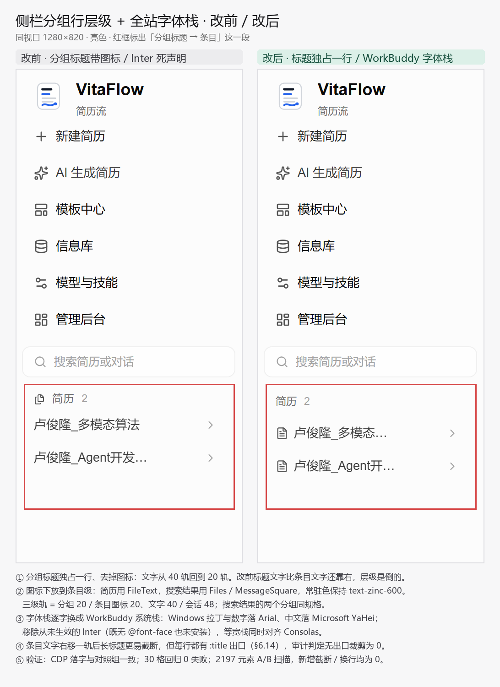
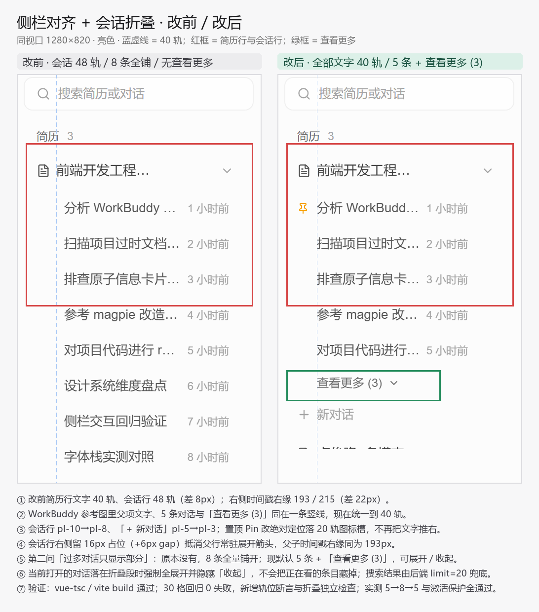
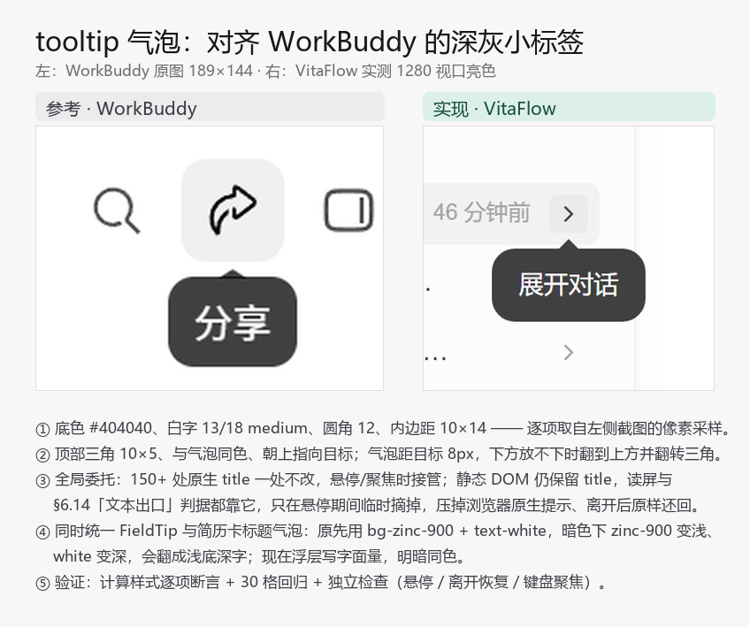

# ResumeFlow 设计系统

> 定位：规范化文档。描述项目当前 UI 的事实基线，并对不一致处给出**目标态规则**；发现的存量偏差统一收敛到文末「存量改造项」，不在本文档交付时修改代码。
>
> 受众：AI 结对协作（规则速查置顶）+ 前端开发者参考。

---

## 0. AI 协作速查

改前端时逐条遵守；与正文冲突以正文为准。

1. **只用 Tailwind 原子类**，不写自定义 CSS/SCSS（全局例外仅 `src/styles/index.css`）。
2. **灰阶只用 `zinc-*`**，禁止 `gray-*`/`slate-*`（存量 gray 见文末清单，遇到即改）。
3. **主操作色是黑（`zinc-900`）**，不是蓝色；`blue-600` 只用于链接、强调、信息提示、选中焦点。
4. 新 UI 组件先找 `src/components/ui/`，没有再用 shadcn-vue 生成后改造，禁止直接在业务组件里手写完整弹窗/下拉等复杂控件。
5. 弹窗一律遵循 ConfirmDialog 结构模式（Teleport + 遮罩 `bg-wb-scrim/40 backdrop-blur-sm` + `rounded-2xl shadow-wb-dialog` + 底部灰底按钮区；遮罩别再写 `bg-zinc-950/*`，暗色下会变白雾；入场用 `wb-anim-scrim` + `wb-anim-panel`，别让遮罩跟着面板一起位移，§6.25）。
6. 图标只用 `lucide-vue-next`，默认尺寸 `h-4 w-4`。
7. 轻提示用 `showGlobalToast()`（`src/utils/toast.ts`），不要自造 toast。
8. **主题用 `<html data-theme="light|dark">` 单开关**：`dark:` 变体已接到这个开关（§6.11），不要再写 `prefers-color-scheme` 媒体查询或 `.dark` 类；颜色走 `zinc-*` / `bg-wb-scrim/*` 语义变量，别写字面量。
9. 语义色：成功 `emerald-600`、危险 `red-600`、警告 `amber-500`，不要换其他色相。
10. 全局样式/浏览器兜底只能加在 `src/styles/index.css`，且需注释说明原因。
11. **扁平优先**：静态内容不叠「边框 + 阴影 + 底色」三件套；选中/聚焦只给一处信号（浅灰底 `bg-zinc-100` 或描边），阴影只留给浮层（下拉、弹窗、抽屉）。
12. **不用胶囊**：`rounded-full` 仅限头像、圆形图标按钮、圆点；分段控件、筛选标签、状态标记一律 `rounded-md`，选中态用 `bg-zinc-100`/`bg-zinc-200/70`，不用「黑底胶囊 + 内嵌白块 + 阴影」。圆角大小按 §1 圆角阶梯递进（行 6 / 控件 8 / 容器 12 / 大容器与弹窗 16），**不要把所有圆角统一压到 `rounded-md`**。
13. 图标默认单色（`text-zinc-400`，选中 `text-zinc-500`），不做彩色图标底块与 hover 上浮动画；**侧栏常驻图标例外**，统一 `text-zinc-600`（§3.4.1）。
14. **预览类卡片只留一圈框**：缩略图（简历预览、模板预览）一律贴边由卡片自身的 `ring`/`border` 当唯一边框，预览组件用 `bare` 模式去掉自己的 `border`+`rounded`，底部用渐变过渡到白，不要再套「外层边框 + 内层描边 + 页面白底」三层，否则会出现明显的框中框。
15. **弹窗交互由外壳负责**：所有基于 `AppDialog` 的弹窗自动获得 Esc 关闭、body 滚动锁（引用计数）、焦点进出、`role="dialog"`/`aria-modal`；业务侧不要再自己绑 keydown 或改 `body.style.overflow`。纯图标按钮必须有 `aria-label`（巡检脚本会把无名按钮计为缺陷）。
16. **设置类页面**：内容列 `max-w-3xl` 居中，白卡各占一块（`rounded-xl border-zinc-200 p-5 sm:p-6`），标题行右放状态/操作，说明文字独占一行，底部仅一行浅灰边界说明；密集表单可降到 `h-9 + rounded-lg + text-[13px]`，但同一页面内高度必须一致。涉及密钥/隐私等敏感能力时，最后一张卡必须如实写出「存哪里 / 谁能看到 / 如何彻底删除 / 轮换策略」四项（`dt/dd` 两列，不新增彩色卡片），并配一个需二次确认的破坏性操作与「最近使用记录」列表；部署状态用 `rounded-md bg-zinc-100 text-[10.5px]` 小标记，异常态才允许 `bg-amber-50`。不要写「绝对安全」「零知识」这类与代理架构不符的承诺。
17. **一对多配置用「列表 + 内联编辑区」，不用弹窗套弹窗**：模型配置、技能这类「可保存多条」的设置，卡片上半部是 `divide-y` 列表行（名称 + 次要信息一行、说明独占一行、右侧开关/编辑/删除图标），下半部是同卡片内展开的浅灰编辑区（`rounded-xl border-zinc-200 bg-zinc-50/40`）。这样 Esc/滚动锁归属简单、移动端不超屏、编辑态与列表能同时对照；只有单条、字段极少的编辑（如技能正文）才用 `AppDialog`。状态标记（`默认`、`推理 深度`、来源）用 `rounded-md bg-zinc-100 text-[10.5px]`，不要新增彩色徽章。
18. **触屏可达**：任何 `opacity-0 group-hover:opacity-100` 的真实操作按钮都必须加 `touch-always-visible`（全局样式里用 `@media (hover: none)` 强制常显）；不要用宽度断点代替，因为宽屏平板也可能没有鼠标。纯装饰性的箭头/提示文字不受此约束。
19. **列表/内容页三件套**：加载骨架（与卡片同尺寸同圆角）、空态（区分「库为空」与「筛选无结果」两套文案）、分页（`totalPages > 1` 才出现）缺一不可；卡片网格、分类 chips、悬浮操作的具体类见 §3.6，页面骨架见 §4.4。搜索/筛选请求必须防抖（≥260ms）且把条件真正传给后端，不要只在前端过滤一页数据。
20. **AI 输入区单一来源 `AiComposer.vue`**：`components/ai/AiComposer.vue` 同时承载工作台首页与简历内对话面板，外壳类名仍取自 `composerStyles.ts`。两端差异只能用 props 表达——首页传 `:show-session-actions="false"`（还没有会话，就不该有「新对话 / 清空」），其余（模型选择、图片附件、斜杠技能、Enter/IME 处理、发送键）必须完全一致。任何页面不要再手写「textarea + 发送键」的组合。
21. **侧栏「新建对话」挂在父行，不占列表行**：做成父行右侧的图标按钮（`MessageSquarePlus`，20×20，`hit-area` + `touch-always-visible`），hover 显形；它和时间戳**共用同一格**（`absolute right-2` 叠在时间上，hover 时时间淡出、图标顶上），不要另起一列——另占一格会把父行时间戳右缘挤得与会话行错开（§6.23 的对齐断言会红），标题也要白白让出 20px。会话列表末尾那一位只留给「查看更多 / 收起」，不要把新建动作做成列表里的一行（会被折叠挤走，且与默认标题「新对话」同字）。触屏常显时记得给同格文字加 `.touch-hide-meta`，否则两者叠在一起。
22. **tooltip 方向可按元素指定**：默认仍放下方（与 WorkBuddy 一致），但**下方紧贴可点条目、气泡落下去就会盖住邻居**的位置必须写 `data-tooltip-placement="top"`（`utils/tooltip.ts` 读取；那一侧确实塞不下才自动翻边）。侧栏父行右侧的「新建对话 / 展开对话」是一行里的图标、下面紧接会话列表，两个都朝上。tooltip 文案**只写动作名**，不写快捷键——快捷键由 `⌘/Ctrl + Alt + N` 这类全局手势承载，塞进气泡既长又抢注意力，还容易被误读成「必须按这个」。
23. **侧栏导航行不给原生 `title` 气泡**：侧栏是密集列表，原生 tooltip 是系统级浮层（深底、带尖角、约 1s 延迟），弹出必然盖住紧邻的会话行，且样式不受控。父行标题这类「被截断也只是少几个字、点开就是完整标题」的文字，出口用**父行按钮的 `aria-label`**（语义出口）+ 打开后看全文即可，不要再挂 `title`。这条只约束侧栏这类**导航密集区**；卡片式列表（简历库卡片用 `group/title` 自定义气泡）不受影响——那里的自定义气泡是控制样式的，不是原生 `title`。

---

## 1. 技术栈基线

| 项 | 事实 |
|---|---|
| 框架 | Vue 3 + Vite + TypeScript |
| 样式 | Tailwind CSS **v4**（`@import "tailwindcss"` 于 `src/styles/index.css`），无 SCSS |
| 无头组件 | radix-vue（shadcn-vue 模式，`components.json`：`cssVariables: false`） |
| 图标 | lucide-vue-next（约 45+ 文件使用），个别自绘 SVG（BrandLogo、FlowAgentIcon、FlowPointIcon） |
| 暗色模式 | 支持，`<html data-theme="light\|dark">` 单开关 + 中性阶变量翻转（§6.11）；首屏有防闪脚本，`useTheme` 提供浅色 / 深色 / 跟随三档 |
| 全局样式 | 唯一入口 `src/styles/index.css`（同时 `@import` 了 `wb-theme.css`）：body 背景 `#f7f7f8`（变量）、文字中性近黑、字体栈**逐字对齐 WorkBuddy 系统栈**（见 §2 字体栈）、开启字体平滑；`@theme` 覆盖了 zinc 灰阶（中性化）与 `--font-sans` / `--font-mono`；含 `.thin-scrollbar`、选区基线、富文本重置、旧浏览器 oklch/color-mix 兜底变量 |
| 字体单一来源 | `src/styles/wb-theme.css` 的 `:root` → `--wb-font-sans` / `--wb-font-mono`；`@theme inline` 的 `--font-wb-*`、`index.css` 的 `--font-sans` / `--font-mono` 和 `body` 全部引用它。**不要在第二个文件里再写一份字面量** |
| 注意 | Tailwind v4 **不使用 JS 配置文件**（原 `tailwind.config.js` 已删除）。没有自定义主题扩展，颜色直接用默认色阶（灰阶用 `zinc-*`）；不要在项目根新增 `tailwind.config.js`，v4 不会读取 |

**并列可点击行**：同一列表里相邻行之间必须留 **4px**（容器 `space-y-1`，或行自身 `mb-1`），**不允许行与行直接相接**——两块 `bg-zinc-*` 贴上就成了一条，看起来像「整块被选中」，也会让鼠标划过时分辨不出高亮的是哪一行。树形列表的父子之间单独用 `mt-1.5`（6px）拉开层级。

适用范围：侧栏主导航、简历树、会话行、搜索结果、账号菜单、右键菜单、管理后台二级导航。**改一处就要连带检查同一体系里的其它列表**，不要只修截图里看到的那一段。

**字号阶梯**（全站只允许下表这些档位，不再随手写 11/12/13 混排）

| 用途 | 类 | px | 字重 / 颜色 |
|---|---|---|---|
| 页面标题 | `text-[20px]` | 20 | `font-semibold` + `tracking-tight` + `zinc-900` |
| 区块/卡片标题 | `text-sm` | 14 | `font-semibold` + `zinc-900` |
| 正文（表单值、富文本） | `text-sm` | 14 | 常规 + `zinc-700` |
| 列表主文本（侧栏导航、简历行） | `text-[13.5px]` | 13.5 | `font-medium` + `zinc-700`（选中 `font-semibold` + `zinc-900`） |
| 列表次级（会话行、菜单项、二级导航） | `text-[13px]` | 13 | 常规 + `zinc-600`（选中 `font-semibold` + `zinc-900`） |
| 说明文字 | `text-[12.5px]` | 12.5 | 常规 + `zinc-500` |
| 分组标签 | `text-[11.5px]` | 11.5 | `font-medium` + `tracking-wider` + `zinc-400`（**侧栏分组标题例外**：不加 `tracking-wider`、用 `zinc-500`，见 §3.4.1 / §6.22） |
| 元信息（时间戳、计数） | `text-[11px]` | 11 | 常规 + `zinc-400`，配 `tabular-nums` |

规则：
- **最小 11px**，禁止 `text-[10px]`——中文在这个尺寸下发虚。
- **中文的 500 是假的**：字体栈是系统雅黑（对齐 WorkBuddy 后仍是 `Microsoft YaHei`，结论不变），只有 Regular 与 Bold 两档，`font-medium` 不产生视觉差异。要表达「选中/强调」必须用 `font-semibold`（600），并且字重变化只给选中态，不要给 hover（hover 只变底色）。
- 颜色承载层级：`zinc-900` 主 → `zinc-700` 常规 → `zinc-600` 次级 → `zinc-500` 说明 → `zinc-400` 元信息。**需要阅读的正文不许用 `zinc-500` 及更浅**。
- **hover / active 底色只走语义变量**：`hover:bg-wb-hover`（亮 `rgb(0 0 0 / 5%)`、暗 `rgb(255 255 255 / 6%)`）、`active:bg-wb-active`（8% / 10%），定义在 `wb-theme.css` 的 `--wb-bg-hover` / `--wb-bg-active`。**禁止再写 `hover:bg-zinc-50`（含 `/50` `/60` `/70`）**——zinc-50 是 `#fafafa`，在白色纸面上叠完几乎等于白，见 §6.41。列表项、表格行、菜单项这类「整块可点」的元素用这一档；已经在 `bg-zinc-100` 容器里的行悬停用 `hover:bg-zinc-200/50` 一档，不要跨。
- 标题 `font-semibold tracking-tight`，`text-[14px]` 与 `text-sm` 等价，新代码优先写 `text-sm`。

**字体栈实测（2026-11-15）**：WorkBuddy 桌面端**不自带中文 Web Font**，用的是系统字体栈。本机 `app.asar.unpacked/renderer/assets/dist-eTnrGI8p.css` 里的声明是

```
-apple-system, BlinkMacSystemFont, "PingFang SC", Helvetica, Arial,
"Microsoft YaHei", "微软雅黑", "黑体", Heiti, sans-serif
```

macOS 落 San Francisco + 苹方；**Windows 用 CDP `CSS.getPlatformFontsForNode` 实测：拉丁/数字 → `Arial`（25 字），中文 → `Microsoft YaHei` 微软雅黑（4 字）**，与「仅 `Arial, "Microsoft YaHei"`」的对照组结果完全一致。

**全站已对齐（§6.22，2026-11-15）**：字体栈唯一来源是 `wb-theme.css` 的 `:root` → `--wb-font-sans` / `--wb-font-mono`（逐字抄上面这串声明 + WorkBuddy 等宽栈）；`@theme inline` 的 `--font-wb-*`、Tailwind 的 `--font-sans` / `--font-mono` 与 `body` 全部引用它，**不再有第二份字面量**。改后 CDP 复测：33 字探针里 31 字落 `Arial`、2 字落 `Microsoft YaHei`，与「仅 `Arial, "Microsoft YaHei"`」对照组逐字一致；等宽栈落 `Consolas`（中文回落 `NSimSun`）。回归审计每格都会断言这三处同源且不含 `Inter`。

改前 `--font-sans` 以 `Inter` 打头，既没有 `@font-face` 引入、系统也未安装，**这个声明从未生效**——整串（含拉丁与数字）都落 `Microsoft YaHei UI`，与「微软雅黑」是两套字体文件。移除它是修正死声明，不是换一套字体设计。注意 `docs/design/workbuddy-visual-reference.md` 还记了聊天面 `--cr-font-family`（PingFang 打头）与 VS Code 继承的 body 栈：WorkBuddy 各区域确有多套栈，但 Windows 上落字同样是 Arial + 微软雅黑，本项目统一取上面实测的这一串。

**圆角阶梯**（五档，按元素尺寸递进；勿随意新造）

| 类 | 值 | 用途 |
|---|---|---|
| `rounded-full` | 9999px | 仅头像、圆形图标按钮、状态圆点；**不作为分段控件/标签/按钮的形状** |
| `rounded-md` | 6px | 密集列表行（侧栏简历行、会话行、「新对话」）、菜单项、内联小徽标、图标按钮的 hover 底、分段控件容器 |
| `rounded-lg` | 8px | 按钮（`Button.vue` 基础类即此档）、单行输入框、搜索框、附件缩略图、模块导航项、模式切换 tab、移动端底部 tab、缩略图内框 |
| `rounded-xl` | 12px | 卡片（简历卡、模板卡、个人中心/帮助中心/后台的白卡）、消息气泡、所有浮层（下拉面板、右键菜单、确认气泡、斜杠指令菜单）、大虚线空态框 |
| `rounded-2xl` | 16px | 大容器与弹窗：对话输入区（composer）、`AppDialog`、`ConfirmDialog`、导出进度、轻量提示卡、编辑器内的表单卡 |
| `rounded-3xl` | 24px | **仅营销面**：首页 hero 纸面、首页模板展示卡、功能卡（`sm:` 档）。应用内的卡片/弹窗不要用这一档 |

判断口诀：**行 6 / 控件 8 / 容器 12 / 大容器与弹窗 16 / 营销面 24**。看过 WorkBuddy 的实测基线——删除确认气泡圆角 12px、气泡内按钮 8px、侧栏列表行接近直角（4–6px）、对话输入框 16px（大高度容器）、圆角刻度 0/2/4/6/8/12/16/20/24，与上表一致；单调地把所有圆角压到 6px 会让 40px 以上的容器明显发「方」，把列表行提到 12px 又会回到胶囊感。

**不要写任意值圆角**：`rounded-[2rem]`、`rounded-[20px]`、`rounded-[1.25rem]` 这类一律不许（2026-11-14 已把 46 处全量归位到阶梯上，原 32px 全部降到 12/16/24）。缩略图内框比外框低一档：外 12 → 内 8，外 16 → 内 12。

**对话输入区（composer）的结构基线**（对齐 WorkBuddy）：外层 `rounded-2xl border border-zinc-200` + 极轻阴影，聚焦时只把边框提到 `zinc-300` 并加 `ring-2 ring-zinc-900/[0.04]`；底部工具条左起为「`+` 加附件 → 图标+模型名+⌄ 的纯文字 Select」，右侧为「新对话 / 清空 / 圆形发送（`rounded-full bg-zinc-900`，禁用变 `bg-zinc-200`）」；输入区与工具条之间不留分隔线。

**composer 尺寸基线**（2026-11-24 上调，此前 13px 字 + 单行高度放在这么宽的列里明显偏小）：输入区 `px-4 pt-3.5 text-[14px]`，`sm:` 升到 `px-5 pt-4 text-[15px]`；文本域初始 `min-h-[56px] sm:min-h-[68px]`、上限 `sm:max-h-[200px]`（超出转内部滚动）；工具条 `px-2.5 pb-2.5 pt-1 sm:px-3`；工具条内的图标按钮、ghost Select 与发送键**统一 36px（`h-9`）**，同一行不出现三种高度。文案值都在 `components/ai/composerStyles.ts`，两端只引用、不各写一份。

**宽度由宿主决定，不由 composer 决定**：首页列宽 800px；编辑器对话列 700px 且左右各留一档 padding（`px-4 md:px-6`），与上方消息列表同宽同对齐。

**不透传 attrs 的组件，外部 `class` 会被静默丢弃**（2026-11-24 实际踩到，全仓修了 15 个）。两类中招：
1. **多根模板**（如 `form` + `ConfirmDialog`）——Vue 不知道该合并到哪个根，直接丢弃；
2. **根只有 `<Teleport>`**（各类弹窗）——attrs 停传送门上，到不了可见面板。

表现都一样：不报错、不警告，只是**样式没生效**（输入框撑满父容器、贴死两边；传 `class="mt-5"` 毫无反应）。修法：组件内 `defineOptions({ inheritAttrs: false })` + 在语义根（面板层，不是遮罩）上 `v-bind="$attrs"`；有 `v-if`/`v-else` 多分支的要**逐分支绑定**。给组件传 `class`/`style`/`id` 前，先确认它有没有 `inheritAttrs: false`。


另：`w-[calc(100%-2rem)]` 这种减号不带空格的写法**是有效的**——Tailwind 编译（Lightning CSS）会把任意值规范化成 `calc(100% - 2rem)`。排查宽度异常时不要往这上面归因，先看元素上的 `className` 里到底有没有那条类。写法上仍推荐 `w-[calc(100%_-_2rem)]`（下划线代替空格），成文即合法，不依赖构建链的隐式修补。

**Button 的圆角覆盖坑**：`Button.vue` 基础类已含 `rounded-lg`，调用处**不要再写 `rounded-md`**（Tailwind 同组工具类按尺度排序，基础类会盖掉它，代码与实际渲染不一致）。需要更圆时写 `rounded-xl`（大于基础档才生效），需要更方时只能改基础类。

**阴影阶梯**：默认**无阴影**（静态卡片用 `ring-1 ring-zinc-200/70` 或 `border-zinc-200` 表达边界）；浮层一律用 `shadow-wb-popup`（下拉、弹窗、抽屉、toast），不再出现 `shadow-xl` / `shadow-2xl`。聚焦态用 `ring-1 ring-zinc-300`、`focus-within:ring-2 ring-zinc-900/[0.04]` 表达，不用彩色 glow。编辑器画布内允许自绘 rgba 阴影，业务页面不允许。

**z-index 约定**：全站只有 **9 档命名 token**，定义在 `styles/wb-theme.css` 的 `@utility z-*`。新浮层先在这张表里找档位，**不要就地写 `z-[数字]`**。

| 档 | 类 | 值 | 用途 |
|---|---|---|---|
| 内容抬升 | `z-base` | 10 | 渐变遮罩、图片上的操作条、卡片内浮层 |
| 组件上层 | `z-raised` | 20 | 面板头、装饰浮层、表单行 hover 时抬升 |
| 吸顶 | `z-sticky` | 30 | sticky 导航、编辑器工具条、拖拽分隔条、移动端底栏 |
| 遮罩 | `z-scrim` | 35 | 抽屉/菜单的全屏点击遮罩 |
| 抽屉 | `z-drawer` | 40 | 抽屉与侧面板（编辑器样式/模板面板） |
| 弹窗 | `z-modal` | 50 | `AppDialog`、ConfirmDialog、全屏预览 |
| 次级层 | `z-overlay` | 60 | 叠在弹窗之上：`ConfirmPopover`、日期层、二级弹窗 |
| 浮层 | `z-popover` | 70 | Select content、侧栏右键菜单 |
| 提示气泡 | `z-tip` | 75 | 全站 tooltip（§6.24）：必须高于弹窗与下拉，低于 toast |
| 提示 | `z-toast` | 80 | `toast.ts`，永远最上 |

排序口诀：**内容 < 吸顶 < 遮罩 < 抽屉 < 弹窗 < 次级层 < 浮层 < 提示气泡 < 提示**。`z-popover` 必须高于 `z-modal`——Select 的展开面板要能盖住它所在的弹窗；tooltip 再高一层，但**不能盖过 toast**。

---

## 2. 设计 Token（语义 → Tailwind 类映射）

> 本项目不定义自定义 token 变量，语义靠「映射表 + 使用规则」约束；映射对象是 Tailwind 默认色阶。

### 2.1 色彩

| 语义 | Tailwind 类 | 色值 | 使用场景 |
|---|---|---|---|
| 主操作色（近黑） | `bg-wb-primary` / hover `bg-wb-primary-hover` | 日 #000000e6 / 暗 #ffffffeb | 主按钮（见 §6）；管理后台选中态、toast 底、深色徽标仍用 `bg-zinc-900` |
| 强调色（蓝） | `text-blue-600` / `bg-blue-50` 等 | #2563eb | 链接、进度/信息图标、编辑器标题聚焦态、蓝底浅色提示区 |
| 成功 | `text-emerald-600` / 底 `emerald-50`、toast 图标 `emerald-400` | #059669 | 保存成功、成功 toast |
| 危险 | `bg-red-600` / hover `bg-red-700`、文字 `text-red-600`、底 `red-50` | #dc2626 | danger 按钮、删除确认、错误文案 |
| 警告 | `text-amber-500` | #f59e0b | 保存中状态、琥珀色提示（「未选择」等） |

**规则**：
- 主按钮 = `<Button>` 默认档（`bg-wb-primary text-white hover:bg-wb-primary-hover`，100ms、按下缩 .97）；内联写法用同一组值。蓝色不是主操作色，禁止把主按钮改成蓝底。
- **填色与文字必须成对**：`bg-wb-primary` 上的字用 `text-white`（暗色下 white 代表纸面色，会自动变深）；`bg-red-600` / `bg-blue-500` 这类**饱和强调填充**上的字用 `text-wb-on-solid`（两种主题都是白色）。压在照片/遮罩上的字用字面白 `text-[#fff]`，不要用 `text-white`。
- **不要用 class 覆盖 Button 的观感**：给 `<Button>` 传 `class` 只写尺寸、圆角、间距、宽度（`h-11`、`rounded-xl`、`px-8`、`w-full`）。颜色、阴影、`transition-*`、`active:scale-*` 一律由组件决定——写上去会盖掉组件默认值，历史上有 27 处这样退回了旧观感。
- 语义色只允许上表色值；需要浅底时用对应 `-50` 色。
- 唯一扩展：能力/标签类徽标允许 `purple`（`bg-purple-50 border-purple-200/60 text-purple-700`，如「多模态」标签）；purple 不得用于按钮、文字正文或状态反馈。
- 灰阶一律 `zinc`。`gray-*` 是存量偏差，新代码禁止。

### 2.2 背景分层

| 层 | 类 | 说明 |
|---|---|---|
| 页面底 | body `var(--wb-page-bg)`：日 `#f7f7f8` / 暗 `#0b0b0d`；局部 `bg-zinc-50/30~50` | 浅灰底 |
| 纸面 | `bg-white`：日 `#ffffff` / 暗 `#17171b` | 卡片、弹窗面板、输入框底色 |
| 卡片 | `bg-white border border-zinc-200`（或 `ring-1 ring-zinc-200/70`），**无阴影** | 内容承载单元 |
| 嵌入区 | `bg-zinc-50/50` ~ `bg-zinc-100/80` | 卡片内的次级分区 |
| 毛玻璃页头 | `bg-white/80 backdrop-blur-md` | 用户端/编辑器顶栏 |
| 遮罩 | `bg-wb-scrim/40 backdrop-blur-sm` | 弹窗背景。**不要用 `bg-zinc-950/40`**——它会随主题翻成白色雾 |
| 吸顶条 | 必须带 `border-b border-zinc-200/60`（或 `ring-b`），滚动时内容从它下面穿过要有明确分界 | 不靠阴影区分——静态内容一律无阴影 |

**阴影只属于浮层，且分 8 档**（§6.25）：`card` / `card-soft` / `card-hover` / `dropdown` / `dialog` / `dialog-md` / `drawer` / `elevated`，另保留 `popup` 作存量兜底。按「离用户多近」选档，不按大小；同一个组件换位置不换档。静态内容（列表行、输入框、开关滑块）仍然一律无阴影。

### 2.3 文字分级

| 层级 | 类 | 用途 |
|---|---|---|
| 标题 | `text-zinc-900`（ ConfirmDialog 标题用 zinc-900）+ `font-semibold` | 卡片/弹窗标题 |
| 正文 | `text-zinc-700` ~ `text-zinc-800` | 表单值、列表内容 |
| 次要 | `text-zinc-600` | 说明、导航未选中 |
| 辅助/占位 | `text-zinc-500` / `text-zinc-400` | 描述文字、placeholder、禁用图标 |

**截断与出口**：用 `truncate` / `line-clamp-N` 就默认它可能会裁掉内容，此时必须同时给出完整文本出口——自定义 hover 气泡优先，其次 `title`，**两者不并用**（会弹两个）。中文标签不要靠换行规避截断，断行点几乎必然落在词中间。详见 §6.14。

### 2.4 边框

- 统一 `border-zinc-200`，页面顶栏等轻分隔用透明度变体 `border-zinc-200/60 ~ /80`。
- 卡片内分隔线 `border-zinc-100`。
- 聚焦（鼠标/程序化）：输入框 `focus:border-zinc-500`；Select 打开态 `border-zinc-900 ring-1 ring-zinc-900`；其余输入类控件统一 `focus:border-zinc-900`，**不再使用蓝色聚焦环**（2026-11-14 已收口）。
- 聚焦（键盘）：全站一条全局规则——`:is(a, button, [role=button], [role=tab], [role=checkbox], [role=radio], [role=option], [role=menuitem], [role=switch], summary, [tabindex]:not([tabindex="-1"])):focus-visible` 画 `2px solid var(--wb-focus-ring)`、`outline-offset: 2px`。只在 `:focus-visible`（键盘 Tab / 读屏）出现，鼠标点击不出现；**输入类控件排除在外**，它们靠边框加深表达焦点，再叠外描边会出现双边框。写新组件时只要用 `<button>` 或语义 `role`，焦点环自动生效，不需要自己写 `focus:ring-*`。

### 2.5 间距与密度

间距不用「看着差不多」，只用 **4 的倍数**：`4 / 8 / 12 / 16 / 20 / 24 / 32 / 40 / 48`。半档只允许 `2px` 用于图标与文字的贴合间距（`gap-0.5`）。

| 值 | 类 | 典型用途 |
|---|---|---|
| 4 | `gap-1` / `space-y-1` / `mb-1` | 相邻可点行之间、图标与徽标 |
| 8 | `gap-2` / `p-2` / `px-2` | 行底色距容器边缘、图标与文字、页边距（窄容器） |
| 12 | `px-3` / `gap-3` | 行内文字距底色边缘、卡片内边距（小） |
| 16 | `p-4` / `space-y-4` | 卡片内边距、表单纵向间距 |
| 20 | `px-5` / `pl-5` | **侧栏内容轨**（图标/标题左缘）、段落间距 |
| 24 | `p-6` / `space-y-6` | 页面区块间距、大卡片内边距 |
| 32 / 40 | `px-8` / `pl-10` | 页面左右留白、其它二级缩进（侧栏会话行现为 `pl-8` = 32，见 §6.23） |

**侧栏内容轨（20 / 40，只有两条）**——这是「看起来松不松」的主因，比行高更敏感：

| 部位 | 位置 | 算法 |
|---|---|---|
| 行底色块 | 距面板左边 8 | 容器 `px-2` |
| 一级轨（导航图标、**分组标题文字**、简历条目图标） | 距面板左边 20 | 8（容器）+ 12（行内 `px-3`），或标题行直接 `px-5` |
| 二级轨（简历条目标题、会话行文字、骨架、「查看更多 / 新对话」文字、搜索结果条目标题） | 距面板左边 40 | 有图标的行：20 + 图标 14 + `gap-1.5` 6；无图标的会话行 / 查看更多：`pl-8`（32 + 容器 8）；「新对话」`pl-3` + `Plus`(14) + 6（搜索框文字 42 属同一带） |

**没有三级轨（§6.23）**：曾把会话行让到 48 轨制造「20 → 40 → 48 单调递增」，但对照 WorkBuddy 截图后撤回——它的父项文字与所有对话文字同轨，层级靠「分组标题独占一行 + 图标只属于条目 + 选中加粗」表达，不靠逐级缩进。右移一档还会让长标题更早截断。

判定口诀：**底色比文字轨多让 12px（左右各一）；全站侧栏只有 20 / 40 两条文字轨**——分组标题与所有常驻图标在 20，父行、会话行、查看更多、新对话的文字全在 40，上下对齐成一条竖线；「父级」由图标承担，不是靠把标题推到二级轨（改前正是这样，造成层级倒挂，见 §6.22）。底色块与文字轨同宽会显得「文字被框顶住」，往外扩到面板边缘则会失去轻盈感。

**行与命中区**：

| 项 | 规格 |
|---|---|
| 行高 | 列表行 32（`h-8`，或 `py-1.5` + `leading-5`）；导航行 36（`h-9`）；菜单行 32 |
| 行高与字号比 | 保持 **2.3–2.7**（13.5px 字 → 32px 行）。低于 2.2 会挤，高于 3 会散 |
| 行距 | 兄弟行 4，父子行 6（见 §3.4.1） |
| 最小命中区 | 可点元素 ≥ **28×28**。图标按钮视觉 20 时，用 `p-1`/`-m-1` 或透明 `::before` 外扩，不放大图标本身 |
| 命中区写法 | 统一用 `hit-area` 工具类（`::after` 外扩 `-4px -2px`，视觉尺寸不变，见 §6.10）。相邻的可点元素之间必须留够间隙，使两边的外扩**相切而不重叠** |
| 整行可点 | 列表行必须整行可点（行容器内不要再套一个只有文字可点的内层） |

**图标尺寸**——按「角色」分档，不是按需调：

| 角色 | 档 | 类 | 用在哪 |
|---|---|---|---|
| 交互图标 | 12 | `h-3 w-3` | 时间戳、徽标内、pin、行内 chevron（分组标题**不带图标**，§6.22） |
| | 14 | `h-3.5 w-3.5` | 行内动作图标、输入框内图标、**树形列表条目前置图标**、模型名前的小图标 |
| | 16 | `h-4 w-4` | **默认档**：导航图标、按钮图标、工具条、表单前后缀 |
| | 20 | `h-5 w-5` | 页面级操作（顶栏按钮）、侧栏导航、设置页行图标 |
| 图标块 | 24 | `h-6 w-6` | 只在 48px 方块/圆形容器里用（`h-12 w-12` + 24 图标），如 hero 图标、导入进度头部 |
| 空态 / 占位 | 28 | `h-7 w-7` | 空列表、无结果、卡片内占位（`StateBlock` 的 icon） |
| 整页加载 | 40 | `h-10 w-10` | 整页 spinner、结果页插画 |

- **同一行只出现相邻两档**（14 配 16 可以，12 配 20 不行）。这一条最容易被破坏——聊天输入框那排曾是 14/16/17/18 四个尺寸挤在一起，肉眼就是「图标大小不一」。
- 不用 `h-4.5`、`h-[17px]` 这类「差一点点」的值：18 和 16 差 2px 看不出「有意为之」，只显得没对齐。
- 品牌标识（`BrandLogo` 的 36px 图标）不属于图标规范，它是 logo。
- **描边**：交互图标（≤20）用 `1.75`，装饰图标（≥24）用 `2`；同排必须一致。勾选标记允许 `stroke-[3]`，品牌插画不在此列。默认不写 `stroke-width` 就是 2。

### 2.6 主题（亮 / 暗）

**唯一开关是 `<html data-theme="light|dark">`**，不许用 class、不许用 `prefers-color-scheme` 媒体查询直接写样式（`dark:` 变体已经被改成跟 `data-theme` 走）。

| 项 | 规则 |
|---|---|
| 怎么切 | 侧栏用户菜单 →「外观」三档：浅色 / 深色 / 跟随。用户没选过就跟随系统；选了「跟随」会清掉 localStorage |
| 首屏 | 主题在 `index.html` 的内联脚本里定，**不能等到 Vue 挂载**——否则会闪一帧白底 |
| 中性阶 | `zinc-50…950` 把值换成 `var(--wb-n-*)`，暗色是另一套手调值（不是明度镜像）。所以全站 2900+ 处 `zinc-*` 一个字都不用改 |
| `white` | 表示**纸面**：日 `#fff` / 暗 `#17171b`。于是 `bg-white` 是深色卡片、`text-white` 是压在浅色填充上的深墨。压在照片/遮罩上的白字必须写字面 `text-[#fff]` |
| 强调色 | 不做整套翻转（同一个 `red-600` 既当字又当底）。浅底 `bg-*-50`、描边 `border-*-200`、文字 `text-*-400..700` 由桥接层按用法分别处理；**实心填充 `bg-*-500/600/700` 不动**，上面的字用 `text-wb-on-solid` |
| 新代码 | 优先语义 token：`bg-wb-surface` / `text-wb-ink` / `bg-wb-hover` / `bg-wb-primary` / `bg-wb-scrim`。`zinc-*` 是兼容桥，不是首选 |

**暗色档取值的依据**（不是凭感觉调）：让**同一档在两种主题下的对比度尽量持平**。日间 `zinc-400` 在白底只有 2.5:1（刻意做弱），暗色就取到 `#83838d`（对 `#17171b` 约 4.5:1）——宁可略强，也不让弱化文字彻底消失。`zinc-500` 日间 5.07:1、暗色 5.5:1，`zinc-900` 两边都是主文字档。

### 2.7 选区与拖拽

桌面应用和网页的手感分界线就在这里：**控件不是文本，内容才是文本**。双击导航项留下蓝色选区、拖动分隔条选中半屏文字，都是「这是个网页」的瞬间暴露。

| 部位 | 规则 | 实现 |
|---|---|---|
| 按钮 / 标签 / 菜单项 / 开关 / 复选单选 | **不可选** | 全局基线 `@layer base` + `:where(...)` 设 `user-select: none`。用 `:where` 把特异性压到 0，任何显式 `select-text` / `.selectable` 都能覆盖回来 |
| 导航里的 `a[href]` | **不可选** | 基线刻意不含 `a[href]`（正文里带链接的段落要能复制），只命中 `nav` / `role=navigation|tablist|menu` 下的链接；不在语义容器里的**跳转型**链接（侧栏 `<aside>`、帮助中心「快捷入口」、首页卡片头部的「全部简历」）逐个补 `select-none` |
| 正文段落、输入框、富文本、AI 回复 | **保持可选** | 不加任何全局 `select-none`。审计必须复核「正文段可选率」，防止基线误伤 |
| 拖拽期间 | **整页临时锁定** | `mousedown` 时 `body.userSelect = 'none'` + `e.preventDefault()`（否则按下瞬间就起选区）；`mouseup` 还原 |
| 拖拽收尾 | **必须有多路兜底** | 鼠标在窗口外松开时收不到 `mouseup`，只靠它整页会**永久不可选中**。在 `mousemove` 里判断 `e.buttons === 0` 就地收尾，再监听 `window.blur`（切走窗口时同样漏 `mouseup`）；三条路径统一走一个 `onMouseUp()`，避免重复解绑 |
| 分隔条命中区 | 视觉 16px，有效 ≥ 24px | 用 `after:absolute after:-left-1 after:-right-1` 伪元素外扩，不放大可见线条（同 §2.5 命中区写法） |

判据：任一页面上「可选中文字的交互元素」必须为 **0**，而正文段落的可选率必须为 **100%**。审计按 `getComputedStyle(el).userSelect !== 'none'` 统计，再用双击实测收尾（见 §6.17）。

---

## 3. 组件规范

基础组件位于 `src/components/ui/`（shadcn-vue 生成后手写改造），通用展示组件在 `src/components/common/`。

### 3.1 Button — `ui/button/Button.vue`

```vue
<Button variant="default|outline|ghost|danger" size="sm|md|icon" :disabled />
```

| variant | 样式 | 场景 |
|---|---|---|
| `default` | 黑底白字（目标 `bg-zinc-900 hover:bg-zinc-800`，存量 `gray-900` 待改） | 主操作，一屏至多一个 |
| `outline` | 白底 `border-gray-200`（待改 zinc-200）`text-gray-900` | 次操作 |
| `ghost` | 透明底 hover `bg-gray-100`（待改 zinc-100） | 图标按钮、工具栏 |
| `danger` | `bg-red-600 text-white hover:bg-red-700` | 删除等破坏性操作 |

- 尺寸：`sm` = `h-8 px-3`；`md` = `h-10 px-4`；`icon` = `h-9 w-9`。统一 `rounded-lg text-sm font-medium`，`disabled:opacity-50`。
- 规则：同一操作区（弹窗底部、卡片尾部）按钮高度必须一致；危险操作旁必须配取消按钮。

### 3.2 弹窗 — 统一外壳 `ui/dialog/AppDialog.vue`

所有弹窗必须基于 `AppDialog`（Teleport + 遮罩 `bg-wb-scrim/40 backdrop-blur-sm` + `rounded-2xl shadow-wb-dialog max-h-[90vh]` + 头部/底部结构），通过 props 定制：`open`（v-model:open）、`title`/`description`（默认头部）、`maxWidthClass`、`bodyClass`/`headerClass`/`footerClass`、`showClose`/`overlayClose`；`#icon` 插槽加头部图标，`#header`/`#footer` 插槽全自定义。确认类弹窗用 `ConfirmDialog`（已构建于 AppDialog 之上）。默认头部 = title/description + 右上 X；默认底部容器 = `border-t border-zinc-100 bg-zinc-50 px-5 py-4`。

```
<Teleport to="body">
  <Transition>                                   ← 只管离场（opacity 100ms）
    <div 遮罩: fixed inset-0 z-modal flex items-center justify-center p-4
              wb-anim-scrim bg-wb-scrim/40 backdrop-blur-sm @click.self=关>
      <div 面板: wb-anim-panel bg-white rounded-2xl shadow-wb-dialog w-full max-w-sm overflow-hidden>
        头部: px-5 py-4 flex gap-3
              左: w-10 h-10 rounded-full 图标圆底（破坏性 red-50/red-600，否则 blue-50/blue-600）
              中: 标题 text-zinc-900 font-semibold text-[16px] + 描述 text-sm text-zinc-500
              右: X 关闭钮 text-zinc-400 hover:bg-zinc-100
        底部: px-5 py-4 bg-zinc-50/50 border-t border-zinc-100 flex gap-3
              取消: flex-1 h-10 rounded-xl border-zinc-200 bg-white text-zinc-700
              确认: flex-1 h-10 rounded-xl text-white（破坏性 red-600，否则 zinc-900）
```

- Props 约定：`open`（v-model:open）、`title`、`description`、`confirmText`、`destructive`。
- 规则：确认按钮触发异步时由调用方自行置 loading/禁用；遮罩点击 = 取消。
- **交互基线（Ticket 17）**：`AppDialog` 内置 Esc 关闭、堆叠弹窗的 Esc 归属栈、引用计数式 body 滚动锁、打开时聚焦面板 / 关闭时归还焦点，以及 `role="dialog" aria-modal="true"`。共享状态放在 `ui/dialog/dialogState.ts`（**不能**写在 `<script setup>` 里——那里的顶层变量是每实例一份，无法跨弹窗协调）。同时打开多个弹窗时，只有最上层响应 Esc，关掉一个不会提前解锁滚动。

### 3.3 表单控件

| 控件 | 文件 | 关键样式 |
|---|---|---|
| Input | `ui/input/Input.vue` | `h-10 w-full rounded-lg border-zinc-200 px-3.5 text-[14px]`，hover `border-zinc-300`，focus `border-zinc-500`，`placeholder:text-zinc-400` |
| Textarea | `ui/textarea/Textarea.vue` | 同 Input 圆角/边框风格（`rounded-lg`）；自动增高，`rows` 决定最小高度，内容超出 `maxHeight` 后改为内部滚动 |
| Select | `ui/select/Select.vue` | radix-vue SelectRoot；默认 `h-10 border-zinc-200`，**打开态** `border-zinc-900 ring-1 ring-zinc-900`；`ghost` variant `h-8` 透明底用于工具栏内嵌下拉；面板 `rounded-xl border-zinc-200 shadow-wb-popup z-popover`，选中项 `focus:bg-zinc-100` |
| Label | `ui/label/Label.vue` | 表单标签 |
| Switch | `ui/switch/Switch.vue` | 布尔开关 |
| DateTimePicker | `ui/DateTimePicker.vue` | 日期时间选择 |

**规则**：表单控件高度统一 `h-10`（ghost 档 `h-8` 仅用于工具栏内嵌，composer 工具条内为 `h-9` 以对齐 36px 圆钮；设置页这类密集表单允许整页降到 `h-9`，但必须与同页 `Button size="sm"` 对齐）；圆角统一 `rounded-lg`（8px 控件档）——原先 Input/Textarea 用 `rounded-xl`（12px）与 Button 的 8px 并排时不协调，已收敛；表单标签一律配 `Label` 或带 `for` 的 `<label>`；错误文案 `text-sm text-red-600 mt-1.5`；表单纵向间距 `space-y-4` 起步。多行文本一律用 `Textarea` 组件；仅在透明底内嵌、等宽小字配置、需用户拖拽高度或复杂键盘交互（如 AI 对话输入框）时才手写 `<textarea>`，此时仍须遵循上面的边框与圆角规范，不要再用 `rounded-xl`。

### 3.4 展示组件

| 组件 | 关键样式 | 备注 |
|---|---|---|
| 卡片 | 无组件，按规范手写：`rounded-xl border border-zinc-200 bg-white`（列表卡可 `ring-1 ring-zinc-200/70`），**不加阴影** | 原 `ui/card/Card.vue` 于 2026-11-14 移除（全项目零引用） |
| 状态徽标 | `rounded-full px-2.5 py-1 text-xs font-medium`；彩色徽标按语义色 `-50` 底 + `-600/700` 字 | 无组件，按规范手写（原 `ui/badge/Badge.vue` 于 2026-11-14 移除） |
| 模式切换 tab | `h-7 rounded-lg px-2.5`，选中 `bg-zinc-100 text-zinc-900`，未选中 `text-zinc-500 hover:bg-zinc-50`，容器无底色只留发丝线 | 无组件，按规范手写（原 `ui/tabs/Tabs.vue` 于 2026-11-14 移除）；用于工作区内容编辑 / Flow Agent 切换、模板分类 |
| Pagination | `ui/pagination/PaginationFooter.vue` | 列表分页统一用它 |
| EmptyState | `common/EmptyState.vue` | 空状态统一入口 |
| BrandLogo | `common/BrandLogo.vue` | 品牌标识 |

### 3.4.1 树形列表行（侧栏「分组 → 简历 → 会话」）

三层结构（`layout/WorkspaceSidebar.vue`）：**分组标题独占一行且无图标，图标属于条目**。层级靠「图标 + 选中态」表达，文字轨不再逐级递进（§6.23）；容器始终不缩进，否则选中底色会比父行短一截。改前是「图标 + 简历 + 计数」合成一行、条目反而没有图标，分组标题文字（40 轨）比条目文字（20 轨）还靠右，层级是倒的（§6.22）。

| 部位 | 规格 |
|---|---|
| 分组标题行 | `mt-4 h-6 px-5`，**无图标**；标签 `text-[11.5px] font-medium text-zinc-500`（侧栏例外，不加 `tracking-wider`，中文加字距会散），计数 `tabular-nums text-zinc-400`；文字落在 20 轨，与下面条目的图标上下对齐。列表容器 `mt-1.5` |
| 父行（简历条目） | `rounded-md`，行内 `pl-3 pr-2 gap-1.5`：前置 `FileText` 图标 `h-3.5 w-3.5 text-zinc-600` 落在 20 轨，标题落在 40 轨；未选中 `text-zinc-700 hover:bg-zinc-200/50`，独占选中 `bg-zinc-200/60 text-zinc-900`；标题固定 `font-medium`（父级不参与「选中加粗」，否则和子行抢重量）。文字右移一轨后长标题更易截断，由 `:title` 兜住（§6.14） |
| 父行（子项选中时） | `bg-zinc-200/25 text-zinc-900` + `hover:bg-zinc-200/60`：静止态让位给子行，鼠标移上去立刻加深到与子行同档，父行永远有可点反馈 |
| 子行（会话） | 容器不缩进（`w-full` 与父行等宽）、`relative`，`pl-8 pr-2` → 文字 **40 轨，与父行文字同列**（§6.23）；置顶 `Pin` 用 `absolute left-3` 落 20 轨图标槽，不推文字。选中 `bg-zinc-200/60 text-zinc-900 font-semibold`，未选中 `text-zinc-600 hover:bg-zinc-200/40 hover:text-zinc-900` |
| 「新对话」行动作 | `pl-3` + `Plus`(14) + `gap-1.5`：图标 **20 轨**、文字 **40 轨**，与父行的图标 / 文字分别同列 |
| 「查看更多 (N)」 | 会话数 > 5 才出现；`pl-8` → 文字 40 轨，`text-[12px] text-zinc-500` + `ChevronDown`；展开后文案「收起」、箭头 `rotate-180`（§6.23） |
| 行间距 | 父子之间 `mt-1.5`，兄弟行之间 `mb-1`（4px）——**不留空隙会让相邻两块底色粘成一条**，「新对话」「查看更多」这类行动作也走同一间距 |
| 行内元信息 | 时间戳 `text-[11px] text-zinc-400`，hover 时整块换成操作图标（置顶 / 删除）。父行有常驻展开箭头占 22px，会话行用 `w-4` 占位（16 + `gap-1.5` 6）抵消，父子时间戳右缘同为 193；占位在 hover 时一起收起让位给按钮 |
| 色阶（§6.21 沿用） | 条目常驻图标 `text-zinc-600`（`#545454`）→ 分组标签 `text-zinc-500`（`#6e6e6e`）→ 计数 `text-zinc-400`（`#a3a3a3`），三档递减。比 §2 全站「分组标签 `zinc-400`」深一档：侧栏底色本就是浅灰，且要和 WorkBuddy 的近黑图标对齐。hover 才出现的操作图标、搜索框 placeholder 图标、时间戳仍留 `zinc-400` |
| 搜索结果分组 | 「简历 / 对话」两个标题同规格（无图标、`px-3` → 20 轨），条目已有 `Files` / `MessageSquare` 图标（`text-zinc-600`）→ 文字 40 轨；这是新层级的天然样板 |

判定口诀：**底色按父行宽度拉满，层级交给图标与选中态；分组标题不带图标，图标只属于条目，所有条目文字同落 40 轨**；选中靠加粗 + 底色，hover 只换底色。

### 3.5 Toast（轻提示）

非组件，统一调用 `showGlobalToast(message, "success" | "error")`（`src/utils/toast.ts`）：底部居中 `bottom-10`，黑底 `bg-zinc-900 rounded-xl shadow-wb-popup`，图标 `emerald-400`（成功）/`red-400`（失败），3s 自动消失，全局单例。**禁止**在业务组件里再造 toast/悬浮提示。

### 3.6 信息卡片与分类筛选（信息库）

「把一堆条目平铺出来」时的统一写法，见 `views/WorkspaceInfo.vue`。

| 部位 | 规格 |
|---|---|
| 网格 | `grid grid-cols-1 gap-3 sm:grid-cols-2`；卡片等高（`flex flex-col` + 底部 `mt-auto`），窄屏单列 |
| 卡片 | `rounded-xl border border-zinc-200/70 bg-white p-4`，hover 只改边框 `hover:border-zinc-300`，不加阴影位移 |
| 分类徽标 | `rounded-md bg-zinc-100 px-1.5 py-0.5 text-[11px] font-medium text-zinc-500`（灰底，不用彩色） |
| 标题 | `text-[14px] font-medium leading-5 text-zinc-900 line-clamp-2` |
| 摘要 | `text-[12.5px] leading-relaxed text-zinc-500 line-clamp-2` |
| 标签 | `rounded bg-zinc-50 px-1.5 py-0.5 text-[11px] text-zinc-500`，前缀 `#`，最多展示 4 个 |
| 底部元信息 | `text-[11.5px] text-zinc-400`（使用次数 · 相对时间），右侧操作 `rounded-md px-2 py-1 text-[12px] font-medium text-zinc-500 hover:bg-zinc-100 hover:text-zinc-900` |
| 悬浮操作 | 编辑/删除图标 `h-7 w-7`，容器 `opacity-0 group-hover:opacity-100 group-focus-within:opacity-100`，并加 `touch-always-visible`（触屏常显） |
| 分类 chips | `h-8 shrink-0 rounded-lg px-2.5 text-[12.5px] font-medium`，选中 `bg-zinc-900 text-white`（计数 `text-white/60`），未选中 `text-zinc-600 hover:bg-zinc-200/60`；容器横向滚动 `scrollbar-none -mx-1 overflow-x-auto px-1`，计数用 `text-[11px] text-zinc-400` |
| 骨架屏 | `h-32 animate-pulse rounded-xl bg-white/70 ring-1 ring-zinc-200/60`，与卡片同尺寸同圆角 |
| 空态 | `rounded-xl border border-dashed border-zinc-300 bg-white/60 px-6 py-14 text-center`，图标 `text-zinc-300`，标题 `text-[13.5px] font-medium text-zinc-700`，说明 `text-[12.5px] text-zinc-500`（搜索无结果与库为空用两套文案） |

规则：卡片不做整块悬浮放大，交互反馈只靠边框、底色与文字颜色；一屏只允许一个主操作（右上「新增信息」），其余入口用 outline/ghost。

### 3.7 待确认卡（简历修改 + 信息入库双通道）

对话里 AI 的产出可能同时包含「简历修改」与「待入库的信息条目」，卡片要在一处说清。

- 触发：`message.optimized_resume_data` 或 `message.pending_info_fragments?.length` 任一存在即算 `pending`。
- 文案：`AI 准备了简历修改` / `AI 准备了简历修改，并整理了 N 条信息` / `AI 整理了 N 条信息，确认后保存到信息库`。不放工具名、不放原始字段，用户只需要知道「有什么等着我决定」。
- 条目预览：最多 3 条，`flex min-w-0 items-center gap-1.5 text-[11.5px] text-zinc-500`，分类徽标 `rounded bg-zinc-100 px-1 py-0.5 text-[10.5px]`，超出显示「等 N 条」。
- 按钮层级（三个角色，从左到右依次降级）：
  1. **主**「应用」/「保存到信息库」——`Button size="sm"`，`bg-zinc-900 px-4 text-white`，点了就落库；
  2. **次要**「逐条审阅」——`h-8 rounded-md px-3 text-[13px] font-medium text-zinc-600 hover:bg-zinc-100`，只在有简历修改时出现，切到 diff 审阅模式；
  3. **文字**「放弃」——`h-8 rounded-md px-3 text-[13px] font-medium text-zinc-500 hover:bg-zinc-100`，位置最左（`mr-auto` 之后的第一个）。
- 结果态：`CheckCircle2` + 「修改已生效」/「信息已保存到信息库」；取消态区分「修改已取消」/「已忽略」。同一会话只有最新一条 pending 可操作，更早的显示「已有更新版本的修改待处理」。
- 点「逐条审阅」进入的**审阅台**见 §6.48：它接管左栏、一次列出**全部模块**的变更，每块分「修改前（只读）/ 修改后（可微调）」，不再按模块 tab 逐个翻。

### 3.7.1 技能卡（对话空态）

空态是「选一个技能」的入口，不是欢迎语。

- 标题 `想改哪一部分？`（`text-[19px] font-medium tracking-tight text-zinc-900 sm:text-[21px]`），副标题 `text-[12.5px] text-zinc-400`：`选一个技能，或直接说你看到了什么问题`。
- 卡片：两列网格（`sm:grid-cols-2`），每项是 `button`，`flex items-start gap-2.5 rounded-lg px-2.5 py-2 hover:bg-zinc-100`；图标 `h-3.5 w-3.5 text-zinc-400 group-hover:text-zinc-600`。
- 行内排版：名称 `text-[12.5px] font-medium text-zinc-900` + 参数提示 `text-[11px] text-zinc-400`（如 `<粘贴岗位描述>`）同行；说明 `text-[11.5px] leading-4 text-zinc-500` 换行。
- 带参数的技能点击后把 `/名称 ` 预填进输入框（不直接发送），无参数技能直接发送 `/名称`；输入 `/` 弹出的菜单用同一份数据，`/名称` 用 `font-mono text-xs`。
- 图标在 `lucide-vue-next` 里选语义明确的（诊断=Stethoscope、JD匹配=Target、重写=SquarePen、润色=Wand2、翻译=Languages、开场白=MessageCircle），**不使用 emoji**。

### 3.8 三态：加载 / 空 / 错误

三态只有一套写法，组件是 `components/common/StateBlock.vue`（`tone: "empty" | "error"`）。

| 状态 | 用什么 | 规则 |
|---|---|---|
| 加载 | 首屏骨架 / 行内 spinner | 骨架**只要求形状像**（骨架侧栏 220 而真实 280 也可以）；翻页或筛选时保留旧数据 + 局部 loading，**不要清空重绘**，否则页面闪一下 |
| 空 | `StateBlock tone="empty"` | 必须区分「真的没有」与「筛选没命中」：后者给「清空筛选 / 查看全部」动作，文案里带上关键词 |
| 错误 | `StateBlock tone="error"` | **永远不要用空态表达错误**。「还没有简历」如果其实是一次 500，用户会照着引导去重复创建；首屏失败整块换成错误态并给「重试」，已有数据时只 toast 并保留旧列表 |

配套规则：

- **整块区域为空**（页面主区、列表区）才加 `frame`（虚线框）；表格单元格、抽屉、弹窗里不加框，用 `compact`。
- **文案**：接口返回的中文提示原样透传（如「登录已过期」）；`Network Error`、`timeout of 15000ms exceeded` 这类传输层英文**不展示给用户**，换成「网络或服务暂时不通，检查连接后重试。」并把原始错误 `console.error` 出来给开发看。
- **按钮**：状态块里的按钮用 `Button variant="outline" size="sm"`（次要动作用 `ghost`），不要手写 `h-8 rounded-lg border-...`。
- 状态块整体垂直居中在内容区，不要贴顶；`frame` 态左右各留 `px-6`。

### 3.10 文案（microcopy）

界面上所有用户可见的中文都按这一节写；写代码时顺手改，不做二次「文案优化」轮次。

**时间**：统一 `utils/time.ts` 的 `formatRelativeTime()`，不要再在组件里手写。

| 距今 | 展示 |
|---|---|
| < 1 分钟 | `刚刚`（信息库可加后缀 `刚刚更新`） |
| < 1 小时 | `12 分钟前` |
| < 24 小时 | `12 小时前` |
| < 48 小时 | `昨天` |
| < 7 天 | `3 天前` |
| 更早 | 当年 `10月20日`，跨年 `2025年10月20日` |

**数字与单位**：数字与中文单位之间加一个空格——`3 份`、`12 次`、`近 10 次平均`；百分数、金额不加（`82%`、`¥0.02`）；四位数以上用 `toLocaleString("zh-CN")` 加千分位。

**中英混排**：中文与英文/数字之间加一个空格——`AI 生成简历`、`PDF 导出`、`Vue3` 这类技术名保持原样。

**标点**：中文句子用全角（，。：；），句末不加句号的情况只限标签、按钮、短提示；说明句、错误提示要加「。」；不用感叹号。

**按钮动词**：

| 场景 | 用 | 不用 |
|---|---|---|
| 提交表单并关闭 | `保存` | 确定、提交、完成 |
| 新建实体 | `新建简历` / `创建简历`（同一入口只选一种） | 添加 |
| 破坏性操作 | `删除` / `清空` / `全部清除` | 确定 |
| 二次确认 | 重复动作动词（`删除`、`清空`、`覆盖`） | 是、好的、OK |
| 取消 | `取消` | 关闭 |
| 选择类浮层的确认（日期/时间/颜色） | `确定`（这是「确认选择」，不是保存表单） | 保存 |

**错误提示**：`<对象><动作>失败`，需要时可加「，请重试」。技术细节（`Network Error`、状态码、堆栈）不进界面，进 `console.error`（见 §3.8）。

**空态**：`还没有 X` / `没有匹配的 X`，最多再补**一句**「下一步点哪里」；不写用途解释、不写第二句。不要写「暂无数据」。

**说明性文字的取舍**（§6.35 的成文规则）：

1. **先删，再谈补偿**。标题、字段标签、按钮文案、列表结构能说清的，一律不再加文字。删完回头看：新手还能不能找到下一步？能 → 到此为止。
2. **每个区块下不写描述句**。卡片头只有标题（+ 状态徽标），不写「本卡统计什么」；页面头只有标题，不写「本页能做什么」。
3. **不写教学段落与原理讲解**。要讲「这是什么」，挂在标题旁的 `FieldTip`（ⓘ + 悬停气泡）；不在正文里铺开。
4. **不写复述结构的元文案**：`只需三步`（下面就是三步）、`点击卡片即可应用`（卡片本来就是按钮）、英文 eyebrow（`User Center` / `Announcements` 与中文标题同义）都删。
5. **能进控件就不进文字**：把解释写进选项 label（`顺序（按列表依次尝试）`）、写进占位符、写进页签（`已勾选 N` / `所有模型`），都比另起一段强。
6. **必须保留**：表单标签与 `aria-label`、空态的下一步、状态与后果（`关闭后原链接立即失效`、`保存将移除 N 个模型`）、破坏性操作的二次确认与不可恢复说明、格式/数值约束（压成一行，如 `JPG / PNG，≤ 5MB`）。
7. **营销页例外**：`components/home/*` 的标题与 feature 描述是页面内容，按内容写；但同样删掉复述结构的句子。

### 3.9 新组件准入规则
按优先级：

1. **复用**：先找 `src/components/ui/` 与 `src/components/common/`，props 不够用优先扩展现有组件。
2. **生成改造**：`ui/` 没有对应物时，用 shadcn-vue CLI（`components.json` 已配置）生成到 `ui/` 下，再去掉用不到的 API、把样式统一到本文档规范（替换其默认 slate/gray 为 zinc）。
3. **手写**：仅当控件足够简单（一个 div 级别的静态布局）才允许在业务组件内手写；**弹窗、下拉、日期选择、拖拽类复杂控件一律禁止业务内手写**。
4. 命名：`ui/` 下 PascalCase 单文件或多文件目录（如 `button/Button.vue`）；业务组件按域归目录（`editor/`、`resume/`、`ai/`、`admin/`、`home/`、`preview/`、`announcement/`、`layout/`）。

### 3.11 服务商接入卡（管理后台 · 模型配置）

「一条记录里含身份、密钥、子项集合、端点」的接入形态（模型服务商最典型）。参考 magpie 的服务商卡：**列表里每一行是一条摘要，点开才展开成表单**；不再把接入拆成「新增/编辑/再加子项/拉取子项」多个弹窗，也不再让每条记录都摊开成一份长表单。

| 部位 | 规格 |
| --- | --- |
| 卡片 | `rounded-xl border border-zinc-200 bg-white`，无阴影，`overflow-hidden`（收起时的 hover 底不能溢出圆角）；头部 `px-4 py-3` 放摘要，展开时头部补 `border-b border-zinc-100` |
| 摘要行 | 整行是一个按钮（`aria-expanded`）：第一行 `Server` 图标 + 名称 + 标识徽标 + 状态标记（`未保存的改动` / `未配置密钥`，琥珀色 11px）；第二行缩进 24px 的灰字 = `域名 · N 个子项 · 前三个名称`（超过 3 个补「等」），整体 `truncate`。右侧读数（余额 / 套餐用量）+ 尾部 `ChevronRight`，展开时 `rotate-90` |
| 收起/展开 | 收起 = 只留摘要行，表单 `v-if` 不渲染（DOM 里没有输入框）× **收起即放弃草稿**；展开态由父级 `expanded` 决定，**Boolean prop 缺席会被 Vue 转成 `false`**，新增卡要显式传 `true` |
| 一次只开一张 | 父级持 `openKey`；点另一行、点「新增」、复制、收起自己都要过同一道 `requestOpen()`。当前卡有未保存改动时挂起意图并弹 `ConfirmDialog`（「放弃未保存的改动？」/ `放弃改动` · `继续编辑`），确认后才切换 |
| 顺序 | 身份（名称/ID）→ **密钥** → 套餐（仅套餐型厂商）→ **端点** → 子项（模型）→ 用量。端点必须排在子项之前：拉取/测试子项都要用上面刚填的地址与密钥，顺序颠倒会让操作者回头找。标签写「密钥」不写「账号」——它就是一个 API Key，不是登录凭据 |
| 套餐 | 套餐型厂商在端点上方多一行 `套餐`：分段按钮 `按量付费` / `Coding Plan` / `Agent Plan`（样式同模型标签页，`bg-zinc-100` 底 + 选中项 `bg-white`），右侧灰字写当前那一档的含义。**切套餐就是换 Base URL**——额度只在那一个地址上抵扣，让操作者手抄地址必然抄错。地址认不出来时三档都不高亮，灰字换成「当前地址不是上面三档之一：套餐额度不会抵扣，按量计费照常扣」 |
| 用量凭证 | **按厂商渲染**（火山方舟 `ark.*.volces.com` 任意路径、阿里百炼 `token-plan.*`、腾讯云 `tencentmaas.com/plan`），字段名按各家叫法：火山 `AccessKey ID` / `Secret Access Key`，阿里 `AccessKey ID` / `AccessKey Secret`，腾讯 `SecretId` / `SecretKey`。火山的**按量付费也算在内**——同一个控制台同一对密钥，只是那时读不到套餐额度，标题写「云账号密钥」、提示写明「用不上，切到套餐才用它读额度」，别让人以为填了就有数。非这类厂商的卡片里**不出现这一块**，也没有「高级」折叠 |
| 标签轨 | 两列栅格 `grid-cols-[56px_minmax(0,1fr)] items-start gap-3`；标签 `pt-2 text-xs font-medium text-zinc-500`，内容列自成一列，长错误/说明缩进在同一列 |
| 控件 | 行内输入统一 `h-10 rounded-lg`；密集子面板（模型资料）可降到 `h-9`，同面板内保持一致 |
| 子项多选 | 两个标签页写「已勾选 N」与「所有模型」——**勾选就是 Agent 可见集合**，不要起「已接入 / 供应商列表」这类要猜意思的名字；一行提示写明「只有已勾选的会出现在对话选型里」。芯片：选中 = `rounded-md border-zinc-300 bg-zinc-100 text-zinc-900` + `Check`，未选 = `border-zinc-200 bg-white text-zinc-500`。**不用胶囊**（§0-12） |
| 上游列表 | 超过 24 条才出过滤框（否则挤占芯片行），过滤同时匹配 id 与名称；`全选 / 全不选` 只作用于当前可见（筛后）的集合 |
| 资料自动填 | 拉列表时服务端就用 models.dev 把**上下文窗口、最大输出、是否支持图片**一起查回来，勾选即得到填好的资料，**拉取时覆盖手填值**（拉错了点取消可回滚，写盘仍要点保存）。手抄厂商文档是最容易出错的一环，不该让操作者做 |
| 推理强度 | 每个子项一格 `推理强度`（`h-9`，宽 104）。**选项就是上游参数原词**：`default / off / minimal / low / medium / high / xhigh / max`，不翻译成「均衡 / 深度」——这些词要跟厂商文档对得上，中文只写在标题下方的说明里（§6.34）。`default` = 不下发 `reasoning_effort`，跟随模型默认；选了具体档位会同时把该模型标成推理模型（`reasoning: true`），否则 pi 只给它 `off` 一档，档位会被静默夹回去 |
| 操作区 | 芯片下方一行：添加（输入 + 按钮）、重新获取、测试模型、模型设置、清除；`全选 / 全不选` 只作用于当前标签页。**连通性测试只保留这一处批量入口**，模型资料面板里不再给每个子项挂一个测试按钮（一屏十几个闪电图标，点谁都一样） |
| 底部 | 左 `移除 / 复制`，右 `取消 / 保存`；有删除或新增时在保存按钮左侧写一句数量提示。**保存成功后自动收起**回摘要行（行里已是保存后的样子） |
| 草稿语义 | 所有改动先落草稿，保存时**一次写请求**带上身份/端点/密钥与子项增删改，由服务端一次落盘；取消整体回滚；头部显示「未保存的改动」 |
| 先测后存 | 拉上游列表、探测都用「卡片里当前填的值」，**不要求先保存**：新建卡也能先看清楚有哪些子项再决定接不接，避免「先建半个服务商」 |
| 密钥 | 只回显掩码 + `使用中`；替换需重新填写，环境变量（`$VAR`）与明文二选一，输入框永远不回填真实密钥 |
| 端点 | 协议标记（`rounded-md bg-zinc-100 text-[10px]`）+ 地址输入 + 测试按钮；提示写清「带不带 `/v1` 都能用」 |
| 只读记录 | 不可编辑的记录（faux 演示服务商）渲染同构的单行摘要：图标 + 名称 + 标识 + `只读` 标记 + 右侧子项数，第二行灰字列子项名；**没有按钮、没有展开**，不给出会失败的操作入口 |

四条硬约束：

1. **取消勾选要先查引用**：被子项集合（路由组、引用该子项的策略）引用时不允许直接取消，提示先解绑，否则提交会在半途失败。随服务商一起提交的删除，服务端要在写盘前用同一判据再拦一次。
2. **保存要原子**：服务商与子项放在同一次写盘里。分成「建 → 导入 → 改 → 删」多请求时，中途失败会留下半套数据，界面只能刷新回退、用户还得重来。
3. **保存中禁用而不是并发提交**：一次写盘会重建运行时（约 1s），按钮显示「保存中…」并禁用整卡操作；失败时保留草稿，供就地重试。
4. **收起与切换都会丢草稿**：静默丢掉用户刚敲的内容是最伤的一类交互；任何让草稿失效的动作（点别的行、点新增、复制、收起自己）都必须先问，确认按钮写「放弃改动」而不是「确定」。

### 3.12 模型定价表（管理后台 · 模型配置）

「目录里有一组模型，每个模型一套价格和开关」的形态。一条目录模型一行，不再先「新建策略」再「选目录模型」——多出来的那层概念会让同一个模型出现好几条互相打架的定价。

| 部位 | 规格 |
| --- | --- |
| 容器 | `rounded-xl border border-zinc-200 bg-white` + `overflow-hidden`；头部 `px-5 py-4`、`border-b border-zinc-100`；表格区 `overflow-x-auto`；底栏 `bg-zinc-50/60` + `border-t` |
| 行来源 | 目录里的每个模型与路由组各一行（`GET /admin/model-pricing` 直接按目录拼），**不是按已有配置拼**——没定价的模型也必须看得见，否则「哪些还没定价」永远发现不了 |
| 行结构 | 名称（`truncate` + `tooltip` 给全名）+ `provider/model` 标识 + 徽标（`多模态` / `1M 上下文` / `路由组 N 个`）；价格三格；`一轮约`；`上架`；`默认`；尾部 `ChevronRight` 展开「更多」 |
| 价格三列 | `起扣 / 次`、`输入 / 百万`、`输出 / 百万`，右对齐 `tabular-nums`；**留空 = 不单独定价、按兜底价扣**，占位符就写兜底价（灰 `text-zinc-300`），不能拿「建议价」冒充——两者差好几倍，混着显示会让人以为价已填好 |
| 一轮约 | 派生列，写 `≈ 33 点`：`起扣 + 2000×输入/百万 + 500×输出/百万`（「一轮 300 字对话」的统一口径）。没定价但有建议价时这一格变成动词 `用建议 33 点`，点一下才落价 |
| 上架 / 默认 | 两个方形勾选框（`rounded`，没有胶囊）。`上架` = 出现在用户的模型选择器里；`默认` = 单选，用户没手选时按它对话，**默认行自动保持上架**，想关掉先换默认（前端拦 + 服务端兜） |
| 更多 | 展开行放 `历史消息条数`、`排序值`、上游价与建议价（`$0.15 / $0.6 每百万 token · 建议 20 起扣 + 3,240 / 12,960`）；目录里已不存在的定价行在这里给「移除这行定价」。条数的初始值取后端 `defaults.context_messages`（即全局 env `AI_SERVICE_CONTEXT_MESSAGES`），**不在前端写死 12**；清空或越界在提交时被拦成「只能填 1–40 的整数」，不会打到后端换一句 422（§6.32） |
| 缺行 | 定价行还在、模型已从目录消失（换服务商 / 取消勾选）时**照样列出来**并挂琥珀色 `目录中已不存在`，不让它静默消失；服务商删了模型却留着一条扣费行是最难查的一类账 |
| 建议价 | 头部 `按上游价补全 (N)` 只补「三个价格都没填」的行，已有价一律不动；单行建议走「用建议」动词，不自动落价。系数与取整见 `backend/app/services/model_pricing.py` |
| 保存 | 整表覆盖（`PUT /admin/model-pricing`）：表里有什么就是什么。头部与底栏各一个保存按钮，脏状态在底栏写「有未保存的改动」+ `放弃`；保存中禁用全表 |
| 窄屏 | `min-w-[640px] lg:min-w-[820px]`；`lg` 以下隐藏派生列 `一轮约`（省 104px），1000 视口下容器约 700 能整表放下；价格列宽 92/104/104，开关列 60 |
| 空态 | 目录里没有模型时整块换成「先在上面接入服务商并勾选模型」，不给一张空表 |

五条硬约束：

1. **一行一个模型**：`ai_model_configs.model_ref` 加唯一索引（0041 迁移并合并历史重复行）。以前允许同一 ref 建多条，计费只命中排序最前的一条，其余价格静默失效。
2. **默认模型必须上架**：单选且 `is_active ⇒ is_chat_selectable`，否则「默认」在用户的选型器里根本不存在，前端还拦着不让取消上架。
3. **未定价不隐藏**：没填价格的行照常显示、照常能上架（按兜底价扣），但要能一眼看出「这行没单独定价」——靠占位符与 `用建议` 动词，不靠颜色小点。
4. **价格输入用 `type="text" inputmode="decimal"`**：`type=number` 在 Chromium 里不吃 `text-align: right`（数字看着居中、与表头不对齐），滚轮还会在翻页时误改数值；千分位在解析时剥掉（`3,240` 认）。
5. **整表覆盖要能吃下并发的目录变化**：保存前若目录里新增了模型，表里没有它 = 保存后它没有定价行（不影响它按兜底价上架，因为它本来就得先被勾选）；目录里删掉的模型，其定价行会出现在「缺行」里等人工决定。

### 3.13 用户端「自定义模型接入」（模型与技能 · BYOK）

用户只接**一个**自己的模型，形态不是后台那张「多服务商管理表」，而是一段内联表单。但「手抄地址、手填模型名、手查上下文长度」这套不该让用户做——凡是后台已经能自动填的，这里同样自动填。

| 部位 | 规格 |
| --- | --- |
| 服务商 | 一排方形 chip（`rounded-lg border px-2.5 py-1.5 text-[12px]`），选中 `border-zinc-900 bg-zinc-900 text-white`，未选白底描边。点击同时填 `名称` + `接入地址`，并清空已拉到的模型列表。**不是下拉**——8 家里挑一家比展开下拉再找快，且一眼看到支持哪些 |
| 套餐 | 选到火山方舟时多一行三档（`按量付费 / Coding Plan / Agent Plan`），点了直接换 Base URL，右侧灰字写当前档的含义；地址认不出来时三档都不高亮，灰字换成「套餐额度不会抵扣」。与后台 §3.11 同一套 `PROVIDER_PLANS` |
| 名称 / 地址 | 仍可手改。自建网关不选服务商，直接填地址即可（chips 全部不高亮） |
| 模型 | 单独一块白底小卡：标题行 `模型 · 当前名 · 1M 上下文 · 支持图片` + 右侧 `获取模型列表`（拉到过就变 `重新获取`）；下面是搜索框 + `max-h-52` 列表，每行 `model id` + 右侧上下文读数 / `图片` 标记，选中行带 `Check` 与 `bg-zinc-100` |
| 选中的效果 | 点一行 = 填 `model` + `context_window` + `max_tokens` + `supports_image`（`input` 含 `image` 即为真）。**必须按后端上下界夹住**：models.dev 给的最大输出常是 393216，而 `UserAiCredentialIn` 只收到 65,536，不夹住保存就 422 |
| 兜底手填 | 列表下方留一个「也可以直接填模型名」输入框。上游不实现 `/models` 的兼容层只能手填，别把这条路堵死 |
| 更多设置 | 上下文长度 / 最大输出 / 推理强度收进折叠行，标题右侧用灰字显示当前三个值。这些值已由所选模型填好，只在要覆盖时展开。推理强度的选项与后台同源（`@/utils/reasoningEffort`），同样是英文档位 `default / off / minimal / low / medium / high / xhigh / max`；`xhigh`、`max` 要上游认才生效，不认时 pi 会退到 `high`，提示语里写明这一点 |
| 换地址 | 地址一变就清空上一家的模型列表 —— 留着会把 A 家的模型配到 B 家的地址上 |
| 不匹配提醒 | 列表拉回来了、当前模型名却不在里面时，在列表上方给一条琥珀提示「是不是换了服务商没换模型」，**不擅自改用户填的名字** |
| 保留项 | `测试连接` 仍在（它验的是密钥与模型名，与拉列表互补）；三个开关（支持图片 / 设为默认 / 启用）留在底部 |

四条硬约束：

1. **不重复实现**：预设、套餐地址、上下文读数格式都来自 `@/utils/modelProviders`（后台与本页共用）。各写一份必然对不上，而地址少一段的后果是静默按量计费。
2. **拉列表不落盘**：`POST /user-ai/models/remote-models` 只读，密钥是本次请求的入参，不写库；`api_key` 留空则用 `credential_id` 那条已存的（改地址重拉不必重填）。
3. **SSRF 双保险**：schema 的 `_normalize_base_url` 拦字面内网地址，接口里再过一次 `probe_public_url`（DNS 解析后校验）。用户自带地址是这个功能唯一的攻击面。
4. **数据不在前端编**：拿不到 models.dev 资料时只填 id，不猜上下文（`context_window: null` 就不动表单里的值）。

---

## 4. 布局模式

断点：`sm` 640 / `md` 768 / `lg` 1024。移动优先，降级规则各模式内注明。

**栅格列数用容器查询，不用视口断点。** 侧栏 + 二级导航会吃掉 300–450px，视口 `sm` 触发 4 列时容器可能只剩 500px（§6.15 的统计卡就是这么被挤坏的）。凡是「卡片网格」这类列数随可用宽度变的容器，父层加 `@container`，子层用 `@2xl:grid-cols-4`（672px）而不是 `sm:grid-cols-4`。

**整页布局切换同理**：编辑器的三栏 / 单栏按 `workspace-surface` 的实测宽度判断（阈值 900px），不用 `window.innerWidth < 768` 配 `md:` 断点（§6.18）。视口够宽不等于主区够宽。

### 4.1 用户端框架 — `layout/MainLayout.vue`

- sticky 顶栏：`sticky top-0 z-20 border-b border-zinc-200/60 bg-white/80 backdrop-blur-md`，内容行 `h-16 max-w-7xl mx-auto px-4 sm:px-6`。
- 页面内容统一 `max-w-7xl mx-auto px-4 sm:px-6` 容器宽度。
- 移动端：汉堡菜单展开全宽下拉层（`sm:hidden`，`bg-white/95 backdrop-blur-xl`）；未登录直接显示登录/注册按钮。

### 4.2 简历编辑器 — `views/ResumeEditor.vue`

- 独立于 MainLayout：自有顶栏 `h-14 md:h-16`（返回、可内联编辑的标题、保存状态指示、编辑/AI 分段切换 pill、预览/导出）。
- 保存状态指示：`text-amber-500`（保存中）/`text-red-500`（失败）/`text-zinc-500` + `emerald-500` 图标（已保存）。
- 编辑模式：`ModuleSidebar`（模块导航，移动端横置顶部）+ `ResumeFormPanel`（表单区）+ 右侧 A4 预览，之间是一条 1px 分隔线（`cursor-col-resize w-4` 命中区，宽度可拖、悬停变色、两端淡出，无可见把手，见 §6.51）。
- AI 模式：`ResumeAiChatPanel` 白底对话面板接管主区。
- 编辑器内允许大量精细化样式（自绘阴影、`absolute` 微调），业务页面不模仿。

### 4.3 管理后台 — `admin/AdminShell.vue`

后台挂在工作区外壳内，**不再自建一套视觉**：二级导航与应用侧栏同一套扁平行，选中态也用浅灰底，不用黑底白字（黑底留给主按钮）。

- 容器 `max-w-7xl mx-auto flex gap-8 px-4 py-6 sm:px-6 lg:py-8`。
- 二级导航：`hidden w-44 shrink-0 lg:block` + `sticky top-6`，**不套白卡**（无 border / shadow / 圆角容器），直接平铺。
  - 项：`h-8 rounded-md px-2.5 text-[13px]`，选中 `bg-zinc-200/60 font-semibold text-zinc-900`，未选中 `text-zinc-600 hover:bg-zinc-200/40 hover:text-zinc-900`；图标 `h-3.5 w-3.5`。
  - 分组标题：`text-[11.5px] font-medium tracking-wider text-zinc-400`，右侧 `ChevronDown` 折叠；**默认全展开**（只有 4 组，收起后侧栏会空掉一大片）。
- 窄屏（<lg）：二级导航降级为横向滚动 chips（`h-8 rounded-lg`），与信息库的分类 chips 同一套。
- 页头：`text-[20px] font-semibold tracking-tight`（与内容页同档）+ `text-[12.5px] text-zinc-500` 说明；**不要**再加全大写宽字距的英文小标签（如 `VitaFlow Admin`），那是独立站点的装饰，和工作区其它页面并列时显得突兀。
- 内容卡片：`rounded-xl border border-zinc-200 bg-white p-4 sm:p-5`，**静态卡片不加 `shadow-sm`**（与工作区卡片一致）；弹窗才用 `rounded-2xl shadow-wb-popup`。
- 元信息最小字号 `text-[11px]`，不要再出现 `text-[10px]`。

### 4.4 内容页 — `WorkspacePage` 内的长列表页（信息库等）

- 容器：`mx-auto w-full max-w-5xl px-4 py-6 sm:px-8 sm:py-8`（比公开页 `max-w-7xl` 窄，读起来集中），底色 `WorkspacePage background="muted"`。
- 头部：图标 + 标题 `text-[20px] font-semibold tracking-tight text-zinc-900`，说明 `text-[12.5px] leading-relaxed text-zinc-500 max-w-2xl`；右侧操作按钮与标题同基线（`flex flex-wrap items-start justify-between gap-3`）。
- 筛选区：搜索框 + 分类 chips 同属一块，不与卡片网格混排；结果计数用 `text-[12px] text-zinc-400` 贴右侧（`sm` 以上显示）。
- 列表：见 §3.6；分页只在 `totalPages > 1` 时出现，`text-[12.5px] text-zinc-500`，按钮 `rounded-md px-2 py-1 hover:bg-zinc-200/60 disabled:opacity-40`。
- 移动端（<640px）：卡片单列，chips 横向滚动且允许被裁切，但**必须挂 `v-scroll-hint`**：两端按「是否还能滚」显示渐隐与箭头，滚轮或点击都能翻到（§6.18）。纯 CSS 方案试过不可行（§6.15）。头部按钮换行到标题下方。

### 4.5 新页面开发 checklist

- [ ] 外层容器是否 `max-w-7xl mx-auto px-4 sm:px-6`？
- [ ] 是否复用 MainLayout（或确有理由独立如编辑器）？
- [ ] 页面底色遵循 body 默认，未另设背景？
- [ ] 所有灰阶是 zinc？语义色符合 2.1 表？
- [ ] 弹窗走 ConfirmDialog 模式 / 复杂控件来自 ui/？
- [ ] toast 用 showGlobalToast？
- [ ] 移动端（<640px）检查过：导航可用、卡片不溢出、弹窗不超屏？
- [ ] 列表页：空态、骨架屏、分页三件套齐了？搜索/筛选有防抖（≥260ms）且参数真正下发给后端？
- [ ] 图标 lucide、默认 `h-4 w-4`？
- [ ] z-index 落在约定档位？

---

## 5. 存量改造项

> 文档即目标态；以下偏差按表逐项勾销，改造时同步更新本表。

| # | 位置 | 现状 | 目标 | 改造方式 | 风险 | 状态 |
|---|---|---|---|---|---|---|
| 1 | `tailwind.config.js` + `components.json` | v4 不读取该配置，`primary: #2563eb` 等为死配置；`components.json` tailwind 段仍引用它 | 删除 `tailwind.config.js`，`components.json` 的 tailwind 段清空/移除；`baseColor: "slate"` 改 `"zinc"` | 直接删除（无运行时引用） | 低 | 已完成 |
| 2 | 全库 30 处 `gray-*`（17 文件） | 与 zinc 混用，含核心组件 Button/Card/Badge/Label/Separator/Switch/Avatar/Alert | 全部替换为对应 `zinc-*` | 机械替换 + `npx vue-tsc --noEmit` + 逐页目检 | 低（数量少） | 已完成 |
| 3 | 手写弹窗外壳：ResumeList 内联 AI 生成壳（AiGenerateDialog 仅表单体）、`AnnouncementModal`、`PointsAdjustModal`、`CreateResumeModal`、`ResumeShareDialog`、`AvatarCropperModal` | 各自手写 Teleport/遮罩/按钮区，z 层（50/80/90/100/120）、圆角、阴影漂移 | 统一迁移到 `AppDialog`（3.2）；`ConfirmDialog` 重建其上 | 已抽取 AppDialog 并逐个迁移，保留业务内容 | 中（需逐个回归） | 已完成 |
| 4 | `ui/dialog/Dialog.vue` | 空壳（仅 slot，无实现） | 删除（radix-vue Dialog 需要时再按 3.6 生成） | 直接删除 | 低 | 已完成 |
| 5 | 表单控件高度 | Input `h-10` vs Select `h-9`，同排不齐 | 统一为 `h-10`（Select 默认档提高，ghost 档不变） | 改 Select 触发器高度 + 目检所有同排场景 | 中（视觉回归） | 已完成 |
| 6 | 任意字号值 | 大量 `text-[14px]`（与 `text-sm` 等价）、`text-[16px]` 等 | 已定稿 §1 字号阶梯（20/14/13.5/13/12.5/11.5/11，最小 11px）；存量遇改即换，不专项清理 | 渐进 | 低 | 阶梯已定稿 |
| 7 | body 背景 `#f7f8fb` | 非 Tailwind 色阶值（zinc-50 是 `#fafafa`） | 已改为中性 `#f7f7f8`（原值是带蓝调的近似白），见 §6 WorkBuddy 对齐层 | 改一行 + 首页目检 | 低 | 已被 §6 取代 |
| 8 | 工作区外壳（侧栏、对话页、编辑器顶栏、模板中心、简历卡） | 圆角 1.25~2rem、选中态「白底 + 描边 + 阴影」、图标彩色底块、hover 位移与光斑 | 统一扁平：选中态只留浅灰底、图标单色、静态无阴影；圆角按阶梯分层（列表行 6 / 控件 8 / 卡片与浮层 12 / 弹窗 16），不整体压到 6px | 逐组件改类名 + Playwright 截图目检 | 中（纯样式） | 已完成 |
| 9 | `ResumeAiChatPanel` 的 Markdown 列表 | Tailwind v4 preflight 清掉 `ul/ol` 符号与缩进，AI 回复的要点变成无符号的连续段落 | 在 `index.css` 补 `.chat-markdown` 的 `!important` 列表重置（与富文本区同一套做法） | 全局样式补一段 | 低 | 已完成 |
| 10 | 管理后台外壳 | 自成一套：白卡侧栏 + 黑底白字选中、`rounded-2xl shadow-sm` 卡片、24/30px 标题、`VitaFlow Admin` 全大写小标签，和外部工作区外壳并排时像两套系统 | 见 §4.3：扁平二级导航 + 浅灰选中、卡片降到 `rounded-xl` 无阴影、标题 20px、删掉英文小标签、元信息最小 11px | 重写 AdminShell + 批量改卡片类名 + 目检 | 中（纯样式） | 已完成 |

> 附带修复（审计 ticket 1~11 新增/重写组件时发现）：`ResumeAiChatPanel` 与 `ResumeList` 各自内造 toast → 统一 `showGlobalToast`；AI 图片灯箱 `z-[9999]` → 弹窗档 `z-[100]`；`PointsAdjustModal` 主按钮 blue-600 → zinc-900（黑主蓝辅）、输入聚焦蓝环 → zinc。

---

## 6. WorkBuddy 对齐层

外部参考：`docs/design/workbuddy-visual-reference.md`（桌面端拆解，含证据与未确认项）。

**定位**：布局、栅格、信息密度、字号阶梯全部沿用本项目既有约定；这一层只调「配色冷暖、字体、组件质感、动效节奏」。之所以能做得很轻，是因为两者本来就同源——近黑主操作色、扁平优先、焦点靠加深描边、圆角阶梯 6/8/12/16/24，几乎一致。差异主要在灰阶色温（本项目偏蓝，WorkBuddy 纯中性）和动效时长（本项目 150ms，WorkBuddy 100ms）。

### 6.1 落点

| 层 | 位置 | 内容 |
| --- | --- | --- |
| token | `src/styles/wb-theme.css` | `--wb-*` 色板/语义/尺度、窗口与骨架尺寸、`--shadow-wb-popup`；`@theme inline` 生成 `bg-wb-*` / `text-wb-*` / `shadow-wb-*` / `ease-wb-*` 等工具类 |
| 主题覆盖 | `src/styles/index.css` 的 `@theme` | `--font-sans` / `--font-mono` 引用 `--wb-font-*`（逐字对齐 WorkBuddy 系统栈，§6.22）、zinc 灰阶中性化 |
| 共享组件 | `ui/button/Button.vue`、`ui/input/Input.vue`、`ui/dialog/AppDialog.vue` | 按 WorkBuddy 的组件配方改类名，API 不变 |
| 动效 | `wb-theme.css` 的 `--default-transition-duration: 100ms` + `ResumeAiChatPanel.vue` | 没写 `duration-*` 的过渡一律 100ms；面板/淡入显式写 `duration-150`；消息入场 `.32s cubic-bezier(.34,1.56,.64,1)` |

### 6.2 写新 UI 时照这个来

1. **主操作**：优先用 `<Button>`（默认档就是近黑）。内联时 `bg-zinc-900 hover:bg-zinc-800` 与 `bg-black/90 hover:bg-black/75` 等价可用（`zinc-900` 现已中性化为 `#171717`，与 WorkBuddy 的 `#000000e6` 同档）。主操作**不要**用 `blue-600`。
2. **过渡**：不写 `transition-all`——按实际变化选 `transition-colors` / `transition-transform` / `transition-opacity`，混合动才用 `transition`；宽度动画（进度条、预览缩放）显式写 `transition-[width]`。时长只有两档：交互反馈默认 100ms（`--default-transition-duration` 已兜底，不必每个类都写），状态展开/淡入写 `duration-150`，进度条 `duration-300`。**只有消息入场允许回弹**，其余一律不弹。**浮层入场不要手写 transition**：用 `.wb-anim-scrim`（遮罩）/ `.wb-anim-panel`（模态）/ `.wb-anim-popover`（下拉、气泡）/ `.wb-anim-rise`（就地展开）/ `.wb-anim-drawer-*`（抽屉），它们已按档位定好位移与曲线（§6.25）；`animate-in` / `zoom-in-95` 这套来自未安装的 `tailwindcss-animate`，写了也不生效，审计会直接判失败。
3. **焦点**：靠 `focus:border-zinc-900` 加深描边，不写 `ring-*`、不加发光环。
4. **阴影与浮动**：静态内容（卡片、行、列表）**不加阴影**，边界只靠 `border-zinc-200` / `ring-1 ring-zinc-200/70`；浮层按「离用户多近」选档（§6.25）——下拉/气泡 `shadow-wb-dropdown`、模态 `shadow-wb-dialog`、小模态 `shadow-wb-dialog-md`、抽屉 `shadow-wb-drawer`、toast `shadow-wb-elevated`、静态纸面 `shadow-wb-card`，`shadow-wb-popup` 只作存量兜底。它们都是两段小半径叠出来的轻投影，比 `shadow-xl` 弱得多。hover 只改描边（`hover:border-zinc-300` / `hover:ring-zinc-300`），**不做 `hover:-translate-y-*` 上浮**，也不加 `hover:shadow-*`（卡片悬停浮起请用 `shadow-wb-card-hover`，且只在确有拖拽/拾取语义时）。
5. **灰阶**：只用 `zinc-*`（值已中性化）。不要再写 `#f7f8fb`、`#111827`、`#e4e4e7` 这类带蓝调的旧 hex。
6. **按下反馈**：按钮已带 `active:scale-[.97]`，新组件沿用同一幅度，不要用 `.95` 那种明显位移。

### 6.3 明确不做

- 不引入 TDesign，也不复制 WorkBuddy 的 `t-*` 类名。
- 不移植窗口层（`titleBarOverlay`、`vibrancy:'under-window'`）——本项目是 Web，没有原生窗口；`--wb-titlebar-height` 等变量只作参考值存在，不驱动布局。
- 不改页面骨架、栅格与信息密度；字号阶梯仍按 §1。

### 6.4 存量清账（2026-11-14）

一次性把「阴影汤」和「圆角漂移」清干净，之后按 §6.2 第 4 条 + §1 圆角阶梯执行即可，不需要再判一次。

| 项 | 清账前 | 清账后 |
| --- | --- | --- |
| 阴影工具类 | 201 处：`shadow-sm` 105、`shadow-xl` 30、`shadow-md` 14、`shadow-2xl` 10、`shadow-lg` 8、`shadow-inner` 1、各类 `hover:`/`disabled:`/响应式变体 25、自绘 `shadow-[…]` 8 | 55 处：`shadow-wb-popup` 52（浮层）、自绘 3（composer 极轻阴影 1、首页 hero 纸面 2，属装饰/画布） |
| 卡片边界 | 白卡靠 `shadow-sm` 立起来，`ring-zinc-100` 几乎不可见 | 阴影归零后把 6 处卡片/工具条的 `ring-zinc-100` 提到 `ring-zinc-200/70`，4 个分页按钮补同款描边 |
| 卡片 hover | 7 处 `hover:-translate-y-*` 上浮 + `transition-all duration-300/500` | 全部删除位移，只留 `hover:border-zinc-300` / `hover:ring-zinc-300`，时长统一 150ms |
| 深色徽标的投影 | `shadow-md shadow-zinc-900/10`、`shadow-lg shadow-zinc-900/15` 一类 glow | 连颜色投影一起删（暗底上本就看不出，还脏） |
| 任意圆角 | 46 处：`rounded-[2rem]` 10、`[1.5rem]` 9、`[1.25rem]` 7、`[20px]` 6、`[16px]` 6、`[14px]`/`[12px]`/`[10px]`/`[1.2rem]`/`[28px]`/`[24px]`/`[3px]` 余下 | 全部归位阶梯：32/28/24 → 24、20/19.2/16 → 16、14/12 → 12、10 → 8、3 → 4；模板卡/个人中心/帮助中心/后台卡统一 12，弹窗与弹层 16，只有首页营销面保留 24 |

判据只有一条：**元素是否需要离开页面平面**。需要（弹窗、下拉、抽屉、toast、tooltip）→ `shadow-wb-popup`；不需要（卡片、输入框、列表行、选中态白块、开关滑块、图标底块）→ 无阴影。

### 6.5 动效与层级收口（2026-11-15）

| 项 | 收口前 | 收口后 |
| --- | --- | --- |
| `transition-all` | 142 处，把布局属性（`width`/`height`/`margin`/`padding`）一起纳入过渡，卡片 hover 会触发多余重排 | 0 处：79 处纯颜色变化 → `transition-colors`，58 处带缩放/透明 → `transition`，3 处宽度动画 → `transition-[width]` / `transition-[width,height]`，1 处 hero 视差 → `transition-transform` |
| 过渡时长 | 7 档：100/150/200/300/500/700/1000（700 与 1000 占 8 处） | 两档：`duration-100` 35 处 + 默认 100ms，`duration-150` 52 处；`duration-300` 3 处（进度条与分享预览），`duration-700`/`1000` 各 1 处（登录翻卡、hero 视差，属单次装饰） |
| 默认时长 | Tailwind 默认 150ms，全站约 150 处过渡没写 `duration-*` | `--default-transition-duration: 100ms`，写不写都落到 100ms |
| z-index | 16 个裸数值：`z-10/20/30/40/50`、`z-[55]/[60]/[64]/[80]/[90]/[100]/[110]/[200]/[210]/[9999]/[99999]` | 9 档语义 token（见 §1 表），84 处全部替换，0 处裸数字 |
| 蓝色焦点环 | 5 处 `focus:ring-blue-*` / `focus:border-blue-*`（AI 生成、提问弹窗、另存弹窗、编辑器标题） | 统一 `focus:border-zinc-900`（或 `ring-zinc-900/25` 的柔化版），与全站一致 |

验证方式：浏览器里遍历 `body *` 读 `getComputedStyle`，`transitionDuration` 过滤掉 `0s`（未声明过渡的元素会返回初始值 `all` + `0s`，直接判 `transitionProperty === 'all'` 会全量误报），实测五个页面 `transition-property: all` 均为 0；浮层用 `document.elementFromPoint` 打点确认「命中自身」，用户菜单、模板面板、样式面板均未被遮挡。

### 6.6 间距与密度收口（2026-11-15）

侧栏原来没有「轨」的概念：导航图标在 22、简历标题在 18、会话在 38，三条左缘互相错 2–4px；行内右边距只有 4px，时间戳和 chevron 挤在一起。本轮把它们并到 **20 / 40 两条轨**上。

| 项 | 收口前 | 收口后 |
| --- | --- | --- |
| 导航区容器 | `px-3`（12） | `px-2`（8，与列表行底色同起点） |
| 导航条目内边距 | `px-2.5` → 图标落在 22 | `px-3` → 图标落在 **20** |
| 简历行 | `px-2.5` → 文字落在 18、右 10 | `pl-3 pr-2` → 文字落在 **20**、右 8 |
| 会话行 / 新对话 / 骨架 | `pl-[30px] pr-1` → 文字 38、右 4 | `pl-8 pr-2` → 文字 **40**、右 8 |
| 分组标题 | `gap-1.5` → 文字 38 | `gap-2` → 文字 **40** |
| 搜索框 | 容器 `px-3`、图标 16、文字 36 | 容器 `px-2`、图标 **20**、文字 **42** |

验证：浏览器读 `getBoundingClientRect().left`，导航图标 20、简历标题 20、会话标题 40、分组标题文字 40、搜索图标 20，全部落在轨上；行高保持 32、行距 4 不变（布局未动）。

为什么是 20/40 而不是更大：把 WorkBuddy 手机截图按面板宽度归一后，它的一级文字在 8.2%、二级在 16.8%，本项目收口后是 8.1% / 16.1%——比例本就接近。真正让人觉得「挤」的不是总缩进，而是**行底色与文字只差 10px、右侧只留 4px**，以及三条左缘不齐。所以这轮只补「底色比文字轨多让 12px」和「嵌套正好一个轨宽」，不整体放大内边距。

**2026-11-15 后续修订（§6.22）**：分组行层级重构后，上表两条轨位**有意变化**——分组标题去掉图标、文字从 40 回到 20；简历条目加前置图标，文字从 20 移到 40；会话行再从 40 让到 48。这不是把 §6.6 的收口回退，而是层级语义变了：改前「分组标题文字 40 / 条目文字 20」是倒挂的，现在变成 20 → 40 → 48 单调递增，且分组标题与条目图标同轨。两条底色轨（8 / 12 让位）和行高、行距都没动。

**同日再修订（§6.23）**：对照 WorkBuddy 侧栏截图后，判定 48 轨是过度缩进并**撤回**——父项文字与所有对话文字本就同轨。现行口径回到 20（分组 / 图标）/ 40（全部条目文字）两条轨；§6.22 表格里的 48 轨只记录当时状态。

### 6.7 键盘焦点收口（2026-11-15）

| 项 | 收口前 | 收口后 |
| --- | --- | --- |
| 焦点可见性 | `focus-visible` 只有 33 处、集中在 Input 与登录页；`outline-none` 131 处；Button、导航行、列表行、菜单项用键盘聚焦时**没有任何视觉反馈** | 一条全局规则覆盖所有 `a` / `button` / `role=*` / `summary` / `[tabindex]≥0`：`2px` 中性深灰外描边 + `offset 2px`，跟随圆角 |
| 颜色 | 无 token | `--wb-focus-ring`：亮色 `rgb(24 24 27 / 55%)`、暗色 `rgb(255 255 255 / 55%)`，对白底对比 ≈ 4.6:1（≥ WCAG 3:1） |
| 输入类控件 | 与按钮共用 `focus:ring-*` 的写法，容易双环 | 明确排除在描边规则外：靠 `focus:border-zinc-900` 加深描边，弹窗/输入框不会出现「双边框」 |
| 弹窗焦点循环 | Tab 第 5 次落到 `body`、第 6 次跑到弹窗背后的侧栏，弹窗还开着却无可见焦点 | `AppDialog` 内 Tab / Shift+Tab 在面板内首尾循环；Esc 仍只关最上层；关闭后焦点回到触发元素（原有逻辑） |
| 组合行 | 简历行的可点区是内层按钮，描边会切在箭头之前 | 内层按钮补 `rounded-md`，描边沿圆角收口，视觉上仍明确指向「标题按钮」而非整行 |

验证方式：Playwright 连按 Tab，逐个读 `document.activeElement` 与 `getComputedStyle().outlineWidth`；再按像素采样确认描边实际颜色（`getComputedStyle().outlineColor` 在 `!important` 简写与长写并存时会返回 `currentColor`，不可信）。鼠标点击后 `:focus-visible` 为 `false`，不出现描边。

### 6.8 三态统一（2026-11-15）

| 页 | 收口前 | 收口后 |
| --- | --- | --- |
| 简历库 | 请求失败只弹 toast，随后渲染「还没有简历 / 创建简历」——把 500 说成了空库 | 首屏失败换成错误态 + 重试；已有数据时保留旧列表只 toast |
| 信息库 | 同上（`loadList` 失败只 toast），空态文案会引导用户重复录入 | 同上，`listError` 与空态互斥 |
| 模板中心 | 错误与空态各自手写一套图标+文案+按钮，按钮样式不在 `Button` 上 | 合并到 `StateBlock`，按钮回到 `Button variant="outline" size="sm"` |
| 简历库空态 | 独立组件 `ResumeListEmptyState` 自带 15px 标题 / 20px 内边距 | 内部改成 `StateBlock frame`，标题层级与全站统一为 14px |
| 死组件 | `common/EmptyState.vue` 只有一个虚线 div，全项目零引用 | 删除 |
| 错误文案 | 直接展示 axios 的 `Network Error` | 有中文才透传（业务提示），英文传输层报错换成「网络或服务暂时不通，检查连接后重试。」，原始错误进 `console.error` |

验证方式：Playwright `route.abort()` 拦下 `**/api/resumes**` 与 `**/api/templates**`，确认首屏出现错误态而非空态；`unroute` 后点「重试」能恢复正常列表（实测「前端开发工程师」重新出现、错误文案消失）。

### 6.9 文案收口（2026-11-15）

| 项 | 收口前 | 收口后 |
| --- | --- | --- |
| 相对时间 | 三份实现：侧栏 7 天外给 `10月20日`、简历卡 30 天外给 `2026-10-20`、信息库没有「分钟」档 | 合并到 `utils/time.ts`：刚刚 / N 分钟前 / N 小时前 / 昨天 / N 天前 / `M月D日`（跨年带年份） |
| 数字与单位 | 「12 小时前」与「12小时前」并存；`近10次平均` | 一律加空格：`12 小时前`、`近 10 次平均` |
| 按钮动词 | 点数调整弹窗的表单提交写「确定」 | 改「保存」；「确定」只留给日期/颜色这类选择浮层，已写进 §3.10 的动词表 |
| 规则成文 | 无 | 新增 §3.10：时间、数字单位、中英混排、标点、按钮动词、错误提示、空态句式 |

验证：`formatRelativeTime` 的输入输出用 7 个时间点过一遍（59 秒 / 30 分钟 / 3 小时 / 30 小时 / 3 天 / 当年 / 跨年），页面截图核对侧栏、简历卡、信息库三处展示一致。

### 6.10 命中区收口（2026-11-15）

小图标按钮视觉尺寸保持 20×20（WorkBuddy 同款的行内动作），但有效命中区外扩到 **24×28**，图标本身一个像素都没放大。

| 项 | 收口前 | 收口后 |
| --- | --- | --- |
| 实现方式 | 想让按钮好点只能加 `p-1` / `-m-1`，前者撑大行高、后者会改变 flex 间距，两种都要动布局 | `@utility hit-area`：`position: relative` + `::after { inset: -4px -2px }`。零布局影响，一个类名搞定 |
| 覆盖范围 | 侧栏 chevron、置顶、删除，信息库「导入简历」、模板「使用」、对话「重新生成」共 6 类，全是 20×20 | 全部加 `hit-area`。全局扫描「两个方向都 <28」的控件，未覆盖数 = 0 |
| 相邻按钮重叠 | 置顶与删除紧邻（各 20 宽），外扩后各占 24，中间叠出 **4px 重叠带**；删除在 DOM 里更靠后，压在上面——瞄置顶的右边缘会点到**删除** | 两个按钮外包 `flex gap-1`，间隙正好等于两侧外扩之和，命中区**相切不重叠**。破坏性操作不再重叠误触区 |
| 不该加的 | — | 单边 ≥28 的横条按钮（`100×24`）按 WCAG 2.2 SC 2.5.8 的 24×24 下限已达标，不加；整行可点的列表行不加，避免整行被 `::after` 盖住 |

验证方式：Playwright 悬停会话行后以 0.5px 步进扫 `elementFromPoint`，读出命中区切换点。置顶占 `[185, 209)`、删除占 `[209, 233)`——**精确相切，零重叠**，且两个按钮各自的可视盒（`187–207`、`211–231`）都不含对方的命中区。纵向探针：中心左右 12、上下 14 内命中，外扩 10px 落到行容器，确认没有越界到相邻行。另给两个 `::after` 临时刷半透明底色截图，肉眼确认两块矩形正好贴合。

---

### 6.11 暗色模式（2026-11-15）

之前 `dark:` 全站 0 处，`wb-theme.css` 里虽然写了 `[data-theme="dark"]` 的一套 `--wb-*`，但没人消费——系统切暗色时只会闪一下白，之后仍是亮的。

| 项 | 收口前 | 收口后 |
| --- | --- | --- |
| 切换方式 | 无。只能改代码 | 用户菜单「外观」三档分段控件；默认跟随系统，选过就记住；`<html data-theme>` 是唯一开关 |
| 首屏闪白 | — | `index.html` 内联脚本在渲染前落定 `data-theme`，不等 Vue |
| 存量 2991 处 `zinc-*` | 全部是字面色值（构建产物里 `bg-zinc-100` → `#f4f4f4`），改类名才换肤 = 动 85 个文件 | 把 `--color-zinc-*` 接成 `var(--wb-n-*)`，**模板一字未改**；浅色档逐位等于原值，日间像素零变化 |
| 暗色档取值 | 无 | 手调一套（非明度镜像）：面 50/100/200/300 由深到浅，字 400→950 由弱到强，每档对比度对齐日间 |
| `bg-white`（376 处） | 硬白 | 映射为纸面：日 `#fff` / 暗 `#17171b` |
| 近黑填充（32 处） | `bg-black/90`、`bg-zinc-900` 混用 | 统一 `bg-wb-primary`；暗色下变近白填充，字自动翻黑 |
| 遮罩（20 处） | `bg-zinc-950/40` | `bg-wb-scrim/40`（纯黑 + 透明度）。原写法在暗色下会翻成**白色雾**——这是最容易漏的一处 |
| 强调色 | 浅底 `bg-red-50` 在暗色下是刺眼的白粉色块 | 桥接层：`-50/-100` 底与 `-200` 描边压深、`text-*-400..700` 提亮；实心填充不动 |
| 彩色填充上的白字 | `text-white` 会被翻成深色，压在红/蓝上读不了 | 改用 `text-wb-on-solid`（两种主题都是白） |

**验证**：
- 浅色零回归——`body` 背景 `rgb(247,247,248)`、正文 `rgb(10,10,10)`、卡片 `rgb(255,255,255)`，与改造前逐位相同；构建产物里每个中性色同时保留「字面量兜底 + 变量」两条声明。
- 逐页跑对比度审计（11 个路由，遍历文本节点并把祖先链上的半透明底色合成）：暗色下只剩 `zinc-400` 4.39:1 与 `zinc-300` 1.66:1 两档，前者靠微调 `#7d7d87 → #83838d` 补到 4.5 以上，后者是刻意做弱的计数徽标（日间同位置只有 1.45:1）。
- 扫描「暗色下仍是大面积浅色」的元素（>1500px²，亮度>0.35）：只剩主按钮（暗色本就是近白填充）、`bg-zinc-900` 选中态、以及简历 A4 预览纸——后三者都是有意保留。
- 交互：点「深色」立即生效（`body` 变 `rgb(11,11,13)`），刷新后保持；点「跟随」清空存储并回到系统偏好。

**刻意不做的**：登录页左半「深色面板 + 白字」整块跟着翻转（暗色下变浅色面板）。它靠 `bg-zinc-950 text-white` 表达对比关系，若强行固定成深色，面板内的 `text-zinc-300/400` 会反向失效——翻转后「一深一浅」的对撞关系仍然成立，代价最小。

### 6.12 图标尺寸与描边收口（2026-11-15）

尺寸不分档时，问题不是「某个图标偏大」，而是**同一排四个图标各差 1–2px**——单看都合理，并排就像没对齐。

| 项 | 收口前 | 收口后 |
| --- | --- | --- |
| 尺寸档位 | 实测 10 种：12/14/16/17/18/20/24/28/32/36/40/48，其中 17、18 是「差一点点」的随手值 | 按角色分档：交互 12/14/16/20、图标块 48+24、空态 28、整页 40；品牌 logo（36）单列为例外 |
| 聊天输入框工具栏 | 同一排 14（模型名前）＋16（加载圈）＋18（加号）＋17（新对话/清空），四个尺寸 | 全部 16，只有模型名前的 14 保留（相邻档） |
| 空态占位图标 | 24（模板中心、StateBlock）、32（新建简历、公告）混用 | 统一 28；`StateBlock` 的 icon 从 24 提到 28，与独立空态一致 |
| 行内次级图标 | 移动端顶栏、帮助中心标题旁的 24 | 降到 20 |
| 工具栏 `h-4.5` | 个人资料导航、首页特性卡用 18 | 改 20（首页 `sm:` 断点仍是 24，属相邻档） |
| 描边宽度 | 12 种：1.5/1.6/1.7/1.75/1.8/2/2.2/2.5/2.6/3/3.2/4 | 收敛成两档：交互图标 1.75、装饰图标 2；发送按钮三种状态原本 1.8/2/2.2 也统一为 2 |
| 空态图标颜色 | `text-zinc-300`，暗色下 `#3d3d45` 几乎看不见 | `text-zinc-400`（暗色 `#83838d`，4.5:1） |

验证：Playwright 遍历每页所有可见 `svg` 取 `getBoundingClientRect().width`，按 `{12,14,16,20,24,28,40,48}` 白名单核对——10 个路由（含首页、管理后台、编辑器）越档只剩每页 1 个 36px 的品牌 logo。同一排混档用「flex 容器内两层深度内的 svg 尺寸极差 ≤4」判定，收口后为 0 处。

### 6.13 滚动收口（2026-11-15）

滚动本身没样式，但「滚动条出现的那一刻」会改变布局，这个副作用全站都没管。

| 项 | 收口前 | 收口后 |
| --- | --- | --- |
| 横跳 | 41 处 `overflow-y-auto` 容器，内容从「不满一屏」变成「溢出」时，可用宽度少一个滚动条（Windows Chrome 实测 10px），列表与正文整体左移 | 统一 `scrollbar-gutter: stable`：始终预留条宽，有无滚动条宽度不变 |
| 滚动条宽度 | 三套：`.thin-scrollbar` 手写 8px（WebKit 专用伪元素）、Firefox 走 `scrollbar-color` 但宽度是默认、其余容器用系统默认 | 全站 `scrollbar-width: thin` + `scrollbar-color: var(--wb-scrollbar)`；WebKit 伪元素只在挂了 `.thin-scrollbar` 的容器上仍生效，两者宽度接近 |
| 滚动链 | 弹窗/抽屉里的长内容滚到底，滚轮继续传给背后页面，关掉弹窗发现列表已经不在原处 | `overscroll-behavior: contain` 把滚动截在容器内 |
| 暗色滚动条 | 滑块写死 `rgb(0 0 0 / 20%)`，深底上等于隐形 | 走 `--wb-scrollbar`（日 黑 20% / 暗 白 22%） |
| 粘性头 | 检查过 `MainLayout` / `SharedResume` 的吸顶栏，都已带 `border-b`，滚动时不会和内容糊在一起 | 规则写进 §2.2：吸顶容器必须有 `border-b` 或等效分隔，不许靠阴影 |

验证（有头 Chromium，Windows 默认滚动条）：把同一个列表从「不满屏」撑到「溢出」，读 `clientWidth`——
`scrollbar-gutter: auto` 时 247 → 237（**横跳 10px**），`stable` 时 237 → 237（**不跳**）。
无头模式下 Playwright 默认隐藏滚动条，这个差异复现不出来，必须用 `headless=False` 测。

**补记（2026-11-17）：根元素常驻空滚动条。** `index.css` 曾有 `html { overflow-y: scroll; }`，让根元素永远显示一条带系统箭头的滚动条（Windows 实测吃 10px 视口宽）。但全站是 `h-dvh` 全屏 + 内部容器滚动，根 `scrollHeight === clientHeight`——这 10px 轨道永远是空的。编辑器预览区恰好自己也有 `overflow-auto`，于是页面最右缘并排出现两条滚动条（底部两个向下箭头并排），即用户报的「双滚动条」。

全站 13 路由 + 手机/平板视口验证：没有任何页面的根元素真正溢出，`scroll` 改成 `overflow-y: auto` 后根条从 10px → 0，按需出现的语义保留，长页面若真超高仍会滚。规则收敛为：**根元素不常驻滚动条，滚动一律交给内部容器**（内部容器继续用 `scrollbar-gutter: stable` 防横跳）。验证读 `window.innerWidth - document.documentElement.clientWidth`，应为 0。

### 6.14 文本溢出收口（2026-11-15）

`truncate` 和 `line-clamp` 全站共 97 处，但只有 30 处会真被截断——**写了截断类不等于会被截断**，所以不能按类名统计工作量。规则只有一条：

> 凡是真的裁掉了内容，就必须给出完整文本出口；出口挂在**被裁元素自身**（`title`），或由它 4 层内的祖先提供。

出口优先级：自定义 hover 气泡 > 原生 `title`。
**二者不能同时上**——浏览器会先弹原生 tooltip，自定义气泡紧跟其后，屏幕上同时出现两个，比不给出口更糟。简历卡标题（`ResumeCard.vue` 的 `isTitleTruncated` + `group-hover/title:block`）属于已有自定义气泡，故**刻意不加** `title`，它是全站唯一保留「仅气泡」的一处。

| 缺口 | 位置 | 修法 |
| --- | --- | --- |
| 侧栏简历标题被截断，只能看到一个省略号 | `WorkspaceSidebar.vue` | 补 `:title` |
| 后台统计卡标签被截断（卡片窄 + 图标挤） | `AdminDashboardPanel.vue` | 补 `:title`，**并从 `p-5`→`p-4`、图标块 `p-2`→`p-1.5`、`gap-2`→`gap-1.5` 里挤出 14px**，让 4 字标签本身不再被截断 |
| 信息卡标题、两行摘要 | `WorkspaceInfo.vue` | 补 `:title`；摘要另见下条 |
| 简历卡元信息（`13 小时前 · 简体中文`）在窄卡下被截断 | `ResumeCard.vue` | 抽出 `updatedLabel` / `languageLabel` 两个 computed，补 `:title` 同时消掉模板里重复的表达式 |
| 新建简历弹层的模板名 | `CreateResumeModal.vue` | 补 `:title` |

**不要用换行规避截断。** 统计卡标签最初被改成 `leading-tight` 允许换行，结果中文被拆成「用户总/数」「上线天/数」的竖排——比截断难看得多，已回退为单行 `truncate` + 从内边距里挤空间。中文标签的断行点几乎必然落在词中间，除非容器宽到能放下整词，否则单行 + 出口永远优于换行。

顺带修掉一个真 bug：信息卡 `summary` 存的是**富文本**，`{{ }}` 插值把 `<p><strong>` 原样印在了卡片上。新增 `frontend/src/utils/text.ts`：

```ts
toPlainText(value)   // 块级标签换空格 → 剥标签 → 解实体（&nbsp; &amp; &lt; &gt; &quot; &#39;）→ 压空白
toSummary(value, max = 160)  // 在 toPlainText 基础上截断
```

显示与 `title` 都走 `toPlainText`，两边一致。

验证分两轮，第二轮才是准的：

1. **类名法**（`C:/tmp/overflow_audit.py`）：只查 `[class*="truncate"], [class*="line-clamp"]`，判据 `scrollWidth > clientWidth + 1 || scrollHeight > clientHeight + 1`，再沿 4 层祖先找 `title`/`aria-label`。
2. **计算样式法**（`C:/tmp/overflow_audit2.py`）：不看类名，遍历所有含自有文本节点的元素，`getComputedStyle` 的 `overflow-x/y` 为 `hidden|clip` 且真溢出才算。**必须过滤 `visibility:hidden`**——Select 组件用 `col-start-1 row-start-1 invisible` 的 grid 探针来测宽，它天然溢出，是第一轮的主要误报源。这一轮还额外开两个弹层（新建简历、分享）扫了一遍。

11 个路由 × 2 个视口（1100×820 / 820×700），收口前缺口分布在 4 类共 16 处，收口后仅剩简历卡标题一处（已有气泡出口）。
另：`820px` 是这批缺口的暴露阈值，`1100px` 下大部分卡片根本不截断——只在宽视口测会漏掉一半。

### 6.15 响应式收口（2026-11-15）

先纠正一个衡量方式：**「页面没有横滚」不等于「响应式没问题」**。真正要查的是「有没有东西点不到」，所以审计拆成两层。

| 层 | 判据 | 结果 |
| --- | --- | --- |
| 页面级横滚 | `documentElement.scrollWidth > clientWidth` | 5 视口（1280 / 1100 / 800 / 640 / 375）× 11 路由，**全为 0**，外层骨架本来就是稳的 |
| 横向不可达 | 交互控件完全落在视口左右之外，且**没有任何可横滚祖先** | 同样维度下 **0 个** |

第二层的两个排除项是关键，不加就是满屏假阳性：

- **竖直方向不算**。页面能上下滚是正常浏览，第一版把 `top > vh` 的按钮全报了，550 条里 95% 是「首屏以下的内容」。
- **被祖先裁掉的不算**。收起状态的侧栏用 transform 挪到 `x: -264`，DOM 里仍在，`getBoundingClientRect` 照样报告在外——必须沿祖先链找 `overflow: hidden` 且确认元素完全落在裁切框外，才能判为「有意隐藏」。

查出的两个真缺陷：

**1. 分页按钮永远滚不到（`AiRecords.vue`）**

表格页用 `overflow-x-auto` + `min-w-[780px]` 兜底横滚，分页条写在横滚容器**内部**，还加了 `sticky left-0 min-w-[780px]`。这个组合比不写更糟：元素 780 宽、左缘被 `sticky left-0` 钉在 0，于是右缘永远停在 780；640 视口里「下一页」必然在屏幕外，而且因为被钉住，**横滚也追不上它**——彻底不可达。

修法是把分页移出横滚容器（表格一层 `overflow-x-auto`，分页作它的兄弟）：

```html
<div>
  <div class="overflow-x-auto"><table class="min-w-[780px]">…</table></div>
  <footer class="flex items-center justify-between gap-3 border-t px-5 py-3">…</footer>
</div>
```

验证：640 视口下「下一页」稳定落在 `L520–585`，滚到底位置不变（`footerInScrollContainer: false`）。同文件里另外三处历史列表本来就是这么写的，只有 records / points 两个表格写错了。

**2. 统计卡按视口断点排，容器却不够宽（`AdminDashboardPanel.vue`）**

`sm:grid-cols-4` 在视口 640 就触发，但后台内容区被应用侧栏和二级导航吃掉后只剩 494–586px，4 列每张卡 **121px**：标签截成「用户...」「Toke...」，数字截成「542....」「13,0...」。

改成容器查询（按容器实际宽度而不是视口）：

```html
<section class="@container">
  <div class="grid grid-cols-2 gap-3 @2xl:grid-cols-4 @2xl:gap-4">
```

`@2xl` = 672px。实测：容器 494 → 2 列（卡 241）、586 → 2 列（卡 287）、766 → 4 列（卡 180）、926 → 4 列（卡 220）；标签 `clientWidth == scrollWidth` 全部不截断，`Flow Points 消耗` 和 `13,072.96` 在 800 宽下也能完整显示。

顺带补 `overscroll-behavior-x: contain`：`overflow-x-auto` 不含 `overflow-y`，§6.13 那条 `:where([class*="overflow-y-auto"])` 命中不到横滚容器，触控板双指横扫到尽头会穿透成页面级横滚或浏览器「后退」手势。

**一次失败的尝试，记下来免得再试一遍**：想让横滚的 chips 条在「右边还有内容」时显示边缘阴影，用了 Lea Verou 的 `background-attachment: local` 技巧（遮罩层 `local` + 阴影层 `scroll`，让浏览器自己算是否溢出）。技术上确实跑通了——起始态右缘灰度 191.8、滚到底 247.0，阴影出现又消失。**但看不见**：背景画在内容下层，chip 的文字和实心底把 12px 的阴影带挡掉了，截图里右端仍是硬切。唯一能盖住内容的是伪元素覆盖层，而它判断不了「是否滚到底」，常驻渐隐又会在滚到底时糊住最后一个 chip。权衡后不做，把代价写清楚（见下）。**这个结论在 §6.18 被推翻**：缺的只是「是否滚到底」这一位状态，用 JS 补上、把渐隐从背景层换成 `mask-image` 就能做对，代价并没有当时估的那么高。

**下面两条限制已在 §6.18 清账**（原记录保留，便于追溯当时的判断）：

- ~~5 条 chips 条挂了 `scrollbar-none`，窄窗下右端内容只能靠 Shift+滚轮或触控板横扫到达。~~ → §6.18 用 `v-scroll-hint`（JS 判断 + `mask-image` + 箭头）解决。
- ~~编辑器在 800×600 下三栏硬挤，预览区被压到约 180px。~~ → §6.18 改为按主区实宽 900px 切单栏 + 底部三档切换。

### 6.16 内容行宽核查（2026-11-15）

原以为会有「宽屏一行 200 字」的问题，实测**没有**——因为页面容器早就把宽度收住了。这一项的产出是规则和基线数字，不是改代码。

先纠正一个容易踩的坑：**中文不要用 `ch` 限宽。** `ch` 是数字 `0` 的宽度，约 `0.5em`；`max-w-[65ch]` 换算成汉字只有 **32 字左右**，套在中文段路上会窄得反常。中文的行宽单位要用 `em`（1em ≈ 1 个汉字），`max-w-[42em]` 才是「每行 42 个汉字」。

估算每行字数的可靠公式（也就是审计脚本用的）：

```
每行汉字数 ≈ (元素宽度 - 左右内边距) / fontSize
```

实测（5 视口 1280–1920 × 14 条路由，含公开页 `/`、`/login`、`/templates`）：

| 场景 | 最宽 | 位置 | 判断 |
| --- | --- | --- | --- |
| 15px 正文（AI 回复） | 49 字/行 | 编辑器聊天面板 | 符合业界聊天区（ChatGPT / Claude 中文约 40–50 字） |
| 13px 说明 | 52 字/行 | 设置页卡片描述 | 可接受 |
| 12px 辅助 | 58 字/行 | 设置页密钥说明 | 上限，不再加宽 |
| 公开页所有段落 | < 45 字/行 | — | 无超标 |

基线定为：**正文 ≤ 50 汉字/行，12px 辅助文字 ≤ 58**。现有最宽值正好压在这条线上，所以不改。

规则留给以后写新界面用：长段落（超过 3 行、连续阅读）用 `max-w-[42em]`；卡片内的 12–13px 说明文字保持现状，额外限宽只会让文字块缩在卡片左侧、右边空出一片，反而不平衡。

### 6.17 拖拽与选区收口（2026-11-15）

**收口前**：`select-none` 只散落在 6 个侧栏组件上，全局没有任何基线。后台页 38 个可交互文字元素里 **37 个能选中**，双击任意导航项都会留下一片蓝色选区。编辑器分隔条虽然在 `startResize` 里锁了 `body.userSelect`，但只在 `mouseup` 还原——**鼠标在窗口外松开就收不到 `mouseup`，整页会永久无法选中文字**（比不锁更糟）。

**收口后**（规则见 §2.7）：

- `styles/index.css` 新增 `@layer base` 全局基线，用 `:where(button, [role="button"], [role="tab"], …, summary)` 把控件设为 `user-select: none`；特异性 0，显式 `select-text` 可随时覆盖。
- `a[href]` **不进全局基线**（正文里带链接的段落还要能复制），只处理 `nav` / `[role=navigation|tablist|menu]` 下的链接；不在语义容器里的跳转型链接补 `select-none`：侧栏 `<aside>`、帮助中心「快捷入口」卡片、首页卡片头部「全部简历」。
- `ResumeEditor.startResize`：`e.preventDefault()` 阻止按下瞬间起选区；`mousemove` 里 `e.buttons === 0` 就地收尾；`window.blur` 兜底切窗口；三条路径共用一个 `onMouseUp()` 统一解绑。分隔条命中区用 `after:-left-1 after:-right-1` 外扩（视觉 16 → 有效 24）。

**验证**：

| 检查 | 结果 |
|---|---|
| 11 条路由「可选中文字的交互元素」 | 38/38 → **0/38**；1280 与 640 两视口 × 11 路由合计 **0** |
| 正文段落可选率 | 信息库 7/7、设置 4/4、帮助 2/2、编辑器 3/3 → **100%**（基线未误伤） |
| 页面级横滚（回归） | 2 视口 × 11 路由 **0**，新增 CSS 层未引起布局变化 |
| 双击侧栏导航项 | 选区 `''`（空） |
| 双击设置页正文 | 选中「简历」2 字（内容仍可选） |
| 拖动分隔条 | 左栏 528 → 618px，`preventDefault` 未阻断调宽；选区长度 0 |
| 窗口外松开（只发 `buttons=0` 的 mousemove，不派发 mouseup） | `body.userSelect` 与 `cursor` 均复位为空 |
| `vue-tsc --noEmit` / `vite build` | 通过 |

**审计教训**：第一轮只在 1280 视口统计，报「全站 0」就准备提交；补跑 640 视口才抓到首页「全部简历」这 1 个漏网链接——它只在窄窗布局里出现在那个位置，宽视口下被别的容器收住。**选区/可达性这类「元素是否存在」的审计必须跨视口跑**，单视口的 0 不能当结论。

### 6.18 两笔技术债清账（2026-11-15）

用户放宽「布局不动」的前提后，把 §6.15 留下的两笔一起修掉。**改前画面先截图存档**，改后用同一路由、同一视口、同一账号状态复拍，合成对比图：


**1. chips 横滚条：从「硬切且滚不到」到「有提示且能滚到」**

§6.15 的纯 CSS 方案失败在两点：背景画在内容下层被 chip 实心底挡住；纯 CSS 判断不了「是否滚到底」。这次把缺失的那一环交给 JS：新建 `frontend/src/directives/scrollHint.ts`（`main.ts` 注册成 `v-scroll-hint`），挂到 4 条导航型横滚条（信息库分类、后台子导航、帮助中心分类、个人中心设置页）。模块栏 `ModuleSidebar` 本来就有自己的左右箭头，不重复挂。

| 手段 | 解决什么 | 为什么这样选 |
| --- | --- | --- |
| `scroll` + `ResizeObserver` + `MutationObserver` 算 canScrollLeft/Right | 纯 CSS 判断不了滚到底 | 写 `data-sh-left/right`；容器尺寸、chip 数量、字体加载变化都会重算 |
| `mask-image` 两端渐隐 | 视觉线索 | mask 作用于**整个容器的合成结果**，能裁掉 chip 的实心底；跟着 border box 走、不随内容滚；不带颜色，暗色自动适配 |
| 定位壳 `.wb-sh-wrap` 里的左右圆形箭头 | 明确的「还有内容」+ 鼠标可达 | 箭头是容器的**兄弟节点**，不受 mask 裁剪；点击滚 0.8 个容器宽 |
| `wheel` → 横向 `scrollLeft` | 鼠标不必 Shift+滚轮 | 只在「该方向还有剩余」时 `preventDefault`，滚到头放行页面竖直滚动；触控板横向手势（`deltaX > deltaY`）交还浏览器 |

实测（640 视口信息库，内容 1407px / 容器 574px）：起始 `left=0 right=1` 只显示右箭头；点右箭头 `scrollLeft 0 → 459`；滚到底 `left=1 right=0`，右箭头消失、左箭头出现。暗色下箭头底色 `#17171b`、字色 `#f0f0f3`，自动跟主题。挂了指令的 4 个页面在 640 / 1280 下页面横滚均为 0，定位壳没撑破布局。

**2. 编辑器：按主区实宽切单栏**

改前 800×600 下是「应用侧栏 248 + 编辑 380 + 分隔条 16 + 预览 156」，预览被压成一条、右上「导出」挤出屏幕。项目里其实早有一整套单栏切换实现（`mobileTab` + 底部分段控件），只是触发条件写死为 `window.innerWidth < 768`，CSS 又用 `md:`(768) 显隐——800 视口正好落在三栏区。

改为**按容器而非视口判断**（呼应 §4）：`workspace-surface` 挂 `ref` + `ResizeObserver`，实宽 < **900px** 进入紧凑模式（三栏至少需要 796px，留 100px 余量）。顶栏次要按钮收进汉堡、模式切换条隐藏、底部分段控件接管；进入时同步 `mainMode` 与 `mobileTab`，避免「高亮编辑、内容却是 Agent」。

| 主区实宽 | 布局 | 结果 |
| --- | --- | --- |
| 552（视口 800） | 单栏 | 一栏独占 552；预览可切到全宽 552 |
| 852（视口 1100） | 单栏 | 仍紧凑（<900） |
| 1032（视口 1280） | 三栏 | 编辑 528 + 预览 488，桌面按钮回来 |

**踩到的坑**：根 div 带 `v-if`（等简历数据），`onMounted` 时 `workspaceRef` 还是 `null`；第一版把 ResizeObserver 挂在 `onMounted` 里，紧凑模式**永远不触发**。改成 `watch(workspaceRef, …, { immediate: true, flush: 'post' })` 等 ref 落地再挂才生效。

**验证**：`vue-tsc --noEmit` / `vite build` 通过；11 路由 × 5 视口页面横滚 0、横向不可达控件 0；溢出审计仍只剩简历卡标题 1 处（已有自定义气泡出口）；800 下汉堡菜单「模板 / 设置 / 分享 / 删除 / 导出 PDF」齐全；预览态 A4 完整可读。

### 6.19 交叉态体检：把十一轮单项验证叠加起来（2026-11-15）

**动机**：§6.7–§6.18 每一轮只验证自己那一维——暗色只在 1100 视口验、紧凑模式只在 800 亮色验、横滚提示只在 640 亮色验。**单项全绿不等于叠加全绿**，此前从未把主题、断点、布局状态交叉起来测过。于是补一次矩阵：主题（light / dark）× 视口（640 / 800 / 1280）× 5 条关键路由 = 30 格，每格同时量页面横滚、横向不可达控件、无出口的文本裁剪，以及各轮新增控件在该组合下的实际状态。

| 叠加检查 | 实测结果 |
| --- | --- |
| 横滚箭头配色 | 亮 `#fff` / `#0a0a0a`，暗 `#17171b` / `#f0f0f3`；且只在 `data-sh-right=1` 时 `opacity:1` |
| 箭头出现条件 | 1280 且内容不溢出 → `over=0, 00, op=0`；640 / 800 内容溢出 302–921px → 只显示右箭头 |
| 统计卡列数 | 容器 494 / 586 → 2 列，1032 → 4 列；与主题无关 |
| 编辑器 | 主区 552 / 640 → 单栏（底部分段显示、汉堡显示、预览 `display:none`）；1032 → 三栏（预览 488） |
| 运行时 light→dark（不刷新） | 改 `html.dataset.theme` 后箭头配色立即跟随，`data-sh-*` 与溢出量 833 不变，横滚 / 不可达 / 裁剪均 0 —— CSS 变量方案在运行时切换下稳定 |

**抓到一个真缺口**：`AdminDashboardPanel.vue` 的模型名 / 任务类型名写了 `truncate` 却没有 `title`。§6.14 的溢出审计只在 1100×820 与 820×700 跑过——1100 下模型名 `scrollWidth == clientWidth`（281）恰好不裁，820 下该页又是另一套布局；**只有 800 视口**容器被挤到 272px，281px 的模型名才真被裁掉。补 `:title="item.model_name"` 与 `:title="taskTypeText(...)"` 后，30 格异常由 4 降到 0。

**审计脚本自身的一处修正**：`ResumeCard` 标题的气泡由 `@mouseenter` 触发 `isTitleTruncated`，`v-if` + `group-hover` 才渲染，静态 DOM 里根本看不到；只认 `title` / `aria-label` 的审计会把它当成「无出口」误报（首轮 4 格里有 2 格是它）。按父容器 `group/title` 特征豁免后矩阵归零。这也再次确认 §6.14 的规则：自定义气泡与原生 `title` 二选一，**不要并用**。

**沉淀为规则**：以后每加一维（主题 / 断点 / 状态），除单测之外还要与已有维度至少做一轮**两两叠加**；优先取「最窄容器 × 暗色 × 最复杂状态」那一格，信息量最大。审计口径也要跟着升级——把 `v-if` + hover 才出现的出口显式登记，否则会拿误报当缺陷修。

---

### 6.20 回归审计资产化（2026-11-15）

**问题**：§6.7–§6.19 的验证手段一直散在临时目录的 60 个一次性 Python 探针里，有三个代价：换机器 / 换会话即失效；口径各自演化（§6.19 正是靠人工补跑 800 视口才抓到漏检）；探针里硬编码了登录 JWT，既不能入库也不便复用。规范写完了，但**验证规范的能力没有沉淀下来**。

| 文件 | 作用 |
| --- | --- |
| `scripts/audit/regression.py` | 自包含审计：交叉态矩阵 + 断言 + JSON 报告；token 走环境变量 |
| `scripts/audit/run.mjs` | npm 入口，自动探测 `backend/.venv` 的 Python（Windows / POSIX 两种布局） |
| `frontend/package.json` | 新增 `audit:ui` 脚本 |

**用法**（先起 `frontend` 的 vite dev server，默认 5173）：

```bash
VITAFLOW_TOKEN=<jwt> npm --prefix frontend run audit:ui              # 完整 30 格
VITAFLOW_TOKEN=<jwt> npm --prefix frontend run audit:ui -- --quick    # 8 格，约 20 秒
VITAFLOW_TOKEN=<jwt> backend/.venv/Scripts/python.exe scripts/audit/regression.py --json > report.json
```

`VITAFLOW_BASE_URL` 可覆盖地址；退出码 `0` 全绿 / `1` 断言失败 / `2` 配置或依赖缺失。`--json` 要**直接调 Python**——经 npm 会把脚本头混进 stdout，破坏 JSON。JWT 只在运行时写进 `localStorage`，**不写进任何文件**。

**开跑前先探一次登录态**：拿 token 打一次 `/api/resumes`，被拒（401/403）就退出码 `2` 并给出重新签发的命令，不进矩阵。原因是 token 过期**不会**报「登录失效」——前端只会 401 跳 `/login`，于是 30 格全是白屏，断言报出来的是「字体栈偏离 WorkBuddy: Times New Roman」「`--font-sans` 未接单一来源」「可选中交互控件 1」，最后在某一格撞上导航抛 `Execution context was destroyed`。这些全是假阳性，真因只有一个。

**每格 10 条断言**：① 主题生效；② 无页面横滚；③ 横向不可达控件 0（排除竖直方向、被祖先裁切、可横滚到达）；④ 无出口文本裁剪 0（自定义气泡按 `group/title` 特征豁免）；⑤ 可选中交互控件 0（表单控件排除，它们本就该能选字）；⑥ 正文段落 100% 可选（双向判定，防基线误伤）；⑦ 横滚箭头自洽——有溢出才 `opacity=1` 且 `data-sh-right=1`，不溢出必须隐藏；⑧ 布局自洽——主区 <900 走单栏（底部分段 + 汉堡 + 预览隐藏）、≥900 走三栏，统计卡容器 ≥672 排 4 列否则 2 列；⑨ 字体栈自洽（§6.22）——`--font-sans` / `--wb-font-sans` / `body` 归一后必须同源，且不含 `Inter`、含 `-apple-system` 与 `Microsoft YaHei`，`--font-mono` 含 `Consolas`；⑩ 侧栏轨位自洽（§6.23，**条件式**）——该格若有展开态，父行 / 会话 / 查看更多 / 新对话的文字轨极差 ≤1px，父子时间戳右缘差 ≤2px。

**⑨ 的一个坑**：比较前必须先剥掉引号再压空白。浏览器计算值会把 `"微软雅黑"` 变成 `微软雅黑`，而自定义属性保留字面量 `"微软雅黑"`；直接比整串会让 30 格全部假失败（首版就是这么报的）。

**矩阵之外再跑四段独立检查 + 一段静态扫描**：① **运行时 light→dark 不刷新**——箭头配色跟随、`data-sh` 状态不变、无新增横滚与裁剪；② **侧栏轨位 + 会话折叠（§6.23）**——矩阵各路由都没有展开态（`/workspace/79` 是历史 id，取不到会话），第 ⑩ 条会 30 格全空跑，所以单独用 Pinia 往内存注入 8 条会话（不落库），强制量文字 / 图标 / 时间戳轨，并验证 5 → 8 → 5 折叠与激活会话保护；③ **全站 tooltip（§6.24）**——气泡只在悬停/聚焦时存在，静态快照量不到，所以单开一段量计算样式（`#404040` / 白字 / 圆角 12 / 13px / 10×14 / 三角 10×5 / 间距 8）并验证 `title` 的摘除与恢复、键盘聚焦可弹出；④ **浮层动效分层与阴影分档（§6.25）**——只在「打开的一瞬间」成立，矩阵同样量不到，所以起亮/暗/`reduced_motion=reduce` 三个上下文，断言遮罩与面板各播各的动画、阴影走对档位、关闭时入场动画不被 `fill` 锁住、系统省电模式退化为瞬时；⑤ **死动画类名静态扫描**——不依赖浏览器，直接扫 `frontend/src`，命中 `animate-in` / `zoom-in-95` / `slide-in-from-*` 即失败。每个检查失败都会单列进输出与退出码，`--json` 分别多 `folding_failures` / `tooltip_failures` / `motion_failures` / `dead_class_failures` 字段。

**与 §6.19 的关系**：这个矩阵就是「主题 × 断点 × 布局状态」叠加规则的落地，`--quick` 取的正是「最窄容器 × 暗色」子集。以后每加一维，先往 `assert_cell()` 加断言、再扩 `CASES`，**不要另起临时脚本**——口径分散本身就是 §6.19 那次漏检的根因。

---

### 6.21 侧栏字形与图标色阶对齐（2026-11-15）

用户拿 WorkBuddy 侧栏截图逐项对照，提了三点观察并问字体。先把「深一点 / 淡」量化成像素（中性像素的最暗值，排除红框标注）：

| 观察 | 实测 | 处理 |
| --- | --- | --- |
| ①「文字在图标之后」 | WorkBuddy 的**分组标题「空间 (4)」独占一行、没有图标**；图标属于下面的项目条目 `vitaflow`，文字紧跟图标右侧。我们是「图标 + 简历 + 3」把分组标题和图标合成一行——**顺序一致，层级不同** | 顺序本来就是图标在前、文字在后，无需改；层级差异属结构调整，本轮未动（**下一轮 §6.22 已重构**） |
| ②「图标颜色深一点」 | WorkBuddy 文件夹图标 **24**（近黑），我们分组图标 **163**（`#a3a3a3`），差一整档 | ✅ 已改 |
| ③「父文件夹的字体没我们这么淡」 | WorkBuddy 分组标题 **121**，我们 **169**。中文字体只有 Regular / Bold 两档（§2），所以「淡」是**颜色**不是字重 | ✅ 已改 |

**字体答案**（CDP `CSS.getPlatformFontsForNode` 实测，完整声明见 §2 字体栈实测）：WorkBuddy 不自带中文 Web Font，用系统字体栈；Windows 上拉丁/数字 `Arial` + 中文 `Microsoft YaHei` 微软雅黑，macOS 是 San Francisco + 苹方。我们当前整串（含拉丁与数字）落 `Microsoft YaHei UI`，`--font-sans` 里打头的 `Inter` **既没引入也没安装，从未生效**。中文观感接近，差异在拉丁/数字字形与两套雅黑字体文件。

**改动**（`layout/WorkspaceSidebar.vue` 共 12 处）：

- 侧栏常驻图标统一 `text-zinc-600`（原 `zinc-400` / `zinc-500` 混档）：新建简历、AI 生成、主导航未选中态、三个分组行图标、搜索结果条目图标；选中态仍 `zinc-700`。
- 分组标题行文字 `zinc-400 → zinc-500`，计数 `zinc-300 → zinc-400`。
- hover 才出现的置顶 / 删除 / 折叠箭头、搜索框 placeholder 图标、时间戳**保持 `zinc-400`**——它们不是常驻视觉锚点，一起加深反而会抢焦点。

改后亮色像素：图标 **84**（`#545454`）→ 标签 **110**（`#6e6e6e`）→ 计数 **163**，三档递减；暗色由中性阶自动翻成 `#a6a6af` / `#8f8f99` / `#83838d`，清晰但不过亮。规则已写进 §3.4.1。

**两件留到下一轮的事（用户随后确认，已在 §6.22 完成）**：

1. **全站字体栈对齐**：改变全站所有拉丁与数字的字形（`vitaflow`、时间戳、计数、代码），属全局视觉变化，不在「图标调深」这轮擅自动。
2. **分组行层级重构**：把分组标题独立成行、图标下放到条目级才与 WorkBuddy 结构完全一致，属布局调整。

**验证**：`npm --prefix frontend run audit:ui` 30 格 0 失败、`vue-tsc --noEmit` / `vite build` 通过、亮/暗截图目视与像素复核。

---

### 6.22 全站字体栈与分组行层级（2026-11-15）

用户确认把 §6.21 留下的两件一起做。这两件会互相放大影响：字体换栈改变字宽，图标下放又把条目标题从 20 轨推到 40 轨，所以**必须一起验证**，不能分两次各看一眼。

#### ① 字体栈：单一来源，逐字对齐

| 位置 | 改前 | 改后 |
| --- | --- | --- |
| `--wb-font-sans` / `--wb-font-mono` | 不存在（只有 `@theme inline` 里一份不完整的 `--font-wb-sans` 副本） | `wb-theme.css` 的 `:root` 上定义，逐字抄 WorkBuddy 声明 |
| `--font-sans` | `Inter, "PingFang SC", ui-sans-serif, …`（`Inter` 是死声明） | `var(--wb-font-sans)` |
| `--font-mono` | Tailwind 默认值（未对齐） | `var(--wb-font-mono)`（WorkBuddy 等宽栈） |
| `--font-wb-sans` / `--font-wb-mono` | 另一份字面量副本，与 `--font-sans` 不同 | 引用同一个 `--wb-font-*` |

**为什么只留一份字面量**：两份栈会各改各的慢慢漂移；`@theme inline` 与 `index.css` 的 `@theme` 都引用 `:root` 变量，构建产物里 `--font-sans: var(--wb-font-sans)`，运行时解析，改一处全站生效。实测 `vite build` 产物同时含 `--font-sans:var(--wb-font-sans)` 和 `--wb-font-sans:-apple-system, …`，接线没断。

**CDP 落字复测**（`CSS.getPlatformFontsForNode`，33 字混合探针）：

| 栈 | 结果 |
| --- | --- |
| `var(--font-sans)` 改后 | `Arial` 31 字 + `Microsoft YaHei` 2 字 |
| 对照组 `Arial, "Microsoft YaHei"` | `Arial` 31 字 + `Microsoft YaHei` 2 字 |
| 改前 `Microsoft YaHei UI` 对照 | `Microsoft YaHei UI` 33 字（整串） |
| `var(--font-mono)` | `Consolas` 31 字 + `NSimSun` 2 字 |

结论：**改后与 WorkBuddy 对照组逐字一致**；差异从「中文观感接近但拉丁字形不同、两套雅黑字体文件」变成完全一致。macOS 仍是 San Francisco + 苹方，不用自带中文 Web Font。

#### ② 分组行层级：标题归标题，图标归条目

| 部位 | 改前 | 改后 |
| --- | --- | --- |
| 分组标题 | `Files` 图标 +「简历」+ 计数挤在一行，文字 40 轨 | 独占一行、**无图标**，文字 20 轨；`h-6 px-5`，标签 `zinc-500`、计数 `tabular-nums zinc-400`，去掉 `tracking-wider` |
| 简历条目 | 无图标，文字 20 轨 | `FileText` 图标（20 轨，`text-zinc-600`）+ 文字 40 轨 |
| 会话行 | 文字 40 轨 | 文字 48 轨（`pl-10`），与父行文字拉开一档 |
| 「新对话」 | 文字 60 轨 | 文字 48 轨（`pl-5` + `Plus` 图标吃掉前 20px），与会话行同轨 |
| 搜索结果「简历 / 对话」 | 标题也带图标 | 标题无图标、20 轨；条目图标 `text-zinc-600` 统一（原来对话条目是 `zinc-400`） |

浏览器实测 `getBoundingClientRect().left`：分组标题文字 **20**、条目图标 **20**、条目标题 **40**、分组标题内 svg 数 **0**；搜索态分组标题文字同为 20、无图标。三级轨单调递增，改前的倒挂消失。

> **§6.23 再修订**：本表「会话行 / 新对话」两行只记录 §6.22 当时的状态。对照 WorkBuddy 截图后，48 轨被判定为过度缩进并撤回到 40 轨；**现行口径以 §2.5 / §3.4.1 / §6.23 为准**。

**取舍**：条目标题右移一轨后更容易截断（`卢俊隆_多模态算法` 在 248 宽侧栏会成 `卢俊隆_多模态…`）。这是 WorkBuddy 形态的必然代价——图标要占一档。按 §6.14 的规则，每行都有 `:title` 出口，审计判定「无出口裁剪」为 0；不为了让一个长名字完整显示而把时间戳做成 hover 才占位（那会让行宽在悬停时跳动）。



#### ③ 验证

- `vue-tsc --noEmit`、`vite build` 通过；`audit:ui` **30 格 0 失败**（含新增的字体栈第 ⑨ 条断言），运行时 light→dark 稳定。
- **字体 A/B 扫描**：在同一页面注入旧栈量一次、移除后再量一次，5 个路由共 2197 个元素，**新增截断 0、新增换行 0**。中文标签换两行（§6.14 修过的「用户总/数」）没有回归；变化的只有拉丁/数字字形。
- 亮色列表态、搜索态截图目视复核；改前改后对比图入库 `docs/assets/sidebar-hierarchy-font.png`。

**口径同步**：§2 字体栈实测、§2.5 内容轨（当时是 20/40/48，§6.23 已改回 20/40）、§3.4.1 树形列表行、§6.1 落点、§6.6 后续修订、§6.20 断言数、§6.21 待办状态全部更新。顺带修掉 §0 / §1 里「项目不支持暗色模式」这类早期基线残留。

---

### 6.23 侧栏条目对齐与「查看更多」折叠（2026-11-15）

用户贴两张截图：一张是我们展开后的侧栏，红框圈住「简历行 + 会话行」说**没对齐**；另一张是 WorkBuddy 的项目分组，显示 5 条对话 + 底部「查看更多 (3)」，问我们**是否也有过多对话只显示部分的设计**。

#### ① 先把「没对齐」量出来

纯 PIL 逐行投影两张截图（过滤掉红框像素），读出文字段左右缘：

| 来源 | 父项文字左缘 | 对话文字左缘 | 「查看更多」文字左缘 |
| --- | --- | --- | --- |
| WorkBuddy | 75 | 75 / 76（5 条全同列） | 75 |
| VitaFlow 改前 | 68 | **81**（会话行） | 不存在 |

浏览器 `getBoundingClientRect()` 实测（相对 `aside`）：分组文字 20、父行图标 20、父行文字 40、**会话文字 48**、「＋ 新对话」图标 28 / 文字 48；父行时间戳右缘 193、**会话行 215**。所以「没对齐」是两处：文字多缩进一档（40 vs 48），右侧时间戳差 22px——父行有常驻展开箭头占了 22px，会话行没有对应占位。

§6.22 把会话行从 40 让到 48，本意是「三级轨单调递增」，但 WorkBuddy 的层级根本不靠缩进：父项文字与所有对话文字在同一条竖线，靠「分组标题独占一行 + 图标只属于父项 + 选中加粗」表达层级。故撤回 48 轨：

| 部位 | 改前 | 改后 |
| --- | --- | --- |
| 会话行 | `pl-10` → 48 轨 | `pl-8` → **40 轨** |
| 置顶 `Pin` | 内联，把文字推到 58 轨 | `absolute left-3` → 20 轨图标槽，文字恒 40 |
| 「＋ 新对话」 | `pl-5`，图标 28 / 文字 48 | `pl-3`，图标 **20** / 文字 **40** |
| 「查看更多 (N)」 | 不存在 | `pl-8` → 文字 40 |
| 右侧时间戳 | 父 193 / 子 215 | 会话行加 `w-4` 占位（16 + `gap-1.5` 6 = 22，hover 收起让位给操作按钮），父子同为 **193** |

改后实测：分组文字 20 / 父图标 20 / 父文字 40 / 会话文字 40 / 会话时间戳右缘 193 / 置顶图标 20 / 查看更多文字 40 / 新对话图标 20 / 新对话文字 40。hover 时占位收起，标题宽度变化反而比改前更小。

#### ② 第二问的答案：原本没有

侧栏此前只有**简历级**分页（`SIDEBAR_PAGE_SIZE = 48` + 「查看全部 N 份」），会话列表是 `v-for` 全量铺开；搜索结果由后端 `limit=20` 兜底。手风琴只保证「同时展开一份简历」，但那份简历下有几十条对话时，仍会把下面的简历挤出视口。

按 WorkBuddy 形态补 `SIDEBAR_SESSION_PREVIEW = 5`：默认只露前 5 条，其余折到「查看更多 (N)」，可点开 / 收起；预览用 `sessionPreviews` computed **只为展开中的简历**计算，不每帧对几十份简历做 slice。

**一条必要的保护**：当前打开的对话若排在第六位以后，强制全展开并隐藏「收起」按钮——否则用户从别处跳进一个旧对话，侧栏会把它藏在折叠段里。实测激活第 7 条时渲染 8 行、按钮消失。搜索结果维持后端 `limit=20`，不在前端再叠一层折叠：它是临时筛选态，不是常驻列表。



#### ③ 验证与回归资产

- `vue-tsc --noEmit` / `vite build` 通过；`audit:ui` **30 格 0 失败**，运行时 light→dark 稳定。
- 新增第 ⑩ 条「侧栏轨位自洽」断言（条件式）。**发现它在矩阵里 30 格全空跑**：`/workspace/79` 是历史 id，取不到会话。于是补 `check_session_folding()`，用 Pinia 往内存注入 8 条会话（不落库）强制量轨位，并验证 5 → 8 → 5 与激活保护；失败单列进输出与退出码，`--json` 多一个 `folding_failures` 字段。
- 对比图入库 `docs/assets/sidebar-align-fold.png`。8 条会话是为截图与审计临时注入的内存数据，**后端数据未改动**。

**口径同步**：§2.5 内容轨、§3.4.1 树形列表行、§6.6 后续修订、§6.20 断言数、§6.22 历史表注、§7 清单。

---

### 6.24 全站 tooltip 对齐 WorkBuddy（2026-11-15）

用户贴一张 WorkBuddy 工具栏截图（搜索 / 分享 / 侧栏三个图标，悬停「分享」后弹出深灰小气泡），要求 tooltip 也照这个做。

#### ① 先量截图，再定规格

纯像素采样（189×144，白底）把一颗气泡拆成参数：

| 项 | 值 | 依据 |
| --- | --- | --- |
| 底色 | `#404040` | 出现 2818 次的主色，不是近黑 `#18181b` |
| 文字 | `#fff`，13px / 18px，`font-weight: 500` | 「分享」两字居中，笔画在 regular 与 semibold 之间 |
| 圆角 | 12px | 逐行扫描四角，半径约 12 |
| 内边距 | 10px × 14px | 气泡 70×50 与文字包围盒反推 |
| 三角 | 10×5，与气泡同色，居中朝上 | y=80 行出现 8px 突起，指向正上方图标 |
| 间距 | 气泡距目标 8px | 图标底 y≈72，三角顶 y=80 |
| 位置 | 默认在目标**下方** | 图标在上、气泡在下、三角朝上 |

#### ② 问题不在两个组件，在 150+ 处原生 title

项目里原有两处自定义气泡（`ui/tooltip/FieldTip.vue` 走 radix-vue、`resume/ResumeCard.vue` 手写），但只覆盖字段说明与卡片标题。真正占多数的是**原生 `title` 属性**——150 处，浏览器渲染成系统默认提示（Windows 上是浅黄底黑字），与截图完全不是一回事。

所以没有逐处替换，而是做**全局委托**（`utils/tooltip.ts` + `main.ts` 一行 `installTooltip()`）：

- 捕获阶段监听 `pointerover` / `pointerout` / `focusin` / `focusout`，命中最近的 `[title]` 即接管；
- 悬停 120ms 后显示（悬停意图），定位在目标下方 8px；下方空间不足时翻到上方，并把三角翻到底部；
- 水平方向 clamp 到视口 8px 内；三角水平位置跟随目标中心，但不越过气泡圆角；
- 滚动、缩放、窗口失焦、按下时立即收起；`data-no-tooltip` 可显式关掉某棵子树。

**关键取舍：静态 DOM 始终保留 `title`**。它同时是读屏兜底和 §6.14「无出口裁剪」的判据（审计把 `title` / `aria-label` 当文本出口）。只在悬停/聚焦期间临时摘掉，浏览器就没机会弹原生提示，离开时原样写回。若一上来把 `title` 换成 `data-*`，30 格回归会整片报「无出口裁剪」。

#### ③ 浮层不参与主题翻转

这是本轮最容易踩的坑：`bg-zinc-900` 在暗色下是 `#f0f0f3`（浅），`text-white` 是 `#17171b`（深）——两个旧气泡在暗色下都会翻成**浅底深字**，与 WorkBuddy 的深灰气泡正好相反。tooltip 是浮层，明暗同色，所以样式全部写字面量（`#404040` / `#fff`），集中在 `index.css` 的 `.wb-tooltip`，不走 `--wb-n-*`。

`FieldTip` 与 `ResumeCard` 的内联气泡同步改成同一规格（圆角 12、13/18 medium、10×14、三角 10×5、`#404040`）；`ResumeCard` 原来手画的箭头带 `border-zinc-700/50` 描边，截图里的三角是纯色无描边，一并去掉。

#### ④ 回归资产

矩阵是静态快照，量不到只在悬停时存在的元素，所以新增第三段独立检查 `check_tooltip()`：

- 计算样式逐项断言：底色 `rgb(64,64,64)`、文字 `rgb(255,255,255)`、圆角 `12px`、字号 `13px`、内边距 `10px 14px`、`placement=bottom`、间距 8±1、三角 `5px×5px` 且同色；
- 行为断言：悬停期间 `title` 必须已摘除且挂上 `aria-describedby`；离开后 `title` 必须恢复、气泡收起；键盘 `focus` 必须能弹出；
- 失败计入退出码，`--json` 多一个 `tooltip_failures` 字段。

实测：悬停「展开对话」得到 80×38 气泡（4 字 + 2×14 padding），`title` 计数 3 → 2 → 3，`aria-describedby` 正确挂载；亮暗两态底色都是 `#404040`；长标题「前端开发工程师简历 · 1-3 年」单行 192px，贴视口左缘时 clamp 生效、三角仍指向目标。



**口径同步**：§6.20 独立检查（两段 → 三段）、§7 清单与索引。

---

### 6.25 浮层动效与阴影分级（2026-11-15）

用户让「扫描一下 WorkBuddy 还有哪些是本项目没有的」。做法是拆安装包：`app.asar` 里的 zh-CN 词典（12043 条文案 / 160 个功能域）、`tokens-*.css`（1999 个变量 / 78 个组件族），再加主窗口截图分区比对。结论里属于**视觉层**的两条最便宜也最普遍，本轮先补这两条。

#### ① 两个硬指标：0 个关键帧、1 档阴影

| 指标 | WorkBuddy | 本项目（改前） |
| --- | --- | --- |
| `@keyframes` | 12（dialog 内容/遮罩分离、toast 四向滑入、handle 淡入） | **0** |
| 阴影 token | card / card-hover / card-soft / dialog / dialog-md / dropdown / drawer / elevated / error / focus | **1**（`shadow-wb-popup`） |

0 个关键帧意味着所有浮层只是「透明度 + 位移」的 transition，弹窗、抽屉、下拉质感完全一样；1 档阴影意味着模态和气泡投影一样重，层级是塌的。

顺手挖出一个更硬的坑：`CustomSectionForm`、`SectionListForm`、`DateTimePicker`、`Select`、`Login` 五个文件里写着 `animate-in` / `fade-in-0` / `zoom-in-95` / `slide-in-from-top-2` —— 这套类名来自 `tailwindcss-animate` 插件，**本项目没装**，一条 CSS 都没生成过。它们比「没写动效」更糟：review 时看着像做过了。

#### ② 阴影按「离用户多近」分档，不按大小

值逐项抄 WorkBuddy tokens 的 `--wb-shadow-*`，亮暗各一套：

| 档位 | 用途 | 亮色 | 暗色 |
| --- | --- | --- | --- |
| `shadow-wb-card` | 静态纸面托底 | `0 1px 2px 4%` | `40%` |
| `shadow-wb-card-soft` | 大块纸面（hero、预览） | `0 16px 32px -8px 3%` | `30%` |
| `shadow-wb-card-hover` | 卡片悬停才浮起 | `0 8px 20px 12%` | `50%` |
| `shadow-wb-dropdown` | 下拉、锚定气泡 | `0 6px 24px 4%, 0 4px 6px 4%` | `35% / 30%` |
| `shadow-wb-dialog` | 模态 | `0 8px 48px -4px 12%, 0 6px 12px -4px 6%` | `60% / 30%` |
| `shadow-wb-dialog-md` | 小模态（日期面板） | `0 8px 24px 8%` | `28%` |
| `shadow-wb-drawer` | 贴边抽屉 | `-4px -2px 16px 6%, inset 1px 3%` | `40%, 白 8%` |
| `shadow-wb-elevated` | 通用「更高一层」（toast） | `0 8px 24px 10%` | `30%` |

`shadow-wb-popup` 保留不动（54 处存量引用），作为「还没归类的浮层」的兜底；新代码从上面挑，找不到再讨论。静态内容仍然无阴影，边界靠 border / ring-1。

暗色的 `drawer` 内描边必须翻成白色，否则深底上贴着页面看不出边。

#### ③ 动效层：遮罩与面板必须分开动

改前的写法是遮罩和面板包在同一个 `<Transition>` 里、共用一套 `translate`，于是**整块全屏遮罩跟着面板一起位移**，像一张大灰纸在滑动。WorkBuddy 是两层：遮罩只淡入，面板自己淡入 + 上浮 + 微缩。

`index.css` 新增一层语义化动画（`@layer components`）：

| 类 | 关键帧 | 用途 |
| --- | --- | --- |
| `wb-anim-scrim` | `wb-scrim-in` 180ms | 遮罩，只动透明度 |
| `wb-anim-panel` | `wb-panel-in` 200ms | 模态：`translate 0 8px` + `scale .97` |
| `wb-anim-popover` | `wb-popover-in` 150ms | 下拉/气泡；`[data-side=top]` 自动翻成反向位移 |
| `wb-anim-rise` | `wb-rise-in` 160ms | 就地展开的区块（新增模块表单），只上浮不缩放 |
| `wb-anim-fade` | `wb-fade-in` 150ms | 纯淡入 |
| `wb-anim-drawer-left/right` | `wb-drawer-in-*` 220ms | 抽屉，位移方向跟所在边一致 |
| `wb-anim-toast` / `wb-toast-out` | `wb-toast-in/out` | toast 入场与退场 |

三个实现约束，改之前先读：

1. **位移与缩放用 `translate` / `scale` 两个独立属性，不写 `transform`**。面板普遍带 `-translate-x-1/2` 这类工具类，写进 `transform` 会被动画整个覆盖，定位当场错位。
2. **入场动画带 `fill: both`，会把 `opacity` 钉在 1**。父级挂 `.wb-leaving` 时统一让子树面板动画失效（`.wb-leaving .wb-anim-panel { animation: none }`），否则关闭弹窗只有遮罩在淡出、面板「啪」地消失。这条是实测出来的：改前 60ms 时面板 `animationName` 仍是 `wb-panel-in`。
3. **`prefers-reduced-motion: reduce` 下全部置 `animation: none`**，退化成瞬时出现。

接入的浮层：`AppDialog`（遮罩 + 面板 + 离场）、`ConfirmPopover`、`Select` 下拉、`DateTimePicker`、`Login` 协议弹窗、`ResumeEditor` 右滑面板、`WorkspaceUserMenu`、全站 toast。`WorkspaceUserMenu` 原本就有一套正确的双向过渡（`opacity + translateY 6px`），只换阴影档，没动过渡。

#### ④ 回归资产

新增两段检查，`--json` 多两个字段：

- `check_motion_tokens()`：起三个上下文（亮 / 暗 / `reduced_motion=reduce`）。断开简历弹窗后断言 —— 遮罩 `wb-scrim-in` 且 `transform: none`（不再整体位移）、面板 `wb-panel-in` / 200ms / 圆角 16 / 阴影含 `48px`（模态档）；关闭 40ms 时面板 `animationName` 必须是 `none`、360ms 后必须已移除；暗色下阴影必须含 `0.6`（翻档加重）；reduced-motion 下两者都必须是 `none`；再开一次用户菜单，断言下拉走 `0.04` 轻档且**不能**是 48px 模态档。字段 `motion_failures`。
- `check_dead_utility_classes()`：静态扫 `frontend/src`，命中 `animate-in` / `fade-in-0` / `zoom-in-95` / `slide-in-from-*` 等就失败，防这套死类名再混进来。字段 `dead_class_failures`。

实测：亮色遮罩 `wb-scrim-in` / 0.18s / `transform: none`，面板 `wb-panel-in` / 0.2s / 终态 `translate: 0px` + `scale: 1`；暗色阴影 `0.6 / 0.3`；reduced-motion 两者 `animationName: none`；关闭 40ms 时面板 `none`、360ms 后元素数为 0；用户菜单阴影 `0.04 / 0.04` 两段。`--quick` 8 格与完整 30 格均 0 失败。

**口径同步**：§2.2 背景分层（阴影改成 8 档）、§3.2 弹窗外壳（入场结构）、§6.20 独立检查（三段 → 五段）、§7 清单与索引。

---

### 6.26 服务商接入收成一张卡（2026-11-15）

用户贴了 magpie 的服务商卡截图：「现在供应商的接入方式不太符合逻辑，参考 magpie 的写法，在同一个卡片中一起实现多个功能」。核了一遍确实是接入链路被切碎了：`AiCatalogPanel.vue` 里有 **5 个互不相干的操作入口**——新增服务商弹窗、编辑服务商弹窗、新增模型弹窗、编辑模型弹窗、拉取上游模型弹窗，而模型本身还要到另一个面板「模型策略」里再选一次。每步都是「先落库再回来」，填错只能重开弹窗；卡片上只剩一排只有 `title` 的图标。

#### ① 改前 / 改后

| 环节 | 改前 | 改后 |
| --- | --- | --- |
| 新增服务商 | 弹窗填 4 个字段 → 保存 → 回列表（此时没有任何模型） | 列表顶部展开草稿卡，预设芯片一键填 ID/名称/地址，模型、密钥、端点同一屏 |
| 加模型 | 拉模型弹窗勾选导入 / 新增模型弹窗手填 | 芯片多选：勾选 = 进目录，取消 = 出目录，随保存一起提交 |
| 改模型资料 | 每行一个铅笔图标 → 弹窗 | 「模型设置」就地展开，名称/上下文/最大输出/多模态随保存提交 |
| 改服务商 | 再开编辑弹窗，密钥只能覆盖 | 卡片内直接改，密钥「替换」时才出现输入框 |
| 撤回 | 无：改一点生效一点 | 底部 `取消` 整体回滚；头部标「未保存的改动」 |
| 删除服务商 | 先逐个删模型，否则后端拒绝 | `移除` 二次确认后连模型一起删；被策略引用的模型会让删除停下并报出原因 |
| 复制 | 无 | `复制` 生成同地址、同模型、空密钥的草稿，改个 ID 就能接入第二份 |

拆出两个文件：`AiProviderCard.vue`（单卡片编辑器，草稿态 + 芯片多选 + 端点 + 高级 + 底部四操作）、`providerDraft.ts`（草稿结构、预设、diff → 一次保存要做的增/删/改）。

#### ② 顺手挖到一个隐藏 bug

`backend/app/api/admin/ai_configs.py` 的 `PUT /ai-catalog/providers/{key}` 复用了「创建」的 `CatalogProviderWrite`（`key` 必填），而前端从不回传 `key`（路径里已经有了）——**改前每次「编辑服务商」都是 422**，只是被弹窗的即时关闭掩盖了。本轮新增 `CatalogProviderUpdate`（标识来自路径），实测 PUT 从 422 变 200。

#### ③ 实测

- 新建：预设 → 填 ID/名称 → 明文密钥 → 手加模型 ID → 保存 → 草稿卡收起、新卡带 1 个模型、密钥掩码 `sk-***ef12`、`使用中` 标记正常。
- 资料：模型设置里改名称/上下文 128000/最大输出 8192/多模态 → 保存后 API 返回 `('m1','模型一号',128000,8192,['text','image'])`。
- 改名 → 「未保存的改动」出现 → `取消` 回滚到服务端值；`移除` 连模型一起删干净。
- 复制 → 放弃：草稿卡出现/消失各 1 次，目录不变。
- 布局：1440 / 900 / 640 三档 `scrollWidth - clientWidth = 0`；暗色下选中芯片靠「浅描边 + 深色底 + 勾」区分，未选芯片只留发丝边。
- `vue-tsc` 0 错、`vite build` 通过、新增 10 条 `providerDraft` 单测通过、后端 `pytest` 328 passed（`WorkspaceInfo.spec.ts` 的 1 条失败在改动前就存在，与本轮无关）。

#### ④ 没做的

- **多密钥**：pi 运行时每个 provider 只认一个 `apiKey`，多 key 轮换要在旁路服务加选 key/重试层，本轮不碰；卡片里只保留「一个密钥 + 可替换」。
- **多协议端点**：magpie 的 OpenAI/Responses/Anthropic 三行端点依赖 `models.json` 的 `api` 字段，而现网「拉模型 / 测模型」都写死 OpenAI 兼容协议；只放选择器不配探测逻辑会造出新的假能力，留作下一轮。

**口径同步**：§3.11 新增服务商接入卡规范、§7 清单与索引。

---

### 6.27 服务商接入链路对齐 magpie（2026-11-15）

§6.26 把五个弹窗收成了一张卡，但用户接着要求「去对照一下 magpie 添加供应商的逻辑」。magpie 是 Wails 应用，主 UI 不在安装目录里，而是以 zip 内嵌在 `magpie-windows-amd64.exe`（本地 0.1.3968）：扫出 EOCD（`PK\x05\x06`）→ 由中央目录偏移反推压缩包起点（offset 86283670）→ 解出 316 个 `assets/*.js`。对照读的是 `app.js` 的 `renderAdd()`(L7093) 添加面板、`drawEditor()`(L9312) 卡片、`addFormModels()`(L10983) 拉模型、`save()`(L10271)。

#### ① 对照结论：三处逻辑倒置

| 环节 | magpie | 改前 VitaFlow | 改后 |
| --- | --- | --- | --- |
| 字段顺序 | Base URL → API key → 模型 | 密钥 → **模型** → 端点 | 密钥 → **端点** → 模型 |
| 拉上游列表 | `provider/list` 用表单里的 URL+key 现拉，注释写明「asked as it stands … nothing is saved」 | 必须**先保存服务商**（ai-service 用 `requireEditableProvider` 取已存的地址与密钥） | `POST /v1/catalog/remote-models` 接受 `base_url`/`api_key`/`provider_key`，空值回落到已存的那份 |
| 保存 | 一次 `provider/save`，body 带 `models`，后端一次写盘 | 建 → 导入 → 改资料 → 删，最多 4 次写盘，失败只能刷新 + 保留草稿 | 服务商的 POST/PUT 接受 `models { added, removed, patches }`，一次 `mutateCatalog` |

#### ② 实现要点

- **ai-service**：`catalog.ts` 新增 `parseModelDelta()` / `applyModelDelta()`（改资料 → 加新 id（带它自己 typed 的资料）→ 删取消勾选的）。删除用 `splice` 就地改，不重新赋值数组——外面可能还持有 `provider.models` 的引用（单测就是这么抓到的）。
- **字段名翻译必须在后端**：前端写模型用 `snake_case`（`context_window`），ai-service 读 camelCase（`contextWindow`）。单条模型接口一直由 FastAPI 翻译，随服务商提交的 `patches` 也必须走同一张表，否则 `contextWindow` / `maxTokens` 会被静默丢掉——第一轮实测就撞上了（名称改了、上下文是 `null`）。
- **引用保护不能绕开**：`PUT /ai-catalog/providers/{key}` 现在带 `db`，写盘前先按 `f"{provider_key}/{model_id}"` 查 `AiModelConfig.model_ref`，命中就 409，与单条删除接口同一判据。
- **前端**：`AiSettingsManager.submitCatalogProvider` 从「一串写操作」缩成一次请求；`loadRemote` 去掉 `!provider` 门槛，改传卡片当前值（`keyMode === "keep"` 时密钥留空，让服务端回落到已存密钥）。

#### ③ 实测

- 新建（2 个模型 + 上下文 128000，一次保存）：网络只有 `POST /ai-catalog/providers` 一条；目录落 `tmp-a`（`128k`）+ `tmp-b`。
- 改动（改名一个、取消勾选一个、加一个）：只有 `PUT /ai-catalog/providers/vf-tmp` 一条；结果 `['tmp-a 改名 128k', 'tmp-c']`。
- 未保存也能拉列表：新建卡填地址 + 假密钥 → 卡片内直接显示上游 401 原文（证明用的是表单值、没有落库）；已存服务商 → 200 拿到 2 个模型（密钥回落到 `models.json`）。
- 引用保护：把 `vf-tmp/tmp-a` 绑进模型配置后，带 `removed:["tmp-a"]` 的 PUT 返回 409「模型 vf-tmp/tmp-a 正被模型策略使用」。
- `tsc`（ai-service）0 错、`node --test` 170 passed（新增 2 条 delta 单测）、`vue-tsc` 0 错、`vite build` 通过、后端 `pytest` 328 passed。

#### ④ 没做的

- **单编辑器 + 摘要行**：magpie 是「列表摘要行 + 一次只开一张卡」，VitaFlow 仍是每张卡都摊开。属信息密度/交互重构，牵涉整页结构与折叠态保存，留待需要时再做（§6.28 已收口）。
- **curl / env 粘贴自动填**、**逐协议 detect**、**多密钥**、**每模型协议与 kind**：分别依赖响应头嗅探、多协议端点与 pi 运行时的多 key 支持，超出一张卡的范围。

**口径同步**：§3.11 补「顺序 / 上游列表过滤 / 先测后存 / 原子保存」四条与改写后的三条硬约束；§7 新增一行；索引补 §6.27。

---

### 6.28 服务商列表收成摘要行 + 单卡展开（2026-11-15）

§6.27 的「没做的」里最后一条形态差异：magpie 是**列表摘要行 + 一次只开一张卡**，VitaFlow 是**每个服务商都摊开成一份长表单**。接 5 家服务商时页面要滚三屏，而 90% 的时间只是想看一眼「接了哪几家、各有哪些模型、余额还剩多少」。

#### ① 改前 / 改后

| 环节 | 改前 | 改后 |
| --- | --- | --- |
| 列表 | 每条记录 = 一整张表单（含 5 个区块 + 底栏），全部同时展开 | 每条记录 = 一行摘要（名称 + 标识 + 域名 · 子项数 · 前三个子项名 + 余额/用量 + 尾部箭头），收起时 DOM 里没有输入框 |
| 打开方式 | 无需打开，本来就是展开的 | 点行展开；展开态由父级 `openKey` 控制，**一次只开一张** |
| 收起/切换 | 无此操作（一直摊开） | 有未保存改动时先弹确认（`放弃改动` / `继续编辑`），确认后才切换；**收起 = 放弃草稿** |
| 保存后 | 卡片留在原地（草稿已被重置，视觉上分辨不出保存成没成） | 自动收起回摘要行，行里就是保存后的名称与子项数——「保存完成了」这件事本身有视觉结果 |
| 只读记录（faux） | 带模型芯片的卡片 | 同构的单行摘要 + 右侧子项数，没有按钮 |

摘要行把「扫一眼」需要的信息全放在两行里：**域名**说明接的是哪家（同名不同区很常见）、**子项数 + 前三个名字**说明接了哪些、**余额/套餐用量**说明还能不能用。四类信息原来分散在头部的三个位置和「高级」里。

#### ② 实现要点

- **一条行 = 卡片头部**：`AiProviderCard` 的头部改成 `<component :is="provider ? 'button' : 'div'">`（有记录的才可点），展开时头部补 `border-b`，正文与底栏 `v-if="open"`。新增卡没有记录，头部是 `div`（避免做成点了没反应的按钮），并由父级显式传 `:expanded="true"`。
- **Boolean prop 的坑**：`defineProps<{ expanded?: boolean }>()` 编译出的运行时 prop 类型是 `Boolean`，Vue 对 Boolean prop 的缺席属性会**强制转成 `false`** 而不是 `undefined`。原来写的 `props.expanded !== false` 让新增卡永远显示成收起态（只剩标题、表单消失）——实测第一轮就是这样：`forms rendered: 0`、新增卡 innerText 只有两行。改成 `props.expanded === true` 并显式传参。
- **脏状态由子组件上报**：`watch(dirty, (v) => emit('dirty', v), { immediate: true })`，父级存 `dirtyByKey[key]`（不用单个布尔，否则换卡时旧卡的 `false` 会盖掉新卡的 `true`）。收起时 `watch(expanded)` 调 `resetDraft()`，所以「收起后回到已保存状态」这件事不依赖父级记得手动重置。
- **切换意图统一走一道门**：`requestOpen({ key, seed? })` → 有未保存改动就挂进 `pending` 并弹 `ConfirmDialog`，确认后 `applyIntent()`。点另一行、点新增、复制、收起自己都调它，四条路径不会各自漏掉确认。
- **目录刷新后清理**：`watch(providers.map(k))` 里删掉已消失的 `dirtyByKey` 条目并复位 `openKey`，避免删掉服务商后留下一张打不开的展开态。
- **hover 底不能溢出圆角**：卡片 `overflow-hidden`（`Select` 是 radix Portal，不受影响）。

#### ③ 实测（真后端 + Playwright，1440/900/640）

- 初态：`rows: 2`，`aria-expanded: ['false','false']`，`forms rendered: 0`；两行分别是 `Deepseek | deepseek | api.deepseek.com · 1 个模型 · DeepSeek-V4.1-Flash`、`VF row saved | vf-row | api.deepseek.com/v1 · 2 个模型 · Row Model A、row-b`。
- 展开：`aria-expanded` → `true`，名称输入回填 `VF row saved`，无改动时「保存」为禁用。
- 改名后：行内出现 `未保存的改动`，「保存」转为可用。
- 切到另一行：弹「放弃未保存的改动？」，正文「打开另一张表单会让这张卡里还没保存的改动失效；想保留就先点保存。」；点「继续编辑」→ 原卡仍展开、输入值仍在；点「放弃改动」→ 目标行展开、原卡收起且名称回滚为 `VF row saved`。
- 新增卡：始终展开（`create form visible: True`），点别的行同样弹确认，放弃后卡片消失。
- 保存：改名 → 保存 → 卡片自动收起（`aria-expanded: false`），行文本变为 `VF row saved2 | vf-row | api.deepseek.com/v1 · 2 个模型 · …`。
- 宽度：1440 / 900 / 640 下 `document.scrollWidth - clientWidth = 0`，两行自身 `scrollWidth - clientWidth` 均为 0（长域名/长模型名靠 `truncate` 收，不撑破）。
- 新建整链：新增卡（名称 + 标识 + 地址 + 明文密钥 + 手加模型 + 上下文 32000）保存后，草稿卡消失、新摘要行出现且处于收起态（`VF 新建验证 | vf-new | api.deepseek.com/v1 · 1 个模型 · new-a`）。
- 展开态下移除：确认后「删模型 + 删服务商」各约 1s，约 5s 界面收敛（行数 2→1，展开的表单随记录一起消失，无残留），toast「服务商已移除」。
- 亮/暗两套截图：摘要行、展开态、`未保存` 标记、余额读数在暗色下均可辨（`overflow-hidden` 没有影响 Select 弹层）。
- 无 `pageerror`。

#### ④ 没做的

- **搜索 / 分组**：magpie 的添加面板按来源分组（Vendors / Relays / On this machine…）并可搜 name/id/host；VitaFlow 服务商数量通常是 1–5 家，没有分组的必要。等到列表超过一屏再补，规则已写在 §3.11（摘要行两行内）。
- **摘要行直接给「移除」**：删除仍在展开后的底栏（要和「被策略引用」「模型一起删」的确认放在一起），行内不做危险操作。
- **多张同时展开**：明确不做。多开会让「一次保存写一份盘」的原子性在视觉上失效。

**口径同步**：§3.11 的卡片/摘要行/收起展开/一次只开一张/只读记录五行与第 4 条硬约束；§6.27 ④ 的单编辑器条目回指本节。

---

### 6.29 接入卡的用词、字段归位与资料自动填（2026-11-16）

用户拿着截图逐条提了五处：①「账号」应叫「密钥」②模型的两个标签页应叫「已勾选 / 所有模型」③拉模型时应把模型资料也填好 ④「高级」里的「套餐账号钥匙」不是每家都有、名字也不对（火山方舟叫 AccessKey ID / Secret Access Key）⑤模型设置里不要每个模型单独的测试。

#### ① 改前 → 改后

| 位置 | 改前 | 改后 |
| --- | --- | --- |
| 标签 | 账号 | **密钥**（它就是一个 API Key，不是登录凭据） |
| 子项标签页 | 已接入 N / 供应商列表 | **已勾选 N / 所有模型**，并写明「只有已勾选的会出现在对话选型里」 |
| 拉列表 | 只返回 id，资料要一个个手填 | 服务端一并返回 models.dev 的上下文/最大输出/图片支持，**勾选即有资料、拉取覆盖手填值** |
| 「高级」折叠 | 所有卡都挂着一对「套餐账号钥匙」，名字还不对 | **整块删掉**。只有识别出套餐的厂商才出现「用量」，字段名按各家：火山方舟 `AccessKey ID`/`Secret Access Key`、阿里百炼 `AccessKey ID`/`AccessKey Secret`、腾讯云 `SecretId`/`SecretKey` |
| 模型资料面板 | 每行一个闪电图标，各自测连通 | 只留顶部的「测试模型」批量入口；资料面板顶部改放「补全空白资料」（models.dev，只填空白项） |

#### ② 实现要点

- **资料从哪来**：`POST/GET /v1/catalog/*remote-models` 拉完上游 id 后调 `withModelMetadata()`——用 `fetchModelsDev()` 拉公开目录，把 id 映射成临时 `CatalogProvider` 交给 `enrichProviderFromModelsDev()`，再把 `contextWindow / maxTokens / input` 塞回响应。models.dev 不可用时**静默返回 id 列表**（补全是附加信息，不能挡住拉列表本身）。
- **匹配键的选择**：已保存的服务商直接用 `provider_key`；新建卡还没有 key，用 `guessModelsDevKey(baseUrl)`（`modelsdev.ts` 里一张固定的域名表：`deepseek.com → deepseek`、`bigmodel.cn → zhipuai`、`moonshot.cn → moonshotai`、`volces.com → volcengine`、`aliyuncs.com → alibaba` …，兜底取主机名里第一个不是 `api/www/open` 的段）。**故意不做模糊匹配**——上下文窗口填错会让 pi 的自动压缩行为失常。
- **覆盖而不是只填空白**：勾选时 `draftFor(id)` 直接取上游资料建草稿；`loadRemote()` 成功后 `applyRemoteMetadata()` 把资料盖到已勾选的模型上，并 toast 告知覆盖了几个。写盘仍要点保存，所以「拉错了」点取消即可回滚。
- **厂商判据不要在前端另写一套**：已保存的记录用后端返回的 `plan_vendor`（`detectPlan()` 的结论）；只有新建卡（还没保存）才用本地 `detectPlanVendor(baseUrl)` 兜底，判据与 `planusage.ts` 的 `volcPlanOf / aliPlanSite / tencentPlanRegion` 对齐。（§6.31 调整：厂商与套餐要分开判——火山改成 `ark.*.volces.com` 就算这家（按量付费也要显示凭证块），套餐再按路径细分；`plan_vendor` 只在套餐地址上才有值，拿它当「要不要显示凭证」的唯一判据会让按量付费的卡整块消失）
- **删掉折叠而不是条件渲染折叠里的内容**：「高级」原本装了两件事（凭证 + models.dev 补全），凭证要按厂商条件渲染、补全属于模型资料，两件事都不该待在同一个折叠里。折叠一空就把它删了。

#### ③ 实测（真后端 + Playwright，1440/900）

- 已存 deepseek 卡：标签为 `['名称','ID','密钥','端点','模型']`，**没有「用量」也没有「高级」**。
- 点「所有模型」→ 自动拉列表 → `deepseek-flash` 的上下文从脏值 `2` 被覆盖成 `1048576`、最大输出 `393216`、多模态勾选；取消后「未保存的改动」消失（回滚）。
- 临时建三张卡（火山 `ark.cn-beijing.volces.com/api/coding/v3`、阿里 `token-plan.cn-beijing.maas.aliyuncs.com`、腾讯 `tokenhub.tencentmaas.com/plan/v3`），后端识别出 `volcengine / Coding Plan`、`alibaba / Token Plan`、`tencent / Token Plan 企业版`；卡片上的字段名分别是 `AccessKey ID + Secret Access Key`、`AccessKey ID + AccessKey Secret`、`SecretId + SecretKey`，提示语按厂商写。测完已删除，目录回到只有 `deepseek`。
- 模型资料面板里 `button[title*="测试连通性"]` 数量为 0（单模型测试已移除）。
- 1440 / 900 两档 `document.scrollWidth - clientWidth = 0`，无 `pageerror`。
- `ai-service`：`tsc` 0 错、171 条单测通过（新增 `guessModelsDevKey` 一条）；前端 `vue-tsc` 0 错、13 条单测通过（新增 3 条）、`vite build` 通过。

#### ④ 没做的

- **按厂商改整套字段**（magpie 每家卡的字段都不同：Bedrock 有区域选择、StepFun 有 Step Plan 登录、智谱团队版有 org/project）：VitaFlow 目前只有「OpenAI 兼容 + 套餐用量」两类差异，等真要接 Bedrock/Vertex 这类非 OpenAI 协议时再按 §3.11 扩一张「厂商 → 字段」表。
- ~~**模型策略改「按模型扣点」**~~：本轮只改接入卡，定价表化留到下一轮（已在 §6.30 落地）。

---

### 6.30 模型策略改成「按模型扣点」的定价表（2026-11-16）

用户看完接入卡后提了第六条：「下面的模型策略我也看不太懂，是否可以直接改成按模型扣点数，参考 workbuddy，你给个方案我」。方案给过去，用户回「按这个方案做，具体定价多少你帮我想一下」。

#### ① 为什么「看不懂」

旧面板一屏两个栏目：左边一列「策略卡」（名称 + 目录模型 + 排序/历史/可选/启用），右边一张「编辑策略」表单（策略名称、目录模型下拉、历史条数、排序值、两个勾选、三格价格）。要上架一个模型得走完：新增策略 → 起个名字 → 选目录模型 → 设历史与排序 → 勾「可选」→ 填三种价格 → 保存。然后**同一个模型还能再建一条**（价格不同），而计费只认排序最前那条——改价改到第二条上，账单纹丝不动。

根因不是表单太长，是「模型」和「策略」被拆成两层：目录里已经有模型，中间又插了一层「策略」，两者多对多，价格挂在策略上。

#### ② 改前 → 改后

| 位置 | 改前 | 改后 |
| --- | --- | --- |
| 概念 | 模型目录 → 模型策略（多对多） | 模型目录 → **模型定价（一对一，`model_ref` 唯一）** |
| 列表 | 一列策略卡，只有建过的模型才出现 | **目录里每个模型/路由组各一行**，没定价的也在，一眼看出缺口 |
| 定价 | 新增策略后填三格价格 | 行内直接填：`起扣/次`、`输入/百万`、`输出/百万`，右侧实时算「一轮约 33 点」 |
| 上架 | 「AI 助手可选」勾选框藏在表单里 | 行内 `上架` 方框；`默认` 单选，默认行自动上架 |
| 来源 | 手填名字、手选目录模型 | 名字与标识来自目录，**不能重名也不能选错**（少了两个出错口） |
| 历史/排序 | 和价格挤在同一张表单 | 收进 `更多` 展开行 |
| 保存 | 一条策略一次请求，改十行点十次 | 整表一次 `PUT /admin/model-pricing`，底栏提示未保存改动 |
| 未定价 | 不存在这个状态（建了策略才有价） | 允许：显示兜底价占位符 + `用建议 X 点` 动词，不偷偷按建议价扣 |

#### ③ 定价口径（`backend/app/services/model_pricing.py`）

- **1 点 ≈ ¥0.001**（1000 点 ≈ ¥1），**点价 = 上游 token 成本 × 3**（覆盖系统提示、工具往返、失败重试与毛利）。
- 于是 `点数/百万 = 美元价 × 7.2 × 3 ÷ 0.001 = 美元价 × 21600`，向上取整到 10 点。
- 起扣 = 一轮约 6k token 系统提示的成本（输入单价的 0.6%），最小 10 点：`deepseek-flash`（$0.15/$0.6）→ `20 / 3,240 / 12,960`。
- 兜底档位（上游没有报价时手填的参考）：轻量 `20 / 3,000 / 9,000`、标准 `80 / 12,000 / 36,000`、旗舰 `200 / 40,000 / 120,000`。
- 现网 `deepseek/deepseek-flash` 从手填的 `200 / 5,000 / 5,000`（输入输出同价，且 200 的起扣让短问题成本与上游差 40 倍）改为建议价，一轮 300 字对话从约 212 点降到约 33 点。

#### ④ 顺带修掉的计费 bug

`get_ai_config_by_model_ref`（ai_config_service.py:169）原来带 `AiModelConfig.is_active == True` 过滤。`is_active` 的语义是「默认对话模型」，全局只有一排；这条过滤等于**只有默认模型的自定义价格生效**，用户在选择器里选的其他模型全部按兜底价扣。既然 `model_ref` 现在唯一，直接按 ref 取即可，过滤已删。

#### ⑤ 实测（真后端 + Playwright，1440 / 1000 / 暗色）

- 单行（deepseek）：`20 / 3240 / 12960` 回显、`≈ 33 点`、上架与默认都选中；`GET /api/ai/capability` 返回 `points_per_million_output_tokens: 12960`，对话选型器据此显示价位。
- 临时加一个路由组：第二行出现，价格留空 → 占位符 `5 / 1,000 / 1,000`（兜底价）、动词 `用建议 33 点`；点一下变成 `20 / 3240 / 12960`；把默认切到路由组后，deepseek 行的 `默认` 自动取消；再点路由组的 `上架` 被拦下并 toast「默认模型必须保持上架」。
- 保存 → `PUT /admin/model-pricing` 一次写盘 → 刷新后默认行是路由组、deepseek 价格还在。
- 目录外定价行（`ghost/gone-model`）：显示琥珀色 `目录中已不存在` + `移除这行定价`，保存时一并清掉。
- 1000 视口：`lg` 以下隐藏 `一轮约`，整表不横向裁切；1440 全列可见；暗色下输入框、展开行、勾选框对比正常。
- 校验：两个默认 → 400「只能有一个默认模型」；没有默认 → 400「请指定一个默认模型」；全部下架且目录里有模型 → 400「至少要上架一个模型」。
- `pytest` 336 通过（新增 `test_model_pricing.py` 8 条）；`vue-tsc` 0 错；前端单测 12 条（新增 `modelPricingTable.spec.ts`）；`vite build` 通过。

#### ⑥ 没做的

- **整体倍率开关**：加成 3 倍写在 `model_pricing.py` 常量里，改售卖策略要改代码 + 重新部署。等真要做活动价（整表 ×0.8）时再把它做成 `AppSetting`。
- **批量改价 / 按服务商批量上架**：模型少于 20 个时用不上；目录真到几十个模型再加行选择与批量条。
- **按 token 阶梯价**（缓存命中价、批量价）：上游 `cost.cacheRead` 已经落进 `models.json`，但计费侧只有一个输入单价，暂不区分。

---

### 6.31 火山方舟按套餐分地址（2026-11-16）

用户贴了 magpie 的火山方舟卡与我们的卡对比：「火山方舟有不同的套餐，对应着不同的地址，当前的只有一种，且没有 AccessKey ID Secret Access Key」。

#### ① 差在哪

火山的订阅不是一个入口：Coding Plan、Agent Plan、按量付费各有一个 Base URL，**额度只在那一个地址上抵扣**。官方文档原话是「请勿使用 `/api/v3`：该 Base URL 不会消耗您的 Coding Plan 额度，而是会产生额外费用」。我们的预设只有一个 `/api/v3`，等于把套餐用户推向按量计费。

第二个问题更隐蔽：`accessKeySpec` 的判据是 `props.provider?.plan_vendor ?? detectPlanVendor(base_url)`，而 `detectPlanVendor` 只认 `/api/coding/` 与 `/api/plan/`。按量付费地址 → 认不出 → **整块凭证不渲染**。于是用户看到的火山卡里根本没有那两个框，也就无从填。

#### ② 改法

| 位置 | 改前 | 改后 |
| --- | --- | --- |
| 端点 | 一个输入框，地址靠手抄 | 上方多一行 `套餐`：`按量付费` / `Coding Plan` / `Agent Plan`，点了直接换 Base URL |
| 判据 | 路径前缀（`/api/coding`、`/api/plan`） | 地址说话：`ark.<region>.volces.com` 出现套餐行；路径认套餐；认不出时三档不高亮 + 灰字提醒「套餐额度不会抵扣」 |
| 凭证 | 只对套餐地址渲染 | 按厂商渲染（火山任意路径，含按量付费） |
| 标题 | 固定「套餐用量」 | 跟着套餐走：`Coding Plan 用量` / `Agent Plan 用量`；按量付费写「云账号密钥」 |
| 摘要行 | 只有 `key` 徽标 | 非按量付费时追加套餐徽标（同名域名下三家火山在收起状态也能分开） |

地址表（与火山文档的 OpenAI 兼容协议一列一致，也对应 `planusage.ts` 的 `volcPlanOf()`）：

```
按量付费    https://ark.cn-beijing.volces.com/api/v3
Coding Plan https://ark.cn-beijing.volces.com/api/coding/v3
Agent Plan  https://ark.cn-beijing.volces.com/api/plan/v3
```

#### ③ 为什么不让操作者自己填地址

地址只差一个路径段，抄错不报错——接口照样响应，只是悄悄按量计费。这种「静默扣错钱」的失败模式在后台里必须被消灭掉，所以套餐做成按钮而不是下拉里的提示文字。反过来若用户手填了别的路径（比如自建代理），三档都不高亮、灰字写清后果，不硬套一档骗他。

#### ④ 实测

- 新建卡点「火山方舟」→ 套餐行出现、按量付费高亮、`AccessKey ID` / `Secret Access Key` 两个框在（改前完全没有）；点 Coding Plan → 地址变 `/api/coding/v3`、说明变「额度只在这个地址抵扣」，用量标题变「Coding Plan 用量」。
- `POST /admin/ai-catalog/providers` 建档（`/api/coding/v3` + 一对测试密钥）→ 目录返回 `plan_vendor=volcengine`、`plan_label=Coding Plan`、`has_access_key=true`；`PUT` 改成 `/api/plan/v3` → `plan_label` 变 `Agent Plan`，`GET plan-usage` 走的是 `GetAFPUsage` 而不是 `GetCodingPlanUsage`（假密钥回 `InvalidAccessKey`，说明链路选对了接口）。
- 手填 `/api/other` → 三档都不选中，灰字切到「当前地址不是上面三档之一」。
- 暗色 / 1440 下无溢出；测试服务商已删除，目录回到只剩 `deepseek`。

#### ⑤ 没做的

- **多协议端点并列**（magpie 会把 OpenAI / Responses / Anthropic 三个地址都列出来）：本项目 provider 的 `api` 固定 `openai-completions`，列出用不上的地址只会误导。等真要接 Anthropic 协议时连 `api` 字段一起做。
- **按套餐过滤模型**：Coding / Agent Plan 支持的模型清单不同，现在是切完套餐后点「重新获取」自己看；不做硬编码白名单（厂商随时改）。

---

### 6.32 历史消息条数在定价表里的落点（2026-11-16）

用户问：「那之前模型策略中的消息条数现在如何处理」。§6.30 换表时把它折进了每行的「更多」，用户看过两个选项后选了**保持现状**（继续只放「更多」里），但同意修掉兜底值的偏差。

#### ① 它现在在哪、还生效吗

`ai_model_configs.context_messages`，每行（= 每个目录模型）一份，随整表一次写盘。生效链路一行没改：`_context_message_limit()`（`ai_chat_service.py:487`）夹 `1..40`，没配回落全局 `AI_SERVICE_CONTEXT_MESSAGES`（默认 12）。它同时决定两件事——每轮注入的历史条数（`build_context` 取 `history[-limit:]`），以及**后台滚动摘要的窗口**（未压缩消息超过 `limit + 8` 就触发压缩，压缩时保留最新 limit 条原文）。所以调大它是**推迟压缩 + 拉高每轮 token + 推高扣点**，是成本参数，不只是「多看几条」。

`model_ref` 唯一之后一个模型只有一份条数，以前「同一 ref 建两条策略、改了不生效」的状态在数据层就存不下了。

#### ② 修掉的偏差：新行不再假装是 12

改前端 `rowFromItem(item, fallbackContextMessages = 12)` 的硬编码时发现真问题：未定价行取 `config?.context_messages ?? 12`，与 env 无关。于是 env 一改成 20，新行仍显示 12，**保存一次就把 12 拍成该模型的显式值**，此后改 env 对它永久失效。

- 后端 `GET /admin/model-pricing` 的 `defaults` 多返回 `context_messages`（读 `settings.ai_service_context_messages`，同样夹 `1..40`）。
- 前端 `rowsFromItems(items, fallback)` 用它铺初始值；已配过的行不受影响。

#### ③ 顺带补的校验

「更多」里那两格是裸 `input[type=number]` + `v-model.number`，**清空时给的是空串**，直接发出去只会换回一句 int 解析失败的 422。`validateRows()` 现在逐行校验：条数必须是 `1..40` 的整数、排序值必须是 `0..9999` 的整数，报「DeepSeek-V4.1-Flash 的历史消息条数只能填 1–40 的整数」这种带行名的人话；清空时框内 `placeholder` 写 `1–40`，避免一片空白让人以为「空 = 用默认」。

#### ④ 实测

- `GET /admin/model-pricing` → `defaults.context_messages = 12`，已配行仍是 `15`。
- Playwright：展开「更多」→ 条数回显 15、排序 100 → 改 16 → 底栏出现「有未保存的改动」→ 保存 → 接口回 16 → 收尾恢复 15。
- 清空条数 → 保存被拦，红色横条 + toast「…只能填 1–40 的整数」，请求没发出去。
- 单测新增 2 条（14 通过）：`rowFromItem(item(), 20)` 取 20、已配行不受兜底影响、空串与越界都报同一句；前端全量 127 通过（`WorkspaceInfo.spec.ts` 那条是既有失败），`vue-tsc` / `vite build` 通过。

#### ⑤ 没做的

- **把条数提到主行**：给了「主行只读徽标 / 单独一列 / 保持现状」三个选项，用户选保持现状——表格最干净，代价是运营基本不会去调它。
- **全局兜底做成界面**：`AI_SERVICE_CONTEXT_MESSAGES` 仍只有 env。现在它的语义是「行没配过时的初始值」，保存整表后每行都有显式值，改 env 只影响新出现的模型行。

---

### 6.33 用户端接入也改成「选出来」而不是「填出来」（2026-11-16）

用户贴了用户端「模型与技能 · 自定义模型接入」的截图：「这里的接入方式也用管理后台那种，不用手动填」。

#### ① 改前是什么样

一张表单七个字段全靠手填：名称、模型名、Base URL、API Key、上下文长度、最大输出、多模态。用户得自己去控制台找地址、去文档页找模型 id、去别处查 128k 还是 1M。填错不会报错——地址少一段照样能调通，只是按量计费；上下文填小只是会让模型「忘事」。

后台在 §6.26–§6.31 已经把这些都自动化了（预设、套餐、拉列表、models.dev 补资料），用户端却还是最原始的手抄形态。

#### ② 改成了什么

| 位置 | 改前 | 改后 |
| --- | --- | --- |
| 服务商 | 无这个概念，`名称` 手填 | 8 家预设 chip，点了自动填名称与地址；自建网关不选，直接改地址 |
| 套餐 | 无 | 火山方舟出三档（按量 / Coding / Agent），点了换 Base URL，与后台同一份定义 |
| 模型 | 手填 id | `获取模型列表` 从上游拉，列表可搜、带上下文读数与图片标记，点一行就选中 |
| 上下文 / 最大输出 / 多模态 | 手填 | 选模型时自动填（`max_tokens` 按后端上限夹到 65,536，models.dev 常给 393216） |
| 推理强度 | 平铺在表单里 | 与上面三项一起收进「更多设置」，标题右侧灰字显示当前值 |
| 手填 | 唯一途径 | 列表下方保留「也可以直接填模型名」（上游不实现 `/models` 的兼容层） |
| 测试连接 | 主要验证手段 | 保留，与拉列表互补：一个验密钥与模型名，一个取清单 |

#### ③ 后端只加一个接口

`POST /user-ai/models/remote-models`：入参 `{base_url, api_key?, credential_id?}`，**不需要模型名**（正是为了不必手填）。内部走 ai-service 的 `/v1/catalog/remote-models`，`provider_key` 传空——ai-service 会用 `guessModelsDevKey(base_url)` 兜底匹配 models.dev，因此用户端不用维护「哪家对应哪个 key」。

不落盘：密钥只是这次请求的入参，不会因为「点一下列表」被写进库；`api_key` 留空时回落到 `credential_id` 那条已存的，改地址重拉不必重填。

安全：`_normalize_base_url` 拦字面内网地址（422），接口里再过一次 `probe_public_url` 做 DNS 解析后校验（400）。用户自带地址是这个功能唯一的攻击面，两道都要。

#### ④ 顺手抽出的共享模块

预设、套餐地址、`formatContextWindow` 从 `components/admin/ai/providerDraft.ts` 搬到 `src/utils/modelProviders.ts`，两边都从那里引。原来用户端要 import 一个叫 `components/admin/...` 的模块——语义上说不通，而且「各写一份地址表」的下一步就是不一致（后台改了 coding 地址、用户端没改，用户切到套餐仍然按量计费）。

`providerDraft.ts` 保留 `export { ... } from "@/utils/modelProviders"`，后台现有 import 点一行没动。

#### ⑤ 两个刻意的行为

- **换地址就清列表**：否则用户先拉 DeepSeek 的列表、再切到 Moonshot，点一个 `deepseek-flash` 就配到了 Moonshot 的地址上。
- **不擅自改模型名**：列表拉回来、当前名字不在里面时只给一条琥珀提示（「是不是换了服务商没换模型」），不改用户填的值——上游列表也可能不全（有的兼容层只暴露部分模型）。

#### ⑥ 实测

- 真后端 + 真 DeepSeek 密钥：选 DeepSeek → 名称/地址自动填 → 拉列表返回 2 个（`deepseek-flash` / `deepseek-v4-pro`，带 1M 上下文与图片标记）→ 点第一个 → 上下文 1048576、最大输出被夹到 65536、`supports_image=true` → 保存 → 库里的值一致（测完删除，用户表回到空）。
- 编辑态：chip 回落到 DeepSeek、密钥框留空提示「留空表示继续使用已保存的密钥」、点「获取模型列表」用 `credential_id` 拿到同一份列表。
- 切到 Moonshot：地址变、列表清空、琥珀提示消失；手填一个不在列表里的名字时提示出现。
- 375 窄屏 + 暗色：chips 换行整齐、字段单列、页面无横滚（`documentElement/body` 均为 0）。
- 后端 `pytest` 338 通过（新增 2 条：已存密钥回落 + 缺密钥 / 内网拦截）；前端 129 通过（新增 2 条：预设带出地址、选模型后夹住上限并落进提交载荷），`vue-tsc` / `vite build` 通过。

#### ⑦ 没做的

- **未把「上限 10 个模型」收成一条**：同一家配多个模型仍要重复选服务商、重复填密钥。真要优化应做成「一个接入点 + 多模型」的结构，那是数据模型改动，不在本轮。
- **未做余额显示**：后台接入卡有余额与套餐用量，用户端没接。用户自带额度，平台去查他的余额既无权限也不合适。
- **未做协议选择**：仍固定 OpenAI Chat Completions，与 `UserAiCredentialIn` 一致。

---

### 6.34 推理强度：两侧都有、且用英文原词（2026-11-16）

用户贴出用户端「新增模型配置」的截图：推理强度只在用户端有，管理后台的模型资料里没有；而且下拉里写的是「跟随模型默认 / 轻度 / 均衡 / 深度」，与上游参数对不上。要求「参考 magpie 怎么设置的」。

#### ① magpie 的做法

解包 `app.js` 得到它的档位定义：

```js
const EFFORT_ORDER = ["off", "none", "minimal", "low", "medium", "high", "xhigh", "max"];
```

选项的 value 就是这些 token，显示时 `t(option.label || option.value)` —— 英文环境原样显示 `low` / `high` / `xhigh` / `max`，只有切到中文等语言才翻成「低 / 高 / 很高 / 最高」。**档位标识与展示在英文界面是同一个词**，因为它是给接入点看的参数，翻译过的名字反而让人对不上厂商文档。

#### ② 我们改了什么

- **档位集合补齐到 8 个**：`auto / off / minimal / low / medium / high / xhigh / max`（新增 `max`，与 pi 的 `ThinkingLevel` 全集一致）。后端 `REASONING_EFFORTS`、ai-service `MODEL_EFFORTS`、前端 `@/utils/reasoningEffort` 三处逐字一致。
- **文案只留英文原词**：`auto` 在界面上写 `default`（magpie 同款），其余直接写 token；中文解释挪进 `hint`（用户端提示行、后台说明行）。
- **后台模型资料多一格「推理强度」**：与显示名称 / 上下文 / 最大输出 / 多模态同一行，`Select` 收紧到 `!h-9 !text-xs`。
- **字段落进目录**：`models.json` 的模型对象带 `reasoningEffort`，`GET /v1/catalog` 回 `reasoning_effort`，后台保存走已有的 patches 一次写盘。
- **真正生效**：ai-service 每轮按 model ref 读目录（`modelEffortOf`），有档位就作为 `thinkingLevel` 传给 `runChat`；`auto`/缺省保持 agent 默认（推理模型 `medium`、其它 `off`）。读目录失败只打日志，不拦对话。
- **选档位即标推理模型**：`validateModelBody` 在 `reasoningEffort !== "auto"` 时顺带写 `reasoning: true`。pi 的 `getSupportedThinkingLevels` 对 `reasoning: false` 的模型只给 `off`，不联动的话档位会被静默夹掉。

#### ③ 为什么 `xhigh` / `max` 可能「看起来没变」

pi 对 `xhigh` 与 `max` 的态度是「模型声明支持才发」（`thinkingLevelMap` 里得有这一档，否则 `clampThinkingLevel` 退到 `high`）。OpenAI 兼容端点的 `reasoning_effort` 多数只到 `high`，所以这两个档位对通用接入点等于 `high`。**保留它们是为了与 magpie / 厂商文档同一个词表**，提示语里写清「上游不支持时自动降级为 high」，不假装它更快。

#### ④ 实测

- 后台：展开 Deepseek 卡 → 模型设置 → 下拉显示 `high`（读的是目录值）→ 选项为 8 个英文档位 → 选 `low` 保存 → `models.json` 落 `reasoningEffort: "low"` → 选 `default` 保存 → 落 `auto`。
- 运行时：`reasoningEffort: "high"` 时 ai-service 日志 `model=deepseek/deepseek-flash thinking=high`，首 token 1517ms；清掉档位后同一句 `thinking=default`，首 token 778ms —— 参数确实到了上游。
- 用户端：同样 8 个英文档位，`default` 为初始值。
- `pytest` 341（+3：patches 翻译、`max` 档位）+ ai-service 172（+1：`modelEffortOf`）+ 前端 130（+1：改档位进 patch 且带 `reasoning: true`）；`vue-tsc` / `vite build` / `tsc --noEmit` 全通过。

#### ⑤ 没做的

- **没做「是否推理模型」开关**：`reasoning` 由 models.dev 同步或选档位时自动置真，不单独暴露——多一个开关就多一种「档位是 high 但 reasoning 是 false」的矛盾状态。
- **没做 `thinkingLevelMap` 编辑**：把 `xhigh`/`max` 映射成厂商私有的档位名（如某些模型认 `max`）属于进阶配置，等真有这类上游再加。

---

### 6.35 文案减法：让结构自己解释（2026-11-16）

用户给的验收标准：「避免不必要的次要标签、说明文字、辅助文案；让布局、视觉层级、间距和主操作自己完成解释。优先强视觉层级与自解释结构，而不是用文字去解释。默认不加 slogan 式文字、教学段落，不在每个区块下都加帮助说明；确实需要补充信息时用 info 图标 + tooltip。保留必要的表单标签与可访问名称。危险或不可逆操作必须保留后果提示。去掉说明文字后，第一次使用的人仍应能看懂下一步点哪里。」

#### ① 判定：什么该删、什么必须留

| 类型 | 处置 | 例子 |
|---|---|---|
| 标题下的描述句（复述标题已经说的事） | **删** | 「服务商接入」下的「点一行展开成表单，改完再保存…」；仪表盘 7 张卡片各一句「本卡统计什么」 |
| 教学段落（教怎么用、讲原理） | **删** | 路由组下方「把几个模型绑成一个引用：某个服务商挂掉时…」→ 收进标题旁 ⓘ |
| 复述结构的元文案 | **删** | 「只需三步，即可拥有…」（下面就是三步）；「点击卡片即可直接应用」 |
| 页面标语 / slogan / 英文 eyebrow | **删** | 后台「管理与配置 VitaFlow 系统各项核心功能」；个人中心的 `User Center`、公告页的 `Announcements`（与中文标题同义） |
| 空状态里「下一步点哪里」 | **留，且只留一句** | 「点「重新获取」拉取上游列表，不用先保存」 |
| 状态与后果 | **留** | 「关闭后，原链接会立即停止访问」「保存将移除 N 个模型」「请勿关闭窗口」 |
| 破坏性确认文案 | **留** | 删除码「确定删除 X 吗？删除后无法恢复。」 |
| 格式 / 数值约束 | **压缩成一行**，或折进 tooltip | 「支持 JPG, PNG 格式」+「文件大小不超过 5MB」→ `JPG / PNG，≤ 5MB` |
| 表单标签、`aria-label` | **一律不动** | 仅去掉与标签重复的说明文字，不合并控件 |

判断口径只有一条：**删掉这句，新手还能不能在当前界面找到下一步？** 能就删；不能就保留，但先尝试把它变成按钮文案或选项标签（例如组策略选项直接写成「顺序（按列表依次尝试）」），只有都不行才落成 tooltip。

#### ② 落地的两套收法

- **收进 tooltip**：`ui/tooltip/FieldTip.vue`（label 后内联 ⓘ，悬停/聚焦出深灰气泡）。用于「不点开也不影响操作，但想知道细节」的信息——路由组是什么、密钥存哪、推理强度认不认由谁决定、这份数据按什么口径统计。本轮新增 14 处，覆盖后台卡片头、字段标签与用户端设置页标题。
- **收进结构**：把解释变成控件本身。策略选项带括号注释、模型列表用「已勾选 N / 所有模型」两个页签代替说明、定价表把「留空 = 兜底价」交给表头 ⓘ 与列内占位符。

#### ③ 各页删了什么（净减约 60 处）

- **后台 · 模型配置**：服务商接入的整段使用说明；路由组说明 → ⓘ；「暂无路由组」后的一整句建议；选型策略的三档解释（已在选项 label 里）；「勾选即决定…」；「模型资料：显示名称、上下文窗口…」；「补全空白资料查 models.dev…」；推理强度说明 → 列头 ⓘ；密钥「不会回显…」→ 密钥标签 ⓘ；端点「…发送一个 16 token 的最小请求」→ 只留「带不带 /v1 都能用」；模型定价表脚注（与表头兜底价行、列内 ⓘ 重复）。
- **后台 · 数据看板**：7 张卡片各一句口径说明，其中 5 句直接删（图表/表头已自解释），「用户活跃时间段」「AI 功能调用分布」两句折成标题 ⓘ；后台页头副标题删除。
- **后台 · 系统设置 / 兑换码**：三张卡片的描述句 → 字段标签 ⓘ；富文本卡标题下的说明 → ⓘ；导入弹窗「重复的码会自动跳过」保留一句、删掉「每个用户对同一个码只能兑换一次」「导入的每个兑换码都会启用该限制」。
- **用户端 · 模型与技能**：页头 slogan 删除，改为标题 ⓘ 承载「只作用于简历 Agent 对话」这条真实限制；密钥与隐私的整段原理说明删除（下方 `dl` 已按「存哪里 / 谁能看到 / 如何彻底删除 / 密钥轮换」逐条列明）；页脚三段免责声明删除，只保留 `legacy` 模式下的降级警告（且改成条件渲染）。
- **用户端 · 工作台 / 模板 / 编辑**：「VitaFlow，帮你写好一份简历」下的一段流程说明、模板中心副标题、导入进度里的一句流程复述、分享弹窗「支持 3-64 位…」→「3–64 位，字母或数字开头」、条目编辑器空态的第二行、新建简历三张卡的描述压到 8–10 字。
- **公共页**：个人中心 / Flow Points / 历史公告三页的英文 eyebrow 与副标题；登录页左栏副标题与注册 slogan；公开分享页的招聘口号（保留 CTA 按钮）。

#### ④ 有意没动的

- **首页 `components/home/*`**：营销页的标题与 feature 描述就是页面内容，删了会变成空壳；只删掉「只需三步」这类复述结构的元文案。
- **帮助中心 FAQ**：问答正文是内容，不是界面说明。
- **表格里的数据性辅助行**（`每人限 1 次 · 每 IP 限 1 次`、`入 310.5K · 出 236.2K`）：是数据不是文案。
- **破坏性确认弹窗**：一句没删。

#### ⑤ 验证

`vue-tsc` 通过；`vitest` 130/131（唯一失败是既有的 `WorkspaceInfo.spec.ts` 解构断言，与文案无关）；`vite build` 通过。Playwright 逐页取 1440×1000 截图核对：后台模型配置（收起/展开/模型设置）、数据看板、系统设置、兑换码、用户端设置、模板中心、工作台首页，另加暗色主题下的导入弹窗与路由组弹窗 —— 无孤立标题、无因删字产生的空行错位；`模型定价` 底部按钮组改为右对齐后与顶部操作区同列。

### 6.36 导出下拉与 JSON 快照（2026-11-16）

导出从「一个按钮 = PDF」变成「按钮 + 下拉（PDF / JSON）」。两种格式都先落库再导出，保证文件反映的是「已保存」的简历，而不是编辑器内存里的草稿。

#### ① 为什么不再手写下拉

新增 `ui/dropdown/ActionMenu.vue`：radix-vue `DropdownMenu` 的薄封装，业务只提供条目（`key` / `label` / `icon` / `disabled`），键盘导航、点击外部关闭、焦点回填由 radix 负责。面板按 §6.25 的浮层档位写死 `rounded-xl` + `shadow-wb-dropdown` + `wb-anim-popover` + `z-popover`——和 `Select` 同一套观感，但语义是「触发一组操作」，不是「选一个值」，所以不复用 `Select`。

#### ② 两条只在导出这里成立的规则

- **遮罩只留给 PDF**：Chromium 渲染可能几秒，全屏遮罩有意义；JSON 是毫秒级序列化，上遮罩只会闪一下、看上去像卡顿。`exportLoading` 保留三态（`"" | "pdf" | "json"`），但只有 `"pdf"` 触发遮罩，`"json"` 只在按钮上转圈。
- **移动端不叠第三层菜单**：汉堡菜单底部并排两行等宽按钮（PDF 主按钮、JSON 描边按钮），宽度一致、无截断，390px 下不产生横滚。

#### ③ 下载头与响应体

- HTTP 头只能是 latin-1，中文标题必须走 RFC 5987 的 `filename*=UTF-8''`；ASCII 兜底名在剔除中文后**不含字母**时统一退回 `resume.json`（否则会出现 `1-3 .json` 这种残渣）。
- `api/request.ts` 的放行条件从「MIME 是 pdf/word」改为「`responseType === "blob"`」。原先按 MIME 判断时，JSON 导出会被当成业务响应解包成 `body.data`（`undefined`），**下载到一个空文件却不报错**。

#### ④ 验证

`vue-tsc` + `vite build` 通过；Playwright 取日间/暗色各一张菜单截图（对齐、可读性、面板与按钮无遮挡），移动端 390px 下两个导出入口都在、`scrollWidth - clientWidth = 0`；暗色实测面板 `rgb(23,23,27)`、文字 `rgb(240,240,243)`、描边 `rgb(42,42,49)`，未写任何 `dark:` 变体。真实下载文件名为「前端开发工程师简历 · 1-3 年.json」，10.7 KB，顶层键 `format` / `format_version` / `schema_version` / `exported_at` / `resume`。

### 6.37 管理后台：分页默认 10 条 + 系统设置首屏收口（2026-11-17）

**① 表格默认每页 10 条。** 九个列表面板此前各自写死 `ref(20)` / `page_size: 20`，噪声大且改默认要改九处。把默认值提为 `adminFormat.ts` 的 `ADMIN_PAGE_SIZE_DEFAULT = 10`，各面板 data 初始化与 `pageSize` ref 统一引用；档位选项 `ADMIN_PAGE_SIZE_OPTIONS`（10/20/50/100）不变，用户仍可切。`AnnouncementManager` 原先 data 写 20、load 写 10 自相矛盾，一并归一。单测里 mock 返回值与请求断言同步改 10。实测点数流水「共 75 条 / 第 1/8 页」、导出记录「共 15 条 / 第 1/2 页」，默认即 10 条。

**② 系统设置页：保存按钮沉底 + 编辑器下方空一块。** 两个成因分开治：
- AI 记录页提示是 `compact` 编辑器（内部 `min-h-32`=128px），外层却套 `min-h-[220px]` 强撑出约 48px 空白——去掉外层包裹，让内部高度生效。用户协议那张同理去掉多余包裹（内部 `min-h-56`=224px 已够）。
- 基础三卡 `p-6`→`p-5`、图标 `h-11`→`h-10`、`mt-6`→`mt-4`；区块间距 `space-y-6`→`space-y-4`、富文本标题下边距 `pb-4 mb-5`→`pb-3 mb-4`。
- 保存栏改 `sticky bottom-0 z-10 + bg-zinc-50/95 + backdrop-blur` 吸底，无论内容多长都留在视口内——这是「按钮必须在当前窗口」的兜底，前面压缩是让常规视口不必滚动也能看见。

实测 1440×900：保存按钮 `top` 从 1072（首屏外）→ 848（首屏内），内容总高 1144→1063，AI 记录区块 330→283。1080 视口同样可见。`vue-tsc` + `vite build` + 201 条前端测试全绿。

### 6.38 头像从「简历字段」变成「账号素材」（2026-11-17）

导出的 JSON 里原本带着 `http://127.0.0.1:8000/api/files/avatar/1_xxx.jpg`——换台机器就是死链，还把内网地址写进了会被随手转发的文件。

**① 数据归属：头像不是简历内容。** 上传接口本来就按 `user_id` 生成对象名，一份账号下的 N 份简历存的是同一个 URL 的 N 份副本。改成两类角色：`uploaded_files`（`file_type="avatar"`）是**库**，简历 `basics.avatar` 只是**引用**，存对象名不存 URL。旧数据里的完整 URL 继续兼容（`avatar_service.avatar_object_name` 三种形态都认），不做数据迁移。

**② 信息库页加一块「头像」区。** 位置在页面标题下、搜索框上——它属于「与我有关的资产」，和下面的原子信息卡片是两个东西，所以给独立 `<section>` 而不是混进分类筛选。缩略图 `h-16 w-14`、选中态 `ring-2 ring-zinc-900`、使用中角标用 `bg-wb-scrim/70` + 字面白（压照片，不能跟主题走）。删除按钮只在 hover / `focus-visible` 出现，二次确认的文案说清「已写入简历的图片不会消失」——因为删除只清索引不删对象，说「会裂图」反而是假话。

**③ 编辑器里不弹窗。** 头像区下方一个「从信息库选择」文字按钮，点开就地展开缩略图网格（不叠 dialog）。同一份简历想换照片时，视线不用离开头像区；空态直接写「上传一张后会自动存进来」，不用另开引导。

**④ 导出/导入两头都剥。** 导出 `deepcopy` 后清空本系统头像引用（**不能就地改 `resume.resume_data`**，那是 ORM 属性，一提交就把库里头像删了）；导入端同样清掉旧文件里的残留引用，并把「头像需重新选择」拼进成功提示——否则用户会以为导出丢了东西。用户自己填的外链头像属于内容，两端都原样保留。

**⑤ 信息库里不生成头像条目。** `extract_from_resume` 拆 `basics` 时排除 `avatar`：头像是账号素材，拆成 fragment 只会让「个人信息」里多出一个贴对象名的文本框。

实测：真实 5.7KB 简历导出后 `basics.avatar` 为空、源对象仍保留原 URL、文件内不含 `127.0.0.1`；`pytest` 491 条、前端 208 条、`vue-tsc` + `vite build` 全绿。

### 6.39 数据看板重排为「KPI 条 + 4 tab」，AI 任务改异常优先（2026-11-17）

原看板把**三种用途**堆在一屏：增长运营（指标卡、趋势）、AI 成本（Token/点数/收入）、工程排障（对话环节质量、工具步骤）。受众、刷新频率、决策场景都不同，结果是 8 个板块纵向排开、滚动约 3 屏，且一半信息平时没人看。

**① 指标口径：累计值降级为脚注，主数值改窗口值 + 环比。** 8 张卡里 6 张是单调递增的累计数（用户/简历/AI/导出/Token/点数），做不了决策；「今日新增」这种真正有信息量的数字却被做成 11px 灰字。现在顶部常驻 5 张卡（活跃用户 / AI 调用 / 新建简历 / 兑换收入 / 失败调用）全部是**窗口值 + 较前 N 天环比**，累计规模挪进「增长」tab 的「累计规模」块，品牌口径（累计用户 · 简历数 · 上线天数）压成一行 11px 脚注。分母为 0 时环比给「—」而不是 0%——否则「0 次调用」会被读成「全线失败」。

**② 删掉三项：** 「模块润色调用分布」口径已失真（只统计 `section_optimize` 旧链路，对话里的 `polish` 不计入）且不可行动；「上线天数」是装饰；「近 7 天总活动」把用户/简历/AI/导出/分享四种量纲相加，产出 137 这种没有含义的数字。趋势图改为分线。

**③ 结构：4 个 tab，首屏不滚动。** 概览（漏斗 + 趋势 + 功能 Top5 + 失败 Top5）/ 增长（每日新增 + 活跃时段 + 累计规模）/ AI 成本（成本四卡 + 功能与模型明细）/ 质量排障（运行质量 + 失败原因 Top + 对话环节质量）。tab 选择存 `localStorage['vitaflow_admin_dashboard_tab']`，回来停在原处。时间范围（今天/7/30/90 天）在 KPI 条上方，是全局控件。

**④ 运行质量不再用进度条。** 真实成功率长期 99%+，进度条长度永远一样，信息量为零；改成「数值 + 本周期失败次数」，只有低于 95% 才转 amber、低于 90% 转 red。对话环节质量整块下沉到「质量排障」并默认折叠——它是 APM 性质的东西（对应 Sentry Performance），不该跟营收同屏；卡片说明里写清「固定取最近 500 条回合，不受时间范围影响」。

**⑤ AI 任务从「翻历史」改成「从异常进」。** 这张表本质是计费与客诉的事实表（谁、何时、扣多少点、多少 token、为什么失败），记录必须留；问题在呈现：默认全量倒序、无时间范围、9 列 1200px 宽、成功与失败混排、耗时（`turn_timing.total_ms`，其实早就存着）没进列表。现在默认视图是「异常」，配时间范围筛选；列减到 6 列（异常视图多一列错误摘要），`min-w` 1200→880；点行进详情抽屉（模型/耗时/计费/错误全文）；支持按当前筛选导出 CSV（最多 5000 条，带 BOM）。删除的「简历 ID」列改为简历标题，简历已删除时写「已删除的简历 #N」——裸 ID 对运营没有意义，但客诉回溯需要它。

**⑥ 顺手对齐规范：** 分段控件按 §2 规则 12 做成「容器 `rounded-lg bg-zinc-100` + 项 `rounded-md` + 选中白底」，没有用黑底胶囊套白块；状态徽标从 `rounded-full` 改回 `rounded-md`（§2 规则 12 明令不用胶囊）；字号从 10/11/12 混排归位到 11 / 11.5 / 12.5 / 13 四档；白卡统一经 `dashboard/DashboardCard.vue`（`rounded-xl border-zinc-200`）出图，不再各写一份。

**后端**：`GET /admin/dashboard?range=today|7d|30d|90d` 返回 `kpi`（含 `delta_pct`）、`funnel`（以窗口内注册用户为 cohort，窗口内无新注册时退回全站口径并标注 `basis`）、`failure_reasons`（任务级 `error_message` 归一化后 Top 8）、`economics`（成本按「点数/百万 ÷ 21600」反算上游美元单价，只统计已定价模型，并回传 `priced_calls/unpriced_calls`）。顺带把逐日 8×N 次标量查询改成 SQL 分组，全表扫描收窄到窗口内。成本与收入**币种不同**（$ 与 ¥），只做趋势对照，不在这里算毛利率——毛利需要汇率与售价口径，宁缺勿错。

实测 1440×1000：`scrollHeight` = 1000（首屏装完，改前约 3 屏）；390 宽移动端页面横向溢出 0；四种时间范围与四个 tab 往返切换无 console error；抽屉 Esc / 关闭按钮均可关闭且 `body.overflow` 正确还原；CSV 下载 13 行（含表头）、中文与 BOM 正常。`pytest` 510 条、前端 208 条、`vue-tsc` + `vite build` 全绿。

---

### 6.40 工作台首页放大一档：列宽 760 + 正文上移到阶梯内（2026-11-18）

`WorkspaceHome.vue` 是全站唯一一个「没有内容、只有一句问句」的界面，之前按 620px 列宽 + 12/13/11 三档混排，在 1440 视口下内容块只有 620×444，四周一片空，用户反馈「字小、留白多」。

**① 列宽 620 → 760。** 内容块的宽度决定「空」的观感：同样的留白，块越窄越像没做完。760 仍小于 `max-w-[800px]` 的阅读上限，输入框一次能看到约 50 个中文字（那句 48 字的示例占位正好不折行），1024 视口下自动回落到 718（`px-6` 撑满），不产生横向滚动。

**② 字号回阶梯。** 原值 22/26 的标题、12 的标签与建议、13 的输入框、11 的提示是随手写的，全部偏离 §2 阶梯。现在：标题 `text-[24px] sm:text-[30px]`（首页门面，比「页面标题 20px」高一档，与营销页 `HeroSection` 同级）、场景标签 `13`、输入框 `text-sm` + `leading-7`、提示 `11.5`、建议行 `13.5`、底部动作 `13`。可读性上限同步上移：标签与建议从 `zinc-500` 提到 `zinc-600`，按 §2「需要阅读的正文不许用 zinc-500」处理。（其中「四条建议行」与「键盘提示」两条已在 §6.42 整块删除。）

**③ 输入框 3 行改 2 行。** 3 行 × 24px 的高度只放一行占位，中间那 48px 是纯空——放大字号后这块空白反而更显眼。改 2 行 × 28px 后，占位下方只留一行「可继续写」的暗示，卡片从 134 降到 126，回车即发送的行为不变。

**④ 间距同步放大，不单独调。** 标签组 / 输入框 `mt-4 → mt-5`，建议组 `mt-3 → mt-4`，底部动作 `mt-8 → mt-9` + `pt-4 → pt-5`，`gap-x-5 → gap-x-6`；图标随文字从 14 提到 16（`h-3.5 → h-4`），与同行 13px 文字相邻两档以内，符合 §2 图标规则。

实测 1440×900 / 1280×800 / 1024×768：内容块 760 / 760 / 718，居中对齐、`overflowX` 均为 false；暗色下标题、建议行、提示文字对比度正常；`vue-tsc` 0 错、`vite build` 通过、vitest 208 passed。

**同轮**：首页与登录页页脚去掉指向原仓库 `github.com/cgz233/vitaflow` 的链接（改纯文本 `© 2026 ResumeFlow`），等自有仓库改名后再挂；两页 `a[href]` 外链现为 0。备案号与原作者站点链接已在此前一轮清除，未留悬空分隔符。

---

### 6.41 悬停底色归位：`zinc-50` 换成 `wb-hover`（2026-11-18）

用户贴后台「AI 任务」截图：鼠标压在某一行上，几乎看不出哪一行被选中。量出来 `hover:bg-zinc-50/70` = `#fafafa` 再叠 70% → **`#fbfbfb`，对白纸的对比度只有 1.03:1**，等于没有反馈。而且同一个语义在全站有四种写法（`zinc-50`、`/50`、`/60`、`/70`），深浅不一致。

**根因**：`--wb-bg-hover`（亮 5% 黑 / 暗 6% 白）早就存在，`Button.vue` 的 ghost 档一直在用，但列表行、表格行、菜单项各写各的，写死成 zinc-50 系列。半透明黑比固定灰阶更适合做 hover——它叠在任意底色（白卡、`bg-zinc-50` 面板、表格斑马行、暗色纸面）上都成立，而固定灰阶只在纯白上碰巧对。

**改法**：`hover:bg-zinc-50(/50|/60|/70)` → `hover:bg-wb-hover`，共 **54 处 / 30 个文件**，全仓已无 `hover:bg-zinc-50*`。亮色下从 `#fbfbfb` 提到 `#f2f2f2`（对比度 1.12:1，且比 zinc-100 的 `#f4f4f4` 还要深一点点，与全站 113 处 `hover:bg-zinc-100` 视觉同档）；暗色下是 6% 白（`rgba(255,255,255,0.06)`），叠在暗纸面上同样成立。

覆盖面按「整块可点」筛的，不是无脑全局替换：表格行（AI 任务 / 岗位预设 / 模型设置）、列表行（我的反馈、公告历史、帮助中心入口、看板排行）、菜单项（斜杠菜单、模型选择、信息库筛选）、以及 outline 按钮（边框已经提供底色对照，但 `Button.vue` 的 `hover:bg-zinc-50` 一样是白叠白，顺手归位）。

**一个必须连带改的副作用**：`Button.vue` 的 outline 档原来是 `hover:bg-zinc-50 active:bg-zinc-100`——hover 提到 5% 黑之后，按下态（`#f4f4f4`）反而比悬停态（`#f2f2f2`）更浅，按下去会「变亮」。`active` 一并改成 `bg-wb-active`（8% 黑），恢复「悬停→按下逐级加深」，与 ghost 档的 `hover:bg-wb-hover active:bg-wb-active` 彻底同构。

**没动的**：`hover:bg-zinc-200/50`、`/60`（侧栏里的行，rest 底色本来就在 `bg-zinc-50` 之上，60% 的 zinc-200 落下来约 `#e9e9e9`，够清楚）；`hover:bg-zinc-100`（113 处，本来就可见）。

实测：AI 任务表行亮色 `rgba(0,0,0,0.05)`、暗色 `rgba(255,255,255,0.06)`；岗位预设表行同上；`vue-tsc` 0 错、vitest 208 passed、`audit:ui --quick` 8 格 0 失败（含 light→dark 不刷新、tooltip、浮层动效、死类名扫描）。

---

### 6.42 工作台首页减法 + 输入框对齐 WorkBuddy 形态（2026-11-18）

用户看完 §6.40 的效果后提两点：页面「简洁一点，只保留有用的」；输入框与发送键「参考 WorkBuddy」。

**① 删掉三样东西。** 原页面在一屏里叠了三层「怎么开始」的提示：场景标签、输入框占位、四条建议行，末尾还有一条键盘提示 + 分隔线 + 三个快捷入口。用户读完不知道先看哪个，占位里的那句例子也白写了。现在：

| 删除 | 理由 |
| --- | --- |
| 四条建议行（`suggestions` 数组整块） | 与场景标签语义重复（都是「帮我写一份…」），却是页面上最大的一块视觉质量；具体例子已经由占位句承担 |
| `Enter 发送 · Shift + Enter 换行` | WorkBuddy 同类输入框也不写；回车发送是肌肉记忆，占位行右侧放一个圆形发送键比一行 11.5px 灰字更直观 |
| 底部动作区上方的 `border-t` 分隔线 | 三条动作与输入框的间距（`mt-8`）已经足够分组，加线反而像页脚 |

保留：标题、四个场景标签（各自对应一条真实指令：`求职简历` / `JD 匹配` / `诊断` / `翻译 英文`）、输入框、三个快捷入口（空白 / 按岗位 / 导入——是**功能**不是示例，且不与侧栏「新建简历」重复：后三者分别直达不同起稿方式）。

**② 输入框按 WorkBuddy 复刻，且与站内聊天框同源。** `ResumeAiChatPanel` 的 composer 早已照 WorkBuddy 做过（§6.5 起沿用的 `composer` 形态），首页此前是另写的一套。现在直接对齐它：

- 容器：`rounded-xl`（12）→ **`rounded-2xl`**（16）+ `border-zinc-200` + `shadow-[0_1px_2px_rgba(24,24,27,0.04)]`。12px 是「大容器」下限，输入框这种 100px 以上的整块容器按 §2 圆角口诀走 16 才不发方。
- 发送键：方形 `rounded-md` → **圆形 `rounded-full`**；空输入时 `disabled` 且 `bg-zinc-200 text-zinc-400`（浅灰底灰箭头，与参考图一致），有输入才转 `bg-wb-primary` 近黑。
- 工具栏：从「左提示 + 右按钮」改成「只留右按钮」的 `justify-end`。
- `busy` 时按钮内换成转圈，不再靠 `disabled:opacity-30` 整块变淡——淡掉的黑色按钮在浅色纸面上几乎看不出是在加载。

**③ 一个必须说清的行为变化**：发送键现在 `:disabled="busy || !prompt.trim()"`，`submit()` 也加了空文本守卫。以前空着点箭头会建一份空白简历，现在不会了——这条路径由下面「空白简历」入口承担，避免两个入口做同一件事、且让按钮状态与「有没有东西可发」一致（参考图里空输入就是灰的）。

实测 1440×900：内容块 760×299 垂直居中、无横滚；空输入禁用态亮色 `rgb(232,232,232)`、暗色 `rgb(42,42,49)`（箭头 `#83838d`）；填入文字后变 `rgba(0,0,0,0.9)`；空回车不发请求、URL 不变；点标签正确回填 `/JD匹配 下面是我要投的岗位描述：`。`vue-tsc` 0 错、vitest 208 passed、`audit:ui --quick` 8 格 0 失败。

---

### 6.43 两处 AI 输入框收口到单一来源 `composerStyles.ts`（2026-11-18）

用户提问「首页对话框与简历内 Agent 对话框是否应该保持一致」。结论：**视觉必须一致，功能不必一致**。而 §6.42 只对齐了外壳，内部排版仍各写一套，实测偏差如下：

| 项 | 首页入口（改前） | 简历内对话 | 收口后（两端相同） |
| --- | --- | --- | --- |
| 字号 / 行高 | 14px / 28px | 14.5px / 23.56px | 14.5px / `leading-relaxed` |
| 文字色 | `zinc-950` | `zinc-800` | `zinc-800` |
| 文字左内边距 | 13px | 17px | 17px（`px-4` + 1px 边框） |
| 文字到按钮行 | 8px | 4px | 4px（工具条 `pt-1`） |
| 起始高度 | 固定 2 行 | 1 行起长、上限 160 | 1 行起长（`min-h-[46px]`）、上限 160 |

**改法**：新增 `frontend/src/components/ai/composerStyles.ts`，导出 `COMPOSER_SHELL_CLASS` / `COMPOSER_INPUT_CLASS` / `COMPOSER_TOOLBAR_CLASS` / `COMPOSER_SEND_CLASS` 四段类名，两个组件都从这里取；宽度、居中、`max-w-3xl`、`mb-18` 这类布局类仍留在各自组件。首页同时补上 `adjustHeight()`（`rows="1"` → 随内容长到 160px，点场景标签回填后长高并聚焦），与对话面板同构。空态卡片 130px → **92px，与对话面板完全同高**。

**功能差异是刻意保留的**：首页没有会话上下文，「选模型 / 加图片 / 新对话 / 清空」在那个状态下都无处落地，硬搬会把它重新堆成 §6.42 刚砍掉的拥挤。所以首页工具条只有发送键，对话面板才有左侧「附件 + 模型」与右侧「新对话 / 清空」。

实测两端 `border-radius 16px`、`border rgb(232,232,232)`、`font 14.5px`、`line-height 23.56px`、`color rgb(38,38,38)`、`padding 12/16/4`、发送键 32px 圆形、禁用底 `rgb(232,232,232)` 全部一致；类名写在 `.ts` 里也能被 Tailwind v4 的自动源码扫描吃到（构建产物与运行时计算样式均已确认）。

### 6.44 首页输入框升级成「同一个 composer + 一次性交接」（2026-11-18）

用户的判断是：首页那个框发完话就跳走，只当了个传声筒。选项里它挑了**最快的路径**——点发送就进编辑器，不在首页再养一个聊天页。于是问题变成：不在首页聊天，但首页那个框必须长得、用得跟编辑器里的一模一样。

分三件收：

**① 输入区同源**　`ResumeAiChatPanel.vue` 里的输入区整体抽成 `components/ai/AiComposer.vue`（textarea、附件上传/粘贴、模型选择、斜杠技能菜单、Enter/IME、发送键、清空确认），技能清单抽到 `chatSkills.ts`。面板 738 → 424 行，只剩消息渲染与「应用/放弃」那套业务；首页直接挂同一个组件。

**② 模型同源**　编辑器里的能力加载、BYOK 默认项回落、`p:`/`u:` 解析、是否支持图片、`localStorage` 持久化抽成 `composables/useChatModels.ts`。首页与编辑器共用同一个 key，**首页选的模型进编辑器后还是它**。

**③ 交接收口**　原来靠 `?prompt=` 带一句话，装不下图片和模型，长正文还会被编码成一串乱码。改成 `utils/chatHandoff.ts`：写 sessionStorage、编辑器读走即删。

| 项 | 改前 | 改后 |
| --- | --- | --- |
| 首页输入区 | 裸 `<textarea>` + 一个发送键 | `AiComposer`（模型 / 图片 / 技能 / 快捷回填） |
| 首页「新对话 / 清空」 | 不存在 | 组件支持，首页 `:show-session-actions="false"` 关掉 |
| 跨页携带 | `?prompt=` 文本 | `{ prompt, attachments, modelKey }`，一次有效 |
| 刷新行为 | 会重发（靠 `router.replace` 兜） | 交接已删，不会重发 |
| 模型选择 | 编辑器里重选 | 首页选的直接沿用，失效才回落默认 |

**实测**（Playwright，1440×900）：首页 composer 758×46、模型选择显示 `DeepSeek-V4.1-Flash`、输入 `/` 弹出 6 项技能、无「新对话 / 清空」；发送后落到 `/workspace/85`，`sessionStorage` 交接在编辑器读走后被清空，用户气泡 1 条 + 「正在组织回复」，模型仍是首页选的 `u:21`；编辑器里「重新生成」仍能回填原文、出现「取消」、取消后清空。

**已知边界**：首页每次发送都新建一份简历（对话必须挂在某份简历上，`resumeId` 是会话/扣点的键）；交接写失败（隐私模式）时退化成空对话，但简历已经建好，重打一句即可。

### 6.45 侧栏「新建对话」挂到父行：时间与动作共用一格（2026-11-18）

用户先说这个位置「感觉不太好」，嫌它贴在会话列表末尾像一行灰色脚注；改到列表第一行后又补了一句「和 WorkBuddy 一样吧，放在父级那里」。最终形态是 WorkBuddy 那套：**动作挂在简历行右侧，hover 才出现**，会话列表末尾只留「查看更多 / 收起」。

中间那版（会话区第一行、`pl-8` 文字轨 + 20 轨加号）虽然轨位对齐了，但仍是「列表里的一行」，而且新建出来的会话默认标题就叫「新对话」，动作行与会话行同字并排分不清。父行图标彻底绕开了这两个问题，也顺带修掉动作词（`新建对话`，与右键菜单一致）。

**关键实现是「一格两用」**：加号没有另起一列，而是**叠在时间戳那一格里**（`absolute right-2`，右缘与时间戳右缘重合），hover 时时间淡出、加号顶上。三种做法对比：

| 做法 | 父行时间戳右缘 | 标题宽度 | 结论 |
| --- | --- | --- | --- |
| 另起 20px 槽位 | 左移 22px → 与会话行错开（§6.23 那条断言直接红） | 106.9 → 80.9 | 放弃 |
| 时间戳整条删掉（WorkBuddy 原样） | 无时间可比 | 变宽 | 越界：用户没让删 |
| **同格叠加** | 193 = 会话行 193，零位移 | 106.9，与改前一致 | 采用 |

触屏没有 hover，`touch-always-visible` 会把加号强制常显；同格的文字必须同时让位，否则图标压掉「分钟前」两个字。为此在 `index.css` 的 `@media (hover: none)` 里补了与它成对的 `.touch-hide-meta`（`opacity: 0 !important`），实测 390×844 触屏上下文下 `+`=1 / 时间=0。

**审计同步**（这三处不改就会红）：父行时间戳从标题按钮里移出，`parentTimeRight` 选择器改成 `aside div.group span.tabular-nums`；「新建对话」不再有文字轨，`addText/addIcon` 两条断言换成「是否长在父行内 / 竖直是否收在 32px 行高内 / 右缘距行右 20px 以上 / 静止 opacity=0 / hover opacity=1 / 是否有快捷键 title」；量静止态前先 `page.mouse.move(4,4)`——上一步点展开箭头会把那一行留在 hover 里。

**实测**（1280×820，亮/暗）：`addLeft=173 / addRight=193 = parentTimeRight 193 = sessionTimeRight 193`，按钮 20×20、`rounded 4px`，行高 32；hover 后 `add opacity 0→1`、`time opacity 1→0`（标题宽度 106.9 前后不变，无抖动）；点击新会话插到第一条并激活；触屏 390 宽下加号常显、时间隐藏。`vue-tsc` 0 错、vitest 212、`vite build` 通过、`audit:ui --quick` 8 格 0 失败。

### 6.46 侧栏父行去掉原生 title 气泡（2026-11-18）

用户发来截图：鼠标停在「我的简历」上，系统弹出的深灰尖角气泡正好盖住下面的会话行，一句「不要这个 tooltip」。这不是审美偏好——原生 `title` 的气泡是浏览器画的，位置固定在被 hover 元素正下方偏中，侧栏宽度只有 240，弹出的块比行还宽，**必然压住下一行**，而且样式（深底、尖角、≈1s 延迟）完全不受产品控制。

改法：删掉父行标题上的 `:title`，把完整标题挂到**父行按钮的 `aria-label`** 上。

直接删会撞审计：`regression.py` 的「无出口文本裁剪」会拦——它认为 `truncate` 裁掉了文字却没有出口（`hint()` 只认 `title` / `aria-label` / 卡片自定义气泡三种）。改用 `aria-label` 后语义出口还在（读屏照样读出完整标题），视觉气泡消失，审计 8 格全绿。

| 项 | 改前 | 改后 |
| --- | --- | --- |
| hover 表现 | 系统深灰气泡，盖住下一行会话 | 无任何气泡 |
| 全文出口 | `title`（视觉气泡） | `aria-label`（语义）+ 点开看编辑器顶栏 |
| 会话行 `title` | 摘要气泡 | 保留：那是「扫一眼看出这轮聊了啥」的唯一通道，且不重复标题 |

规范补 §2 第 22 条：**侧栏这类导航密集区不给原生 `title`**；卡片式列表（简历库卡片）继续用 `group/title` 自定义气泡，因为那是受控样式的，不是系统气泡。

**实测**（1280×820，亮/暗）：四行父行 `title=null`、`aria-label` 为完整标题；hover 第一行时右侧只剩气泡加号 + 展开箭头，画面无浮层；`vue-tsc` 0 错、vitest 212、`audit:ui --quick` 8 格 0 失败。

### 6.47 tooltip 不再偶发退回原生白框 + 侧栏图标气泡朝上（2026-11-18）

用户贴的第二张图是**系统原生的白色方框**（「新建对话（Ctrl + Alt + N）」），问「为什么有时会触发原生样式」。这不是样式漏改，是 §6.24 那套全局委托的三条竞态。

**为什么「有时」。** 委托的做法是：`pointerover` 后等 120ms，再把 `title` 摘掉换成自定义气泡。问题在于**摘除状态并不稳定**——以下三种情况都会把 `title` 还回 DOM，而指针没动就不会再触发 `pointerover`，浏览器在指针静止约 1s 后自己弹系统提示：

| 触发 | 旧行为 | 为什么会弹原生 |
| --- | --- | --- |
| 滚动 / 按下 / 缩放 | `hide()` → `restoreTitle()` | 指针还压在那个按钮上，`title` 凭空出现 |
| 窗口失焦再回来 | 同上 | 回焦瞬间浏览器才检查 hover 状态 |
| 框架重渲染把 `title` 写回 | 无感知（`v-for` 刷新、`:title` 依赖变化） | 委托只在 `pointerover` 时摘，写回来没人管 |

第四条更彻底：`installTooltip()` 只在 `(hover: hover) and (pointer: fine)` 生效，触屏与部分混合设备上委托根本不装，原生提示全量生效。这条**有意保留**——触屏上 `pointerover` 会跟系统长按行为打架。

**改法**（`utils/tooltip.ts`）：

- 拆开「真离开」与「被动收起」。`pointerout` / `focusout`（且不在 hover）→ `hide()` 还 `title`；滚动 / 按下 / 缩放 / 失焦 → 新增的 `suspend()` **只收气泡、不动 `title`**，180ms 后 `resume()` 按 `:hover` 判断是恢复气泡还是收尾还 `title`。
- `open()` 之后给目标挂一个 `MutationObserver`（`attributeFilter: ["title"]`）：框架若把 `title` 写回来，立刻再摘一次并用新文案更新气泡。只盯当前一个元素，收起即断开。
- `onPointerOver` 补一条：滑回同一个元素时清掉 `hideTimer`（原来这里直接 return，会被 60ms 后的收起把气泡灭掉、`title` 还回去）。

**朝上 + 去快捷键**：`place()` 新增 `data-tooltip-placement="top" | "bottom"`，显式指定就照办（该侧塞不下才翻边）。侧栏父行的加号在行内、下方紧接会话列表，标 `top`（展开箭头后来干脆不给 tooltip，见 §6.49）。文案改成纯「新建对话」——快捷键仍在（`⌘/Ctrl + Alt + N` 没动），只是不再写进气泡。顺带删掉变成死代码的 `isMac` / `modLabel`。

**审计同步**：`check_tooltip()` 原来量的是「展开对话」按钮并断言 `placement == "bottom"`，现在该按钮显式朝上，断言改成 `top`，三角尺寸/配色按方向取边（朝上时是 `border-top`）；再临时注入一个无方向的探针按钮，守住「默认仍是下方 + 间距 8」。新建对话的 `title` 断言加一条：不得含 `Ctrl` / `Alt` / `⌘`。

**实测**（1280×820）：悬停 → `placement=top`、气泡在按钮上方 8px、文案「新建对话」、`title` 已摘；被动收起 60ms → `shown=false` 且 `title` **仍为 null**；360ms → 自动恢复；失焦 → 收起且 `title` 仍 null，回焦恢复；手动 `setAttribute('title')` → 80ms 内被观察器摘掉；移开 → `title` 还回 DOM。`vue-tsc` 0 错、vitest 212、`vite build` 通过、`audit:ui --quick` 8 格 0 失败。

### 6.48 审阅台：一处看完全部改动，改前只读、改后可微调（2026-11-18）

用户贴了一张「AI 修改待确认」的截图：面板只显示**当前模块**的 diff，9 处改动要挨个点模块 tab 才看得全，一句「想在一处就可以查看全部的更改，不用再一个个找」。同时提出每块要分「修改前 / 修改后」，前只读、后可微调。

**信息结构**：审阅态不再是「表单上面盖一块」，而是**接管左栏**（模块 tab 让位给审阅台的模块 chips）。chips 带每模块的变更数，点了滚动定位，滚动时反向回显当前模块；每个模块一块，块内是成对的变更卡，模块尾巴上折一行「还有 N 条无变化」（默认收起，避免一屏全是不用看的内容）。计数从「只算当前模块」改成跨模块 `已选 5/9 项 · 3 个模块`。

**修改前 / 修改后**：同一个词级 diff 拆成两侧渲染——前侧只留「删除 + 未变」（删除段划线红），后侧只留「新增 + 未变」（新增段绿底）。两侧都保留未变文字，用户不必在脑子里拼接。窄容器（左栏 610）上下排；容器 ≥ 768（`@3xl`）并排两栏（各 398），靠 `@container` 而不是视口。

**微调 = 字段表，不做自由文本解析**。简历条目是异构 JSON，把摊平后的文本改完再解析回去必然丢结构（还会把富文本 HTML 一起洗掉）。所以按「条目自身的形状」生成控件：标量→单行、长文本/富文本→多行、`keywords`/`tech_stack`→逗号分隔、数组→按行、里面还套对象→只读。写入遵循一条硬规则：**没改的字段原样保留原值**（`raw`），所以旁边一格被改不会把这一格里的 `<p><strong>` 摊平成纯文本。

「微调」的入口后来从文字按钮改成滑块（§6.50），字段表本身没动。微调值存进 `overrides: Record<DiffItem.id, unknown>`，直接交给 `buildSelectedResumeData(..., overrides)`——预览与落库共用这一个合并函数，所以「改完右边 A4 立刻变」不是另一条链路。

**顺手修掉两个既有 bug**（都被新界面放大成显性错误）：

1. **只勾模块标题会连正文一起替换**：标题项的 `entryKey` 是 `__title__`，在列表模块里找不到条目所以无害，但 `summary`/`basics` 这类整段对象会走到「整段替换」分支——用户明明只勾了改名，正文却被 AI 版本覆盖。现在标题项在变更循环里直接 `return`，只走 layout 的标题合并。
2. **同名条目错配**：`itemKey` 取 `school/company/...`，同一所学校读两个学位、两段同名实习会撞 key，`currentMap` 后写覆盖前写，结果「本科那条被硕士那条覆盖」，勾选应用还会写出两条重复条目。现在同 key 按出现次序加 `#2`/`#3` 后缀，diff 与合并（含微调载荷）用同一套规则配对。

**先不看也能回去**：审阅台左上角 `×` = 返回编辑（不拒提案），表单恢复，顶部留一条琥珀提醒「还有 9 项 AI 修改待确认 · 查看」。预览只在审阅态渲染合并结果，撤回编辑时回到真实数据，不再「看着像已经改过了」。

**审计同步**：矩阵里永远拿不到 pending 提案，为此新增 `check_review_board()`——先从真实接口取一份简历造出有改动的提案，再拦下会话/消息两个接口把提案喂进去，断言：模块 chips 数与区块数一致、每张卡都有成对的修改前/后、进编辑前零输入控件（只读）、默认全选数等于卡片数、点微调改一个字后该文本出现在 `/preview-html` 的请求体里、返回编辑后审阅台让位且顶部有回收口。负向验证过：把提案换成零改动，这条检查立刻红。

**实测**（1440×900 / 1920×1000 / 390×844，亮暗各一遍）：9 处改动落在 5 个模块，chips 与区块一一对应；修改前/后 8 对齐全（1 条为删除，只有前侧）；进编辑前 `input/textarea` = 0；点微调后出现 8 个字段控件、改一格 900ms 内预览请求体带上新值且出现「已微调」；分模块取消 4/4 → 2/4；全不选后主按钮 disabled；窄容器上下排（各 554）、1920 并排（各 398）；暗色下两栏底色 `#0b0b0d` / `#10241c`、正文 `#f0f0f3`；390 宽无横滚。`vue-tsc` 0 错、vitest 231、`vite build` 通过、`audit:ui` 30 格 0 失败。

### 6.49 收起箭头撤掉 tooltip；原生白框的第二次复发按「不变式」重写（2026-11-19）

用户又贴到原生白框，这次挂在**展开/收起箭头**上（文案「收起对话」），并明确「收起不用 tooltip」。§6.47 那次修的是「被动收起时把 title 还回去」，这次是另一条来路，顺带把整个摘除时机改了。

#### ① 复盘：不是又漏了一处，是摘除时机本身留了窗口

全局委托原来的顺序是「`pointerover` → 等 120ms → `open()` 里才摘 title」。也就是说**指针一进到元素上，到气泡真正出现之前，title 一直挂在 DOM 上**。真正致命的是那个 120ms 定时器可以被别人清掉：

```
out(related=BUTTON)   → 排 hideTimer(60ms)
over(展开对话)        → clearTimeout(hideTimer) → 排 showTimer(120ms)
hide(out-timer)       → ← 60ms 那颗照旧执行，把 showTimer 一起清了
```

那一拍已经进了宏任务队列，`clearTimeout` 清不到。于是 sparkle 定时器没了，title 还在，指针压着不动 → 浏览器按自己的节奏（约 1s）弹系统提示，而指针不动就不会再有 `pointerover` 把自定义气泡补回来。**这就是「有时」**：只有在两个元素之间快速进出、恰好撞上收尾缓冲时才会触发。

#### ② 改法：把「什么时候摘 title」变成不变式

- **一进元素就摘，离开才还**。`pointerover` 命中 `[title]` 时立刻 `strip()`（记下原值、摘属性、挂 `MutationObserver`），120ms 只决定**气泡什么时候出现**，不再决定 title 什么时候摘。这样即使显示定时器被清掉，最坏结果是「没有气泡」，不可能退化成原生白框。
- **收尾必须重新确认指针位置**。`release()` 里先看 `active.matches(":hover")`：还在就当作「回来了」，直接把气泡放回去，title 继续压着。这让晚到的那一拍从「破坏状态」变成「自愈」。
- **认人不能只看 title**。title 被摘掉后 `closestTitleHolder()` 就找不到它了，所以 `pointerover` 先判 `active.contains(target)`，命中就按 `active` 认人（否则「滑出去 60ms 内又滑回来」会既不显示气泡也不还 title）。
- **`installTooltip()` 改幂等**，并补 `uninstallTooltip()`。原来 HMR 重跑 `main.ts` 会叠第二套监听——两个实例各自摘一次 title，后跑的那个因为「元素已经没有 title」认不出目标，气泡直接不出。这条是写单测时撞出来的真问题。

#### ③ 收起箭头：不给 tooltip，也不再留 title

展开/收起箭头的语义自明（WorkBuddy 也不给），且它和「+」共用同一格。`title` / `data-tooltip-placement` 一并删掉，改 `:aria-label="isExpanded ? '收起对话' : '展开对话'"` + `:aria-expanded`——语义出口归到无障碍属性上，视觉上不再有任何气泡。这也顺手堵死这条路：元素上没有 `title`，浏览器就没有可弹的东西。

#### ④ 验证

- **单测** `utils/__tests__/tooltip.spec.ts`（7 条，jsdom + 假定时器）：一进来就摘、120ms 出气泡、离开收起并还 title、**收尾定时器晚到不会吃掉新悬停**、框架写回 title 再摘一次、换元素时前一个归位、无 title 元素不留残留状态。为此补了 `uninstallTooltip()` 做用例隔离（只 `resetModules` 换不掉 document 上的监听）。
- **浏览器压测**（1280×860）：箭头 `title = null`、悬停 1.4s 无气泡；加号悬停期间每 120ms 采样 8 次，`title` 全程不在 DOM、气泡一直显示、`placement=top`、`aria-describedby` 已挂；滚轮、按下、静止 1.6s 三条路径 title 均不回流；移开 1.6s 后 title 归位、气泡收起。
- **审计**：`check_tooltip()` 的悬停对象从箭头换成「新建对话」按钮（箭头已无 title，量不到了），折叠检查里新增两条断言——箭头不得带 `title`、悬停它不得弹气泡。**负向验证**：把 `:title` 加回箭头，两条断言立刻红。
- `vue-tsc` 0 错、vitest 238 passed、`vite build` 通过、`audit:ui` 30 格 0 失败。

> 教训：这类「偶发」不要靠补 `clearTimeout` 修。把**可观测的状态**（这里就是「指针在元素上时 title 不在 DOM」）提成不变式，让任何一条定时器竞态的最坏结果只是「少显示一个气泡」，才不会第三次复发。

### 6.50 审阅卡「对比 / 微调」改成滑块开关（2026-11-19）

用户提「修改 / 微调能不能改成那种滑块按钮，左右滑动就切换」。原来是一个「✎ 微调」文字按钮：点进去、再点「完成」退出来，一个往复三次点击，而且「完成」和「还原」并排，语义容易混（一个是退出编辑，一个是丢弃改动）。

**形状**：`ReviewModeSwitch.vue`，一条 `rounded-lg` 轨道装两片等宽按钮，白色滑块用 `translate-x-full` 平移过去。两个关键量都不写死：滑块宽 `calc(50% - 2px)`（相对轨道的 padding box），位移用 `translate-x-full`（相对自身宽度），所以改字号、改两字/三字标签都不用重算魔法数字。点击任一侧就切换，`aria-pressed` 标当前态；`prefers-reduced-motion` 下取消平移动画（`motion-reduce:transition-none`）。

**为什么不叫「修改」**：卡片头部左侧已经有一枚 kind 徽标（新增 / 修改 / 删除），滑块左边再写「修改」，同一行里会出现两个「修改」。滑块用「对比 / 微调」，徽标继续承担状态，两个词各指一件事。

**对比度是这里唯一的坑**：`SegmentedTabs` 是 `bg-zinc-100` 轨道 + `bg-white` 选中块，那套落在这张**白卡**上几乎看不见（#f4f4f4 vs #fff）。轨道加深到 `bg-zinc-200/70`，未选中文字压到 `zinc-400`、选中加 `font-semibold`，三重差异叠起来才够读。暗色下「白 = 纸面」，白块会**陷进**轨道（比轨道暗），「选中」看起来像凹陷；因此滑块 `dark:bg-zinc-300` 提亮，保证「选中 = 抬起」这个方向在亮暗两个主题里一致（同 `WorkspaceUserMenu` 的做法）。

**交互上的连带修正**：

- 「完成」按钮删掉——切回「对比」就是完成，少一个按钮也少一处歧义。
- 「还原」只在**有覆盖值**时出现，两个态都能点。
- 人工微调过之后切回对比，diff 的后侧基准换成**你改过的文本**（原来是 `showDiff = !editing && !overridden`，一改就退化成一段没有高亮的纯文本）。现在「对比」永远名副其实：既能看到 AI 改了什么，也能看到自己在它基础上又改了什么。

**审计同步**（`check_review_board()` 新增五条）：滑块按两段一组、默认全部停在「对比」；对比态必须渲染出 `[data-review-diff]`；点「微调」后 `aria-pressed` 必须换边、字段控件必须出现；切回「对比」后输入控件归零、diff 回来、且卡里能看到人工写进去的那句话。**负向验证**：把滑块的 `@click` 摘掉，「没有切换过去 / 没有出现字段控件」两条立刻红。

**实测**（1440×900）：滑块 72×22，滑块从 left=2 平移到 left=36（34px，正好半格）；同一张卡 7 个字段控件；改一格后切回对比，`textarea/input` 归零、`[data-review-diff]` 回来、卡内出现人工文本；暗色轨道 `zinc-200/70`、滑块 `#3d3d45`；390 宽无横滚；`pageerror` 0。`vue-tsc` 0 错、vitest 238、`audit:ui` 8 格 0 失败。

---

### 6.51 编辑器面板分隔条：去掉可见把手，只留一条 1px 细线（2026-11-19）

用户提「这个拖拽按钮去掉，改成像 workbuddy 这样」。原来分隔条中间戳着一枚 `h-8 w-1 rounded-full bg-zinc-300` 的胶囊：常态可见、悬停放大 1.25 倍并变黑。问题不在尺寸，在**语义**——WorkBuddy 的面板之间只有一条细线，边界自己就是拖拽入口；多一枚胶囊等于告诉用户「这里有个按钮」，而它既不能点也不能聚焦，只会在两栏之间插一根停在中线的竖条。

**做法**：删掉胶囊和那条「悬停才出现的 primary 线」，换成**一条常驻 1px、两端淡出**的 `bg-wb-border`，`group-hover` / `group-active` 时换成 `bg-wb-primary`。命中区仍是 `w-4`（可见 16px，`after:-left-1 after:-right-1` 外扩到 24px，§6.17 的记录不变），`cursor-col-resize` 与拖拽逻辑一行没动。悬停变色是这条线唯一的发现性来源，所以它是**硬约束**，不是装饰。

**三个必须注意的点**：

- **命中区不能透明**。它夹在左栏（`bg-white`）和预览区（`bg-zinc-100/50`）之间，父级 `workspace-surface` 没有底色，透明会让 16px 条带露出页面底，看起来像一条灰缝。命中区补 `bg-white` 与左栏接平，细线贴右缘（`right-0`）与预览区相接——视觉上就是「白栏 | 1px 线 | 浅灰预览」，和 WorkBuddy 一致。另补 `shrink-0`，避免 flex 把命中区压到 0。
- **细线不要居中**。原来用 `left-1/2 -ml-[0.5px]`，16px 的一半是 8px，减 0.5 落在 **7.5px** 上，1px 线跨两个物理像素、必然发虚。改成贴边 `right-0` 落在整像素，直接清晰。
- **不要给 `role="separator"`**。带这个角色的可拖拽分隔条按 ARIA 应当同时可聚焦、可用方向键调整，而这里只有鼠标拖拽；加了角色等于对外宣称一个不存在的键盘入口。保持纯 `div` + `@mousedown`，与原实现一致。

**渐变：两端淡出，中段最实**。用户随后贴了 WorkBuddy 的分隔线截图说「workbuddy 的是有渐变的」。采样它那条线：0% 是 `(247,252,250)`（与背景 `(247,247,247)` 几乎同色）、50% 到峰值 `(143,212,189)`、100% 又回到 `(250,253,252)`——**中段最实、两端消失**，不是均匀的 1px 边框。

实现上选 **mask 而不是渐变背景**：

```css
.splitter-line {
  -webkit-mask-image: linear-gradient(to bottom, transparent, #000 50%, transparent);
  mask-image: linear-gradient(to bottom, transparent, #000 50%, transparent);
}
```

两个理由。① **悬停变色要能过渡**：线色仍是一个 `background-color`，`transition-colors` 真的会插值；若改成 `linear-gradient(var(--c), …)` 的背景，`background-image` 不可插值，悬停时整条线会突变，原来那条 150ms 的过渡就成了摆设。② **断言口径不用改**：审计读 `backgroundColor` 判「线与命中区同色 = 不可见」仍然成立，只需再加一条「有没有渐变」。`-webkit-` 前缀照 `directives/scrollHint.ts` 的既有写法一起给。

**不跟 WorkBuddy 的绿色**。它那条是品牌绿的淡版本（峰值 `#8FD4BD` 量级），我们的品牌色是中性黑，等价物就是 `--wb-border` 的淡灰。学的是「渐变」这个手法，不是它的色相——把一条绿线插进黑白灰界面里，只会变成一个第二品牌色。

**采样验证**（1440×900，沿线取 14 个采样点）：常态 `255 → 230（中点 #e6e6e6）→ 255`、悬停 `255 → 25（rgba(0,0,0,.9)）→ 255`、暗色 `23 → (42,44,49)（#2a2c31）→ 23`，三组都是严格线性、峰值正好落在 50%。

**审计同步**（新增 `check_splitter()`：六条静态 + 五条交互）：分隔条只有 1 个 1px 子元素（防胶囊回归）、命中区可见宽度 16px（防靠缩窄命中区藏线）、线贴右缘、线贯穿高度、`cursor` 是 `col-resize`、线与命中区底色不同（否则等于隐形）；交互侧是悬停必须变色、拖拽 90px 后左栏宽度跟着变、`body.userSelect` 已还原、暗色下细线换色且不与底色溶在一起。**形态两条**：`maskImage` 必须含 `linear-gradient`（否则两端不会淡出）、且必须含 `rgba(0, 0, 0, 0)`（否则等于没渐变）。**负向验证**：把胶囊塞回去 → 「实得 2 个」立刻红；摘掉 `group-hover:bg-wb-primary` → 「悬停不变色」立刻红；删掉 `.splitter-line` 的 mask 两行 → 「缺少渐隐遮罩（mask=none）」立刻红。

**实测**（1440×900）：命中区 16×836、细线 1px 贴右缘 `x=875`、常态 `#e6e6e6` / 暗色 `#2a2c31` / 悬停 `rgba(0,0,0,.9)`；拖拽 612 → 492 生效、松手 `body.userSelect` 为空。浅色与暗色下均无可见色带与半像素发虚，渐变两端在工具栏交界与底部各淡出到不可见。`vue-tsc` 0 错、vitest 238、`vite build` 通过、`audit:ui` 30 格 0 失败。

### 6.52 简历版本历史：补齐「读 / 回滚 / 对比」（2026-11-19）

`resume_versions` 表和 `POST /resumes/{id}/versions` 从 0001 迁移起就在，但一直**只写不读**：前端全仓没有一处调用，用户能看到的只有内存里的撤销栈（50 步、刷新即失）。这一轮把读侧补齐，MVP 范围是「手动存档 + 列表 + 对比 + 预览 + 恢复」。

**入口跟「模板 / 设置 / 分享 / 导出」放一组**。第一版把入口做成撤销组右侧的一个 `History` 图标按钮，结果用户找不到——撤销、重做、版本三个圆形箭头挨在一起，视觉上就是「三个一样的箭头」。现在它在右侧动作组里排第三（模板 / 设置 / **版本** / 分享 / 导出），`xl`（≥1280）显示「版本」文字，更窄时只留图标以免挤掉标题；紧凑模式（工作区实宽 <900）跟模板、设置、分享一样收进右上角汉堡菜单，菜单里写全称「版本历史」。**入口位置是发现性问题，不是审美问题**：图标再精致，用户认不出就等于没有。

**列表不带 `resume_data`**。一份简历 JSON 约 3–20KB，50 条一起返回就是一次几百 KB 的无用传输；列表只回 `id / reason / source / template_id / size_bytes / create_time` 六个字段，打开某一版时才单独取整份数据。来源用 chip 区分：手动存档是黑底白字，AI 修改前与恢复前备份是浅灰底——黑底只留给用户自己做的事。

**写入侧的三条硬约束**（服务端）：

- **内容指纹去重**：编辑器是防抖整包 `PUT`，同一次保存可能触发多次，没有指纹就会写出一串一模一样的快照。`content_hash` 与上一版相同就复用旧行，接口回 `created=false`，前端提示「内容与上一版一致，未新增版本」而不是假成功。
- **保留 50 条，手动存档不淘汰**：超限时只按 id 从旧到新回收 `source != manual` 的行。手动存档是用户的显式动作，被后台策略悄悄删掉比「存不下」更糟。
- **恢复前先备份**：`restore` 先写一份 `source=restore` 的快照，再写回目标版本。恢复本身也要能反悔；备份写完即提交，即使随后写回失败也不会丢当前内容。

**老数据的来源要回填**。0042 给历史行统一填了 `source='manual'`，但「采纳 AI 助手修改」那一批其实是 AI 应用**前**的自动快照——不纠正的话，列表里显示成「手动存档 / 采纳 AI 助手修改」，而且永远躲过保留策略。0043 只把 `source='manual' AND reason='采纳 AI 助手修改'` 的行改成 `source='ai'` + `reason='AI 修改前'`，不碰真正的手动存档。数据回填不可逆，`downgrade()` 留空并写清原因（回退条件会把迁移之后新产生的 AI 快照一起改错）。

**迁移 revision id 不能超过 32 字符**。`alembic_version.version_num` 是 `VARCHAR(32)`，本轮的 id 一开始写成 `0043_resume_version_source_backfill`（33 字符），DDL 全部跑完之后才在写版本号那步炸 `1406 Data too long`，属于「最后一步失败、前面已经执行」的坑——命名时先数长度，别靠跑到一半才发现。

**恢复的两道校验**：`expected_update_time` 与当前简历不一致直接 409（防止把另一标签页刚落库的修改、或刚落库的 AI 应用冲掉）；写回后 `flush + expire` 再读一遍，与目标数据不一致就回滚并 409——JSON 列的静默截断只有回读才看得见，这条口径和 AI 应用（`_persist_resume_change`）保持一致。恢复只写 `resume_data` 与 `template_config`，**不碰**标题、语言、分享开关：快照里本来就没有分享 token，别为了「完整还原」把它带进来。

**预览必须用版本自己的模板**。`POST /preview-html` 用的是当前简历的 `template_id`，拿版本数据去渲染会串模板，用户看到的就不是「当时的简历」。所以版本预览单独一条路由，从 `version.template_config.template_id` 取模板。

**iframe 用 `aria-label`，不要 `title`**。全站 tooltip 委托把 `[title]` 换成自绘气泡，给 iframe 加 `title="版本预览"` 会在预览区中央弹出一个「版本预览」气泡，正好压在简历上；`aria-label` 同样给屏幕阅读器名字，但不进气泡链路。

**对比直接复用 `utils/aiDiff.diffResume`**，方向是「当前 → 该版本」，也就是「恢复后会变成什么样」，标题写「恢复后的变化」。不为版本对比另写一套 diff：条目 id、同名条目 `#2` 后缀、`__title__` 这些坑都已经在那里处理过了。模块标题项（如「基本信息」）的 `title` 与模块名相同，摘要行要过滤掉，否则每个模块都重复显示一遍自己的名字；过滤后为空时显示「内容有调整」。

**恢复的二次确认叠在面板上**。`ConfirmDialog` 叠在版本面板之上，`dialogState` 只让最上层响应 Esc，所以一次 Esc 不会连关两层。确认文案要写明「当前内容会先自动存为一份版本」和「已开启的分享链接会立即显示恢复后的内容」——分享页永远渲染当前数据，恢复会直接影响访问者看到的版本。

**验证**：`test_resume_versions.py` 12 条（指纹去重、手动版本不被清理、恢复前备份、乐观锁 409、回读不一致回滚、越权 404、列表不带 `resume_data`、预览用版本模板）；真实请求走完「存版本 → 重复存 → 改内容 → 列表/详情/预览 → 旧时间戳 409 → 恢复 → 列表出现 restore 备份」；浏览器 1440/390 无横向溢出、无 `pageerror`，暗色沿用面板既有变量未另写 `dark:`。

### 6.53 保存冲突条：两个出口，不替用户选（2026-11-21）

一份简历同时被两个地方改（另一标签页、AI 采纳、版本恢复）时，原来的行为是静默覆盖：谁后到谁赢，输家只看到「已自动保存」。这一轮把写入协议换成版本号（`resumes.revision` + 条件 UPDATE），界面上对应多出一条**冲突条**。

**位置：顶栏正下方，横贯编辑区**。不做弹窗——弹窗会盖住正文，而用户此刻最想做的往往是对比两版；横幅只占 32px，编辑器照常可读可滚动。配色用 amber（提醒而非报错）：数据没坏，只是需要人做个决定。文案写「这份简历已在别处被更新（当前第 N 版），自动保存已暂停」，把「暂停」说出来——用户看到顶栏一直是「保存中」会以为是网络问题。

**两个出口的措辞决定用户会不会点错**。左「载入最新版」（outline，次要）、右「保留我的版本」（default，主要）。不写「覆盖」：用户不知道覆盖的是谁。也不给「稍后再说」——冲突期间自动保存是停的，留着横幅就是对的状态。

**冲突期间停止自动保存，这不是省事而是必要**。防抖保存每 1.5s 一次，两边都在编辑时会打成 409 风暴：请求、失败提示、再请求，界面一直在跳。`performSave` 在 `saveConflict` 存在时直接返回；用户继续打字也不会重发，只有点了出口才恢复。浏览器探针盯的就是这个：冲突后继续输入 2.5s，PUT 次数必须还是 1。

**两处有意的降级**，写在代码注释里免得下一个人「修」掉：

- **关页兜底不带版本号**（`pagehide` 的 keepalive PUT）。它没有响应回调，撞了 409 也无法提示，只会白丢一次保存；能救回内容比协议严格更重要。
- **「保留我的版本」显式不带版本号**。这是用户明确要求覆盖，不是静默覆盖；服务端把缺省 `expect_revision` 解释为「不校验」。

**未解决的冲突要拦一下关页**。`beforeunload` 在 `saveConflict` 存在时 `preventDefault()`：此时自动保存已暂停，用户直接关掉会丢掉本地改动，而横幅很容易被忽略。这是唯一一处用浏览器原生弹窗的地方——没有别的时机能拦住「正在关闭」。

**冲突条不显示原始错误**。后端 409 的 message 里带版本号（给日志和调试看），界面上只取 `latest_revision` 拼一句人话；服务端没给数字时退化成「已在别处被更新」，不出现 `undefined`。

**验证**：`test_resume_revision.py` 12 条覆盖条件 UPDATE 的语义；浏览器探针开两个标签页抢同一份简历，A 先存、B 再存 → 横幅出现、B 的 PUT 只有 1 次，「载入最新版」拉回 A 的内容、「保留我的版本」把 B 写回库；负向把 `if (saveConflict.value && !force) return` 去掉，探针立刻断言失败。

### 6.54 过期提案：不给按钮，只给一句说明（2026-11-21）

待确认提案有四种「不能点」的结局，界面上不能混成一种：

| 状态 | 含义 | 卡片底部 |
| --- | --- | --- |
| `pending` | 唯一可操作的那条 | 「放弃」「逐条审阅」「应用」 |
| `applying` | 本端正在提交 | 同上，按钮禁用 + 转圈 |
| `superseded` | 被更新的方案取代，内容已过期 | 灰字「已被更新的修改方案取代」 |
| `stale` | 应用过程被打断，无法确认是否写入 | 灰字「上次处理未完成，请重新生成」 |

**为什么不给「仍然应用」**。`superseded` 的内容是几轮之前的快照，应用它等于把之后的新结果整份覆盖回去——这正是 RF-006 的现场。要恢复旧内容请走版本历史：那里能看到差异，也知道自己在回滚什么。

**「没有按钮」比「按钮点了报错」好**。后端对这两种状态都回 409，但让用户先点一次再吃一个错误提示，等于把一致性检查外包给用户；卡片直接不渲染操作区，冲突在点之前就消失。

**文案要说「谁取代了它」，不是「操作失败」**。「已被更新的修改方案取代」解释了因果，用户知道往上翻就能找到新的那条；写「该提案已失效」只会让人怀疑是自己弄坏了什么。

**同一会话只保留一条 pending**，这是服务端不变量（新方案落库即 supersede 旧的），不是前端过滤——多标签页各自持有的旧消息也必须失效。

**验证**：`test_chat_proposal_state.py` 覆盖 supersede、旧提案被拒、双击应用、失败退回 pending；`ResumeAiChatPanel.spec.ts` 断言两种状态都没有「应用」按钮且文案正确。

### 6.55 对账页：先给结论，只列非零项（2026-11-22）

「健康与对账」页（`AdminObservabilityPanel.vue`）服务的是**正在排查的人**，不是日常浏览的人。三条规则：

**1. 结论先行，明细在后。** 顶部一句话「账对得上 / 有 N 项对不上」，下面才是数字和表格。运维不该先读十张表再自己下判断——判断是页面该做的事，人只负责处置。

**2. 每一项的含义都是「本该为 0」，所以只展示非零项。** `unhealthy` 里十个计数器全部以 0 为正常值，页面把 `> 0` 的挑出来逐条翻译成人话（「回合没有回复」「余额与流水净额不符」）。展示「全部 10 项 × 0」既占位置又训练出「这里永远一片绿」的错觉；只列非零项时，出现任何一行都值得看一眼。

**3. 瞬时值与窗口聚合分开拉取。** 指标（池等待、线程占用、PDF 队列、在途年龄）秒回，可随刷新反复拉；对账要扫表，只在点刷新或换窗口时拉。合成一个接口的结果是快接口被慢接口拖住，最后两个都没人用——所以 `GET /admin/observability/metrics` 与 `/reconciliation` 刻意分成两个。

**破坏性操作的结果要回填到当前页**。右下「立即清扫一轮」直接调 `POST /admin/maintenance/sweep`，成功 toast 列出各子任务的计数（`tasks_expired=2，proposals_stale=0…`），而不是只说「成功」——清扫是幂等的，人需要确认「这一轮到底动了什么」，否则会反复点。

**验证**：`test_reconciliation.py` 16 条覆盖五种回合状态、余额差额、四种残缺；反向验证把「缺账回合当成正常」改回去，`healthy` 立刻变红。

### 6.56 私有图片：URL 里只有短签名，没有登录态（2026-11-22）

对话附件是用户上传的私有内容，`` 带不了 Authorization 头。约定：**浏览器拿到的图片 URL 里只出现短时效签名（`?sig=&exp=`），绝不出现登录 token**。签名由后端在上传响应与每次读取附件时现签（默认 6h），前端拿到即用，不过问签名怎么算。

两条不变式：

1. **前端不再拼鉴权参数。** 旧 `fileUrl.ts`（把 `vitaflow_token` 拼进 URL）已删除；后端返回的 `url` 就是可直接用的完整地址。任何「给图片 URL 再加点什么」的想法都要先想清楚：签名已经覆盖对象名和过期时间，额外的登录态只会重新引入 RF-025。
2. **query token 不再是备用鉴权路径。** 文件接口对私有对象只认短签名或 Bearer 头；接受 query token 等于签名形同虚设——攻击者拿到签名 URL 的同时一并拿到一条能读**所有**私有对象的凭据。未授权与「不是你的文件」统一回 404，不泄露对象是否存在。

**验证**：`test_signed_file_url.py` 11 条覆盖正确签名放行、签名绑定对象名（换个对象名即 404）、过期/缺项/伪造拒绝、query token 被拒、Bearer 仍可用；反向验证把验签改成恒真，伪造签名那条立刻变红。

---

## 7. 规范覆盖清单（全部收口）

样式（颜色/圆角/阴影/层级）、字体、动效、间距密度、主题这六层已先行成文。2026-11-15 把下表原先「凭感觉」的八项维度逐项补齐，**清单已清空**；下表保留每项收口结论，供写新界面时反查：

| 维度 | 收口结论 | 备注 |
| --- | --- | --- |
| ~~**暗色模式**~~ | ✅ 已收口（§6.11）：`data-theme` 单开关 + 中性阶变量翻转，日间像素零回归 | — |
| ~~**命中区**~~ | ✅ 已收口（§6.10）：`hit-area` 把 20×20 图标按钮的有效命中区外扩到 24×28，相邻按钮相切不重叠 | — |
| ~~**图标尺寸**~~ | ✅ 已收口（§6.12）：按角色分 4 档 + 描边两档，越档只剩品牌 logo | — |
| ~~**滚动**~~ | ✅ 已收口（§6.13）：`scrollbar-gutter: stable` + 全站细条 + `overscroll-behavior: contain` | — |
| ~~**文本溢出**~~ | ✅ 已收口（§6.14）：真截断必须给出口（气泡优先于 `title`，不并用）；信息摘要走 `toPlainText` 剥富文本 | — |
| ~~**响应式**~~ | ✅ 已收口（§6.15）：5 视口 × 11 路由无页面横滚、无横向不可达控件；分页移出横滚区，统计卡改用容器查询 | — |
| ~~**内容行宽**~~ | ✅ 已核查（§6.16）：容器已收住，最宽 58 汉字/行；给出 `em` 而非 `ch` 的限宽规则与基线 | — |
| ~~**拖拽与选区**~~ | ✅ 已收口（§6.17）：全局 `:where` 基线让控件不可选、正文仍可选；拖拽收尾补 `buttons===0` 与 `blur` 兜底 | — |
| ~~**全站字体栈**~~ | ✅ 已收口（§6.22）：`--wb-font-*` 单一来源逐字对齐 WorkBuddy，移除死声明 `Inter`，CDP 落字与对照组一致 | — |
| ~~**分组行层级**~~ | ✅ 已收口（§6.22）：标题独占一行无图标、图标下放条目；三级轨 20/40/48 后被 §6.23 修正为 20/40 | — |
| ~~**侧栏条目对齐与会话折叠**~~ | ✅ 已收口（§6.23）：所有条目文字同落 40 轨、父子时间戳右缘对齐；>5 条对话折到「查看更多 (N)」，激活会话不被藏掉 | — |
| ~~**全站 tooltip**~~ | ✅ 已收口（§6.24）：全局委托接管 150+ 处原生 `title`，深灰气泡 `#404040` + 白字 13/18 + 圆角 12 + 10×5 三角；静态保留 `title`，仅悬停期间临时摘除 | — |
| ~~**浮层动效与阴影分级**~~ | ✅ 已收口（§6.25）：阴影从 1 档拆成 8 档、遮罩与面板分开入场、`prefers-reduced-motion` 退化；清掉 5 个文件里的死动画类名（`tailwindcss-animate` 从未安装） | — |
| ~~**服务商接入交互**~~ | ✅ 已收口（§6.26）：五个弹窗收成一张卡（身份/密钥/模型芯片/端点/高级 + 保存·取消·复制·移除），草稿一次提交；顺带修掉「编辑服务商必定 422」的旧 schema bug | — |
| ~~**接入链路与 magpie 对齐**~~ | ✅ 已收口（§6.27）：端点提到模型之前；未保存即可拉上游列表（用卡片里填的地址与密钥）；保存合成一次写盘（服务商 + 模型增删改），引用保护在写盘前拦 409 | — |
| ~~**服务商列表密度**~~ | ✅ 已收口（§6.28）：每张卡收成一行摘要（域名 · 子项数 · 前三个子项名 + 余额/用量），点开才展开成表单，一次只开一张；收起/切换前确认丢弃草稿，保存后自动收起 | — |
| ~~**接入卡用词与字段归位**~~ | ✅ 已收口（§6.29）：「密钥」不再叫「账号」；子项标签页写「已勾选 / 所有模型」；拉列表即带回 models.dev 资料并覆盖手填；「高级」折叠删除，套餐用量凭证只在对应厂商出现且字段名按各家叫法；单模型连通测试移除 | — |
| ~~**模型策略改按模型扣点**~~ | ✅ 已收口（§6.30）：`model_ref` 唯一（0041 迁移合并历史重复行），定价表按目录自动成行，行内填起扣/输入/输出 + 上架/默认，整表一次写盘；顺带修掉「非默认模型的自定义价格不生效」 | — |
| ~~**火山方舟按套餐分地址**~~ | ✅ 已收口（§6.31）：接入卡多一行「套餐」三档，点了直接换 Base URL（Coding `/api/coding/v3`、Agent `/api/plan/v3`、按量 `/api/v3`）；云账号密钥改为按厂商渲染，按量付费也可见并在提示里说明用不上 | — |
| ~~**历史消息条数随定价表后的落点**~~ | ✅ 已收口（§6.32）：位置保持折叠在「更多」，但新行初始值改取后端 `defaults.context_messages`（不再硬编码 12，否则 env 改了对已保存行永久失效）；清空或越界在提交前拦成带行名的中文提示 | — |
| ~~**用户端接入改成选出来**~~ | ✅ 已收口（§6.33）：服务商 8 家 chip 带出名称与地址、火山三档套餐、`获取模型列表` 挑一个就把上下文/输出/多模态填好；预设与套餐抽到 `@/utils/modelProviders` 两边共用；新增 `POST /user-ai/models/remote-models`（不落盘、SSRF 双校验） | — |
| ~~**推理强度两侧一致且用英文档位**~~ | ✅ 已收口（§6.34）：后台模型资料补「推理强度」一格；8 个档位逐字对齐 magpie 的 `EFFORT_ORDER`（新增 `max`）；目录存 `reasoningEffort`，ai-service 每轮读它作 `thinkingLevel`；选档位自动点亮 `reasoning`，避免被 pi 夹回 `off` | — |
| ~~**文案减法：让结构自己解释**~~ | ✅ 已收口（§6.35）：全站删掉约 60 处区块描述句、教学段落、slogan 与英文 eyebrow；「删了就不懂」的 14 条改为标题/标签旁 `FieldTip`；两套收法（进 tooltip / 进控件）成文进 §3.10；破坏性确认与状态后果一句未动 | 营销页（`home/*`）按内容保留 |
| ~~**导出下拉与 JSON 快照**~~ | ✅ 已收口（§6.36）：新增 `ui/dropdown/ActionMenu.vue` 承载 PDF/JSON 两项；遮罩只给 PDF、JSON 只在按钮转圈；中文文件名走 `filename*` + `resume.json` 兜底；`request.ts` 改按 `responseType === "blob"` 放行，修掉「JSON 导出静默下空文件」 | — |

收口章节索引：键盘焦点 §6.7、三态 §6.8、文案 §6.9、命中区 §6.10、暗色模式 §6.11、图标尺寸 §6.12、滚动 §6.13、文本溢出 §6.14、响应式 §6.15、内容行宽 §6.16、拖拽与选区 §6.17、两笔技术债清账 §6.18、交叉态体检 §6.19、回归审计资产化 §6.20、侧栏字形与图标色阶 §6.21、全站字体栈与分组行层级 §6.22、侧栏条目对齐与会话折叠 §6.23、全站 tooltip §6.24、浮层动效与阴影分级 §6.25、服务商接入收成一张卡 §6.26、接入链路对齐 magpie §6.27、服务商列表收成摘要行 §6.28、接入卡用词与字段归位 §6.29、模型策略改按模型扣点 §6.30、火山方舟按套餐分地址 §6.31、历史消息条数在定价表里的落点 §6.32、用户端接入改成选出来 §6.33、推理强度两侧一致 §6.34、文案减法 §6.35、导出下拉与 JSON 快照 §6.36、数据看板重排与 AI 任务异常优先 §6.39，以及 §6.40–§6.51（工作区首页与 composer 同源、悬停底色、侧栏新建对话、tooltip、审阅台、原生提示二次复发、审阅卡滑块开关、面板分隔条只留细线）。

> 表格前八项是 2026-11-15 逐项补齐的「凭感觉」维度；第九、十项是 §6.21 对照截图后用户确认追加的（§6.22）；随后是用户贴截图追加的侧栏对齐与折叠（§6.23）、tooltip（§6.24）；§6.25 则是用户要求「扫描 WorkBuddy 还有哪些是本项目没有的」之后，从安装包 CSS 与功能词典里比对出来的第一条视觉层缺口。§6.26–§6.30 是同一张接入卡截图引出的连续五轮，最后一轮把后台的「模型策略」整体换成按模型定价。

**技术债清账**（§6.15 记下的两笔，在用户放宽前提后于 §6.18 修掉）：

| 债 | 状态 | 结论 |
|---|---|---|
| chips 条横滚提示 | ✅ 已解决（§6.18） | `v-scroll-hint`：JS 判断滚到底 + `mask-image` 渐隐 + 可点箭头 + 滚轮映射，暗色自动适配 |
| 编辑器 800×600 三栏挤压 | ✅ 已解决（§6.18） | 按主区实宽 900px 切单栏 + 底部三档切换；1280 以上仍保持原三栏 |

改前 / 改后同条件实测对比见 [assets/before-after-legacy-debts.png](assets/before-after-legacy-debts.png)。这两笔都需要 JS 或布局调整，**是在用户明确放宽「布局不动」前提之后才动的**；此前一直按约束只记录、不实施。
