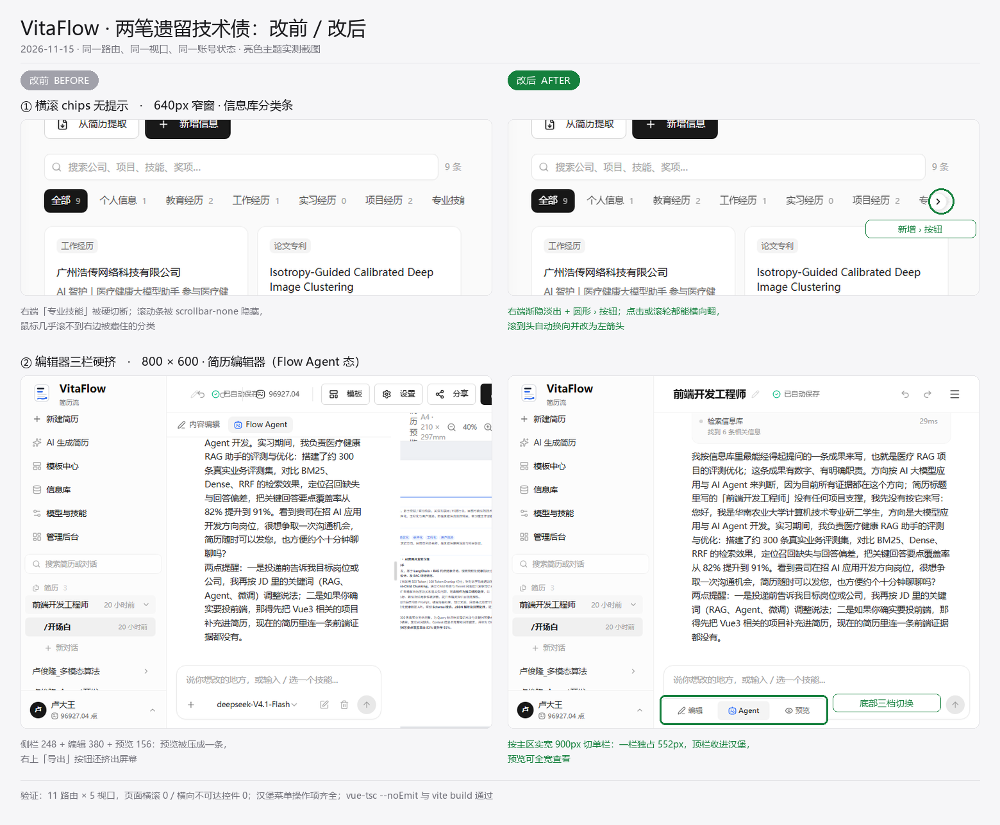

# VitaFlow 设计系统

> 定位：规范化文档。描述项目当前 UI 的事实基线，并对不一致处给出**目标态规则**；发现的存量偏差统一收敛到文末「存量改造项」，不在本文档交付时修改代码。
>
> 受众：AI 结对协作（规则速查置顶）+ 前端开发者参考。

---

## 0. AI 协作速查

改前端时逐条遵守；与正文冲突以正文为准。

1. **只用 Tailwind 原子类**，不写自定义 CSS/SCSS（全局例外仅 `src/styles/index.css`）。
2. **灰阶只用 `zinc-*`**，禁止 `gray-*`/`slate-*`（存量 gray 见文末清单，遇到即改）。
3. **主操作色是黑（`zinc-900`）**，不是蓝色；`blue-600` 只用于链接、强调、信息提示、选中焦点。
4. 新 UI 组件先找 `src/components/ui/`，没有再用 shadcn-vue 生成后改造，禁止直接在业务组件里手写完整弹窗/下拉等复杂控件。
5. 弹窗一律遵循 ConfirmDialog 结构模式（Teleport + 遮罩 `bg-zinc-950/40 backdrop-blur-sm` + `rounded-2xl shadow-wb-popup` + 底部灰底按钮区）。
6. 图标只用 `lucide-vue-next`，默认尺寸 `h-4 w-4`。
7. 轻提示用 `showGlobalToast()`（`src/utils/toast.ts`），不要自造 toast。
8. 不引入暗色模式、不使用 `dark:` 前缀——项目不支持。
9. 语义色：成功 `emerald-600`、危险 `red-600`、警告 `amber-500`，不要换其他色相。
10. 全局样式/浏览器兜底只能加在 `src/styles/index.css`，且需注释说明原因。
11. **扁平优先**：静态内容不叠「边框 + 阴影 + 底色」三件套；选中/聚焦只给一处信号（浅灰底 `bg-zinc-100` 或描边），阴影只留给浮层（下拉、弹窗、抽屉）。
12. **不用胶囊**：`rounded-full` 仅限头像、圆形图标按钮、圆点；分段控件、筛选标签、状态标记一律 `rounded-md`，选中态用 `bg-zinc-100`/`bg-zinc-200/70`，不用「黑底胶囊 + 内嵌白块 + 阴影」。圆角大小按 §1 圆角阶梯递进（行 6 / 控件 8 / 容器 12 / 大容器与弹窗 16），**不要把所有圆角统一压到 `rounded-md`**。
13. 图标默认单色（`text-zinc-400`，选中 `text-zinc-500`），不做彩色图标底块与 hover 上浮动画。
14. **预览类卡片只留一圈框**：缩略图（简历预览、模板预览）一律贴边由卡片自身的 `ring`/`border` 当唯一边框，预览组件用 `bare` 模式去掉自己的 `border`+`rounded`，底部用渐变过渡到白，不要再套「外层边框 + 内层描边 + 页面白底」三层，否则会出现明显的框中框。
15. **弹窗交互由外壳负责**：所有基于 `AppDialog` 的弹窗自动获得 Esc 关闭、body 滚动锁（引用计数）、焦点进出、`role="dialog"`/`aria-modal`；业务侧不要再自己绑 keydown 或改 `body.style.overflow`。纯图标按钮必须有 `aria-label`（巡检脚本会把无名按钮计为缺陷）。
16. **设置类页面**：内容列 `max-w-3xl` 居中，白卡各占一块（`rounded-xl border-zinc-200 p-5 sm:p-6`），标题行右放状态/操作，说明文字独占一行，底部仅一行浅灰边界说明；密集表单可降到 `h-9 + rounded-lg + text-[13px]`，但同一页面内高度必须一致。涉及密钥/隐私等敏感能力时，最后一张卡必须如实写出「存哪里 / 谁能看到 / 如何彻底删除 / 轮换策略」四项（`dt/dd` 两列，不新增彩色卡片），并配一个需二次确认的破坏性操作与「最近使用记录」列表；部署状态用 `rounded-md bg-zinc-100 text-[10.5px]` 小标记，异常态才允许 `bg-amber-50`。不要写「绝对安全」「零知识」这类与代理架构不符的承诺。
17. **一对多配置用「列表 + 内联编辑区」，不用弹窗套弹窗**：模型配置、技能这类「可保存多条」的设置，卡片上半部是 `divide-y` 列表行（名称 + 次要信息一行、说明独占一行、右侧开关/编辑/删除图标），下半部是同卡片内展开的浅灰编辑区（`rounded-xl border-zinc-200 bg-zinc-50/40`）。这样 Esc/滚动锁归属简单、移动端不超屏、编辑态与列表能同时对照；只有单条、字段极少的编辑（如技能正文）才用 `AppDialog`。状态标记（`默认`、`推理 深度`、来源）用 `rounded-md bg-zinc-100 text-[10.5px]`，不要新增彩色徽章。
18. **触屏可达**：任何 `opacity-0 group-hover:opacity-100` 的真实操作按钮都必须加 `touch-always-visible`（全局样式里用 `@media (hover: none)` 强制常显）；不要用宽度断点代替，因为宽屏平板也可能没有鼠标。纯装饰性的箭头/提示文字不受此约束。
19. **列表/内容页三件套**：加载骨架（与卡片同尺寸同圆角）、空态（区分「库为空」与「筛选无结果」两套文案）、分页（`totalPages > 1` 才出现）缺一不可；卡片网格、分类 chips、悬浮操作的具体类见 §3.6，页面骨架见 §4.4。搜索/筛选请求必须防抖（≥260ms）且把条件真正传给后端，不要只在前端过滤一页数据。

---

## 1. 技术栈基线

| 项 | 事实 |
|---|---|
| 框架 | Vue 3 + Vite + TypeScript |
| 样式 | Tailwind CSS **v4**（`@import "tailwindcss"` 于 `src/styles/index.css`），无 SCSS |
| 无头组件 | radix-vue（shadcn-vue 模式，`components.json`：`cssVariables: false`） |
| 图标 | lucide-vue-next（约 45+ 文件使用），个别自绘 SVG（BrandLogo、FlowAgentIcon、FlowPointIcon） |
| 暗色模式 | **不支持**。全库无 `dark:`、`.dark`、`prefers-color-scheme` |
| 全局样式 | 唯一入口 `src/styles/index.css`（同时 `@import` 了 `wb-theme.css`）：body 背景 `#f7f7f8`、文字 `#0a0a0a`、字体栈 Inter → PingFang SC → system-ui → "Microsoft YaHei"、开启字体平滑；`@theme` 覆盖了 zinc 灰阶（中性化）与 `--font-sans`；含 `.thin-scrollbar`、富文本重置、旧浏览器 oklch/color-mix 兜底变量 |
| 注意 | Tailwind v4 **不使用 JS 配置文件**（原 `tailwind.config.js` 已删除）。没有自定义主题扩展，颜色直接用默认色阶（灰阶用 `zinc-*`）；不要在项目根新增 `tailwind.config.js`，v4 不会读取 |

**并列可点击行**：同一列表里相邻行之间必须留 **4px**（容器 `space-y-1`，或行自身 `mb-1`），**不允许行与行直接相接**——两块 `bg-zinc-*` 贴上就成了一条，看起来像「整块被选中」，也会让鼠标划过时分辨不出高亮的是哪一行。树形列表的父子之间单独用 `mt-1.5`（6px）拉开层级。

适用范围：侧栏主导航、简历树、会话行、搜索结果、账号菜单、右键菜单、管理后台二级导航。**改一处就要连带检查同一体系里的其它列表**，不要只修截图里看到的那一段。

**字号阶梯**（全站只允许下表这些档位，不再随手写 11/12/13 混排）

| 用途 | 类 | px | 字重 / 颜色 |
|---|---|---|---|
| 页面标题 | `text-[20px]` | 20 | `font-semibold` + `tracking-tight` + `zinc-900` |
| 区块/卡片标题 | `text-sm` | 14 | `font-semibold` + `zinc-900` |
| 正文（表单值、富文本） | `text-sm` | 14 | 常规 + `zinc-700` |
| 列表主文本（侧栏导航、简历行） | `text-[13.5px]` | 13.5 | `font-medium` + `zinc-700`（选中 `font-semibold` + `zinc-900`） |
| 列表次级（会话行、菜单项、二级导航） | `text-[13px]` | 13 | 常规 + `zinc-600`（选中 `font-semibold` + `zinc-900`） |
| 说明文字 | `text-[12.5px]` | 12.5 | 常规 + `zinc-500` |
| 分组标签 | `text-[11.5px]` | 11.5 | `font-medium` + `tracking-wider` + `zinc-400` |
| 元信息（时间戳、计数） | `text-[11px]` | 11 | 常规 + `zinc-400`，配 `tabular-nums` |

规则：
- **最小 11px**，禁止 `text-[10px]`——中文在这个尺寸下发虚。
- **中文的 500 是假的**：字体栈是 微软雅黑/思源，只有 Regular 与 Bold 两档，`font-medium` 不产生视觉差异。要表达「选中/强调」必须用 `font-semibold`（600），并且字重变化只给选中态，不要给 hover（hover 只变底色）。
- 颜色承载层级：`zinc-900` 主 → `zinc-700` 常规 → `zinc-600` 次级 → `zinc-500` 说明 → `zinc-400` 元信息。**需要阅读的正文不许用 `zinc-500` 及更浅**。
- 标题 `font-semibold tracking-tight`，`text-[14px]` 与 `text-sm` 等价，新代码优先写 `text-sm`。

**圆角阶梯**（五档，按元素尺寸递进；勿随意新造）

| 类 | 值 | 用途 |
|---|---|---|
| `rounded-full` | 9999px | 仅头像、圆形图标按钮、状态圆点；**不作为分段控件/标签/按钮的形状** |
| `rounded-md` | 6px | 密集列表行（侧栏简历行、会话行、「新对话」）、菜单项、内联小徽标、图标按钮的 hover 底、分段控件容器 |
| `rounded-lg` | 8px | 按钮（`Button.vue` 基础类即此档）、单行输入框、搜索框、附件缩略图、模块导航项、模式切换 tab、移动端底部 tab、缩略图内框 |
| `rounded-xl` | 12px | 卡片（简历卡、模板卡、个人中心/帮助中心/后台的白卡）、消息气泡、所有浮层（下拉面板、右键菜单、确认气泡、斜杠指令菜单）、大虚线空态框 |
| `rounded-2xl` | 16px | 大容器与弹窗：对话输入区（composer）、`AppDialog`、`ConfirmDialog`、导出进度、轻量提示卡、编辑器内的表单卡 |
| `rounded-3xl` | 24px | **仅营销面**：首页 hero 纸面、首页模板展示卡、功能卡（`sm:` 档）。应用内的卡片/弹窗不要用这一档 |

判断口诀：**行 6 / 控件 8 / 容器 12 / 大容器与弹窗 16 / 营销面 24**。看过 WorkBuddy 的实测基线——删除确认气泡圆角 12px、气泡内按钮 8px、侧栏列表行接近直角（4–6px）、对话输入框 16px（大高度容器）、圆角刻度 0/2/4/6/8/12/16/20/24，与上表一致；单调地把所有圆角压到 6px 会让 40px 以上的容器明显发「方」，把列表行提到 12px 又会回到胶囊感。

**不要写任意值圆角**：`rounded-[2rem]`、`rounded-[20px]`、`rounded-[1.25rem]` 这类一律不许（2026-11-14 已把 46 处全量归位到阶梯上，原 32px 全部降到 12/16/24）。缩略图内框比外框低一档：外 12 → 内 8，外 16 → 内 12。

**对话输入区（composer）的结构基线**（对齐 WorkBuddy）：外层 `rounded-2xl border border-zinc-200` + 极轻阴影，聚焦时只把边框提到 `zinc-300` 并加 `ring-2 ring-zinc-900/[0.04]`；底部工具条左起为「`+` 加附件 → 图标+模型名+⌄ 的纯文字 Select」，右侧为「新对话 / 清空 / 圆形发送（`rounded-full bg-zinc-900`，禁用变 `bg-zinc-200`）」；输入区与工具条之间不留分隔线。

**Button 的圆角覆盖坑**：`Button.vue` 基础类已含 `rounded-lg`，调用处**不要再写 `rounded-md`**（Tailwind 同组工具类按尺度排序，基础类会盖掉它，代码与实际渲染不一致）。需要更圆时写 `rounded-xl`（大于基础档才生效），需要更方时只能改基础类。

**阴影阶梯**：默认**无阴影**（静态卡片用 `ring-1 ring-zinc-200/70` 或 `border-zinc-200` 表达边界）；浮层一律用 `shadow-wb-popup`（下拉、弹窗、抽屉、toast），不再出现 `shadow-xl` / `shadow-2xl`。聚焦态用 `ring-1 ring-zinc-300`、`focus-within:ring-2 ring-zinc-900/[0.04]` 表达，不用彩色 glow。编辑器画布内允许自绘 rgba 阴影，业务页面不允许。

**z-index 约定**：全站只有 **9 档命名 token**，定义在 `styles/wb-theme.css` 的 `@utility z-*`。新浮层先在这张表里找档位，**不要就地写 `z-[数字]`**。

| 档 | 类 | 值 | 用途 |
|---|---|---|---|
| 内容抬升 | `z-base` | 10 | 渐变遮罩、图片上的操作条、卡片内浮层 |
| 组件上层 | `z-raised` | 20 | 面板头、装饰浮层、表单行 hover 时抬升 |
| 吸顶 | `z-sticky` | 30 | sticky 导航、编辑器工具条、拖拽分隔条、移动端底栏 |
| 遮罩 | `z-scrim` | 35 | 抽屉/菜单的全屏点击遮罩 |
| 抽屉 | `z-drawer` | 40 | 抽屉与侧面板（编辑器样式/模板面板） |
| 弹窗 | `z-modal` | 50 | `AppDialog`、ConfirmDialog、全屏预览 |
| 次级层 | `z-overlay` | 60 | 叠在弹窗之上：`ConfirmPopover`、日期层、二级弹窗 |
| 浮层 | `z-popover` | 70 | Select content、侧栏右键菜单、tooltip |
| 提示 | `z-toast` | 80 | `toast.ts`，永远最上 |

排序口诀：**内容 < 吸顶 < 遮罩 < 抽屉 < 弹窗 < 次级层 < 浮层 < 提示**。`z-popover` 必须高于 `z-modal`——Select 的展开面板要能盖住它所在的弹窗。

---

## 2. 设计 Token（语义 → Tailwind 类映射）

> 本项目不定义自定义 token 变量，语义靠「映射表 + 使用规则」约束；映射对象是 Tailwind 默认色阶。

### 2.1 色彩

| 语义 | Tailwind 类 | 色值 | 使用场景 |
|---|---|---|---|
| 主操作色（近黑） | `bg-wb-primary` / hover `bg-wb-primary-hover` | 日 #000000e6 / 暗 #ffffffeb | 主按钮（见 §6）；管理后台选中态、toast 底、深色徽标仍用 `bg-zinc-900` |
| 强调色（蓝） | `text-blue-600` / `bg-blue-50` 等 | #2563eb | 链接、进度/信息图标、编辑器标题聚焦态、蓝底浅色提示区 |
| 成功 | `text-emerald-600` / 底 `emerald-50`、toast 图标 `emerald-400` | #059669 | 保存成功、成功 toast |
| 危险 | `bg-red-600` / hover `bg-red-700`、文字 `text-red-600`、底 `red-50` | #dc2626 | danger 按钮、删除确认、错误文案 |
| 警告 | `text-amber-500` | #f59e0b | 保存中状态、琥珀色提示（「未选择」等） |

**规则**：
- 主按钮 = `<Button>` 默认档（`bg-wb-primary text-white hover:bg-wb-primary-hover`，100ms、按下缩 .97）；内联写法用同一组值。蓝色不是主操作色，禁止把主按钮改成蓝底。
- **填色与文字必须成对**：`bg-wb-primary` 上的字用 `text-white`（暗色下 white 代表纸面色，会自动变深）；`bg-red-600` / `bg-blue-500` 这类**饱和强调填充**上的字用 `text-wb-on-solid`（两种主题都是白色）。压在照片/遮罩上的字用字面白 `text-[#fff]`，不要用 `text-white`。
- **不要用 class 覆盖 Button 的观感**：给 `<Button>` 传 `class` 只写尺寸、圆角、间距、宽度（`h-11`、`rounded-xl`、`px-8`、`w-full`）。颜色、阴影、`transition-*`、`active:scale-*` 一律由组件决定——写上去会盖掉组件默认值，历史上有 27 处这样退回了旧观感。
- 语义色只允许上表色值；需要浅底时用对应 `-50` 色。
- 唯一扩展：能力/标签类徽标允许 `purple`（`bg-purple-50 border-purple-200/60 text-purple-700`，如「多模态」标签）；purple 不得用于按钮、文字正文或状态反馈。
- 灰阶一律 `zinc`。`gray-*` 是存量偏差，新代码禁止。

### 2.2 背景分层

| 层 | 类 | 说明 |
|---|---|---|
| 页面底 | body `var(--wb-page-bg)`：日 `#f7f7f8` / 暗 `#0b0b0d`；局部 `bg-zinc-50/30~50` | 浅灰底 |
| 纸面 | `bg-white`：日 `#ffffff` / 暗 `#17171b` | 卡片、弹窗面板、输入框底色 |
| 卡片 | `bg-white border border-zinc-200`（或 `ring-1 ring-zinc-200/70`），**无阴影** | 内容承载单元 |
| 嵌入区 | `bg-zinc-50/50` ~ `bg-zinc-100/80` | 卡片内的次级分区 |
| 毛玻璃页头 | `bg-white/80 backdrop-blur-md` | 用户端/编辑器顶栏 |
| 遮罩 | `bg-wb-scrim/40 backdrop-blur-sm` | 弹窗背景。**不要用 `bg-zinc-950/40`**——它会随主题翻成白色雾 |
| 吸顶条 | 必须带 `border-b border-zinc-200/60`（或 `ring-b`），滚动时内容从它下面穿过要有明确分界 | 不靠阴影区分——静态内容一律无阴影 |

### 2.3 文字分级

| 层级 | 类 | 用途 |
|---|---|---|
| 标题 | `text-zinc-900`（ ConfirmDialog 标题用 zinc-900）+ `font-semibold` | 卡片/弹窗标题 |
| 正文 | `text-zinc-700` ~ `text-zinc-800` | 表单值、列表内容 |
| 次要 | `text-zinc-600` | 说明、导航未选中 |
| 辅助/占位 | `text-zinc-500` / `text-zinc-400` | 描述文字、placeholder、禁用图标 |

**截断与出口**：用 `truncate` / `line-clamp-N` 就默认它可能会裁掉内容，此时必须同时给出完整文本出口——自定义 hover 气泡优先，其次 `title`，**两者不并用**（会弹两个）。中文标签不要靠换行规避截断，断行点几乎必然落在词中间。详见 §6.14。

### 2.4 边框

- 统一 `border-zinc-200`，页面顶栏等轻分隔用透明度变体 `border-zinc-200/60 ~ /80`。
- 卡片内分隔线 `border-zinc-100`。
- 聚焦（鼠标/程序化）：输入框 `focus:border-zinc-500`；Select 打开态 `border-zinc-900 ring-1 ring-zinc-900`；其余输入类控件统一 `focus:border-zinc-900`，**不再使用蓝色聚焦环**（2026-11-14 已收口）。
- 聚焦（键盘）：全站一条全局规则——`:is(a, button, [role=button], [role=tab], [role=checkbox], [role=radio], [role=option], [role=menuitem], [role=switch], summary, [tabindex]:not([tabindex="-1"])):focus-visible` 画 `2px solid var(--wb-focus-ring)`、`outline-offset: 2px`。只在 `:focus-visible`（键盘 Tab / 读屏）出现，鼠标点击不出现；**输入类控件排除在外**，它们靠边框加深表达焦点，再叠外描边会出现双边框。写新组件时只要用 `<button>` 或语义 `role`，焦点环自动生效，不需要自己写 `focus:ring-*`。

### 2.5 间距与密度

间距不用「看着差不多」，只用 **4 的倍数**：`4 / 8 / 12 / 16 / 20 / 24 / 32 / 40 / 48`。半档只允许 `2px` 用于图标与文字的贴合间距（`gap-0.5`）。

| 值 | 类 | 典型用途 |
|---|---|---|
| 4 | `gap-1` / `space-y-1` / `mb-1` | 相邻可点行之间、图标与徽标 |
| 8 | `gap-2` / `p-2` / `px-2` | 行底色距容器边缘、图标与文字、页边距（窄容器） |
| 12 | `px-3` / `gap-3` | 行内文字距底色边缘、卡片内边距（小） |
| 16 | `p-4` / `space-y-4` | 卡片内边距、表单纵向间距 |
| 20 | `px-5` / `pl-5` | **侧栏内容轨**（图标/标题左缘）、段落间距 |
| 24 | `p-6` / `space-y-6` | 页面区块间距、大卡片内边距 |
| 32 / 40 | `px-8` / `pl-10` | 页面左右留白、嵌套第二层缩进 |

**侧栏内容轨（20 / 40）**——这是「看起来松不松」的主因，比行高更敏感：

| 部位 | 位置 | 算法 |
|---|---|---|
| 行底色块 | 距面板左边 8 | 容器 `px-2` |
| 一级文字 / 导航图标 | 距面板左边 20 | 8（容器）+ 12（行内 `px-3`） |
| 二级文字（会话行、分组标题文字、搜索框文字） | 距面板左边 40 | 20 + 一个轨宽 |

判定口诀：**底色比文字轨多让 12px（左右各一），嵌套只加一个轨宽 20**。底色块与文字轨同宽会显得「文字被框顶住」，底色块再往外扩到面板边缘则会失去轻盈感。

**行与命中区**：

| 项 | 规格 |
|---|---|
| 行高 | 列表行 32（`h-8`，或 `py-1.5` + `leading-5`）；导航行 36（`h-9`）；菜单行 32 |
| 行高与字号比 | 保持 **2.3–2.7**（13.5px 字 → 32px 行）。低于 2.2 会挤，高于 3 会散 |
| 行距 | 兄弟行 4，父子行 6（见 §3.4.1） |
| 最小命中区 | 可点元素 ≥ **28×28**。图标按钮视觉 20 时，用 `p-1`/`-m-1` 或透明 `::before` 外扩，不放大图标本身 |
| 命中区写法 | 统一用 `hit-area` 工具类（`::after` 外扩 `-4px -2px`，视觉尺寸不变，见 §6.10）。相邻的可点元素之间必须留够间隙，使两边的外扩**相切而不重叠** |
| 整行可点 | 列表行必须整行可点（行容器内不要再套一个只有文字可点的内层） |

**图标尺寸**——按「角色」分档，不是按需调：

| 角色 | 档 | 类 | 用在哪 |
|---|---|---|---|
| 交互图标 | 12 | `h-3 w-3` | 分组标题、时间戳、徽标内、pin、行内 chevron |
| | 14 | `h-3.5 w-3.5` | 行内动作图标、输入框内图标、模型名前的小图标 |
| | 16 | `h-4 w-4` | **默认档**：导航图标、按钮图标、工具条、表单前后缀 |
| | 20 | `h-5 w-5` | 页面级操作（顶栏按钮）、侧栏导航、设置页行图标 |
| 图标块 | 24 | `h-6 w-6` | 只在 48px 方块/圆形容器里用（`h-12 w-12` + 24 图标），如 hero 图标、导入进度头部 |
| 空态 / 占位 | 28 | `h-7 w-7` | 空列表、无结果、卡片内占位（`StateBlock` 的 icon） |
| 整页加载 | 40 | `h-10 w-10` | 整页 spinner、结果页插画 |

- **同一行只出现相邻两档**（14 配 16 可以，12 配 20 不行）。这一条最容易被破坏——聊天输入框那排曾是 14/16/17/18 四个尺寸挤在一起，肉眼就是「图标大小不一」。
- 不用 `h-4.5`、`h-[17px]` 这类「差一点点」的值：18 和 16 差 2px 看不出「有意为之」，只显得没对齐。
- 品牌标识（`BrandLogo` 的 36px 图标）不属于图标规范，它是 logo。
- **描边**：交互图标（≤20）用 `1.75`，装饰图标（≥24）用 `2`；同排必须一致。勾选标记允许 `stroke-[3]`，品牌插画不在此列。默认不写 `stroke-width` 就是 2。

### 2.6 主题（亮 / 暗）

**唯一开关是 `<html data-theme="light|dark">`**，不许用 class、不许用 `prefers-color-scheme` 媒体查询直接写样式（`dark:` 变体已经被改成跟 `data-theme` 走）。

| 项 | 规则 |
|---|---|
| 怎么切 | 侧栏用户菜单 →「外观」三档：浅色 / 深色 / 跟随。用户没选过就跟随系统；选了「跟随」会清掉 localStorage |
| 首屏 | 主题在 `index.html` 的内联脚本里定，**不能等到 Vue 挂载**——否则会闪一帧白底 |
| 中性阶 | `zinc-50…950` 把值换成 `var(--wb-n-*)`，暗色是另一套手调值（不是明度镜像）。所以全站 2900+ 处 `zinc-*` 一个字都不用改 |
| `white` | 表示**纸面**：日 `#fff` / 暗 `#17171b`。于是 `bg-white` 是深色卡片、`text-white` 是压在浅色填充上的深墨。压在照片/遮罩上的白字必须写字面 `text-[#fff]` |
| 强调色 | 不做整套翻转（同一个 `red-600` 既当字又当底）。浅底 `bg-*-50`、描边 `border-*-200`、文字 `text-*-400..700` 由桥接层按用法分别处理；**实心填充 `bg-*-500/600/700` 不动**，上面的字用 `text-wb-on-solid` |
| 新代码 | 优先语义 token：`bg-wb-surface` / `text-wb-ink` / `bg-wb-hover` / `bg-wb-primary` / `bg-wb-scrim`。`zinc-*` 是兼容桥，不是首选 |

**暗色档取值的依据**（不是凭感觉调）：让**同一档在两种主题下的对比度尽量持平**。日间 `zinc-400` 在白底只有 2.5:1（刻意做弱），暗色就取到 `#83838d`（对 `#17171b` 约 4.5:1）——宁可略强，也不让弱化文字彻底消失。`zinc-500` 日间 5.07:1、暗色 5.5:1，`zinc-900` 两边都是主文字档。

### 2.7 选区与拖拽

桌面应用和网页的手感分界线就在这里：**控件不是文本，内容才是文本**。双击导航项留下蓝色选区、拖动分隔条选中半屏文字，都是「这是个网页」的瞬间暴露。

| 部位 | 规则 | 实现 |
|---|---|---|
| 按钮 / 标签 / 菜单项 / 开关 / 复选单选 | **不可选** | 全局基线 `@layer base` + `:where(...)` 设 `user-select: none`。用 `:where` 把特异性压到 0，任何显式 `select-text` / `.selectable` 都能覆盖回来 |
| 导航里的 `a[href]` | **不可选** | 基线刻意不含 `a[href]`（正文里带链接的段落要能复制），只命中 `nav` / `role=navigation|tablist|menu` 下的链接；不在语义容器里的**跳转型**链接（侧栏 `<aside>`、帮助中心「快捷入口」、首页卡片头部的「全部简历」）逐个补 `select-none` |
| 正文段落、输入框、富文本、AI 回复 | **保持可选** | 不加任何全局 `select-none`。审计必须复核「正文段可选率」，防止基线误伤 |
| 拖拽期间 | **整页临时锁定** | `mousedown` 时 `body.userSelect = 'none'` + `e.preventDefault()`（否则按下瞬间就起选区）；`mouseup` 还原 |
| 拖拽收尾 | **必须有多路兜底** | 鼠标在窗口外松开时收不到 `mouseup`，只靠它整页会**永久不可选中**。在 `mousemove` 里判断 `e.buttons === 0` 就地收尾，再监听 `window.blur`（切走窗口时同样漏 `mouseup`）；三条路径统一走一个 `onMouseUp()`，避免重复解绑 |
| 分隔条命中区 | 视觉 16px，有效 ≥ 24px | 用 `after:absolute after:-left-1 after:-right-1` 伪元素外扩，不放大可见线条（同 §2.5 命中区写法） |

判据：任一页面上「可选中文字的交互元素」必须为 **0**，而正文段落的可选率必须为 **100%**。审计按 `getComputedStyle(el).userSelect !== 'none'` 统计，再用双击实测收尾（见 §6.17）。

---

## 3. 组件规范

基础组件位于 `src/components/ui/`（shadcn-vue 生成后手写改造），通用展示组件在 `src/components/common/`。

### 3.1 Button — `ui/button/Button.vue`

```vue
<Button variant="default|outline|ghost|danger" size="sm|md|icon" :disabled />
```

| variant | 样式 | 场景 |
|---|---|---|
| `default` | 黑底白字（目标 `bg-zinc-900 hover:bg-zinc-800`，存量 `gray-900` 待改） | 主操作，一屏至多一个 |
| `outline` | 白底 `border-gray-200`（待改 zinc-200）`text-gray-900` | 次操作 |
| `ghost` | 透明底 hover `bg-gray-100`（待改 zinc-100） | 图标按钮、工具栏 |
| `danger` | `bg-red-600 text-white hover:bg-red-700` | 删除等破坏性操作 |

- 尺寸：`sm` = `h-8 px-3`；`md` = `h-10 px-4`；`icon` = `h-9 w-9`。统一 `rounded-lg text-sm font-medium`，`disabled:opacity-50`。
- 规则：同一操作区（弹窗底部、卡片尾部）按钮高度必须一致；危险操作旁必须配取消按钮。

### 3.2 弹窗 — 统一外壳 `ui/dialog/AppDialog.vue`

所有弹窗必须基于 `AppDialog`（Teleport + 遮罩 `bg-zinc-950/40 backdrop-blur-sm` + `rounded-2xl shadow-wb-popup max-h-[90vh]` + 头部/底部结构），通过 props 定制：`open`（v-model:open）、`title`/`description`（默认头部）、`maxWidthClass`、`bodyClass`/`headerClass`/`footerClass`、`showClose`/`overlayClose`；`#icon` 插槽加头部图标，`#header`/`#footer` 插槽全自定义。确认类弹窗用 `ConfirmDialog`（已构建于 AppDialog 之上）。默认头部 = title/description + 右上 X；默认底部容器 = `border-t border-zinc-100 bg-zinc-50 px-5 py-4`。

```
<Teleport to="body">
  <Transition>                                   ← 200ms ease-out 进场，scale 95→100
    <div 遮罩: fixed inset-0 z-modal flex items-center justify-center p-4
              bg-zinc-950/40 backdrop-blur-sm @click.self=关>
      <div 面板: bg-white rounded-2xl shadow-wb-popup w-full max-w-sm overflow-hidden>
        头部: px-5 py-4 flex gap-3
              左: w-10 h-10 rounded-full 图标圆底（破坏性 red-50/red-600，否则 blue-50/blue-600）
              中: 标题 text-zinc-900 font-semibold text-[16px] + 描述 text-sm text-zinc-500
              右: X 关闭钮 text-zinc-400 hover:bg-zinc-100
        底部: px-5 py-4 bg-zinc-50/50 border-t border-zinc-100 flex gap-3
              取消: flex-1 h-10 rounded-xl border-zinc-200 bg-white text-zinc-700
              确认: flex-1 h-10 rounded-xl text-white（破坏性 red-600，否则 zinc-900）
```

- Props 约定：`open`（v-model:open）、`title`、`description`、`confirmText`、`destructive`。
- 规则：确认按钮触发异步时由调用方自行置 loading/禁用；遮罩点击 = 取消。
- **交互基线（Ticket 17）**：`AppDialog` 内置 Esc 关闭、堆叠弹窗的 Esc 归属栈、引用计数式 body 滚动锁、打开时聚焦面板 / 关闭时归还焦点，以及 `role="dialog" aria-modal="true"`。共享状态放在 `ui/dialog/dialogState.ts`（**不能**写在 `<script setup>` 里——那里的顶层变量是每实例一份，无法跨弹窗协调）。同时打开多个弹窗时，只有最上层响应 Esc，关掉一个不会提前解锁滚动。

### 3.3 表单控件

| 控件 | 文件 | 关键样式 |
|---|---|---|
| Input | `ui/input/Input.vue` | `h-10 w-full rounded-lg border-zinc-200 px-3.5 text-[14px]`，hover `border-zinc-300`，focus `border-zinc-500`，`placeholder:text-zinc-400` |
| Textarea | `ui/textarea/Textarea.vue` | 同 Input 圆角/边框风格（`rounded-lg`）；自动增高，`rows` 决定最小高度，内容超出 `maxHeight` 后改为内部滚动 |
| Select | `ui/select/Select.vue` | radix-vue SelectRoot；默认 `h-10 border-zinc-200`，**打开态** `border-zinc-900 ring-1 ring-zinc-900`；`ghost` variant `h-8` 透明底用于工具栏内嵌下拉；面板 `rounded-xl border-zinc-200 shadow-wb-popup z-popover`，选中项 `focus:bg-zinc-100` |
| Label | `ui/label/Label.vue` | 表单标签 |
| Switch | `ui/switch/Switch.vue` | 布尔开关 |
| DateTimePicker | `ui/DateTimePicker.vue` | 日期时间选择 |

**规则**：表单控件高度统一 `h-10`（ghost 档 `h-8` 仅用于工具栏内嵌；设置页这类密集表单允许整页降到 `h-9`，但必须与同页 `Button size="sm"` 对齐）；圆角统一 `rounded-lg`（8px 控件档）——原先 Input/Textarea 用 `rounded-xl`（12px）与 Button 的 8px 并排时不协调，已收敛；表单标签一律配 `Label` 或带 `for` 的 `<label>`；错误文案 `text-sm text-red-600 mt-1.5`；表单纵向间距 `space-y-4` 起步。多行文本一律用 `Textarea` 组件；仅在透明底内嵌、等宽小字配置、需用户拖拽高度或复杂键盘交互（如 AI 对话输入框）时才手写 `<textarea>`，此时仍须遵循上面的边框与圆角规范，不要再用 `rounded-xl`。

### 3.4 展示组件

| 组件 | 关键样式 | 备注 |
|---|---|---|
| 卡片 | 无组件，按规范手写：`rounded-xl border border-zinc-200 bg-white`（列表卡可 `ring-1 ring-zinc-200/70`），**不加阴影** | 原 `ui/card/Card.vue` 于 2026-11-14 移除（全项目零引用） |
| 状态徽标 | `rounded-full px-2.5 py-1 text-xs font-medium`；彩色徽标按语义色 `-50` 底 + `-600/700` 字 | 无组件，按规范手写（原 `ui/badge/Badge.vue` 于 2026-11-14 移除） |
| 模式切换 tab | `h-7 rounded-lg px-2.5`，选中 `bg-zinc-100 text-zinc-900`，未选中 `text-zinc-500 hover:bg-zinc-50`，容器无底色只留发丝线 | 无组件，按规范手写（原 `ui/tabs/Tabs.vue` 于 2026-11-14 移除）；用于工作区内容编辑 / Flow Agent 切换、模板分类 |
| Pagination | `ui/pagination/PaginationFooter.vue` | 列表分页统一用它 |
| EmptyState | `common/EmptyState.vue` | 空状态统一入口 |
| BrandLogo | `common/BrandLogo.vue` | 品牌标识 |

### 3.4.1 树形列表行（侧栏「简历 → 会话」）

两层结构（`layout/WorkspaceSidebar.vue`）的层级只靠**文字缩进**表达，不缩进容器，否则选中底色会比父行短一截。

| 部位 | 规格 |
|---|---|
| 父行 | `h-8 rounded-md`，文字 `pl-3 pr-2`（距面板左边 20，见 §2.5）；未选中 `text-zinc-700 hover:bg-zinc-200/50`，独占选中 `bg-zinc-200/60 text-zinc-900`；标题固定 `font-medium`（父级不参与"选中加粗"，否则和子行抢重量） |
| 父行（子项选中时） | `bg-zinc-200/25 text-zinc-900` + `hover:bg-zinc-200/60`：静止态让位给子行，鼠标移上去立刻加深到与子行同档，父行永远有可点反馈 |
| 子行 | 容器不缩进（`w-full` 与父行等宽），只把内容推进去 `pl-8 pr-2`（距面板左边 40 = 20 + 一个轨宽）；选中 `bg-zinc-200/60 text-zinc-900 font-semibold`，未选中 `text-zinc-600 hover:bg-zinc-200/40 hover:text-zinc-900` |
| 行间距 | 父子之间 `mt-1.5`，兄弟行之间 `mb-1`（4px）——**不留空隙会让相邻两块底色粘成一条**，「新对话」这类行动作也走同一间距 |
| 行内元信息 | 时间戳 `text-[11px] text-zinc-400`，hover 时整块换成操作图标（置顶 / 删除），不做常显 |

判定口诀：**底色按父行宽度拉满，层级交给 padding；选中靠加粗 + 底色，hover 只换底色**。

### 3.5 Toast（轻提示）

非组件，统一调用 `showGlobalToast(message, "success" | "error")`（`src/utils/toast.ts`）：底部居中 `bottom-10`，黑底 `bg-zinc-900 rounded-xl shadow-wb-popup`，图标 `emerald-400`（成功）/`red-400`（失败），3s 自动消失，全局单例。**禁止**在业务组件里再造 toast/悬浮提示。

### 3.6 信息卡片与分类筛选（信息库）

「把一堆条目平铺出来」时的统一写法，见 `views/WorkspaceInfo.vue`。

| 部位 | 规格 |
|---|---|
| 网格 | `grid grid-cols-1 gap-3 sm:grid-cols-2`；卡片等高（`flex flex-col` + 底部 `mt-auto`），窄屏单列 |
| 卡片 | `rounded-xl border border-zinc-200/70 bg-white p-4`，hover 只改边框 `hover:border-zinc-300`，不加阴影位移 |
| 分类徽标 | `rounded-md bg-zinc-100 px-1.5 py-0.5 text-[11px] font-medium text-zinc-500`（灰底，不用彩色） |
| 标题 | `text-[14px] font-medium leading-5 text-zinc-900 line-clamp-2` |
| 摘要 | `text-[12.5px] leading-relaxed text-zinc-500 line-clamp-2` |
| 标签 | `rounded bg-zinc-50 px-1.5 py-0.5 text-[11px] text-zinc-500`，前缀 `#`，最多展示 4 个 |
| 底部元信息 | `text-[11.5px] text-zinc-400`（使用次数 · 相对时间），右侧操作 `rounded-md px-2 py-1 text-[12px] font-medium text-zinc-500 hover:bg-zinc-100 hover:text-zinc-900` |
| 悬浮操作 | 编辑/删除图标 `h-7 w-7`，容器 `opacity-0 group-hover:opacity-100 group-focus-within:opacity-100`，并加 `touch-always-visible`（触屏常显） |
| 分类 chips | `h-8 shrink-0 rounded-lg px-2.5 text-[12.5px] font-medium`，选中 `bg-zinc-900 text-white`（计数 `text-white/60`），未选中 `text-zinc-600 hover:bg-zinc-200/60`；容器横向滚动 `scrollbar-none -mx-1 overflow-x-auto px-1`，计数用 `text-[11px] text-zinc-400` |
| 骨架屏 | `h-32 animate-pulse rounded-xl bg-white/70 ring-1 ring-zinc-200/60`，与卡片同尺寸同圆角 |
| 空态 | `rounded-xl border border-dashed border-zinc-300 bg-white/60 px-6 py-14 text-center`，图标 `text-zinc-300`，标题 `text-[13.5px] font-medium text-zinc-700`，说明 `text-[12.5px] text-zinc-500`（搜索无结果与库为空用两套文案） |

规则：卡片不做整块悬浮放大，交互反馈只靠边框、底色与文字颜色；一屏只允许一个主操作（右上「新增信息」），其余入口用 outline/ghost。

### 3.7 待确认卡（简历修改 + 信息入库双通道）

对话里 AI 的产出可能同时包含「简历修改」与「待入库的信息条目」，卡片要在一处说清。

- 触发：`message.optimized_resume_data` 或 `message.pending_info_fragments?.length` 任一存在即算 `pending`。
- 文案：`AI 准备了简历修改` / `AI 准备了简历修改，并整理了 N 条信息` / `AI 整理了 N 条信息，确认后保存到信息库`。不放工具名、不放原始字段，用户只需要知道「有什么等着我决定」。
- 条目预览：最多 3 条，`flex min-w-0 items-center gap-1.5 text-[11.5px] text-zinc-500`，分类徽标 `rounded bg-zinc-100 px-1 py-0.5 text-[10.5px]`，超出显示「等 N 条」。
- 按钮层级（三个角色，从左到右依次降级）：
  1. **主**「应用」/「保存到信息库」——`Button size="sm"`，`bg-zinc-900 px-4 text-white`，点了就落库；
  2. **次要**「逐条审阅」——`h-8 rounded-md px-3 text-[13px] font-medium text-zinc-600 hover:bg-zinc-100`，只在有简历修改时出现，切到 diff 审阅模式；
  3. **文字**「放弃」——`h-8 rounded-md px-3 text-[13px] font-medium text-zinc-500 hover:bg-zinc-100`，位置最左（`mr-auto` 之后的第一个）。
- 结果态：`CheckCircle2` + 「修改已生效」/「信息已保存到信息库」；取消态区分「修改已取消」/「已忽略」。同一会话只有最新一条 pending 可操作，更早的显示「已有更新版本的修改待处理」。

### 3.7.1 技能卡（对话空态）

空态是「选一个技能」的入口，不是欢迎语。

- 标题 `想改哪一部分？`（`text-[19px] font-medium tracking-tight text-zinc-900 sm:text-[21px]`），副标题 `text-[12.5px] text-zinc-400`：`选一个技能，或直接说你看到了什么问题`。
- 卡片：两列网格（`sm:grid-cols-2`），每项是 `button`，`flex items-start gap-2.5 rounded-lg px-2.5 py-2 hover:bg-zinc-100`；图标 `h-3.5 w-3.5 text-zinc-400 group-hover:text-zinc-600`。
- 行内排版：名称 `text-[12.5px] font-medium text-zinc-900` + 参数提示 `text-[11px] text-zinc-400`（如 `<粘贴岗位描述>`）同行；说明 `text-[11.5px] leading-4 text-zinc-500` 换行。
- 带参数的技能点击后把 `/名称 ` 预填进输入框（不直接发送），无参数技能直接发送 `/名称`；输入 `/` 弹出的菜单用同一份数据，`/名称` 用 `font-mono text-xs`。
- 图标在 `lucide-vue-next` 里选语义明确的（诊断=Stethoscope、JD匹配=Target、重写=SquarePen、润色=Wand2、翻译=Languages、开场白=MessageCircle），**不使用 emoji**。

### 3.8 三态：加载 / 空 / 错误

三态只有一套写法，组件是 `components/common/StateBlock.vue`（`tone: "empty" | "error"`）。

| 状态 | 用什么 | 规则 |
|---|---|---|
| 加载 | 首屏骨架 / 行内 spinner | 骨架**只要求形状像**（骨架侧栏 220 而真实 280 也可以）；翻页或筛选时保留旧数据 + 局部 loading，**不要清空重绘**，否则页面闪一下 |
| 空 | `StateBlock tone="empty"` | 必须区分「真的没有」与「筛选没命中」：后者给「清空筛选 / 查看全部」动作，文案里带上关键词 |
| 错误 | `StateBlock tone="error"` | **永远不要用空态表达错误**。「还没有简历」如果其实是一次 500，用户会照着引导去重复创建；首屏失败整块换成错误态并给「重试」，已有数据时只 toast 并保留旧列表 |

配套规则：

- **整块区域为空**（页面主区、列表区）才加 `frame`（虚线框）；表格单元格、抽屉、弹窗里不加框，用 `compact`。
- **文案**：接口返回的中文提示原样透传（如「登录已过期」）；`Network Error`、`timeout of 15000ms exceeded` 这类传输层英文**不展示给用户**，换成「网络或服务暂时不通，检查连接后重试。」并把原始错误 `console.error` 出来给开发看。
- **按钮**：状态块里的按钮用 `Button variant="outline" size="sm"`（次要动作用 `ghost`），不要手写 `h-8 rounded-lg border-...`。
- 状态块整体垂直居中在内容区，不要贴顶；`frame` 态左右各留 `px-6`。

### 3.10 文案（microcopy）

界面上所有用户可见的中文都按这一节写；写代码时顺手改，不做二次「文案优化」轮次。

**时间**：统一 `utils/time.ts` 的 `formatRelativeTime()`，不要再在组件里手写。

| 距今 | 展示 |
|---|---|
| < 1 分钟 | `刚刚`（信息库可加后缀 `刚刚更新`） |
| < 1 小时 | `12 分钟前` |
| < 24 小时 | `12 小时前` |
| < 48 小时 | `昨天` |
| < 7 天 | `3 天前` |
| 更早 | 当年 `10月20日`，跨年 `2025年10月20日` |

**数字与单位**：数字与中文单位之间加一个空格——`3 份`、`12 次`、`近 10 次平均`；百分数、金额不加（`82%`、`¥0.02`）；四位数以上用 `toLocaleString("zh-CN")` 加千分位。

**中英混排**：中文与英文/数字之间加一个空格——`AI 生成简历`、`PDF 导出`、`Vue3` 这类技术名保持原样。

**标点**：中文句子用全角（，。：；），句末不加句号的情况只限标签、按钮、短提示；说明句、错误提示要加「。」；不用感叹号。

**按钮动词**：

| 场景 | 用 | 不用 |
|---|---|---|
| 提交表单并关闭 | `保存` | 确定、提交、完成 |
| 新建实体 | `新建简历` / `创建简历`（同一入口只选一种） | 添加 |
| 破坏性操作 | `删除` / `清空` / `全部清除` | 确定 |
| 二次确认 | 重复动作动词（`删除`、`清空`、`覆盖`） | 是、好的、OK |
| 取消 | `取消` | 关闭 |
| 选择类浮层的确认（日期/时间/颜色） | `确定`（这是「确认选择」，不是保存表单） | 保存 |

**错误提示**：`<对象><动作>失败`，需要时可加「，请重试」。技术细节（`Network Error`、状态码、堆栈）不进界面，进 `console.error`（见 §3.8）。

**空态**：`还没有 X` / `没有匹配的 X`，说明句给出下一步；不要写「暂无数据」。

### 3.9 新组件准入规则
按优先级：

1. **复用**：先找 `src/components/ui/` 与 `src/components/common/`，props 不够用优先扩展现有组件。
2. **生成改造**：`ui/` 没有对应物时，用 shadcn-vue CLI（`components.json` 已配置）生成到 `ui/` 下，再去掉用不到的 API、把样式统一到本文档规范（替换其默认 slate/gray 为 zinc）。
3. **手写**：仅当控件足够简单（一个 div 级别的静态布局）才允许在业务组件内手写；**弹窗、下拉、日期选择、拖拽类复杂控件一律禁止业务内手写**。
4. 命名：`ui/` 下 PascalCase 单文件或多文件目录（如 `button/Button.vue`）；业务组件按域归目录（`editor/`、`resume/`、`ai/`、`admin/`、`home/`、`preview/`、`announcement/`、`layout/`）。

---

## 4. 布局模式

断点：`sm` 640 / `md` 768 / `lg` 1024。移动优先，降级规则各模式内注明。

**栅格列数用容器查询，不用视口断点。** 侧栏 + 二级导航会吃掉 300–450px，视口 `sm` 触发 4 列时容器可能只剩 500px（§6.15 的统计卡就是这么被挤坏的）。凡是「卡片网格」这类列数随可用宽度变的容器，父层加 `@container`，子层用 `@2xl:grid-cols-4`（672px）而不是 `sm:grid-cols-4`。

**整页布局切换同理**：编辑器的三栏 / 单栏按 `workspace-surface` 的实测宽度判断（阈值 900px），不用 `window.innerWidth < 768` 配 `md:` 断点（§6.18）。视口够宽不等于主区够宽。

### 4.1 用户端框架 — `layout/MainLayout.vue`

- sticky 顶栏：`sticky top-0 z-20 border-b border-zinc-200/60 bg-white/80 backdrop-blur-md`，内容行 `h-16 max-w-7xl mx-auto px-4 sm:px-6`。
- 页面内容统一 `max-w-7xl mx-auto px-4 sm:px-6` 容器宽度。
- 移动端：汉堡菜单展开全宽下拉层（`sm:hidden`，`bg-white/95 backdrop-blur-xl`）；未登录直接显示登录/注册按钮。

### 4.2 简历编辑器 — `views/ResumeEditor.vue`

- 独立于 MainLayout：自有顶栏 `h-14 md:h-16`（返回、可内联编辑的标题、保存状态指示、编辑/AI 分段切换 pill、预览/导出）。
- 保存状态指示：`text-amber-500`（保存中）/`text-red-500`（失败）/`text-zinc-500` + `emerald-500` 图标（已保存）。
- 编辑模式：`ModuleSidebar`（模块导航，移动端横置顶部）+ `ResumeFormPanel`（表单区）+ 右侧 A4 预览，之间有拖拽 resizer（`cursor-col-resize w-4`）。
- AI 模式：`ResumeAiChatPanel` 白底对话面板接管主区。
- 编辑器内允许大量精细化样式（自绘阴影、`absolute` 微调），业务页面不模仿。

### 4.3 管理后台 — `admin/AdminShell.vue`

后台挂在工作区外壳内，**不再自建一套视觉**：二级导航与应用侧栏同一套扁平行，选中态也用浅灰底，不用黑底白字（黑底留给主按钮）。

- 容器 `max-w-7xl mx-auto flex gap-8 px-4 py-6 sm:px-6 lg:py-8`。
- 二级导航：`hidden w-44 shrink-0 lg:block` + `sticky top-6`，**不套白卡**（无 border / shadow / 圆角容器），直接平铺。
  - 项：`h-8 rounded-md px-2.5 text-[13px]`，选中 `bg-zinc-200/60 font-semibold text-zinc-900`，未选中 `text-zinc-600 hover:bg-zinc-200/40 hover:text-zinc-900`；图标 `h-3.5 w-3.5`。
  - 分组标题：`text-[11.5px] font-medium tracking-wider text-zinc-400`，右侧 `ChevronDown` 折叠；**默认全展开**（只有 4 组，收起后侧栏会空掉一大片）。
- 窄屏（<lg）：二级导航降级为横向滚动 chips（`h-8 rounded-lg`），与信息库的分类 chips 同一套。
- 页头：`text-[20px] font-semibold tracking-tight`（与内容页同档）+ `text-[12.5px] text-zinc-500` 说明；**不要**再加全大写宽字距的英文小标签（如 `VitaFlow Admin`），那是独立站点的装饰，和工作区其它页面并列时显得突兀。
- 内容卡片：`rounded-xl border border-zinc-200 bg-white p-4 sm:p-5`，**静态卡片不加 `shadow-sm`**（与工作区卡片一致）；弹窗才用 `rounded-2xl shadow-wb-popup`。
- 元信息最小字号 `text-[11px]`，不要再出现 `text-[10px]`。

### 4.4 内容页 — `WorkspacePage` 内的长列表页（信息库等）

- 容器：`mx-auto w-full max-w-5xl px-4 py-6 sm:px-8 sm:py-8`（比公开页 `max-w-7xl` 窄，读起来集中），底色 `WorkspacePage background="muted"`。
- 头部：图标 + 标题 `text-[20px] font-semibold tracking-tight text-zinc-900`，说明 `text-[12.5px] leading-relaxed text-zinc-500 max-w-2xl`；右侧操作按钮与标题同基线（`flex flex-wrap items-start justify-between gap-3`）。
- 筛选区：搜索框 + 分类 chips 同属一块，不与卡片网格混排；结果计数用 `text-[12px] text-zinc-400` 贴右侧（`sm` 以上显示）。
- 列表：见 §3.6；分页只在 `totalPages > 1` 时出现，`text-[12.5px] text-zinc-500`，按钮 `rounded-md px-2 py-1 hover:bg-zinc-200/60 disabled:opacity-40`。
- 移动端（<640px）：卡片单列，chips 横向滚动且允许被裁切，但**必须挂 `v-scroll-hint`**：两端按「是否还能滚」显示渐隐与箭头，滚轮或点击都能翻到（§6.18）。纯 CSS 方案试过不可行（§6.15）。头部按钮换行到标题下方。

### 4.5 新页面开发 checklist

- [ ] 外层容器是否 `max-w-7xl mx-auto px-4 sm:px-6`？
- [ ] 是否复用 MainLayout（或确有理由独立如编辑器）？
- [ ] 页面底色遵循 body 默认，未另设背景？
- [ ] 所有灰阶是 zinc？语义色符合 2.1 表？
- [ ] 弹窗走 ConfirmDialog 模式 / 复杂控件来自 ui/？
- [ ] toast 用 showGlobalToast？
- [ ] 移动端（<640px）检查过：导航可用、卡片不溢出、弹窗不超屏？
- [ ] 列表页：空态、骨架屏、分页三件套齐了？搜索/筛选有防抖（≥260ms）且参数真正下发给后端？
- [ ] 图标 lucide、默认 `h-4 w-4`？
- [ ] z-index 落在约定档位？

---

## 5. 存量改造项

> 文档即目标态；以下偏差按表逐项勾销，改造时同步更新本表。

| # | 位置 | 现状 | 目标 | 改造方式 | 风险 | 状态 |
|---|---|---|---|---|---|---|
| 1 | `tailwind.config.js` + `components.json` | v4 不读取该配置，`primary: #2563eb` 等为死配置；`components.json` tailwind 段仍引用它 | 删除 `tailwind.config.js`，`components.json` 的 tailwind 段清空/移除；`baseColor: "slate"` 改 `"zinc"` | 直接删除（无运行时引用） | 低 | 已完成 |
| 2 | 全库 30 处 `gray-*`（17 文件） | 与 zinc 混用，含核心组件 Button/Card/Badge/Label/Separator/Switch/Avatar/Alert | 全部替换为对应 `zinc-*` | 机械替换 + `npx vue-tsc --noEmit` + 逐页目检 | 低（数量少） | 已完成 |
| 3 | 手写弹窗外壳：ResumeList 内联 AI 生成壳（AiGenerateDialog 仅表单体）、`AnnouncementModal`、`PointsAdjustModal`、`CreateResumeModal`、`ResumeShareDialog`、`AvatarCropperModal` | 各自手写 Teleport/遮罩/按钮区，z 层（50/80/90/100/120）、圆角、阴影漂移 | 统一迁移到 `AppDialog`（3.2）；`ConfirmDialog` 重建其上 | 已抽取 AppDialog 并逐个迁移，保留业务内容 | 中（需逐个回归） | 已完成 |
| 4 | `ui/dialog/Dialog.vue` | 空壳（仅 slot，无实现） | 删除（radix-vue Dialog 需要时再按 3.6 生成） | 直接删除 | 低 | 已完成 |
| 5 | 表单控件高度 | Input `h-10` vs Select `h-9`，同排不齐 | 统一为 `h-10`（Select 默认档提高，ghost 档不变） | 改 Select 触发器高度 + 目检所有同排场景 | 中（视觉回归） | 已完成 |
| 6 | 任意字号值 | 大量 `text-[14px]`（与 `text-sm` 等价）、`text-[16px]` 等 | 已定稿 §1 字号阶梯（20/14/13.5/13/12.5/11.5/11，最小 11px）；存量遇改即换，不专项清理 | 渐进 | 低 | 阶梯已定稿 |
| 7 | body 背景 `#f7f8fb` | 非 Tailwind 色阶值（zinc-50 是 `#fafafa`） | 已改为中性 `#f7f7f8`（原值是带蓝调的近似白），见 §6 WorkBuddy 对齐层 | 改一行 + 首页目检 | 低 | 已被 §6 取代 |
| 8 | 工作区外壳（侧栏、对话页、编辑器顶栏、模板中心、简历卡） | 圆角 1.25~2rem、选中态「白底 + 描边 + 阴影」、图标彩色底块、hover 位移与光斑 | 统一扁平：选中态只留浅灰底、图标单色、静态无阴影；圆角按阶梯分层（列表行 6 / 控件 8 / 卡片与浮层 12 / 弹窗 16），不整体压到 6px | 逐组件改类名 + Playwright 截图目检 | 中（纯样式） | 已完成 |
| 9 | `ResumeAiChatPanel` 的 Markdown 列表 | Tailwind v4 preflight 清掉 `ul/ol` 符号与缩进，AI 回复的要点变成无符号的连续段落 | 在 `index.css` 补 `.chat-markdown` 的 `!important` 列表重置（与富文本区同一套做法） | 全局样式补一段 | 低 | 已完成 |
| 10 | 管理后台外壳 | 自成一套：白卡侧栏 + 黑底白字选中、`rounded-2xl shadow-sm` 卡片、24/30px 标题、`VitaFlow Admin` 全大写小标签，和外部工作区外壳并排时像两套系统 | 见 §4.3：扁平二级导航 + 浅灰选中、卡片降到 `rounded-xl` 无阴影、标题 20px、删掉英文小标签、元信息最小 11px | 重写 AdminShell + 批量改卡片类名 + 目检 | 中（纯样式） | 已完成 |

> 附带修复（审计 ticket 1~11 新增/重写组件时发现）：`ResumeAiChatPanel` 与 `ResumeList` 各自内造 toast → 统一 `showGlobalToast`；AI 图片灯箱 `z-[9999]` → 弹窗档 `z-[100]`；`PointsAdjustModal` 主按钮 blue-600 → zinc-900（黑主蓝辅）、输入聚焦蓝环 → zinc。

---

## 6. WorkBuddy 对齐层

外部参考：`docs/design/workbuddy-visual-reference.md`（桌面端拆解，含证据与未确认项）。

**定位**：布局、栅格、信息密度、字号阶梯全部沿用本项目既有约定；这一层只调「配色冷暖、字体、组件质感、动效节奏」。之所以能做得很轻，是因为两者本来就同源——近黑主操作色、扁平优先、焦点靠加深描边、圆角阶梯 6/8/12/16/24，几乎一致。差异主要在灰阶色温（本项目偏蓝，WorkBuddy 纯中性）和动效时长（本项目 150ms，WorkBuddy 100ms）。

### 6.1 落点

| 层 | 位置 | 内容 |
| --- | --- | --- |
| token | `src/styles/wb-theme.css` | `--wb-*` 色板/语义/尺度、窗口与骨架尺寸、`--shadow-wb-popup`；`@theme inline` 生成 `bg-wb-*` / `text-wb-*` / `shadow-wb-*` / `ease-wb-*` 等工具类 |
| 主题覆盖 | `src/styles/index.css` 的 `@theme` | `--font-sans`（Inter 打头、PingFang SC 兜中文）、zinc 灰阶中性化 |
| 共享组件 | `ui/button/Button.vue`、`ui/input/Input.vue`、`ui/dialog/AppDialog.vue` | 按 WorkBuddy 的组件配方改类名，API 不变 |
| 动效 | `wb-theme.css` 的 `--default-transition-duration: 100ms` + `ResumeAiChatPanel.vue` | 没写 `duration-*` 的过渡一律 100ms；面板/淡入显式写 `duration-150`；消息入场 `.32s cubic-bezier(.34,1.56,.64,1)` |

### 6.2 写新 UI 时照这个来

1. **主操作**：优先用 `<Button>`（默认档就是近黑）。内联时 `bg-zinc-900 hover:bg-zinc-800` 与 `bg-black/90 hover:bg-black/75` 等价可用（`zinc-900` 现已中性化为 `#171717`，与 WorkBuddy 的 `#000000e6` 同档）。主操作**不要**用 `blue-600`。
2. **过渡**：不写 `transition-all`——按实际变化选 `transition-colors` / `transition-transform` / `transition-opacity`，混合动才用 `transition`；宽度动画（进度条、预览缩放）显式写 `transition-[width]`。时长只有两档：交互反馈默认 100ms（`--default-transition-duration` 已兜底，不必每个类都写），状态展开/淡入写 `duration-150`，进度条 `duration-300`。**只有消息入场允许回弹**，其余一律不弹。
3. **焦点**：靠 `focus:border-zinc-900` 加深描边，不写 `ring-*`、不加发光环。
4. **阴影与浮动**：静态内容（卡片、行、列表）**不加阴影**，边界只靠 `border-zinc-200` / `ring-1 ring-zinc-200/70`；浮层（弹窗/下拉/抽屉/toast/tooltip）统一 `shadow-wb-popup`，它是两段小半径叠出来的轻投影，比 `shadow-xl` 弱得多。hover 只改描边（`hover:border-zinc-300` / `hover:ring-zinc-300`），**不做 `hover:-translate-y-*` 上浮**，也不加 `hover:shadow-*`。
5. **灰阶**：只用 `zinc-*`（值已中性化）。不要再写 `#f7f8fb`、`#111827`、`#e4e4e7` 这类带蓝调的旧 hex。
6. **按下反馈**：按钮已带 `active:scale-[.97]`，新组件沿用同一幅度，不要用 `.95` 那种明显位移。

### 6.3 明确不做

- 不引入 TDesign，也不复制 WorkBuddy 的 `t-*` 类名。
- 不移植窗口层（`titleBarOverlay`、`vibrancy:'under-window'`）——本项目是 Web，没有原生窗口；`--wb-titlebar-height` 等变量只作参考值存在，不驱动布局。
- 不改页面骨架、栅格与信息密度；字号阶梯仍按 §1。

### 6.4 存量清账（2026-11-14）

一次性把「阴影汤」和「圆角漂移」清干净，之后按 §6.2 第 4 条 + §1 圆角阶梯执行即可，不需要再判一次。

| 项 | 清账前 | 清账后 |
| --- | --- | --- |
| 阴影工具类 | 201 处：`shadow-sm` 105、`shadow-xl` 30、`shadow-md` 14、`shadow-2xl` 10、`shadow-lg` 8、`shadow-inner` 1、各类 `hover:`/`disabled:`/响应式变体 25、自绘 `shadow-[…]` 8 | 55 处：`shadow-wb-popup` 52（浮层）、自绘 3（composer 极轻阴影 1、首页 hero 纸面 2，属装饰/画布） |
| 卡片边界 | 白卡靠 `shadow-sm` 立起来，`ring-zinc-100` 几乎不可见 | 阴影归零后把 6 处卡片/工具条的 `ring-zinc-100` 提到 `ring-zinc-200/70`，4 个分页按钮补同款描边 |
| 卡片 hover | 7 处 `hover:-translate-y-*` 上浮 + `transition-all duration-300/500` | 全部删除位移，只留 `hover:border-zinc-300` / `hover:ring-zinc-300`，时长统一 150ms |
| 深色徽标的投影 | `shadow-md shadow-zinc-900/10`、`shadow-lg shadow-zinc-900/15` 一类 glow | 连颜色投影一起删（暗底上本就看不出，还脏） |
| 任意圆角 | 46 处：`rounded-[2rem]` 10、`[1.5rem]` 9、`[1.25rem]` 7、`[20px]` 6、`[16px]` 6、`[14px]`/`[12px]`/`[10px]`/`[1.2rem]`/`[28px]`/`[24px]`/`[3px]` 余下 | 全部归位阶梯：32/28/24 → 24、20/19.2/16 → 16、14/12 → 12、10 → 8、3 → 4；模板卡/个人中心/帮助中心/后台卡统一 12，弹窗与弹层 16，只有首页营销面保留 24 |

判据只有一条：**元素是否需要离开页面平面**。需要（弹窗、下拉、抽屉、toast、tooltip）→ `shadow-wb-popup`；不需要（卡片、输入框、列表行、选中态白块、开关滑块、图标底块）→ 无阴影。

### 6.5 动效与层级收口（2026-11-15）

| 项 | 收口前 | 收口后 |
| --- | --- | --- |
| `transition-all` | 142 处，把布局属性（`width`/`height`/`margin`/`padding`）一起纳入过渡，卡片 hover 会触发多余重排 | 0 处：79 处纯颜色变化 → `transition-colors`，58 处带缩放/透明 → `transition`，3 处宽度动画 → `transition-[width]` / `transition-[width,height]`，1 处 hero 视差 → `transition-transform` |
| 过渡时长 | 7 档：100/150/200/300/500/700/1000（700 与 1000 占 8 处） | 两档：`duration-100` 35 处 + 默认 100ms，`duration-150` 52 处；`duration-300` 3 处（进度条与分享预览），`duration-700`/`1000` 各 1 处（登录翻卡、hero 视差，属单次装饰） |
| 默认时长 | Tailwind 默认 150ms，全站约 150 处过渡没写 `duration-*` | `--default-transition-duration: 100ms`，写不写都落到 100ms |
| z-index | 16 个裸数值：`z-10/20/30/40/50`、`z-[55]/[60]/[64]/[80]/[90]/[100]/[110]/[200]/[210]/[9999]/[99999]` | 9 档语义 token（见 §1 表），84 处全部替换，0 处裸数字 |
| 蓝色焦点环 | 5 处 `focus:ring-blue-*` / `focus:border-blue-*`（AI 生成、提问弹窗、另存弹窗、编辑器标题） | 统一 `focus:border-zinc-900`（或 `ring-zinc-900/25` 的柔化版），与全站一致 |

验证方式：浏览器里遍历 `body *` 读 `getComputedStyle`，`transitionDuration` 过滤掉 `0s`（未声明过渡的元素会返回初始值 `all` + `0s`，直接判 `transitionProperty === 'all'` 会全量误报），实测五个页面 `transition-property: all` 均为 0；浮层用 `document.elementFromPoint` 打点确认「命中自身」，用户菜单、模板面板、样式面板均未被遮挡。

### 6.6 间距与密度收口（2026-11-15）

侧栏原来没有「轨」的概念：导航图标在 22、简历标题在 18、会话在 38，三条左缘互相错 2–4px；行内右边距只有 4px，时间戳和 chevron 挤在一起。本轮把它们并到 **20 / 40 两条轨**上。

| 项 | 收口前 | 收口后 |
| --- | --- | --- |
| 导航区容器 | `px-3`（12） | `px-2`（8，与列表行底色同起点） |
| 导航条目内边距 | `px-2.5` → 图标落在 22 | `px-3` → 图标落在 **20** |
| 简历行 | `px-2.5` → 文字落在 18、右 10 | `pl-3 pr-2` → 文字落在 **20**、右 8 |
| 会话行 / 新对话 / 骨架 | `pl-[30px] pr-1` → 文字 38、右 4 | `pl-8 pr-2` → 文字 **40**、右 8 |
| 分组标题 | `gap-1.5` → 文字 38 | `gap-2` → 文字 **40** |
| 搜索框 | 容器 `px-3`、图标 16、文字 36 | 容器 `px-2`、图标 **20**、文字 **42** |

验证：浏览器读 `getBoundingClientRect().left`，导航图标 20、简历标题 20、会话标题 40、分组标题文字 40、搜索图标 20，全部落在轨上；行高保持 32、行距 4 不变（布局未动）。

为什么是 20/40 而不是更大：把 WorkBuddy 手机截图按面板宽度归一后，它的一级文字在 8.2%、二级在 16.8%，本项目收口后是 8.1% / 16.1%——比例本就接近。真正让人觉得「挤」的不是总缩进，而是**行底色与文字只差 10px、右侧只留 4px**，以及三条左缘不齐。所以这轮只补「底色比文字轨多让 12px」和「嵌套正好一个轨宽」，不整体放大内边距。

### 6.7 键盘焦点收口（2026-11-15）

| 项 | 收口前 | 收口后 |
| --- | --- | --- |
| 焦点可见性 | `focus-visible` 只有 33 处、集中在 Input 与登录页；`outline-none` 131 处；Button、导航行、列表行、菜单项用键盘聚焦时**没有任何视觉反馈** | 一条全局规则覆盖所有 `a` / `button` / `role=*` / `summary` / `[tabindex]≥0`：`2px` 中性深灰外描边 + `offset 2px`，跟随圆角 |
| 颜色 | 无 token | `--wb-focus-ring`：亮色 `rgb(24 24 27 / 55%)`、暗色 `rgb(255 255 255 / 55%)`，对白底对比 ≈ 4.6:1（≥ WCAG 3:1） |
| 输入类控件 | 与按钮共用 `focus:ring-*` 的写法，容易双环 | 明确排除在描边规则外：靠 `focus:border-zinc-900` 加深描边，弹窗/输入框不会出现「双边框」 |
| 弹窗焦点循环 | Tab 第 5 次落到 `body`、第 6 次跑到弹窗背后的侧栏，弹窗还开着却无可见焦点 | `AppDialog` 内 Tab / Shift+Tab 在面板内首尾循环；Esc 仍只关最上层；关闭后焦点回到触发元素（原有逻辑） |
| 组合行 | 简历行的可点区是内层按钮，描边会切在箭头之前 | 内层按钮补 `rounded-md`，描边沿圆角收口，视觉上仍明确指向「标题按钮」而非整行 |

验证方式：Playwright 连按 Tab，逐个读 `document.activeElement` 与 `getComputedStyle().outlineWidth`；再按像素采样确认描边实际颜色（`getComputedStyle().outlineColor` 在 `!important` 简写与长写并存时会返回 `currentColor`，不可信）。鼠标点击后 `:focus-visible` 为 `false`，不出现描边。

### 6.8 三态统一（2026-11-15）

| 页 | 收口前 | 收口后 |
| --- | --- | --- |
| 简历库 | 请求失败只弹 toast，随后渲染「还没有简历 / 创建简历」——把 500 说成了空库 | 首屏失败换成错误态 + 重试；已有数据时保留旧列表只 toast |
| 信息库 | 同上（`loadList` 失败只 toast），空态文案会引导用户重复录入 | 同上，`listError` 与空态互斥 |
| 模板中心 | 错误与空态各自手写一套图标+文案+按钮，按钮样式不在 `Button` 上 | 合并到 `StateBlock`，按钮回到 `Button variant="outline" size="sm"` |
| 简历库空态 | 独立组件 `ResumeListEmptyState` 自带 15px 标题 / 20px 内边距 | 内部改成 `StateBlock frame`，标题层级与全站统一为 14px |
| 死组件 | `common/EmptyState.vue` 只有一个虚线 div，全项目零引用 | 删除 |
| 错误文案 | 直接展示 axios 的 `Network Error` | 有中文才透传（业务提示），英文传输层报错换成「网络或服务暂时不通，检查连接后重试。」，原始错误进 `console.error` |

验证方式：Playwright `route.abort()` 拦下 `**/api/resumes**` 与 `**/api/templates**`，确认首屏出现错误态而非空态；`unroute` 后点「重试」能恢复正常列表（实测「前端开发工程师」重新出现、错误文案消失）。

### 6.9 文案收口（2026-11-15）

| 项 | 收口前 | 收口后 |
| --- | --- | --- |
| 相对时间 | 三份实现：侧栏 7 天外给 `10月20日`、简历卡 30 天外给 `2026-10-20`、信息库没有「分钟」档 | 合并到 `utils/time.ts`：刚刚 / N 分钟前 / N 小时前 / 昨天 / N 天前 / `M月D日`（跨年带年份） |
| 数字与单位 | 「12 小时前」与「12小时前」并存；`近10次平均` | 一律加空格：`12 小时前`、`近 10 次平均` |
| 按钮动词 | 点数调整弹窗的表单提交写「确定」 | 改「保存」；「确定」只留给日期/颜色这类选择浮层，已写进 §3.10 的动词表 |
| 规则成文 | 无 | 新增 §3.10：时间、数字单位、中英混排、标点、按钮动词、错误提示、空态句式 |

验证：`formatRelativeTime` 的输入输出用 7 个时间点过一遍（59 秒 / 30 分钟 / 3 小时 / 30 小时 / 3 天 / 当年 / 跨年），页面截图核对侧栏、简历卡、信息库三处展示一致。

### 6.10 命中区收口（2026-11-15）

小图标按钮视觉尺寸保持 20×20（WorkBuddy 同款的行内动作），但有效命中区外扩到 **24×28**，图标本身一个像素都没放大。

| 项 | 收口前 | 收口后 |
| --- | --- | --- |
| 实现方式 | 想让按钮好点只能加 `p-1` / `-m-1`，前者撑大行高、后者会改变 flex 间距，两种都要动布局 | `@utility hit-area`：`position: relative` + `::after { inset: -4px -2px }`。零布局影响，一个类名搞定 |
| 覆盖范围 | 侧栏 chevron、置顶、删除，信息库「导入简历」、模板「使用」、对话「重新生成」共 6 类，全是 20×20 | 全部加 `hit-area`。全局扫描「两个方向都 <28」的控件，未覆盖数 = 0 |
| 相邻按钮重叠 | 置顶与删除紧邻（各 20 宽），外扩后各占 24，中间叠出 **4px 重叠带**；删除在 DOM 里更靠后，压在上面——瞄置顶的右边缘会点到**删除** | 两个按钮外包 `flex gap-1`，间隙正好等于两侧外扩之和，命中区**相切不重叠**。破坏性操作不再重叠误触区 |
| 不该加的 | — | 单边 ≥28 的横条按钮（`100×24`）按 WCAG 2.2 SC 2.5.8 的 24×24 下限已达标，不加；整行可点的列表行不加，避免整行被 `::after` 盖住 |

验证方式：Playwright 悬停会话行后以 0.5px 步进扫 `elementFromPoint`，读出命中区切换点。置顶占 `[185, 209)`、删除占 `[209, 233)`——**精确相切，零重叠**，且两个按钮各自的可视盒（`187–207`、`211–231`）都不含对方的命中区。纵向探针：中心左右 12、上下 14 内命中，外扩 10px 落到行容器，确认没有越界到相邻行。另给两个 `::after` 临时刷半透明底色截图，肉眼确认两块矩形正好贴合。

---

### 6.11 暗色模式（2026-11-15）

之前 `dark:` 全站 0 处，`wb-theme.css` 里虽然写了 `[data-theme="dark"]` 的一套 `--wb-*`，但没人消费——系统切暗色时只会闪一下白，之后仍是亮的。

| 项 | 收口前 | 收口后 |
| --- | --- | --- |
| 切换方式 | 无。只能改代码 | 用户菜单「外观」三档分段控件；默认跟随系统，选过就记住；`<html data-theme>` 是唯一开关 |
| 首屏闪白 | — | `index.html` 内联脚本在渲染前落定 `data-theme`，不等 Vue |
| 存量 2991 处 `zinc-*` | 全部是字面色值（构建产物里 `bg-zinc-100` → `#f4f4f4`），改类名才换肤 = 动 85 个文件 | 把 `--color-zinc-*` 接成 `var(--wb-n-*)`，**模板一字未改**；浅色档逐位等于原值，日间像素零变化 |
| 暗色档取值 | 无 | 手调一套（非明度镜像）：面 50/100/200/300 由深到浅，字 400→950 由弱到强，每档对比度对齐日间 |
| `bg-white`（376 处） | 硬白 | 映射为纸面：日 `#fff` / 暗 `#17171b` |
| 近黑填充（32 处） | `bg-black/90`、`bg-zinc-900` 混用 | 统一 `bg-wb-primary`；暗色下变近白填充，字自动翻黑 |
| 遮罩（20 处） | `bg-zinc-950/40` | `bg-wb-scrim/40`（纯黑 + 透明度）。原写法在暗色下会翻成**白色雾**——这是最容易漏的一处 |
| 强调色 | 浅底 `bg-red-50` 在暗色下是刺眼的白粉色块 | 桥接层：`-50/-100` 底与 `-200` 描边压深、`text-*-400..700` 提亮；实心填充不动 |
| 彩色填充上的白字 | `text-white` 会被翻成深色，压在红/蓝上读不了 | 改用 `text-wb-on-solid`（两种主题都是白） |

**验证**：
- 浅色零回归——`body` 背景 `rgb(247,247,248)`、正文 `rgb(10,10,10)`、卡片 `rgb(255,255,255)`，与改造前逐位相同；构建产物里每个中性色同时保留「字面量兜底 + 变量」两条声明。
- 逐页跑对比度审计（11 个路由，遍历文本节点并把祖先链上的半透明底色合成）：暗色下只剩 `zinc-400` 4.39:1 与 `zinc-300` 1.66:1 两档，前者靠微调 `#7d7d87 → #83838d` 补到 4.5 以上，后者是刻意做弱的计数徽标（日间同位置只有 1.45:1）。
- 扫描「暗色下仍是大面积浅色」的元素（>1500px²，亮度>0.35）：只剩主按钮（暗色本就是近白填充）、`bg-zinc-900` 选中态、以及简历 A4 预览纸——后三者都是有意保留。
- 交互：点「深色」立即生效（`body` 变 `rgb(11,11,13)`），刷新后保持；点「跟随」清空存储并回到系统偏好。

**刻意不做的**：登录页左半「深色面板 + 白字」整块跟着翻转（暗色下变浅色面板）。它靠 `bg-zinc-950 text-white` 表达对比关系，若强行固定成深色，面板内的 `text-zinc-300/400` 会反向失效——翻转后「一深一浅」的对撞关系仍然成立，代价最小。

### 6.12 图标尺寸与描边收口（2026-11-15）

尺寸不分档时，问题不是「某个图标偏大」，而是**同一排四个图标各差 1–2px**——单看都合理，并排就像没对齐。

| 项 | 收口前 | 收口后 |
| --- | --- | --- |
| 尺寸档位 | 实测 10 种：12/14/16/17/18/20/24/28/32/36/40/48，其中 17、18 是「差一点点」的随手值 | 按角色分档：交互 12/14/16/20、图标块 48+24、空态 28、整页 40；品牌 logo（36）单列为例外 |
| 聊天输入框工具栏 | 同一排 14（模型名前）＋16（加载圈）＋18（加号）＋17（新对话/清空），四个尺寸 | 全部 16，只有模型名前的 14 保留（相邻档） |
| 空态占位图标 | 24（模板中心、StateBlock）、32（新建简历、公告）混用 | 统一 28；`StateBlock` 的 icon 从 24 提到 28，与独立空态一致 |
| 行内次级图标 | 移动端顶栏、帮助中心标题旁的 24 | 降到 20 |
| 工具栏 `h-4.5` | 个人资料导航、首页特性卡用 18 | 改 20（首页 `sm:` 断点仍是 24，属相邻档） |
| 描边宽度 | 12 种：1.5/1.6/1.7/1.75/1.8/2/2.2/2.5/2.6/3/3.2/4 | 收敛成两档：交互图标 1.75、装饰图标 2；发送按钮三种状态原本 1.8/2/2.2 也统一为 2 |
| 空态图标颜色 | `text-zinc-300`，暗色下 `#3d3d45` 几乎看不见 | `text-zinc-400`（暗色 `#83838d`，4.5:1） |

验证：Playwright 遍历每页所有可见 `svg` 取 `getBoundingClientRect().width`，按 `{12,14,16,20,24,28,40,48}` 白名单核对——10 个路由（含首页、管理后台、编辑器）越档只剩每页 1 个 36px 的品牌 logo。同一排混档用「flex 容器内两层深度内的 svg 尺寸极差 ≤4」判定，收口后为 0 处。

### 6.13 滚动收口（2026-11-15）

滚动本身没样式，但「滚动条出现的那一刻」会改变布局，这个副作用全站都没管。

| 项 | 收口前 | 收口后 |
| --- | --- | --- |
| 横跳 | 41 处 `overflow-y-auto` 容器，内容从「不满一屏」变成「溢出」时，可用宽度少一个滚动条（Windows Chrome 实测 10px），列表与正文整体左移 | 统一 `scrollbar-gutter: stable`：始终预留条宽，有无滚动条宽度不变 |
| 滚动条宽度 | 三套：`.thin-scrollbar` 手写 8px（WebKit 专用伪元素）、Firefox 走 `scrollbar-color` 但宽度是默认、其余容器用系统默认 | 全站 `scrollbar-width: thin` + `scrollbar-color: var(--wb-scrollbar)`；WebKit 伪元素只在挂了 `.thin-scrollbar` 的容器上仍生效，两者宽度接近 |
| 滚动链 | 弹窗/抽屉里的长内容滚到底，滚轮继续传给背后页面，关掉弹窗发现列表已经不在原处 | `overscroll-behavior: contain` 把滚动截在容器内 |
| 暗色滚动条 | 滑块写死 `rgb(0 0 0 / 20%)`，深底上等于隐形 | 走 `--wb-scrollbar`（日 黑 20% / 暗 白 22%） |
| 粘性头 | 检查过 `MainLayout` / `SharedResume` 的吸顶栏，都已带 `border-b`，滚动时不会和内容糊在一起 | 规则写进 §2.2：吸顶容器必须有 `border-b` 或等效分隔，不许靠阴影 |

验证（有头 Chromium，Windows 默认滚动条）：把同一个列表从「不满屏」撑到「溢出」，读 `clientWidth`——
`scrollbar-gutter: auto` 时 247 → 237（**横跳 10px**），`stable` 时 237 → 237（**不跳**）。
无头模式下 Playwright 默认隐藏滚动条，这个差异复现不出来，必须用 `headless=False` 测。

### 6.14 文本溢出收口（2026-11-15）

`truncate` 和 `line-clamp` 全站共 97 处，但只有 30 处会真被截断——**写了截断类不等于会被截断**，所以不能按类名统计工作量。规则只有一条：

> 凡是真的裁掉了内容，就必须给出完整文本出口；出口挂在**被裁元素自身**（`title`），或由它 4 层内的祖先提供。

出口优先级：自定义 hover 气泡 > 原生 `title`。
**二者不能同时上**——浏览器会先弹原生 tooltip，自定义气泡紧跟其后，屏幕上同时出现两个，比不给出口更糟。简历卡标题（`ResumeCard.vue` 的 `isTitleTruncated` + `group-hover/title:block`）属于已有自定义气泡，故**刻意不加** `title`，它是全站唯一保留「仅气泡」的一处。

| 缺口 | 位置 | 修法 |
| --- | --- | --- |
| 侧栏简历标题被截断，只能看到一个省略号 | `WorkspaceSidebar.vue` | 补 `:title` |
| 后台统计卡标签被截断（卡片窄 + 图标挤） | `AdminDashboardPanel.vue` | 补 `:title`，**并从 `p-5`→`p-4`、图标块 `p-2`→`p-1.5`、`gap-2`→`gap-1.5` 里挤出 14px**，让 4 字标签本身不再被截断 |
| 信息卡标题、两行摘要 | `WorkspaceInfo.vue` | 补 `:title`；摘要另见下条 |
| 简历卡元信息（`13 小时前 · 简体中文`）在窄卡下被截断 | `ResumeCard.vue` | 抽出 `updatedLabel` / `languageLabel` 两个 computed，补 `:title` 同时消掉模板里重复的表达式 |
| 新建简历弹层的模板名 | `CreateResumeModal.vue` | 补 `:title` |

**不要用换行规避截断。** 统计卡标签最初被改成 `leading-tight` 允许换行，结果中文被拆成「用户总/数」「上线天/数」的竖排——比截断难看得多，已回退为单行 `truncate` + 从内边距里挤空间。中文标签的断行点几乎必然落在词中间，除非容器宽到能放下整词，否则单行 + 出口永远优于换行。

顺带修掉一个真 bug：信息卡 `summary` 存的是**富文本**，`{{ }}` 插值把 `<p><strong>` 原样印在了卡片上。新增 `frontend/src/utils/text.ts`：

```ts
toPlainText(value)   // 块级标签换空格 → 剥标签 → 解实体（&nbsp; &amp; &lt; &gt; &quot; &#39;）→ 压空白
toSummary(value, max = 160)  // 在 toPlainText 基础上截断
```

显示与 `title` 都走 `toPlainText`，两边一致。

验证分两轮，第二轮才是准的：

1. **类名法**（`C:/tmp/overflow_audit.py`）：只查 `[class*="truncate"], [class*="line-clamp"]`，判据 `scrollWidth > clientWidth + 1 || scrollHeight > clientHeight + 1`，再沿 4 层祖先找 `title`/`aria-label`。
2. **计算样式法**（`C:/tmp/overflow_audit2.py`）：不看类名，遍历所有含自有文本节点的元素，`getComputedStyle` 的 `overflow-x/y` 为 `hidden|clip` 且真溢出才算。**必须过滤 `visibility:hidden`**——Select 组件用 `col-start-1 row-start-1 invisible` 的 grid 探针来测宽，它天然溢出，是第一轮的主要误报源。这一轮还额外开两个弹层（新建简历、分享）扫了一遍。

11 个路由 × 2 个视口（1100×820 / 820×700），收口前缺口分布在 4 类共 16 处，收口后仅剩简历卡标题一处（已有气泡出口）。
另：`820px` 是这批缺口的暴露阈值，`1100px` 下大部分卡片根本不截断——只在宽视口测会漏掉一半。

### 6.15 响应式收口（2026-11-15）

先纠正一个衡量方式：**「页面没有横滚」不等于「响应式没问题」**。真正要查的是「有没有东西点不到」，所以审计拆成两层。

| 层 | 判据 | 结果 |
| --- | --- | --- |
| 页面级横滚 | `documentElement.scrollWidth > clientWidth` | 5 视口（1280 / 1100 / 800 / 640 / 375）× 11 路由，**全为 0**，外层骨架本来就是稳的 |
| 横向不可达 | 交互控件完全落在视口左右之外，且**没有任何可横滚祖先** | 同样维度下 **0 个** |

第二层的两个排除项是关键，不加就是满屏假阳性：

- **竖直方向不算**。页面能上下滚是正常浏览，第一版把 `top > vh` 的按钮全报了，550 条里 95% 是「首屏以下的内容」。
- **被祖先裁掉的不算**。收起状态的侧栏用 transform 挪到 `x: -264`，DOM 里仍在，`getBoundingClientRect` 照样报告在外——必须沿祖先链找 `overflow: hidden` 且确认元素完全落在裁切框外，才能判为「有意隐藏」。

查出的两个真缺陷：

**1. 分页按钮永远滚不到（`AiRecords.vue`）**

表格页用 `overflow-x-auto` + `min-w-[780px]` 兜底横滚，分页条写在横滚容器**内部**，还加了 `sticky left-0 min-w-[780px]`。这个组合比不写更糟：元素 780 宽、左缘被 `sticky left-0` 钉在 0，于是右缘永远停在 780；640 视口里「下一页」必然在屏幕外，而且因为被钉住，**横滚也追不上它**——彻底不可达。

修法是把分页移出横滚容器（表格一层 `overflow-x-auto`，分页作它的兄弟）：

```html
<div>
  <div class="overflow-x-auto"><table class="min-w-[780px]">…</table></div>
  <footer class="flex items-center justify-between gap-3 border-t px-5 py-3">…</footer>
</div>
```

验证：640 视口下「下一页」稳定落在 `L520–585`，滚到底位置不变（`footerInScrollContainer: false`）。同文件里另外三处历史列表本来就是这么写的，只有 records / points 两个表格写错了。

**2. 统计卡按视口断点排，容器却不够宽（`AdminDashboardPanel.vue`）**

`sm:grid-cols-4` 在视口 640 就触发，但后台内容区被应用侧栏和二级导航吃掉后只剩 494–586px，4 列每张卡 **121px**：标签截成「用户...」「Toke...」，数字截成「542....」「13,0...」。

改成容器查询（按容器实际宽度而不是视口）：

```html
<section class="@container">
  <div class="grid grid-cols-2 gap-3 @2xl:grid-cols-4 @2xl:gap-4">
```

`@2xl` = 672px。实测：容器 494 → 2 列（卡 241）、586 → 2 列（卡 287）、766 → 4 列（卡 180）、926 → 4 列（卡 220）；标签 `clientWidth == scrollWidth` 全部不截断，`Flow Points 消耗` 和 `13,072.96` 在 800 宽下也能完整显示。

顺带补 `overscroll-behavior-x: contain`：`overflow-x-auto` 不含 `overflow-y`，§6.13 那条 `:where([class*="overflow-y-auto"])` 命中不到横滚容器，触控板双指横扫到尽头会穿透成页面级横滚或浏览器「后退」手势。

**一次失败的尝试，记下来免得再试一遍**：想让横滚的 chips 条在「右边还有内容」时显示边缘阴影，用了 Lea Verou 的 `background-attachment: local` 技巧（遮罩层 `local` + 阴影层 `scroll`，让浏览器自己算是否溢出）。技术上确实跑通了——起始态右缘灰度 191.8、滚到底 247.0，阴影出现又消失。**但看不见**：背景画在内容下层，chip 的文字和实心底把 12px 的阴影带挡掉了，截图里右端仍是硬切。唯一能盖住内容的是伪元素覆盖层，而它判断不了「是否滚到底」，常驻渐隐又会在滚到底时糊住最后一个 chip。权衡后不做，把代价写清楚（见下）。**这个结论在 §6.18 被推翻**：缺的只是「是否滚到底」这一位状态，用 JS 补上、把渐隐从背景层换成 `mask-image` 就能做对，代价并没有当时估的那么高。

**下面两条限制已在 §6.18 清账**（原记录保留，便于追溯当时的判断）：

- ~~5 条 chips 条挂了 `scrollbar-none`，窄窗下右端内容只能靠 Shift+滚轮或触控板横扫到达。~~ → §6.18 用 `v-scroll-hint`（JS 判断 + `mask-image` + 箭头）解决。
- ~~编辑器在 800×600 下三栏硬挤，预览区被压到约 180px。~~ → §6.18 改为按主区实宽 900px 切单栏 + 底部三档切换。

### 6.16 内容行宽核查（2026-11-15）

原以为会有「宽屏一行 200 字」的问题，实测**没有**——因为页面容器早就把宽度收住了。这一项的产出是规则和基线数字，不是改代码。

先纠正一个容易踩的坑：**中文不要用 `ch` 限宽。** `ch` 是数字 `0` 的宽度，约 `0.5em`；`max-w-[65ch]` 换算成汉字只有 **32 字左右**，套在中文段路上会窄得反常。中文的行宽单位要用 `em`（1em ≈ 1 个汉字），`max-w-[42em]` 才是「每行 42 个汉字」。

估算每行字数的可靠公式（也就是审计脚本用的）：

```
每行汉字数 ≈ (元素宽度 - 左右内边距) / fontSize
```

实测（5 视口 1280–1920 × 14 条路由，含公开页 `/`、`/login`、`/templates`）：

| 场景 | 最宽 | 位置 | 判断 |
| --- | --- | --- | --- |
| 15px 正文（AI 回复） | 49 字/行 | 编辑器聊天面板 | 符合业界聊天区（ChatGPT / Claude 中文约 40–50 字） |
| 13px 说明 | 52 字/行 | 设置页卡片描述 | 可接受 |
| 12px 辅助 | 58 字/行 | 设置页密钥说明 | 上限，不再加宽 |
| 公开页所有段落 | < 45 字/行 | — | 无超标 |

基线定为：**正文 ≤ 50 汉字/行，12px 辅助文字 ≤ 58**。现有最宽值正好压在这条线上，所以不改。

规则留给以后写新界面用：长段落（超过 3 行、连续阅读）用 `max-w-[42em]`；卡片内的 12–13px 说明文字保持现状，额外限宽只会让文字块缩在卡片左侧、右边空出一片，反而不平衡。

### 6.17 拖拽与选区收口（2026-11-15）

**收口前**：`select-none` 只散落在 6 个侧栏组件上，全局没有任何基线。后台页 38 个可交互文字元素里 **37 个能选中**，双击任意导航项都会留下一片蓝色选区。编辑器分隔条虽然在 `startResize` 里锁了 `body.userSelect`，但只在 `mouseup` 还原——**鼠标在窗口外松开就收不到 `mouseup`，整页会永久无法选中文字**（比不锁更糟）。

**收口后**（规则见 §2.7）：

- `styles/index.css` 新增 `@layer base` 全局基线，用 `:where(button, [role="button"], [role="tab"], …, summary)` 把控件设为 `user-select: none`；特异性 0，显式 `select-text` 可随时覆盖。
- `a[href]` **不进全局基线**（正文里带链接的段落还要能复制），只处理 `nav` / `[role=navigation|tablist|menu]` 下的链接；不在语义容器里的跳转型链接补 `select-none`：侧栏 `<aside>`、帮助中心「快捷入口」卡片、首页卡片头部「全部简历」。
- `ResumeEditor.startResize`：`e.preventDefault()` 阻止按下瞬间起选区；`mousemove` 里 `e.buttons === 0` 就地收尾；`window.blur` 兜底切窗口；三条路径共用一个 `onMouseUp()` 统一解绑。分隔条命中区用 `after:-left-1 after:-right-1` 外扩（视觉 16 → 有效 24）。

**验证**：

| 检查 | 结果 |
|---|---|
| 11 条路由「可选中文字的交互元素」 | 38/38 → **0/38**；1280 与 640 两视口 × 11 路由合计 **0** |
| 正文段落可选率 | 信息库 7/7、设置 4/4、帮助 2/2、编辑器 3/3 → **100%**（基线未误伤） |
| 页面级横滚（回归） | 2 视口 × 11 路由 **0**，新增 CSS 层未引起布局变化 |
| 双击侧栏导航项 | 选区 `''`（空） |
| 双击设置页正文 | 选中「简历」2 字（内容仍可选） |
| 拖动分隔条 | 左栏 528 → 618px，`preventDefault` 未阻断调宽；选区长度 0 |
| 窗口外松开（只发 `buttons=0` 的 mousemove，不派发 mouseup） | `body.userSelect` 与 `cursor` 均复位为空 |
| `vue-tsc --noEmit` / `vite build` | 通过 |

**审计教训**：第一轮只在 1280 视口统计，报「全站 0」就准备提交；补跑 640 视口才抓到首页「全部简历」这 1 个漏网链接——它只在窄窗布局里出现在那个位置，宽视口下被别的容器收住。**选区/可达性这类「元素是否存在」的审计必须跨视口跑**，单视口的 0 不能当结论。

### 6.18 两笔技术债清账（2026-11-15）

用户放宽「布局不动」的前提后，把 §6.15 留下的两笔一起修掉。**改前画面先截图存档**，改后用同一路由、同一视口、同一账号状态复拍，合成对比图：



**1. chips 横滚条：从「硬切且滚不到」到「有提示且能滚到」**

§6.15 的纯 CSS 方案失败在两点：背景画在内容下层被 chip 实心底挡住；纯 CSS 判断不了「是否滚到底」。这次把缺失的那一环交给 JS：新建 `frontend/src/directives/scrollHint.ts`（`main.ts` 注册成 `v-scroll-hint`），挂到 4 条导航型横滚条（信息库分类、后台子导航、帮助中心分类、个人中心设置页）。模块栏 `ModuleSidebar` 本来就有自己的左右箭头，不重复挂。

| 手段 | 解决什么 | 为什么这样选 |
| --- | --- | --- |
| `scroll` + `ResizeObserver` + `MutationObserver` 算 canScrollLeft/Right | 纯 CSS 判断不了滚到底 | 写 `data-sh-left/right`；容器尺寸、chip 数量、字体加载变化都会重算 |
| `mask-image` 两端渐隐 | 视觉线索 | mask 作用于**整个容器的合成结果**，能裁掉 chip 的实心底；跟着 border box 走、不随内容滚；不带颜色，暗色自动适配 |
| 定位壳 `.wb-sh-wrap` 里的左右圆形箭头 | 明确的「还有内容」+ 鼠标可达 | 箭头是容器的**兄弟节点**，不受 mask 裁剪；点击滚 0.8 个容器宽 |
| `wheel` → 横向 `scrollLeft` | 鼠标不必 Shift+滚轮 | 只在「该方向还有剩余」时 `preventDefault`，滚到头放行页面竖直滚动；触控板横向手势（`deltaX > deltaY`）交还浏览器 |

实测（640 视口信息库，内容 1407px / 容器 574px）：起始 `left=0 right=1` 只显示右箭头；点右箭头 `scrollLeft 0 → 459`；滚到底 `left=1 right=0`，右箭头消失、左箭头出现。暗色下箭头底色 `#17171b`、字色 `#f0f0f3`，自动跟主题。挂了指令的 4 个页面在 640 / 1280 下页面横滚均为 0，定位壳没撑破布局。

**2. 编辑器：按主区实宽切单栏**

改前 800×600 下是「应用侧栏 248 + 编辑 380 + 分隔条 16 + 预览 156」，预览被压成一条、右上「导出」挤出屏幕。项目里其实早有一整套单栏切换实现（`mobileTab` + 底部分段控件），只是触发条件写死为 `window.innerWidth < 768`，CSS 又用 `md:`(768) 显隐——800 视口正好落在三栏区。

改为**按容器而非视口判断**（呼应 §4）：`workspace-surface` 挂 `ref` + `ResizeObserver`，实宽 < **900px** 进入紧凑模式（三栏至少需要 796px，留 100px 余量）。顶栏次要按钮收进汉堡、模式切换条隐藏、底部分段控件接管；进入时同步 `mainMode` 与 `mobileTab`，避免「高亮编辑、内容却是 Agent」。

| 主区实宽 | 布局 | 结果 |
| --- | --- | --- |
| 552（视口 800） | 单栏 | 一栏独占 552；预览可切到全宽 552 |
| 852（视口 1100） | 单栏 | 仍紧凑（<900） |
| 1032（视口 1280） | 三栏 | 编辑 528 + 预览 488，桌面按钮回来 |

**踩到的坑**：根 div 带 `v-if`（等简历数据），`onMounted` 时 `workspaceRef` 还是 `null`；第一版把 ResizeObserver 挂在 `onMounted` 里，紧凑模式**永远不触发**。改成 `watch(workspaceRef, …, { immediate: true, flush: 'post' })` 等 ref 落地再挂才生效。

**验证**：`vue-tsc --noEmit` / `vite build` 通过；11 路由 × 5 视口页面横滚 0、横向不可达控件 0；溢出审计仍只剩简历卡标题 1 处（已有自定义气泡出口）；800 下汉堡菜单「模板 / 设置 / 分享 / 删除 / 导出 PDF」齐全；预览态 A4 完整可读。

### 6.19 交叉态体检：把十一轮单项验证叠加起来（2026-11-15）

**动机**：§6.7–§6.18 每一轮只验证自己那一维——暗色只在 1100 视口验、紧凑模式只在 800 亮色验、横滚提示只在 640 亮色验。**单项全绿不等于叠加全绿**，此前从未把主题、断点、布局状态交叉起来测过。于是补一次矩阵：主题（light / dark）× 视口（640 / 800 / 1280）× 5 条关键路由 = 30 格，每格同时量页面横滚、横向不可达控件、无出口的文本裁剪，以及各轮新增控件在该组合下的实际状态。

| 叠加检查 | 实测结果 |
| --- | --- |
| 横滚箭头配色 | 亮 `#fff` / `#0a0a0a`，暗 `#17171b` / `#f0f0f3`；且只在 `data-sh-right=1` 时 `opacity:1` |
| 箭头出现条件 | 1280 且内容不溢出 → `over=0, 00, op=0`；640 / 800 内容溢出 302–921px → 只显示右箭头 |
| 统计卡列数 | 容器 494 / 586 → 2 列，1032 → 4 列；与主题无关 |
| 编辑器 | 主区 552 / 640 → 单栏（底部分段显示、汉堡显示、预览 `display:none`）；1032 → 三栏（预览 488） |
| 运行时 light→dark（不刷新） | 改 `html.dataset.theme` 后箭头配色立即跟随，`data-sh-*` 与溢出量 833 不变，横滚 / 不可达 / 裁剪均 0 —— CSS 变量方案在运行时切换下稳定 |

**抓到一个真缺口**：`AdminDashboardPanel.vue` 的模型名 / 任务类型名写了 `truncate` 却没有 `title`。§6.14 的溢出审计只在 1100×820 与 820×700 跑过——1100 下模型名 `scrollWidth == clientWidth`（281）恰好不裁，820 下该页又是另一套布局；**只有 800 视口**容器被挤到 272px，281px 的模型名才真被裁掉。补 `:title="item.model_name"` 与 `:title="taskTypeText(...)"` 后，30 格异常由 4 降到 0。

**审计脚本自身的一处修正**：`ResumeCard` 标题的气泡由 `@mouseenter` 触发 `isTitleTruncated`，`v-if` + `group-hover` 才渲染，静态 DOM 里根本看不到；只认 `title` / `aria-label` 的审计会把它当成「无出口」误报（首轮 4 格里有 2 格是它）。按父容器 `group/title` 特征豁免后矩阵归零。这也再次确认 §6.14 的规则：自定义气泡与原生 `title` 二选一，**不要并用**。

**沉淀为规则**：以后每加一维（主题 / 断点 / 状态），除单测之外还要与已有维度至少做一轮**两两叠加**；优先取「最窄容器 × 暗色 × 最复杂状态」那一格，信息量最大。审计口径也要跟着升级——把 `v-if` + hover 才出现的出口显式登记，否则会拿误报当缺陷修。

---

## 7. 规范覆盖清单（全部收口）

样式（颜色/圆角/阴影/层级）、字体、动效、间距密度、主题这六层已先行成文。2026-11-15 把下表原先「凭感觉」的八项维度逐项补齐，**清单已清空**；下表保留每项收口结论，供写新界面时反查：

| 维度 | 收口结论 | 备注 |
| --- | --- | --- |
| ~~**暗色模式**~~ | ✅ 已收口（§6.11）：`data-theme` 单开关 + 中性阶变量翻转，日间像素零回归 | — |
| ~~**命中区**~~ | ✅ 已收口（§6.10）：`hit-area` 把 20×20 图标按钮的有效命中区外扩到 24×28，相邻按钮相切不重叠 | — |
| ~~**图标尺寸**~~ | ✅ 已收口（§6.12）：按角色分 4 档 + 描边两档，越档只剩品牌 logo | — |
| ~~**滚动**~~ | ✅ 已收口（§6.13）：`scrollbar-gutter: stable` + 全站细条 + `overscroll-behavior: contain` | — |
| ~~**文本溢出**~~ | ✅ 已收口（§6.14）：真截断必须给出口（气泡优先于 `title`，不并用）；信息摘要走 `toPlainText` 剥富文本 | — |
| ~~**响应式**~~ | ✅ 已收口（§6.15）：5 视口 × 11 路由无页面横滚、无横向不可达控件；分页移出横滚区，统计卡改用容器查询 | — |
| ~~**内容行宽**~~ | ✅ 已核查（§6.16）：容器已收住，最宽 58 汉字/行；给出 `em` 而非 `ch` 的限宽规则与基线 | — |
| ~~**拖拽与选区**~~ | ✅ 已收口（§6.17）：全局 `:where` 基线让控件不可选、正文仍可选；拖拽收尾补 `buttons===0` 与 `blur` 兜底 | — |

收口章节索引：键盘焦点 §6.7、三态 §6.8、文案 §6.9、命中区 §6.10、暗色模式 §6.11、图标尺寸 §6.12、滚动 §6.13、文本溢出 §6.14、响应式 §6.15、内容行宽 §6.16、拖拽与选区 §6.17、两笔技术债清账 §6.18、交叉态体检 §6.19。

**技术债清账**（§6.15 记下的两笔，在用户放宽前提后于 §6.18 修掉）：

| 债 | 状态 | 结论 |
|---|---|---|
| chips 条横滚提示 | ✅ 已解决（§6.18） | `v-scroll-hint`：JS 判断滚到底 + `mask-image` 渐隐 + 可点箭头 + 滚轮映射，暗色自动适配 |
| 编辑器 800×600 三栏挤压 | ✅ 已解决（§6.18） | 按主区实宽 900px 切单栏 + 底部三档切换；1280 以上仍保持原三栏 |

改前 / 改后同条件实测对比见 [assets/before-after-legacy-debts.png](assets/before-after-legacy-debts.png)。这两笔都需要 JS 或布局调整，**是在用户明确放宽「布局不动」前提之后才动的**；此前一直按约束只记录、不实施。
